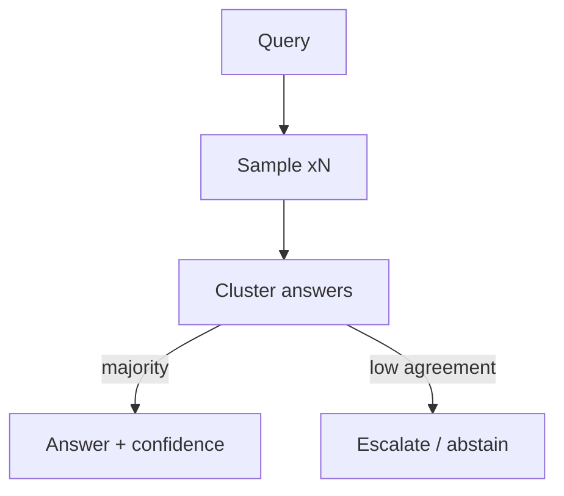

# Chapter 2: Self-Consistency Sampling

**Part I — Planning & Reasoning**

## Self-Consistency Sampling Pattern Overview

Sample N reasoning paths at temperature > 0 and take the majority answer; disagreement signals low confidence.

**Self-Consistency Sampling** is catalogued in the **Planning & Reasoning** part of the catalog (id `self-consistency`). It is tagged for general, finance, healthcare and is assembled from 3 components.

Majority vote over reasoning paths converts one model's uncertainty into a measurable signal: high agreement means the answer is robust to the sampling noise, low agreement means the question is hard for this model — escalate or abstain. The vote is a confidence meter, not a truth machine, and the chapter's protections exist to keep the two concepts separated.

**Definition 1 (Agreement-gated answer).** Let $a_1, \dots, a_N$ be $N$ sampled answers and $m$ the majority. The pattern emits $(m, c)$ where confidence $c = (\text{votes for } m)/N$; if $c < \tau$ (agreement threshold), emit escalate/abstain instead of $m$.

**Theorem 1 (Consensus bounds variance, not bias).** Majority vote over $N$ samples reduces variance as $1/\sqrt{N}$ for independent errors — but leaves shared bias untouched: if all samples share the base model's blind spot, the majority is confidently wrong.

*Proof.* For independent per-sample error probability $p < 1/2$, the majority error falls exponentially in $N$ (Condorcet). But base-model bias correlates the errors: all $N$ samples drawn from the same biased model share its blind spot, so the "independent" premise fails and the majority inherits the bias with high agreement — shared-blind-spot consensus, measured at medium severity. Diversity (mixed temperatures, mixed models) is the only correction: it decorrelates the errors the vote is supposed to average out. Treat consensus as confidence (the vote measured its own stability), never as truth (stability is not correctness) — and still apply deterministic checks for actions, because no vote authorizes a side effect. Cap $N$ and total spend per query: loops of this pattern burn budget fast, and cost multiplication is the failure that needs no adversary. ∎

## Practical Applications & Use Cases

Domains the catalog tags this pattern for:

- general
- finance
- healthcare

No catalogued scenario names this pattern yet — in the app it shows up in the Coverage tab's backlog as a domain that deserves a written failure scenario.

It also appears in 5 composition cascades:

| Cascade | Class | Blast radius | Impact |
|---|---|---|---|
| Multi-Agent Debate / Council — injected debater | Inherent | service | High |
| Parallelization (Voting / Best-of-N) — judge capture | Inherent | service | High |
| Chain-of-Thought (CoT) — reasoning drift | Inherent | service | Medium |
| Ensemble Verification — homogeneity illusion | Inherent | single-agent | Medium |
| Self-Consistency Sampling — shared-blind-spot consensus | Inherent | service | Medium |

## How It Works

1. Run 3-9 parallel CoT samples.
2. Cluster final answers; majority wins.
3. Below agreement threshold, escalate or abstain.

## Components

- N-way sampler
- Answer clusterer
- Agreement threshold gate

## Control-Flow Diagram

## Failure Modes and Risks

2 failure modes are documented for this pattern:

| Failure mode | Severity | What happens |
|---|---|---|
| Cost multiplication | Low | N samples multiply token spend; loops of this pattern can burn budget fast. |
| Shared-blind-spot consensus | Medium | All samples can be wrong the same way (same base model bias). |

## Protections

1. Cap N and total spend per query.
2. Diversity: mix temperatures or models.
3. Treat consensus as confidence, not truth — still apply deterministic checks for actions.

## At a Glance

| Field | Value |
|---|---|
| Catalog id | `self-consistency` |
| Part | I — Planning & Reasoning |
| Domains | general, finance, healthcare |
| Components | N-way sampler, Answer clusterer, Agreement threshold gate |
| Failure modes | 2 |
| Protections | 3 |
| Related patterns | Chain-of-Thought (CoT), Multi-Agent Debate / Council, Ensemble Verification |
| Linked scenarios | 0 |
| Linked cascades | 5 |

## Key Takeaways

- Sample N reasoning paths at temperature > 0 and take the majority answer; disagreement signals low confidence.
- Cap N and total spend per query.
- Diversity: mix temperatures or models.
- Treat consensus as confidence, not truth — still apply deterministic checks for actions.
- Know its failure modes: Cost multiplication (low); Shared-blind-spot consensus (medium).

## References and Related Patterns

| Related pattern | Part | Summary |
|---|---|---|
| Chain-of-Thought (CoT) | Planning & Reasoning | Prompt the model to emit intermediate reasoning steps before the final answer, improving multi-step arithmetic and inference. |
| Multi-Agent Debate / Council | Multi-Agent Topologies | Several agents argue positions or independently answer, then converge — surfaces disagreements before they surface in production. |
| Ensemble Verification | Resilience & Reliability | Multiple heterogeneous verifiers (rules + ML + different models) must concur before high-impact actions. |

## Council deliberation

- **Evaluation methodologist:** Self-Consistency Sampling improves answers in general, finance and healthcare settings by sampling N reasoning paths at temperature above zero and taking the majority answer, running parallel CoT samples with an N-way sampler, Answer clusterer and Agreement threshold gate where disagreement signals low confidence. The tension is Shared-blind-spot consensus where all samples are wrong the same way from the same base model bias. The protection that carries weight is treating consensus as confidence not truth with deterministic checks for actions plus diversity across temperatures or models, linked to Chain-of-Thought and Debate-Council, and the operator should verify escalation on low agreement.
- **Continual-learning researcher:** Your point on shared bias is right, and I would add that the other documented failure of Cost multiplication makes this fragile because N samples multiply token spend and loops burn budget fast. That is why capping N and total spend per query carries practical weight alongside still applying deterministic checks for actions. The Ensemble-Verify relation reinforces that majority vote needs an external anchor, so the operator should verify the agreement threshold gate routes below-threshold cases to escalate or abstain rather than emitting a confident majority.

## Council reading

- **Red team:** Start with Shared-blind-spot consensus (medium): All samples can be wrong the same way (same base model bias). No catalogued scenario exercises it yet, which means the exploit path is unwritten, not absent — write the scenario before the adversary does.
- **Blue team:** Hold with Cap N and total spend per query; Diversity: mix temperatures or models. Then layer the remaining 1: defence here is the list, not any single item. Compose with Chain-of-Thought (CoT), Multi-Agent Debate / Council so a failure in one pattern meets a control in another.
- **Operator:** Deploy where it is tagged (general, finance, healthcare), and watch the 5 linked cascades — Multi-Agent Debate / Council — injected debater first, because composition is where small faults amplify. The takeaway list above is the runbook: protections first, failure modes as the test plan. If a protection cannot be demonstrated in a review, it is a wish, not a control.

## Conclusion

In the catalog this chapter was generated from, **Self-Consistency Sampling** is one of 107 patterns in *Planning & Reasoning*, carrying 2 documented failure modes and 3 listed protections. Use it as a starting point, not a specification: the protection list is the part that survives contact with an adversary.

---
