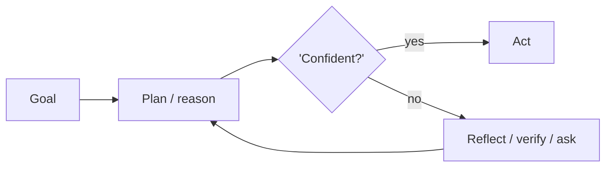

# Chapter 3: Tree of Thoughts (ToT)

**Part I — Planning & Reasoning**

## Tree of Thoughts (ToT) Pattern Overview

Explore multiple candidate reasoning branches with self-evaluation and backtracking, like search over thoughts.

**Tree of Thoughts (ToT)** is catalogued in the **Planning & Reasoning** part of the catalog (id `tree-of-thoughts`). It is tagged for general, research, legal and is assembled from 3 components.

Where CoT walks one path and self-consistency votes among independent walks, ToT searches: generate $b$ candidate next steps, score each with a value function, keep the top-$k$, expand, backtrack on dead ends (BFS or DFS under a search controller). The power is exploration with memory — dead ends teach the search where not to go. The price is combinatorial: branching multiplies tokens, and unbounded depth is budget runaway wearing a lab coat.

**Definition 1 (Bounded thought search).** A ToT search with branching factor $b$, depth limit $d$, beam width $k$, and token budget $B$ explores at most $\min(b^d, k \cdot d \cdot L)$ node-expansions (for mean node cost $L$ tokens) and halts with failure (not runaway) when $B$ is exhausted.

**Theorem 1 (Caps convert runaway to bounded failure).** Under hard caps on depth $\times$ width $\times$ tokens shared with the outer agent loop's budget guardrail, the worst case of ToT is a bounded-cost incomplete search — never an unbounded spend.

*Proof.* Each expansion consumes tokens; the caps $(d, b, k, B)$ bound expansions above by construction, so total spend $\leq B$ regardless of branch quality. Without caps, a deceptive value function expands forever (exploration cost blowup, medium). The independent scorer is the quality half: the same model generating and scoring favors its own plausible-looking branches (value scorer gamed), so high-stakes branches need a different model or prompt — separation of proposer and judge. Budget guardrail shared with the outer loop prevents ToT from spending what the loop needs; verify caps hold before search starts, and backtracking that re-selects self-flattering branches is the signal the scorer is not independent. ∎

## Practical Applications & Use Cases

Domains the catalog tags this pattern for:

- general
- research
- legal

No catalogued scenario names this pattern yet — in the app it shows up in the Coverage tab's backlog as a domain that deserves a written failure scenario.

It also appears in 1 composition cascade:

| Cascade | Class | Blast radius | Impact |
|---|---|---|---|
| Tree of Thoughts (ToT) — exploration cost blowup | Inherent | service | Medium |

## How It Works

1. Generate b candidate next steps.
2. Score each branch with a value function.
3. Keep top-k, expand, backtrack on dead ends.

## Components

- Branch generator
- Value scorer
- Search controller (BFS/DFS)

## Control-Flow Diagram

## Failure Modes and Risks

2 failure modes are documented for this pattern:

| Failure mode | Severity | What happens |
|---|---|---|
| Exploration cost blowup | Medium | Branching multiplies tokens; unbounded depth = budget runaway. |
| Value scorer gamed | Medium | Same model generates and scores, so it favors its own plausible-looking branches. |

## Protections

1. Hard caps on depth × width × tokens.
2. Independent scorer (different model/prompt) for high-stakes branches.
3. Budget guardrail shared with the outer agent loop.

## At a Glance

| Field | Value |
|---|---|
| Catalog id | `tree-of-thoughts` |
| Part | I — Planning & Reasoning |
| Domains | general, research, legal |
| Components | Branch generator, Value scorer, Search controller (BFS/DFS) |
| Failure modes | 2 |
| Protections | 3 |
| Related patterns | Chain-of-Thought (CoT), Budget-Bounded Execution |
| Linked scenarios | 0 |
| Linked cascades | 1 |

## Key Takeaways

- Explore multiple candidate reasoning branches with self-evaluation and backtracking, like search over thoughts.
- Hard caps on depth × width × tokens.
- Independent scorer (different model/prompt) for high-stakes branches.
- Budget guardrail shared with the outer agent loop.
- Know its failure modes: Exploration cost blowup (medium); Value scorer gamed (medium).

## References and Related Patterns

| Related pattern | Part | Summary |
|---|---|---|
| Chain-of-Thought (CoT) | Planning & Reasoning | Prompt the model to emit intermediate reasoning steps before the final answer, improving multi-step arithmetic and inference. |
| Budget-Bounded Execution | Agent Loop & Control | Runtime-enforced ceilings on steps, tokens, wall-clock, tool calls, and dollars per task — the master circuit breaker for agents. |

## Council deliberation

- **Continual-learning researcher:** Tree of Thoughts helps general, research and legal reasoning by exploring multiple candidate branches with self-evaluation and backtracking like search over thoughts, generating candidate next steps, scoring each with a value function, then keeping top-k with expansion and backtracking using a Branch generator, Value scorer and Search controller with BFS or DFS. The tension is Exploration cost blowup where branching multiplies tokens and unbounded depth creates budget runaway. The protection that carries weight is hard caps on depth times width times tokens shared with the outer agent loop and Budget-Bounded-Exec, and the operator should verify caps hold before search starts.
- **Safety researcher:** Caps are necessary, but the deeper risk you underplay is Value scorer gamed where the same model generates and scores so it favors its own plausible-looking branches. That is why an independent scorer with a different model or prompt for high-stakes branches carries the real weight, alongside the shared budget guardrail. Related Chain-of-Thought shows the base step being searched, so the operator should verify scorer independence and that dead-end backtracking does not simply re-select self-flattering branches.

## Council reading

- **Red team:** Start with Exploration cost blowup (medium): Branching multiplies tokens; unbounded depth = budget runaway. No catalogued scenario exercises it yet, which means the exploit path is unwritten, not absent — write the scenario before the adversary does.
- **Blue team:** Hold with Hard caps on depth × width × tokens; Independent scorer (different model/prompt) for high-stakes branches. Then layer the remaining 1: defence here is the list, not any single item. Compose with Chain-of-Thought (CoT), Budget-Bounded Execution so a failure in one pattern meets a control in another.
- **Operator:** Deploy where it is tagged (general, research, legal), and watch the 1 linked cascade — Tree of Thoughts (ToT) — exploration cost blowup first, because composition is where small faults amplify. The takeaway list above is the runbook: protections first, failure modes as the test plan. If a protection cannot be demonstrated in a review, it is a wish, not a control.

## Conclusion

In the catalog this chapter was generated from, **Tree of Thoughts (ToT)** is one of 107 patterns in *Planning & Reasoning*, carrying 2 documented failure modes and 3 listed protections. Use it as a starting point, not a specification: the protection list is the part that survives contact with an adversary.

---
