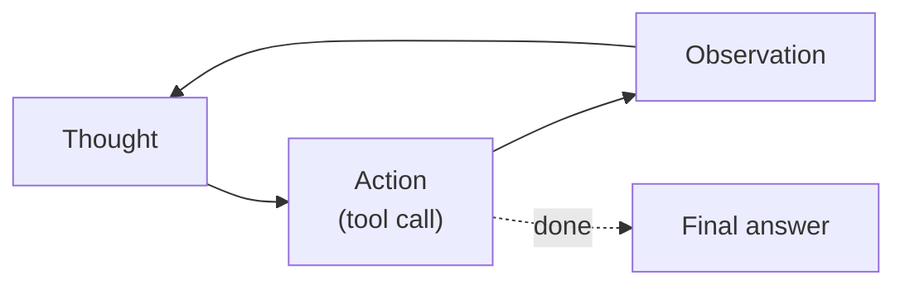

# Chapter 4: ReAct (Reason + Act)

**Part I — Planning & Reasoning**

## ReAct (Reason + Act) Pattern Overview

Interleave reasoning traces with tool actions: think, act, observe, think again. The canonical agentic loop.

**ReAct (Reason + Act)** is catalogued in the **Planning & Reasoning** part of the catalog (id `react`). It is tagged for general, research, devops and is assembled from 4 components.

Think, act, observe, think again — four verbs that turn a language model into an agent. The thought interprets the last observation and selects the next action; the action touches the world through a tool; the observation returns the world's answer into the trace; the next thought reasons over all of it. The loop terminates on Final Answer or on a budget/steps cap. Everything agentic follows from this cycle: the observation channel is what makes the agent powerful (grounded in live state) and what makes it vulnerable (the world can write into the trace).

**Definition 1 (Observation trust boundary).** In a Thought $\to$ Action $\to$ Observation loop, the *trust boundary* sits between Action and Observation: everything upstream (thoughts, planned actions) is model output, and everything downstream (tool results, pages, emails, files) is untrusted input — regardless of how legitimate the tool is.

**Theorem 1 (The loop's three failure classes are exhaustive).** Every ReAct failure is a hallucinated action (thought invents what the tools cannot do), an unbounded loop (termination never fires), or an injected observation (the world writes instructions into the trace) — and the three protections map one-to-one: schemas + server-side validation, max-iterations with stall detection, observations-as-untrusted-data.

*Proof.* The loop has exactly three attacker-controlled surfaces: the thought's action choice (hallucination: invented tool names/arguments corrupting external state — strict schemas plus server-side argument validation refuse what the tools cannot do); the termination condition (unbounded loops: the same failing action retried forever — max-iterations and stall detection via circuit breaker force an exit); and the observation content (injection: tool output containing obeyed instructions — treat all observations as untrusted data with a prompt-injection shield). No fourth surface exists in the Thought/Action/Observation cycle: thoughts are checked by schemas, termination by the breaker, observations by the shield. The critical-severity item is the observation channel (injected observations): a web page or email in the trace is an instruction the model will obey unless the boundary holds — verify every observation is handled as data, never as instruction. ∎

## Practical Applications & Use Cases

Domains the catalog tags this pattern for:

- general
- research
- devops

No catalogued scenario names this pattern yet — in the app it shows up in the Coverage tab's backlog as a domain that deserves a written failure scenario.

It also appears in 4 composition cascades:

| Cascade | Class | Blast radius | Impact |
|---|---|---|---|
| ReAct (Reason + Act) — injected observations | Inherent | service | Critical |
| Standard Agent Loop — runaway loop | Inherent | single-agent | Critical |
| Plan-and-Execute — plan poisoning | Inherent | service | High |
| Chain-of-Thought (CoT) — reasoning drift | Inherent | service | Medium |

## How It Works

1. Model emits Thought / Action / Observation cycles.
2. Environment returns observation after each action.
3. Loop terminates on Final Answer or budget/steps cap.

## Components

- LLM planner
- Action parser
- Tool executor
- Observation buffer

## Control-Flow Diagram

## Failure Modes and Risks

3 failure modes are documented for this pattern:

| Failure mode | Severity | What happens |
|---|---|---|
| Hallucinated tool calls | High | Model invents tool names/arguments that corrupt external state. |
| Unbounded loops | High | Agent re-tries the same failing action forever, burning tokens and side effects. |
| Injected observations | Critical | Tool output (web page, email) contains instructions the model obeys. |

## Protections

1. Strict tool schemas + server-side argument validation.
2. Max-iterations and stall detection (circuit breaker).
3. Treat all observations as untrusted data (prompt-injection shield).

## At a Glance

| Field | Value |
|---|---|
| Catalog id | `react` |
| Part | I — Planning & Reasoning |
| Domains | general, research, devops |
| Components | LLM planner, Action parser, Tool executor, Observation buffer |
| Failure modes | 3 |
| Protections | 3 |
| Related patterns | Standard Agent Loop, Tool Use / Function Calling, Circuit Breaker & Kill Switch |
| Linked scenarios | 0 |
| Linked cascades | 4 |

## Key Takeaways

- Interleave reasoning traces with tool actions: think, act, observe, think again. The canonical agentic loop.
- Strict tool schemas + server-side argument validation.
- Max-iterations and stall detection (circuit breaker).
- Treat all observations as untrusted data (prompt-injection shield).
- Know its failure modes: Hallucinated tool calls (high); Unbounded loops (high); Injected observations (critical).

## References and Related Patterns

| Related pattern | Part | Summary |
|---|---|---|
| Standard Agent Loop | Agent Loop & Control | The canonical runtime: retrieve context → plan → select tool → execute → observe → repeat until done or bounded. |
| Tool Use / Function Calling | Agent Loop & Control | Expose typed tools to the model; model emits structured calls the runtime validates and executes. |
| Circuit Breaker & Kill Switch | Safety, Security & Governance | Automatic trip on anomaly (looping, error rate, spend, output class) plus a human-operable global kill switch. |

## Council deliberation

- **Memory-systems researcher:** ReAct is the canonical agentic loop for general, research and DevOps work by interleaving Thought, Action and Observation cycles where the model emits Thought slash Action slash Observation, the environment returns an observation after each action, and the loop ends on Final Answer or budget slash steps cap using an LLM planner, Action parser, Tool executor and Observation buffer. The tension is Unbounded loops where the agent retries the same failing action forever while burning tokens and side effects. The protection that carries weight is max-iterations with stall detection through a circuit breaker tied to Standard-Agent-Loop, and the operator should verify termination fires.
- **Safety researcher:** Stall limits help, but the critical failure is Injected observations where tool output such as a web page or email contains instructions the model obeys, compounded by Hallucinated tool calls that invent tool names and arguments corrupting external state. The protections that carry weight are strict tool schemas with server-side argument validation and treating all observations as untrusted data with a prompt-injection shield, related to Tool-Use and Circuit-Breaker. The operator should verify every observation is handled as data never as instruction.

## Council reading

- **Red team:** Start with Injected observations (critical): Tool output (web page, email) contains instructions the model obeys. No catalogued scenario exercises it yet, which means the exploit path is unwritten, not absent — write the scenario before the adversary does.
- **Blue team:** Hold with Strict tool schemas + server-side argument validation; Max-iterations and stall detection (circuit breaker). Then layer the remaining 1: defence here is the list, not any single item. Compose with Standard Agent Loop, Tool Use / Function Calling so a failure in one pattern meets a control in another.
- **Operator:** Deploy where it is tagged (general, research, devops), and watch the 4 linked cascades — ReAct (Reason + Act) — injected observations first, because composition is where small faults amplify. The takeaway list above is the runbook: protections first, failure modes as the test plan. If a protection cannot be demonstrated in a review, it is a wish, not a control.

## Conclusion

In the catalog this chapter was generated from, **ReAct (Reason + Act)** is one of 107 patterns in *Planning & Reasoning*, carrying 3 documented failure modes and 3 listed protections. Use it as a starting point, not a specification: the protection list is the part that survives contact with an adversary.

---
