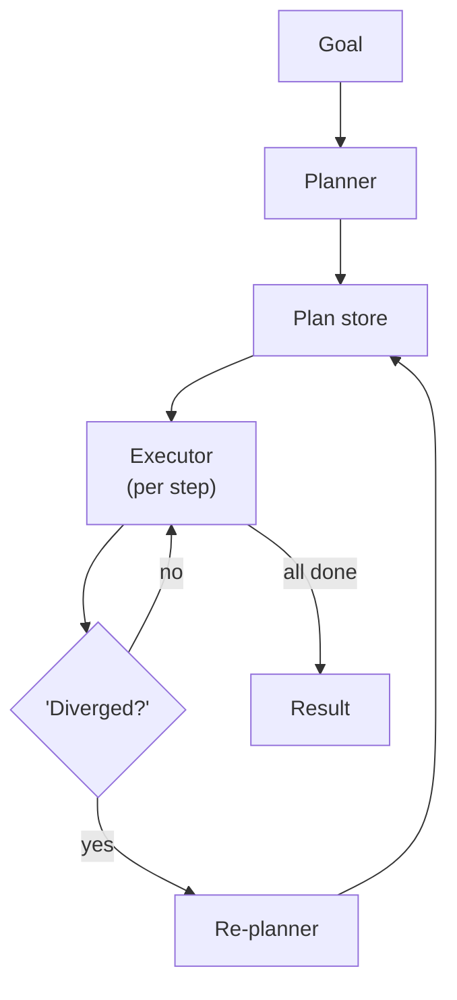

# Chapter 5: Plan-and-Execute

**Part I — Planning & Reasoning**

## Plan-and-Execute Pattern Overview

Make a full plan up front with a planner model, then execute steps with a cheaper executor, re-planning only when reality diverges.

**Plan-and-Execute** is catalogued in the **Planning & Reasoning** part of the catalog (id `plan-and-execute`). It is tagged for general, procurement, research and is assembled from 4 components.

The split is economic as much as architectural: a capable planner reasons once, a cheaper executor grinds through steps, and the re-planner patches the plan only when the world diverges from it. Planning quality concentrates where it is reviewed (the plan store, versioned, diffed, audited); execution stays dumb and cheap. The failure modes attack exactly this split — the executor following a plan the world invalidated, and attacker content sneaking into the re-planner's context to reshape the plan mid-run.

**Definition 1 (Plan validity window).** A plan $P = (s_1, \dots, s_n)$ with preconditions $\mathrm{pre}(s_i)$ is *valid at step $i$* iff $\mathrm{pre}(s_j)$ holds for all $j \geq i$ in current world state. Execution without re-validation assumes perpetual validity — the stale-plan fallacy.

**Theorem 1 (Re-validation bounds staleness; versioning bounds poisoning).** If preconditions are re-validated before each step, then no step executes on an invalidated plan (staleness bounded by one step). If plans are versioned with diffs in the audit trail and high-risk steps wait behind approvals regardless of plan state, then poisoned re-plans cannot self-authorize: the diff exposes the reshape, the gate holds the step.

*Proof.* Staleness: step $s_i$ executes only after $\mathrm{pre}(s_i)$ re-checks true in current state; a plan invalidated by new world state fails the check at the first affected step, so at most the already-executed prefix ran stale — one step of lag, never the whole plan. Poisoning: attacker content entering re-planner context produces plan version $P' \neq P$; versioning plus audit-logged diffs makes $P' - P$ reviewable, exposing the injected reshape. High-risk steps frozen behind approvals cannot execute even under $P'$ without human sign-off — the plan never authorizes its own overrides, because authorization lives outside the plan store. Verify preconditions at every step; verify gates cannot be skipped even when the stored plan claims authorization. ∎

## Practical Applications & Use Cases

Domains the catalog tags this pattern for:

- general
- procurement
- research

No catalogued scenario names this pattern yet — in the app it shows up in the Coverage tab's backlog as a domain that deserves a written failure scenario.

It also appears in 5 composition cascades:

| Cascade | Class | Blast radius | Impact |
|---|---|---|---|
| Self-Healing Replan — runaway remediation | Inherent | single-agent | Critical |
| Plan-and-Execute — plan poisoning | Inherent | service | High |
| Dynamic DAG Planning — cyclic or degenerate plans | Inherent | service | Medium |
| Subgoal Gating / Milestones — weak exit criteria | Inherent | service | Medium |
| Task Decomposition (Decompose & Conquer) — missing-critical-subtask | Inherent | service | Medium |

## How It Works

1. Planner produces ordered step list with expected outputs.
2. Executor runs one step at a time.
3. Re-planner compares state vs plan and patches remaining steps.

## Components

- Planner LLM
- Plan store
- Step executor
- Re-planner / divergence checker

## Control-Flow Diagram

## Failure Modes and Risks

2 failure modes are documented for this pattern:

| Failure mode | Severity | What happens |
|---|---|---|
| Stale plan adherence | Medium | Executor follows a plan invalidated by new world state. |
| Plan poisoning | High | Attacker content read during execution sneaks into re-planner context and reshapes the plan. |

## Protections

1. Re-validate preconditions before each step.
2. Freeze high-risk steps behind approvals regardless of plan state.
3. Version plans; log plan diffs in the audit trail.

## At a Glance

| Field | Value |
|---|---|
| Catalog id | `plan-and-execute` |
| Part | I — Planning & Reasoning |
| Domains | general, procurement, research |
| Components | Planner LLM, Plan store, Step executor, Re-planner / divergence checker |
| Failure modes | 2 |
| Protections | 3 |
| Related patterns | ReAct (Reason + Act), Dynamic DAG Planning, Subgoal Gating / Milestones |
| Linked scenarios | 0 |
| Linked cascades | 5 |

## Key Takeaways

- Make a full plan up front with a planner model, then execute steps with a cheaper executor, re-planning only when reality diverges.
- Re-validate preconditions before each step.
- Freeze high-risk steps behind approvals regardless of plan state.
- Version plans; log plan diffs in the audit trail.
- Know its failure modes: Stale plan adherence (medium); Plan poisoning (high).

## References and Related Patterns

| Related pattern | Part | Summary |
|---|---|---|
| ReAct (Reason + Act) | Planning & Reasoning | Interleave reasoning traces with tool actions: think, act, observe, think again. The canonical agentic loop. |
| Dynamic DAG Planning | Workflow Orchestration | Planner emits an explicit dependency graph at runtime; scheduler executes ready nodes with retries and caching. |
| Subgoal Gating / Milestones | Agent Loop & Control | Split long tasks into milestones; each gate requires a verifiable success criterion before proceeding. |

## Council deliberation

- **Continual-learning researcher:** Plan-and-Execute helps general, procurement and research tasks by making a full plan up front with a planner model then executing steps with a cheaper executor and re-planning only when reality diverges, with the planner producing ordered steps, the executor running one step at a time, and the re-planner patching remaining steps using a Planner LLM, Plan store, Step executor and Re-planner slash divergence checker. The tension is Stale plan adherence where the executor follows a plan invalidated by new world state. The protection that carries weight is re-validating preconditions before each step with versioned plans, related to ReAct and Dynamic-DAG, and the operator should verify preconditions at every step.
- **Safety researcher:** Re-validation matters, yet the higher-severity failure is Plan poisoning where attacker content read during execution sneaks into re-planner context and reshapes the plan. That is why freezing high-risk steps behind approvals regardless of plan state carries the weight, plus logging plan diffs in the audit trail. Related Subgoal-Gating reinforces gated progress, so the operator should verify that approval gates cannot be skipped even when the stored plan claims authorization.

## Council reading

- **Red team:** Start with Plan poisoning (high): Attacker content read during execution sneaks into re-planner context and reshapes the plan. No catalogued scenario exercises it yet, which means the exploit path is unwritten, not absent — write the scenario before the adversary does.
- **Blue team:** Hold with Re-validate preconditions before each step; Freeze high-risk steps behind approvals regardless of plan state. Then layer the remaining 1: defence here is the list, not any single item. Compose with ReAct (Reason + Act), Dynamic DAG Planning so a failure in one pattern meets a control in another.
- **Operator:** Deploy where it is tagged (general, procurement, research), and watch the 5 linked cascades — Self-Healing Replan — runaway remediation first, because composition is where small faults amplify. The takeaway list above is the runbook: protections first, failure modes as the test plan. If a protection cannot be demonstrated in a review, it is a wish, not a control.

## Conclusion

In the catalog this chapter was generated from, **Plan-and-Execute** is one of 107 patterns in *Planning & Reasoning*, carrying 2 documented failure modes and 3 listed protections. Use it as a starting point, not a specification: the protection list is the part that survives contact with an adversary.

---
