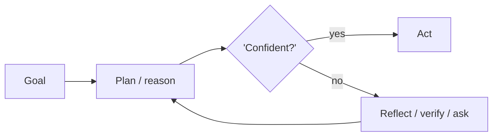

# Chapter 6: Task Decomposition (Decompose & Conquer)

**Part I — Planning & Reasoning**

## Task Decomposition (Decompose & Conquer) Pattern Overview

Break a goal into subtasks (via prompting, LLM-generated trees, or task-specific prompts) and solve each independently.

**Task Decomposition (Decompose & Conquer)** is catalogued in the **Planning & Reasoning** part of the catalog (id `task-decomposition`). It is tagged for general, research, engineering and is assembled from 3 components.

Decomposition converts one unverifiable leap into many verifiable steps: each subtask is small enough to check, parallel enough to schedule, and independent enough to retry. The two failure modes attack exactly the decomposition's seams — the split that silently drops a safety-relevant step, and the merge that smooths inconsistent sub-results into a confident wrong whole.

**Definition 1 (Complete decomposition).** A decomposition $G \to \{g_1, \dots, g_n\}$ with aggregator $A$ is *complete* iff (i) a golden checklist of mandatory subtasks per domain is present in $\{g_i\}$ (e.g., verify-before-irreversible-action), and (ii) $A$ validates the merge against schema constraints and rejects inconsistent combinations rather than smoothing them.

**Theorem 1 (Omission and mismatch are checkable).** Under complete decomposition with subtask provenance (every merged claim cites its subtask), a missing critical subtask is visible as checklist absence before execution, and an inconsistent merge is rejected by the aggregator before delivery — both failures surface structurally, never silently.

*Proof.* Omission: the golden checklist is compared against the emitted task tree; a missing mandatory step (e.g., no budget check) is a set difference, observable without executing anything. Mismatch: sub-results individually fine but jointly inconsistent fail the aggregator's schema validation, which rejects rather than merges — smoothing is forbidden by construction. Provenance closes the loop: every merged claim cites its subtask, so any delivered claim traces to its origin for audit. The operator verifies mandatory steps are present (not assumed) and the aggregator rejects conflicts (not averages them). ∎

## Practical Applications & Use Cases

Domains the catalog tags this pattern for:

- general
- research
- engineering

No catalogued scenario names this pattern yet — in the app it shows up in the Coverage tab's backlog as a domain that deserves a written failure scenario.

It also appears in 2 composition cascades:

| Cascade | Class | Blast radius | Impact |
|---|---|---|---|
| Least-to-Most Prompting — error cascades | Inherent | single-agent | Medium |
| Task Decomposition (Decompose & Conquer) — missing-critical-subtask | Inherent | service | Medium |

## How It Works

1. LLM emits a task tree or checklist.
2. Subtasks executed sequentially or in parallel.
3. Results aggregated bottom-up.

## Components

- Decomposer
- Subtask queue
- Aggregator

## Control-Flow Diagram

## Failure Modes and Risks

2 failure modes are documented for this pattern:

| Failure mode | Severity | What happens |
|---|---|---|
| Missing-critical-subtask | Medium | Decomposition silently omits a safety-relevant step (e.g., budget check). |
| Aggregation mismatch | Low | Sub-results are individually fine but inconsistent when merged. |

## Protections

1. Golden checklist of mandatory subtasks per domain (e.g., 'verify before irreversible action').
2. Aggregator validation pass with schema constraints.
3. Track subtask provenance so every merged claim cites its subtask.

## At a Glance

| Field | Value |
|---|---|
| Catalog id | `task-decomposition` |
| Part | I — Planning & Reasoning |
| Domains | general, research, engineering |
| Components | Decomposer, Subtask queue, Aggregator |
| Failure modes | 2 |
| Protections | 3 |
| Related patterns | Plan-and-Execute, Orchestrator–Workers |
| Linked scenarios | 0 |
| Linked cascades | 2 |

## Key Takeaways

- Break a goal into subtasks (via prompting, LLM-generated trees, or task-specific prompts) and solve each independently.
- Golden checklist of mandatory subtasks per domain (e.g., 'verify before irreversible action').
- Aggregator validation pass with schema constraints.
- Track subtask provenance so every merged claim cites its subtask.
- Know its failure modes: Missing-critical-subtask (medium); Aggregation mismatch (low).

## References and Related Patterns

| Related pattern | Part | Summary |
|---|---|---|
| Plan-and-Execute | Planning & Reasoning | Make a full plan up front with a planner model, then execute steps with a cheaper executor, re-planning only when reality diverges. |
| Orchestrator–Workers | Workflow Orchestration | A central orchestrator dynamically decomposes work and spawns worker LLMs with shared context; returns synthesized result. |

## Council deliberation

- **Evaluation methodologist:** Task Decomposition helps general, research and engineering goals by breaking a goal into subtasks through prompting, LLM-generated trees or task-specific prompts, emitting a task tree or checklist, executing subtasks sequentially or in parallel, and aggregating bottom-up with a Decomposer, Subtask queue and Aggregator. The tension is Missing-critical-subtask where decomposition silently omits a safety-relevant step such as a budget check. The protection that carries weight is a golden checklist of mandatory subtasks per domain such as verify before irreversible action, related to Plan-and-Execute and Orchestrator-Workers, and the operator should verify mandatory steps are present.
- **Memory-systems researcher:** The checklist is essential, and the companion failure is Aggregation mismatch where sub-results are individually fine but inconsistent when merged. That is why an aggregator validation pass with schema constraints carries weight alongside tracking subtask provenance so every merged claim cites its subtask. The bottom-up merge only works if provenance travels with claims, so the operator should verify the Aggregator rejects inconsistent merges rather than smoothing over conflicts.

## Council reading

- **Red team:** Start with Missing-critical-subtask (medium): Decomposition silently omits a safety-relevant step (e.g., budget check). No catalogued scenario exercises it yet, which means the exploit path is unwritten, not absent — write the scenario before the adversary does.
- **Blue team:** Hold with Golden checklist of mandatory subtasks per domain (e.g., 'verify before irreversible action'); Aggregator validation pass with schema constraints. Then layer the remaining 1: defence here is the list, not any single item. Compose with Plan-and-Execute, Orchestrator–Workers so a failure in one pattern meets a control in another.
- **Operator:** Deploy where it is tagged (general, research, engineering), and watch the 2 linked cascades — Least-to-Most Prompting — error cascades first, because composition is where small faults amplify. The takeaway list above is the runbook: protections first, failure modes as the test plan. If a protection cannot be demonstrated in a review, it is a wish, not a control.

## Conclusion

In the catalog this chapter was generated from, **Task Decomposition (Decompose & Conquer)** is one of 107 patterns in *Planning & Reasoning*, carrying 2 documented failure modes and 3 listed protections. Use it as a starting point, not a specification: the protection list is the part that survives contact with an adversary.

---
