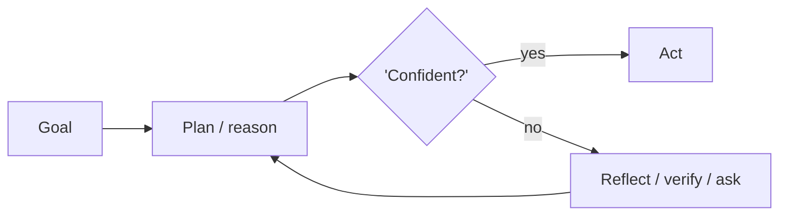

# Chapter 7: Least-to-Most Prompting

**Part I — Planning & Reasoning**

## Least-to-Most Prompting Pattern Overview

Solve easiest subproblem first, feed its answer into harder subproblems, cascading difficulty.

**Least-to-Most Prompting** is catalogued in the **Planning & Reasoning** part of the catalog (id `least-to-most`). It is tagged for general, education and is assembled from 2 components.

Easy-to-hard ordering with carried-forward solutions: each subproblem builds on verified predecessors, decomposing ordered by dependency and stopping to escalate when a subproblem fails. The dependency chain is the strength (harder steps inherit solved foundations) and the single point of failure (one wrong early answer poisons everything downstream) — which is why this chapter's protections are all about verifying before carrying forward.

**Definition 1 (Verified cascade).** A least-to-most cascade $s_1 \to s_2 \to \dots \to s_n$ (ordered by dependency, solutions carried forward) is *verified* iff each $s_i$'s answer is checkpointed and verified before $s_{i+1}$ consumes it, and any failed $s_i$ triggers branch-and-retry (or escalate) instead of forward propagation.

**Theorem 1 (Verification contains cascades).** Under verified cascading, one wrong early answer poisons at most its own step: the checkpoint catches it before use, and branch-and-retry replaces forward propagation of the error.

*Proof.* Unchecked cascading transmits errors downstream by construction: $s_{i+1}$ consumes $s_i$'s answer, so a wrong $s_i$ corrupts all $j > i$ (error cascades, medium — with the catalogued proof in tutoring: leaked answer key teaches to the test). Verification breaks the transmission at each link: checkpoint-and-verify before use means a wrong answer is caught at its own step, never consumed. Branch-and-retry (or stop-and-escalate) replaces the poisoned branch rather than continuing it — the cascade becomes a single retry instead of a corrupted chain. The operator verifies the stop-and-escalate rule actually halts the cascade and triggers the retry branch: no downstream step consumes an unchecked answer, ever. ∎

## Practical Applications & Use Cases

Domains the catalog tags this pattern for:

- general
- education

1 documented failure scenario exercises it:

| Scenario | Severity | Likelihood | Domain |
|---|---|---|---|
| Tutoring agent leaks the answer key and teaches to the test | Medium | High | education |

It also appears in 3 composition cascades:

| Cascade | Class | Blast radius | Impact |
|---|---|---|---|
| Synchronised failure via shared dependency | Emergent | tenant | High |
| Least-to-Most Prompting — error cascades | Inherent | single-agent | Medium |
| Tutoring agent leaks the answer key and teaches to the test | Derived | single-agent | Medium |

## How It Works

1. Decompose ordered by dependency.
2. Solve incrementally, carrying solutions forward.
3. Stop-and-escalate when a subproblem fails.

## Components

- Dependency orderer
- Incremental solver

## Control-Flow Diagram

## Failure Modes and Risks

1 failure mode is documented for this pattern:

| Failure mode | Severity | What happens |
|---|---|---|
| Error cascades | Medium | One wrong early answer poisons every downstream subproblem. |

## Protections

1. Checkpoint each sub-answer and verify before use.
2. Branch-and-retry on failed subproblem rather than continuing.

## At a Glance

| Field | Value |
|---|---|
| Catalog id | `least-to-most` |
| Part | I — Planning & Reasoning |
| Domains | general, education |
| Components | Dependency orderer, Incremental solver |
| Failure modes | 1 |
| Protections | 2 |
| Related patterns | Task Decomposition (Decompose & Conquer), Validation Loop |
| Linked scenarios | 1 |
| Linked cascades | 3 |

## Key Takeaways

- Solve easiest subproblem first, feed its answer into harder subproblems, cascading difficulty.
- Checkpoint each sub-answer and verify before use.
- Branch-and-retry on failed subproblem rather than continuing.
- Know its failure modes: Error cascades (medium).

## References and Related Patterns

| Related pattern | Part | Summary |
|---|---|---|
| Task Decomposition (Decompose & Conquer) | Planning & Reasoning | Break a goal into subtasks (via prompting, LLM-generated trees, or task-specific prompts) and solve each independently. |
| Validation Loop | Resilience & Reliability | Machine-check outputs against executable criteria (tests, schemas, lint) before accepting them. |

## Council deliberation

- **Continual-learning researcher:** Least-to-Most Prompting helps general and education tasks by solving the easiest subproblem first and feeding its answer into harder subproblems in cascading difficulty, decomposing ordered by dependency, solving incrementally while carrying solutions forward, and stopping to escalate when a subproblem fails using a Dependency orderer and Incremental solver. The tension is Error cascades where one wrong early answer poisons every downstream subproblem. The protection that carries weight is checkpointing each sub-answer and verifying before use, related to Task-Decomposition and Validation-Loop, and the operator should verify no downstream step consumes an unchecked answer.
- **Evaluation methodologist:** Checkpointing is the right anchor, and I would stress the second protection of branching and retrying on a failed subproblem rather than continuing. Because the incremental solver carries forward prior solutions, continuing after failure guarantees compounded error. Related Validation-Loop frames that retry discipline, so the operator should verify the stop-and-escalate rule actually halts the cascade and triggers a retry branch instead of pushing a suspect answer forward.

## Council reading

- **Red team:** Start with Error cascades (medium): One wrong early answer poisons every downstream subproblem. Tutoring agent leaks the answer key and teaches to the test is the catalogued proof — medium severity, education domain — so rehearse that exact chain before any other.
- **Blue team:** Hold with Checkpoint each sub-answer and verify before use; Branch-and-retry on failed subproblem rather than continuing. Compose with Task Decomposition (Decompose & Conquer), Validation Loop so a failure in one pattern meets a control in another.
- **Operator:** Deploy where it is tagged (general, education), and watch the 3 linked cascades — Synchronised failure via shared dependency first, because composition is where small faults amplify. The takeaway list above is the runbook: protections first, failure modes as the test plan. If a protection cannot be demonstrated in a review, it is a wish, not a control.

## Conclusion

In the catalog this chapter was generated from, **Least-to-Most Prompting** is one of 107 patterns in *Planning & Reasoning*, carrying 1 documented failure mode and 2 listed protections. Use it as a starting point, not a specification: the protection list is the part that survives contact with an adversary.

---
