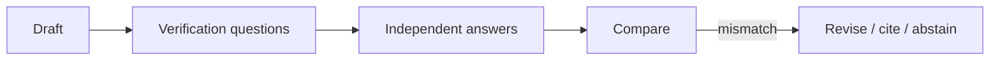

# Chapter 8: Chain-of-Verification (CoVe)

**Part I — Planning & Reasoning**

## Chain-of-Verification (CoVe) Pattern Overview

Generate answer, then independently draft verification questions, answer them without the original context, and revise.

**Chain-of-Verification (CoVe)** is catalogued in the **Planning & Reasoning** part of the catalog (id `chain-of-verification`). It is tagged for research, legal, healthcare, finance and is assembled from 4 components.

Draft, interrogate, revise — with the interrogation deliberately blinded: verification questions answered without the original context, so the verifier cannot parrot the draft's assumptions. The blinding is the load-bearing design choice. An unblinded verifier inherits the draft's hallucinations (self-verification illusion); a blinded verifier checking against external ground truth breaks the inheritance. The strategy report citing 14 papers that don't exist is the catalogued proof that ungrounded verification ships fiction with confidence.

**Definition 1 (Independent verification).** A CoVe pass is *independent* iff (i) verification questions are drafted from the answer's claims, (ii) each question is answered in a clean context (no access to the draft or its reasoning), and (iii) answers are checked against external ground truth (databases, APIs, retrievable sources) — not against the model that wrote the draft.

**Theorem 1 (Self-verification is circular).** If the verifier shares the draft's context and model (no blinding, no external ground truth), then verification cannot detect hallucinations the draft already contains — the check re-derives the same error and calls it confirmation.

*Proof.* The draft's hallucination $h$ lives in its context and its model's priors. An unblinded verifier with the same context and model re-derives $h$ from the same priors (self-verification illusion, medium) and produces citations to match (citation theater — 14 papers that don't exist, cited with confidence). Agreement between draft and verifier is then agreement between a claim and its echo, carrying zero information. Independence breaks the circle at both joints: clean context removes the draft's assumptions, external ground truth replaces the model's priors with checkable records. Require retrievable source IDs for every factual claim used in actions; abstain when verification fails instead of guessing — a failed check that still ships is the illusion with extra steps. ∎

## Practical Applications & Use Cases

Domains the catalog tags this pattern for:

- research
- legal
- healthcare
- finance

1 documented failure scenario exercises it:

| Scenario | Severity | Likelihood | Domain |
|---|---|---|---|
| Strategy report cites 14 papers that don't exist | Medium | High | research |

It also appears in 3 composition cascades:

| Cascade | Class | Blast radius | Impact |
|---|---|---|---|
| Chain-of-Thought (CoT) — reasoning drift | Inherent | service | Medium |
| Chain-of-Verification (CoVe) — self-verification illusion | Inherent | service | Medium |
| Strategy report cites 14 papers that don't exist | Derived | single-agent | Medium |

## How It Works

1. Draft response.
2. Model generates factoid verification questions.
3. Answer questions in a clean context; compare; revise.

## Components

- Draft generator
- Question generator
- Independent verifier
- Reviser

## Control-Flow Diagram

## Failure Modes and Risks

2 failure modes are documented for this pattern:

| Failure mode | Severity | What happens |
|---|---|---|
| Self-verification illusion | Medium | Same model verifying itself inherits the same hallucination. |
| Citation theater | Medium | Agent produces verifiable-looking citations that don't exist. |

## Protections

1. Verify against external ground truth (databases, APIs) not just the model.
2. Require retrievable source IDs for every factual claim used in actions.
3. Abstain when verification fails instead of guessing.

## At a Glance

| Field | Value |
|---|---|
| Catalog id | `chain-of-verification` |
| Part | I — Planning & Reasoning |
| Domains | research, legal, healthcare, finance |
| Components | Draft generator, Question generator, Independent verifier, Reviser |
| Failure modes | 2 |
| Protections | 3 |
| Related patterns | LLM-as-Judge, Provenance & Citation Enforcement, Reflexion / Self-Reflection |
| Linked scenarios | 1 |
| Linked cascades | 3 |

## Key Takeaways

- Generate answer, then independently draft verification questions, answer them without the original context, and revise.
- Verify against external ground truth (databases, APIs) not just the model.
- Require retrievable source IDs for every factual claim used in actions.
- Abstain when verification fails instead of guessing.
- Know its failure modes: Self-verification illusion (medium); Citation theater (medium).

## References and Related Patterns

| Related pattern | Part | Summary |
|---|---|---|
| LLM-as-Judge | Resilience & Reliability | A separate model grades outputs against a rubric for quality/safety gating. |
| Provenance & Citation Enforcement | Safety, Security & Governance | Every claim and action must carry a verifiable provenance chain: which input, which tool, which policy version. |
| Reflexion / Self-Reflection | Planning & Reasoning | After an attempt, the agent critiques its own outcome and stores verbal feedback in memory to improve the next try. |

## Council deliberation

- **Evaluation methodologist:** Chain-of-Verification helps research, legal, healthcare and finance accuracy by drafting a response, then independently drafting verification questions, answering them without the original context, and revising through a Draft generator, Question generator, Independent verifier and Reviser. The tension is Self-verification illusion where the same model verifying itself inherits the same hallucination. The protection that carries weight is verifying against external ground truth such as databases and APIs not just the model, related to LLM-Judge and Reflexion, and the operator should verify revision or abstention on mismatch.
- **Safety researcher:** External grounding is decisive, and the companion failure is Citation theater where the agent produces verifiable-looking citations that do not exist. That is why requiring retrievable source IDs for every factual claim used in actions carries weight alongside abstaining when verification fails instead of guessing. Related Provenance-Citation reinforces source accountability, so the operator should verify every claim presented for action has a retrievable source before execution.

## Council reading

- **Red team:** Start with Self-verification illusion (medium): Same model verifying itself inherits the same hallucination. Strategy report cites 14 papers that don't exist is the catalogued proof — medium severity, research domain — so rehearse that exact chain before any other.
- **Blue team:** Hold with Verify against external ground truth (databases, APIs) not just the model; Require retrievable source IDs for every factual claim used in actions. Then layer the remaining 1: defence here is the list, not any single item. Compose with LLM-as-Judge, Provenance & Citation Enforcement so a failure in one pattern meets a control in another.
- **Operator:** Deploy where it is tagged (research, legal, healthcare, finance), and watch the 3 linked cascades — Chain-of-Thought (CoT) — reasoning drift first, because composition is where small faults amplify. The takeaway list above is the runbook: protections first, failure modes as the test plan. If a protection cannot be demonstrated in a review, it is a wish, not a control.

## Conclusion

In the catalog this chapter was generated from, **Chain-of-Verification (CoVe)** is one of 107 patterns in *Planning & Reasoning*, carrying 2 documented failure modes and 3 listed protections. Use it as a starting point, not a specification: the protection list is the part that survives contact with an adversary.

---
