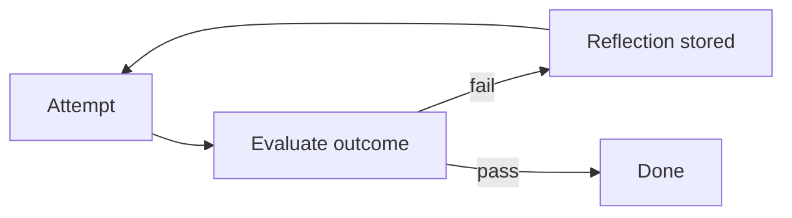

# Chapter 9: Reflexion / Self-Reflection

**Part I — Planning & Reasoning**

## Reflexion / Self-Reflection Pattern Overview

After an attempt, the agent critiques its own outcome and stores verbal feedback in memory to improve the next try.

**Reflexion / Self-Reflection** is catalogued in the **Planning & Reasoning** part of the catalog (id `reflexion`). It is tagged for general, engineering, devops and is assembled from 3 components.

Attempt, evaluate, reflect, retry with the reflection in context — improvement with a ledger, where the verbal signal ("what failed and why") is stored as memory the next attempt reads. The ledger is the asset and the attack surface: reflections grounded in deterministic signals (test results, API errors) compound into competence, while attacker text admitted as "lessons" compounds into persistent compromise (reflection poisoning, high severity).

**Definition 1 (Grounded reflection).** A reflection $r$ on attempt $a$ with outcome $o$ is *grounded* iff (i) $r$ cites a deterministic signal (test result, API error, measured outcome) rather than model opinion alone, (ii) $r$ passes human review before entering long-term memory, and (iii) retries are bounded (escalate after $k$ reflections).

**Theorem 1 (Ungrounded reflection compounds error).** If reflections enter memory on model opinion alone, then rationalization loops ("reflecting" a wrong action into a defended one) and poisoned lessons (attacker text memorized as guidance) accumulate across runs — each generation inherits the previous generation's invented wisdom.

*Proof.* Model-opinion reflection has no external anchor: a wrong action plus a fluent rationalization yields a stored "lesson" endorsing the wrong action. The next attempt reads the lesson as guidance, repeats the action with higher confidence, and reflects again — the loop converges on defended error (rationalization, medium). Attacker text in the evaluated output becomes a memorized lesson the same way (poisoning, high), persisting across runs and agents that share the memory. Grounding breaks both cycles: deterministic signals anchor reflections to measured reality, human review gates memory admission, and the retry bound caps the loop. Verify no reflection enters memory without review against test and error evidence — the memory that learns must also be the memory that forgets the unproven. ∎

## Practical Applications & Use Cases

Domains the catalog tags this pattern for:

- general
- engineering
- devops

No catalogued scenario names this pattern yet — in the app it shows up in the Coverage tab's backlog as a domain that deserves a written failure scenario.

It also appears in 4 composition cascades:

| Cascade | Class | Blast radius | Impact |
|---|---|---|---|
| Memory Consolidation (Reflection-Driven) — consolidation of garbage | Inherent | single-agent | High |
| Reflexion / Self-Reflection — reflection poisoning | Inherent | service | High |
| Chain-of-Verification (CoVe) — self-verification illusion | Inherent | service | Medium |
| Self-Critique & Revise — rubric drift | Inherent | service | Low |

## How It Works

1. Attempt task in environment.
2. Evaluator produces verbal reinforcement signal.
3. Store reflection; retry with reflection in context.

## Components

- Actor
- Self-critic
- Reflection memory

## Control-Flow Diagram

## Failure Modes and Risks

2 failure modes are documented for this pattern:

| Failure mode | Severity | What happens |
|---|---|---|
| Rationalization loop | Medium | Agent 'reflects' its way into defending a wrong action. |
| Reflection poisoning | High | Attacker text becomes the 'lesson' memorized for future runs. |

## Protections

1. Ground reflections in deterministic signals (test results, API errors), not model opinion alone.
2. Human-review reflections before they enter long-term memory.
3. Bound retry count; escalate after k reflections.

## At a Glance

| Field | Value |
|---|---|
| Catalog id | `reflexion` |
| Part | I — Planning & Reasoning |
| Domains | general, engineering, devops |
| Components | Actor, Self-critic, Reflection memory |
| Failure modes | 2 |
| Protections | 3 |
| Related patterns | Self-Critique & Revise, Memory Consolidation (Reflection-Driven) |
| Linked scenarios | 0 |
| Linked cascades | 4 |

## Key Takeaways

- After an attempt, the agent critiques its own outcome and stores verbal feedback in memory to improve the next try.
- Ground reflections in deterministic signals (test results, API errors), not model opinion alone.
- Human-review reflections before they enter long-term memory.
- Bound retry count; escalate after k reflections.
- Know its failure modes: Rationalization loop (medium); Reflection poisoning (high).

## References and Related Patterns

| Related pattern | Part | Summary |
|---|---|---|
| Self-Critique & Revise | Planning & Reasoning | Draft → critique against explicit criteria → revise, iterating until criteria pass or budget is exhausted. |
| Memory Consolidation (Reflection-Driven) | Memory & Knowledge | Background process distills raw interaction logs into durable, ranked memories (like sleep consolidation). |

## Council deliberation

- **Continual-learning researcher:** Reflexion helps general, engineering and DevOps tasks by having the agent critique its own outcome after an attempt and store verbal feedback in memory to improve the next try, attempting the task, producing a verbal reinforcement signal from an evaluator, then storing reflection and retrying with reflection in context using an Actor, Self-critic and Reflection memory. The tension is Rationalization loop where the agent reflects its way into defending a wrong action. The protection that carries weight is grounding reflections in deterministic signals such as test results and API errors not model opinion alone, related to Self-Critique, and the operator should verify retry count is bounded.
- **Safety researcher:** Deterministic grounding helps, but the high-severity failure is Reflection poisoning where attacker text becomes the lesson memorized for future runs. That is why human review of reflections before they enter long-term memory carries the weight, alongside bounding retries and escalating after k reflections. Related Memory-Consolidation shows the persistence risk, so the operator should verify no reflection enters Reflection memory without review against test and error evidence.

## Council reading

- **Red team:** Start with Reflection poisoning (high): Attacker text becomes the 'lesson' memorized for future runs. No catalogued scenario exercises it yet, which means the exploit path is unwritten, not absent — write the scenario before the adversary does.
- **Blue team:** Hold with Ground reflections in deterministic signals (test results, API errors), not model opinion alone; Human-review reflections before they enter long-term memory. Then layer the remaining 1: defence here is the list, not any single item. Compose with Self-Critique & Revise, Memory Consolidation (Reflection-Driven) so a failure in one pattern meets a control in another.
- **Operator:** Deploy where it is tagged (general, engineering, devops), and watch the 4 linked cascades — Memory Consolidation (Reflection-Driven) — consolidation of garbage first, because composition is where small faults amplify. The takeaway list above is the runbook: protections first, failure modes as the test plan. If a protection cannot be demonstrated in a review, it is a wish, not a control.

## Conclusion

In the catalog this chapter was generated from, **Reflexion / Self-Reflection** is one of 107 patterns in *Planning & Reasoning*, carrying 2 documented failure modes and 3 listed protections. Use it as a starting point, not a specification: the protection list is the part that survives contact with an adversary.

---
