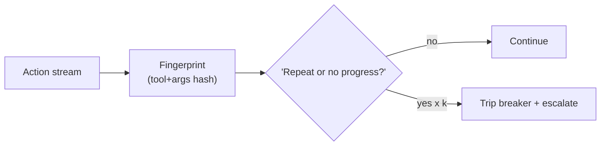
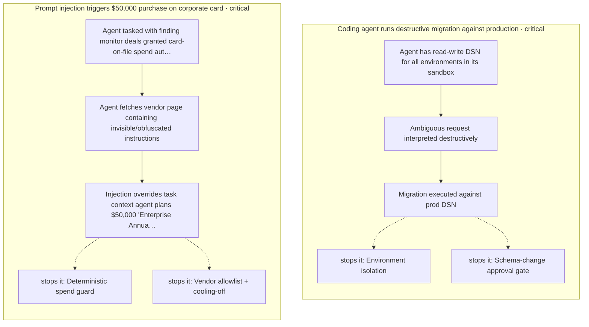
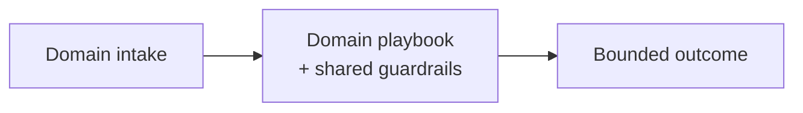

# Chapter 100: Loop / Stall Detection

**Part VIII — Resilience & Reliability**

## Loop / Stall Detection Pattern Overview

Detect repeated identical or non-progressing actions and stop before cost/side effects compound.

**Loop / Stall Detection** is catalogued in the **Resilience & Reliability** part of the catalog (id `loop-detector`). It is tagged for general and is assembled from 3 components.

Fingerprint actions (tool plus args hash); detect repeats within a window or no state delta; trip the breaker, checkpoint, escalate. The distinction that makes the detector usable in production is state delta, not mere repetition: fingerprinting gives repeats an observable signature, but only progress monitoring tells a stall from a cadence — and declared polling cadences let legitimate loops identify themselves instead of tripping the wire.

**Definition 1 (Progress-aware loop signature).** A loop signature is *progress-aware* iff (i) actions are fingerprinted (tool plus args hash), (ii) repetition is judged against state delta (same actions with no progress = stall; same actions with progress = cadence), and (iii) polling tasks declare expected cadence to the monitor (legitimate loops self-identify).

**Theorem 1 (Stalls stop; cadences continue).** Under progress-aware signatures with declared cadences and breaker hookup, genuine stalls trip the breaker before cost compounds, while legitimate polling never trips it at all — the detector distinguishes stuck from steady.

*Proof.* Repeat-only detection false-positives on polling (legitimate repetition classified as loop — the catalogued low-severity failure). State-delta keying fixes the classification: repeated actions that change state are progress (the loop is working, slowly); repeated actions with no state change are stalling (the loop is stuck). Declared cadences give polling an explicit pass: expected repetition, declared upfront, matches the declaration and never trips. Breaker hookup with checkpointing converts detection into containment plus escalation — not a log line nobody reads. The 14,000-duplicate retry storm and the \$8,400 overnight burn are what un-detected loops cost; state-delta signatures plus declared cadences plus the breaker are what stop the next ones. Verify the loop signature includes state delta; confirm polling cadences are declared; wire detection to the breaker, not to a dashboard. ∎

## Practical Applications & Use Cases

Domains the catalog tags this pattern for:

- general

2 documented failure scenarios exercise it:

| Scenario | Severity | Likelihood | Domain |
|---|---|---|---|
| Trading agent retry storm places 14,000 duplicate orders | Critical | Medium | finance |
| Unbounded agent loop burns \$8,400 in tokens overnight | High | High | general |

It also appears in 8 composition cascades — the 6 most impactful of 8:

| Cascade | Class | Blast radius | Impact |
|---|---|---|---|
| Circuit Breaker & Kill Switch — breaker owned by the agent | Inherent | service | Critical |
| Cross-scenario cascade in finance | Cascading | fleet | Critical |
| Cross-scenario cascade in general | Cascading | fleet | Critical |
| Provider outage → retry storm → cost halt | Cascading | fleet | Critical |
| Trading agent retry storm places 14,000 duplicate orders | Derived | service | Critical |
| Retry amplification storm | Emergent | service | High |

## How It Works

1. Fingerprint actions (tool + args hash).
2. Detect repeats within window or no state delta.
3. Trip breaker; checkpoint; escalate.

## Components

- Action fingerprinter
- Progress monitor
- Breaker hookup

## Control-Flow Diagram

## Failure Modes and Risks

1 failure mode is documented for this pattern:

| Failure mode | Severity | What happens |
|---|---|---|
| Legit repetition classified as loop | Low | Polling tasks false-positive. |

## Protections

1. Loop signature includes state-delta, not just action repeat.
2. Polling tasks declare expected cadence to the monitor.

## At a Glance

| Field | Value |
|---|---|
| Catalog id | `loop-detector` |
| Part | VIII — Resilience & Reliability |
| Domains | general |
| Components | Action fingerprinter, Progress monitor, Breaker hookup |
| Failure modes | 1 |
| Protections | 2 |
| Related patterns | Circuit Breaker & Kill Switch, Budget-Bounded Execution |
| Linked scenarios | 2 |
| Linked cascades | 8 |

## Key Takeaways

- Detect repeated identical or non-progressing actions and stop before cost/side effects compound.
- Loop signature includes state-delta, not just action repeat.
- Polling tasks declare expected cadence to the monitor.
- Know its failure modes: Legit repetition classified as loop (low).

## References and Related Patterns

| Related pattern | Part | Summary |
|---|---|---|
| Circuit Breaker & Kill Switch | Safety, Security & Governance | Automatic trip on anomaly (looping, error rate, spend, output class) plus a human-operable global kill switch. |
| Budget-Bounded Execution | Agent Loop & Control | Runtime-enforced ceilings on steps, tokens, wall-clock, tool calls, and dollars per task — the master circuit breaker for agents. |

## Council deliberation

- **Evaluation methodologist:** Loop and Stall Detection fingerprints actions by tool plus argument hash, watches for repeats within a window or absence of state change, then trips the breaker with checkpoint and escalation, through a fingerprinter, progress monitor and breaker hookup. The failure is legitimate repetition flagged as a loop, such as polling tasks tripping the detector. Protections key loop signatures on state delta rather than action repeat alone and let polling tasks declare expected cadence to the monitor, with circuit breakers and bounded execution alongside so genuine stalls stop before cost and side effects compound in general agents.
- **Safety researcher:** State delta rather than mere repetition is the distinction that makes this detector usable in production. Fingerprinting gives repeats an observable signature, but only progress monitoring tells a stall from a cadence. Declared polling cadences let legitimate loops identify themselves, which cuts false trips without weakening the trip wire, and hookup to the breaker with checkpointing means detection ends in containment and escalation rather than a log line nobody reads.

## Council reading

- **Red team:** Start with Legit repetition classified as loop (low): Polling tasks false-positive. Trading agent retry storm places 14,000 duplicate orders is the catalogued proof — critical severity, finance domain — so rehearse that exact chain before any other.
- **Blue team:** Hold with Loop signature includes state-delta, not just action repeat; Polling tasks declare expected cadence to the monitor. Compose with Circuit Breaker & Kill Switch, Budget-Bounded Execution so a failure in one pattern meets a control in another.
- **Operator:** Deploy where it is tagged (general), and watch the 8 linked cascades — Circuit Breaker & Kill Switch — breaker owned by the agent first, because composition is where small faults amplify. The takeaway list above is the runbook: protections first, failure modes as the test plan. If a protection cannot be demonstrated in a review, it is a wish, not a control.

## Conclusion

In the catalog this chapter was generated from, **Loop / Stall Detection** is one of 107 patterns in *Resilience & Reliability*, carrying 1 documented failure mode and 2 listed protections. Use it as a starting point, not a specification: the protection list is the part that survives contact with an adversary.

---

# Part IX: Domain Playbooks

End-to-end reference architectures per industry, guardrails included.

*Domain Playbooks* holds 7 of the catalog's 107 patterns, which appear in 10 catalogued failure scenarios and 25 composition cascades. Each chapter below follows the same order and shape as every other part.

## Council deliberation

- **Evaluation methodologist:** Domain playbooks adapt the shared patterns to regulated settings, turning generic guardrails into end-to-end reference architectures per industry. Their role is translation: clinical triage becomes decision-support only with licensed sign-off and deterministic dosage services, trading becomes signal proposal with broker-level caps and staleness gates, procurement becomes draft orders with vendor verification and processor caps. Each playbook names its characteristic failures, from autonomous clinical action to runaway ordering, and pairs them with controls placed at the layer that actually holds under pressure.
- **Safety researcher:** What makes playbooks credible is that guardrails travel with them rather than being re-derived per deployment. Support keeps refund caps and account verification, coding keeps sandboxed implementation with human merge gates and secret scanning, SRE keeps remediation allowlists with stateful systems human-gated, research keeps citation resolution against content hashes with abstention over fabrication. The pattern is consistent: diagnose freely where reading is safe, but let money, merges, infrastructure and clinical acts move only through gates the agent cannot own.
- **Memory-systems researcher:** I read playbooks as memory with accountability: guideline-grounded suggestions with citations, strategy mandates immutable at runtime, provenance hashed per order, full audit for clinical governance. Each preserves what the domain must remember, from source-quality tiers in research reports to receipt ledgers in procurement, while minimizing what it retains, through tokenized clinical context and vault-mediated identity. Adapting to regulated settings therefore means remembering the right evidence in the right store, retrievable for review long after the run ends.

**Incident anatomy.** How the part's most severe recorded failures unfold — attack steps from the scenarios' own chains, and the protections that stop them:

| Chapter | Pattern | Domains |
|---|---|---|
| 101 | Coding Agent Pipeline | engineering |
| 102 | Customer Support Agent Playbook | support |
| 103 | Autonomous Trading Agent Playbook | finance |
| 104 | Clinical Triage Agent Playbook | healthcare |
| 105 | SRE / DevOps Agent Playbook | devops |
| 106 | Research Agent with Citation Enforcement | research, legal |
| 107 | Procurement / Purchasing Agent Playbook | procurement, finance |

---
