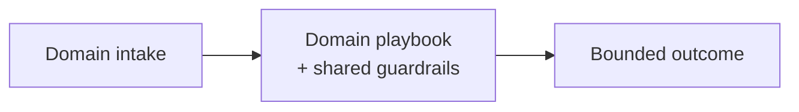

# Chapter 102: Customer Support Agent Playbook

**Part IX — Domain Playbooks**

## Customer Support Agent Playbook Pattern Overview

Triage → resolve low-risk with guardrails → escalate with context; refunds/PII/actions bounded by policy.

**Customer Support Agent Playbook** is catalogued in the **Domain Playbooks** part of the catalog (id `support-triage`). It is tagged for support and is assembled from 4 components.

Classify intent and risk; resolve low-risk from RAG with citations; bound money, PII, and legal actions in policy; escalate with full transcript summaries. Support is kindness at scale — and kindness is exploitable: social-engineered refunds (angry-customer prompts extracting credits) and PII echo (full card numbers to wrong recipients) are the two documented shapes. Refund caps with per-customer velocity limits aggregated across channels, never-echoed PII with vault-based re-identification, and account-ownership verification before any account action are what keep helpfulness from becoming hemorrhage.

**Definition 1 (Bounded helpfulness).** Support is *boundedly helpful* iff (i) refunds carry per-customer caps plus velocity limits aggregated across all channels, (ii) PII is never echoed (redacted in transcripts, re-identified only via vault), and (iii) every account action waits on verified account ownership.

**Theorem 1 (Kindness with ceilings).** Under bounded helpfulness with per-channel-aggregated caps, a farming campaign (escalating anger across channels) hits the aggregate ceiling regardless of distribution — and no single interaction leaks PII or moves money beyond policy.

*Proof.* Farming optimizes per-interaction sympathy; aggregate caps optimize the campaign total: spreading across channels does not reset the counter, because aggregation is per-customer across all of them — the tenth angry message meets the same ceiling the first nine built toward. PII non-echo (ii) removes the exfiltration channel entirely: the card number is never in the output to misroute, and vault re-identification happens outside the conversation. Account-ownership verification (iii) binds actions to verified owners before any state changes. Helpfulness operates freely inside these bounds (triage, RAG answers with citations, escalations with provenance) — and stops exactly where money, identity, and secrets begin. ∎

## Practical Applications & Use Cases

Domains the catalog tags this pattern for:

- support

1 documented failure scenario exercises it:

| Scenario | Severity | Likelihood | Domain |
|---|---|---|---|
| Refund farming via escalating 'angry customer' prompts | Medium | High | support |

It also appears in 2 composition cascades:

| Cascade | Class | Blast radius | Impact |
|---|---|---|---|
| Customer Support Agent Playbook — social-engineered refunds | Inherent | single-agent | High |
| Refund farming via escalating 'angry customer' prompts | Derived | single-agent | Medium |

## How It Works

1. Classify intent + risk.
2. Low-risk: answer from RAG with citations.
3. Money/PII/legal: bounded action + approval.
4. Escalate with full transcript summary.

## Components

- Triage
- RAG resolver
- Policy-gated actions
- Escalation

## Control-Flow Diagram

## Failure Modes and Risks

2 failure modes are documented for this pattern:

| Failure mode | Severity | What happens |
|---|---|---|
| Social-engineered refunds | High | Injected 'angry customer' repeatedly extracts credits. |
| PII echo | High | Agent restates full card number to wrong recipient. |

## Protections

1. Refund caps + velocity limits per customer; aggregate across channels.
2. PII never echoed; redact in transcript and re-identify only via vault.
3. Account-ownership verification before any account action.

## At a Glance

| Field | Value |
|---|---|
| Catalog id | `support-triage` |
| Part | IX — Domain Playbooks |
| Domains | support |
| Components | Triage, RAG resolver, Policy-gated actions, Escalation |
| Failure modes | 2 |
| Protections | 3 |
| Related patterns | Routing, Financial Guardrails (Spend Controls), Output / Content Shielding |
| Linked scenarios | 1 |
| Linked cascades | 2 |

## Key Takeaways

- Triage → resolve low-risk with guardrails → escalate with context; refunds/PII/actions bounded by policy.
- Refund caps + velocity limits per customer; aggregate across channels.
- PII never echoed; redact in transcript and re-identify only via vault.
- Account-ownership verification before any account action.
- Know its failure modes: Social-engineered refunds (high); PII echo (high).

## References and Related Patterns

| Related pattern | Part | Summary |
|---|---|---|
| Routing | Workflow Orchestration | Classifier dispatches input to a specialized downstream prompt/model; cheap fast path, expensive path only when needed. |
| Financial Guardrails (Spend Controls) | Safety, Security & Governance | Dollar-denominated limits: per-transaction caps, rolling budgets, velocity checks, vendor allowlists, dual control above thresholds. |
| Output / Content Shielding | Safety, Security & Governance | Screen agent outputs before they leave the system: PII, secrets, toxic/brand-damaging content, compliance violations. |

## Council deliberation

- **Evaluation methodologist:** Customer Support Playbook classifies intent and risk through Triage, a RAG resolver, Policy-gated actions, and Escalation, resolving low-risk work from cited sources while bounding money, PII, and legal actions and escalating with transcript summaries. That helps support stay fast yet contained. The tension pairs Social-engineered refunds repeatedly extracting credits with PII echo restating full card numbers to the wrong recipient after a plausible complaint.
- **Safety researcher:** Helpfulness cannot override account and data boundaries. The protections that carry weight are refund caps with per-customer velocity limits aggregated across channels, never echoing PII with vault-based re-identification and redacted transcripts, and verifying account ownership before any account action. The operator should verify routing and budget-guardrails and content-shielding enforcement and confirm escalation preserves provenance without leaking secrets.

## Council reading

- **Red team:** Start with Social-engineered refunds (high): Injected 'angry customer' repeatedly extracts credits. Refund farming via escalating 'angry customer' prompts is the catalogued proof — medium severity, support domain — so rehearse that exact chain before any other.
- **Blue team:** Hold with Refund caps + velocity limits per customer; aggregate across channels; PII never echoed; redact in transcript and re-identification only via vault. Then layer the remaining 1: defence here is the list, not any single item. Compose with Routing, Financial Guardrails (Spend Controls) so a failure in one pattern meets a control in another.
- **Operator:** Deploy where it is tagged (support), and watch the 2 linked cascades — Customer Support Agent Playbook — social-engineered refunds first, because composition is where small faults amplify. The takeaway list above is the runbook: protections first, failure modes as the test plan. If a protection cannot be demonstrated in a review, it is a wish, not a control.

## Conclusion

In the catalog this chapter was generated from, **Customer Support Agent Playbook** is one of 107 patterns in *Domain Playbooks*, carrying 2 documented failure modes and 3 listed protections. Use it as a starting point, not a specification: the protection list is the part that survives contact with an adversary.

---
