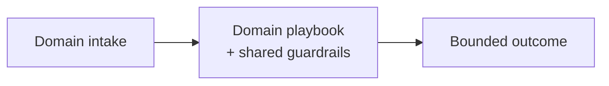

# Chapter 103: Autonomous Trading Agent Playbook

**Part IX — Domain Playbooks**

## Autonomous Trading Agent Playbook Pattern Overview

Strategy agent proposes; risk engine disposes: position limits, kill switches, staleness checks, no self-approval.

**Autonomous Trading Agent Playbook** is catalogued in the **Domain Playbooks** part of the catalog (id `trading-agent`). It is tagged for finance and is assembled from 4 components.

Signal generation (research agent, citation-checked); risk engine validates sizing, limits, exposure; execution via broker API with hard caps; kill switch plus human desk oversight. The separation is propose-versus-dispose: the signal agent may be brilliant, but it cannot trade — only the risk engine, the broker caps, and the staleness gates decide what reaches the market. No self-approval, ever.

**Definition 1 (Propose-dispose separation).** Trading satisfies *separation* iff (i) signal generation cannot execute (no order path from the signal agent), (ii) every order passes the risk engine (sizing, limits, exposure) plus broker-level hard caps outside the agent runtime, (iii) every feed carries a staleness gate (stale defaults flat), (iv) strategy mandates are immutable at runtime (changes need dual control), and (v) the kill switch is tested daily.

**Theorem 1 (No agent trades on its own authority).** Under propose-dispose separation, every executed order passed four independent checks (risk engine, broker caps, staleness gates, immutable mandate) plus a tested kill switch — a single compromised component (drunk signal, stale feed, drifted mandate) cannot move the market alone.

*Proof.* The signal agent proposes; proposal is not an order (i). The risk engine validates sizing, limits, exposure — oversized, over-limit, or over-exposed orders die here. Broker-level hard caps (ii) bind even what the risk engine approves: the broker is outside the agent runtime, so runtime compromise cannot widen them. Staleness gates (iii) default flat on frozen feeds: yesterday's prices never trade, and the flash-crash feedback loop meets pair-level exposure accounting plus the kill switch. Immutable mandates (iv) freeze the strategy: drift via memory cannot rewrite what only dual control can change. The daily-tested kill switch (v) bounds the residual. The 14,000-duplicate retry storm is what idempotency plus order-rate caps stop (no self-approval, no silent rerun); the flash crash is what the staleness gates plus the kill switch stop. Verify the linkage chain — budget guardrails, breakers, idempotency — and confirm retries cannot multiply orders. ∎

## Practical Applications & Use Cases

Domains the catalog tags this pattern for:

- finance

2 documented failure scenarios exercise it:

| Scenario | Severity | Likelihood | Domain |
|---|---|---|---|
| Momentum agents' feedback loop amplifies a flash crash | Critical | Medium | trading |
| Trading agent retry storm places 14,000 duplicate orders | Critical | Medium | finance |

It also appears in 4 composition cascades:

| Cascade | Class | Blast radius | Impact |
|---|---|---|---|
| Autonomous Trading Agent Playbook — runaway loop ordering | Inherent | single-agent | Critical |
| Momentum agents' feedback loop amplifies a flash crash | Derived | service | Critical |
| Trading agent retry storm places 14,000 duplicate orders | Derived | service | Critical |
| Retry amplification storm | Emergent | service | High |

## How It Works

1. Signal generation (research agent, citation-checked).
2. Risk engine validates sizing, limits, exposure.
3. Execution via broker API with hard caps.
4. Kill switch + human desk oversight.

## Components

- Signal agent
- Risk engine
- Executor
- Kill switch

## Control-Flow Diagram

## Failure Modes and Risks

3 failure modes are documented for this pattern:

| Failure mode | Severity | What happens |
|---|---|---|
| Runaway loop ordering | Critical | Retry storm places thousands of duplicate orders. |
| Stale-signal trading | High | Feeds freeze; agent trades on yesterday's prices. |
| Strategy drift via memory | High | Poisoned memory rewrites the mandate. |

## Protections

1. Hard position/order-rate caps at broker (outside agent runtime).
2. Staleness gates on every feed; default flat.
3. Strategy mandates immutable at runtime; changes need dual control.
4. Kill switch tested daily.

## At a Glance

| Field | Value |
|---|---|
| Catalog id | `trading-agent` |
| Part | IX — Domain Playbooks |
| Domains | finance |
| Components | Signal agent, Risk engine, Executor, Kill switch |
| Failure modes | 3 |
| Protections | 4 |
| Related patterns | Financial Guardrails (Spend Controls), Circuit Breaker & Kill Switch, Idempotency Keys |
| Linked scenarios | 2 |
| Linked cascades | 4 |

## Key Takeaways

- Strategy agent proposes; risk engine disposes: position limits, kill switches, staleness checks, no self-approval.
- Hard position/order-rate caps at broker (outside agent runtime).
- Staleness gates on every feed; default flat.
- Strategy mandates immutable at runtime; changes need dual control.
- Kill switch tested daily.
- Know its failure modes: Runaway loop ordering (critical); Stale-signal trading (high); Strategy drift via memory (high).

## References and Related Patterns

| Related pattern | Part | Summary |
|---|---|---|
| Financial Guardrails (Spend Controls) | Safety, Security & Governance | Dollar-denominated limits: per-transaction caps, rolling budgets, velocity checks, vendor allowlists, dual control above thresholds. |
| Circuit Breaker & Kill Switch | Safety, Security & Governance | Automatic trip on anomaly (looping, error rate, spend, output class) plus a human-operable global kill switch. |
| Idempotency Keys | Safety, Security & Governance | Every side-effecting call carries a key so retries/duplicates can't double-charge or double-deploy. |

## Council deliberation

- **Safety researcher:** Trading Playbook separates proposing from disposing through a Signal agent, Risk engine, Executor, and Kill switch, with citation-checked signals, validated sizing and exposure, broker execution under hard caps, and human desk oversight for finance. That structure helps speed stay bounded. Yet its documented failure modes warn of Runaway loop ordering duplicating orders, Stale-signal trading on frozen feeds, and Strategy drift via memory rewriting the mandate mid-session.
- **Evaluation methodologist:** Autonomy here must sit beneath broker truth. The protections that carry weight are hard position and order-rate caps outside the agent runtime, staleness gates defaulting flat, immutable strategy mandates changeable only under dual control, and a daily-tested kill switch. The operator should verify budget-guardrails and circuit-breaker and idempotency-keys linkages and confirm retries cannot multiply orders.

## Council reading

- **Red team:** Start with Runaway loop ordering (critical): Retry storm places thousands of duplicate orders. Trading agent retry storm places 14,000 duplicate orders is the catalogued proof — critical severity, finance domain — so rehearse that exact chain before any other.
- **Blue team:** Hold with Hard position/order-rate caps at broker (outside agent runtime); Staleness gates on every feed; default flat. Then layer the remaining 2: defence here is the list, not any single item. Compose with Financial Guardrails (Spend Controls), Circuit Breaker & Kill Switch so a failure in one pattern meets a control in another.
- **Operator:** Deploy where it is tagged (finance), and watch the 4 linked cascades — Autonomous Trading Agent Playbook — runaway loop ordering first, because composition is where small faults amplify. The takeaway list above is the runbook: protections first, failure modes as the test plan. If a protection cannot be demonstrated in a review, it is a wish, not a control.

## Conclusion

In the catalog this chapter was generated from, **Autonomous Trading Agent Playbook** is one of 107 patterns in *Domain Playbooks*, carrying 3 documented failure modes and 4 listed protections. Use it as a starting point, not a specification: the protection list is the part that survives contact with an adversary.

---
