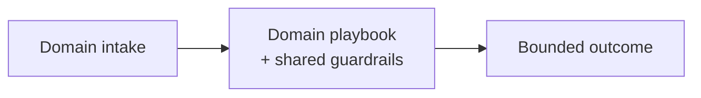

# Chapter 104: Clinical Triage Agent Playbook

**Part IX — Domain Playbooks**

## Clinical Triage Agent Playbook Pattern Overview

Decision-support only: never autonomous diagnosis; PHI handled under strict minimization; escalation-first.

**Clinical Triage Agent Playbook** is catalogued in the **Domain Playbooks** part of the catalog (id `healthcare-triage`). It is tagged for healthcare and is assembled from 4 components.

Minimal tokenized PHI context; guideline-grounded suggestions with citations; any red flag triggers immediate human escalation; full audit for clinical governance. The two rules that carry the whole playbook: no clinical action without licensed human sign-off (the agent informs, never decides), and PHI tokenized before any external call to BAA'd endpoints only. Deterministic dosage calculators — never LLM outputs — close the deadliest gap: the model must never compute what a verified function should.

**Definition 1 (Decision-support-only care).** A clinical agent is *decision-support-only* iff (i) no diagnosis, dosage, or disposition executes without licensed human sign-off, (ii) PHI is minimized and tokenized before any external call (BAA'd endpoints only), (iii) all dosing math runs in deterministic calculators, and (iv) every red flag escalates immediately with full audit for governance.

**Theorem 1 (No autonomous clinical harm).** Under decision-support-only with tokenized PHI and deterministic dosing, the agent cannot autonomously injure a patient or leak their records: every consequential path terminates at a human, a calculator, or an escalation queue.

*Proof.* Autonomous clinical action requires the agent to decide dosage or disposition alone; the hard sign-off rule (i) makes every such action wait for a licensed human — the hallucinated dosage arrives with no valid source attached, and the sign-off catches exactly that. PHI exposure requires un-minimized context leaving approved boundaries; tokenization plus BAA-only endpoints (ii) means external calls carry tokens, not records — the full context never leaves the vault. Dosing errors require LLM-computed doses; deterministic calculators (iii) remove the model from the arithmetic entirely. Red-flag escalation (iv) with full audit catches what the rules miss: the unusual case routes to humans with its evidence attached, and governance can reconstruct every decision afterward. Verify PII filtering, HITL, and RAG grounding end to end; confirm no dosage or diagnosis ships unreviewed. ∎

## Practical Applications & Use Cases

Domains the catalog tags this pattern for:

- healthcare

1 documented failure scenario exercises it:

| Scenario | Severity | Likelihood | Domain |
|---|---|---|---|
| Clinical agent hallucinates a drug dosage | Critical | Medium | healthcare |

It also appears in 3 composition cascades:

| Cascade | Class | Blast radius | Impact |
|---|---|---|---|
| Clinical Triage Agent Playbook — autonomous clinical action | Inherent | single-agent | Critical |
| Clinical agent hallucinates a drug dosage | Derived | service | Critical |
| Shared model version regression across the fleet | Cascading | fleet | Critical |

## How It Works

1. Minimal PHI context (tokenized).
2. Guideline-grounded suggestions with citations.
3. Any red flag → immediate human escalation.
4. Full audit for clinical governance.

## Components

- Intake
- Guideline RAG
- Escalation engine
- PHI vault

## Control-Flow Diagram

## Failure Modes and Risks

2 failure modes are documented for this pattern:

| Failure mode | Severity | What happens |
|---|---|---|
| Autonomous clinical action | Critical | Agent suggests dosage without supervision; hallucinated interaction. |
| PHI to third-party model | Critical | Un-minimized context sent to consumer LLM. |

## Protections

1. Hard policy: no clinical action without licensed human sign-off.
2. PHI tokenization before any external call; BAA'd endpoints only.
3. Dosage calculators are deterministic services, not LLM outputs.

## At a Glance

| Field | Value |
|---|---|
| Catalog id | `healthcare-triage` |
| Part | IX — Domain Playbooks |
| Domains | healthcare |
| Components | Intake, Guideline RAG, Escalation engine, PHI vault |
| Failure modes | 2 |
| Protections | 3 |
| Related patterns | PII Detection & Redaction, Human-in-the-Loop (HITL), RAG-Augmented Agent |
| Linked scenarios | 1 |
| Linked cascades | 3 |

## Key Takeaways

- Decision-support only: never autonomous diagnosis; PHI handled under strict minimization; escalation-first.
- Hard policy: no clinical action without licensed human sign-off.
- PHI tokenization before any external call; BAA'd endpoints only.
- Dosage calculators are deterministic services, not LLM outputs.
- Know its failure modes: Autonomous clinical action (critical); PHI to third-party model (critical).

## References and Related Patterns

| Related pattern | Part | Summary |
|---|---|---|
| PII Detection & Redaction | Safety, Security & Governance | Detect and redact personal data at ingress, in transit through context, and at egress. |
| Human-in-the-Loop (HITL) | Agent Loop & Control | Route high-risk or low-confidence decisions to humans for review/approval before execution. |
| RAG-Augmented Agent | Memory & Knowledge | Ground every answer/action in retrieved documents; cite sources; abstain when retrieval is empty. |

## Council deliberation

- **Safety researcher:** Clinical Triage is decision support only through Intake, Guideline RAG, Escalation engine, and PHI vault, using minimal tokenized context, guideline-grounded cited suggestions, immediate escalation on red flags, and full audit for governance. That helps healthcare stay assistive. The tension is severe, with Autonomous clinical action suggesting unsupervised dosage from hallucinated interactions and PHI to third-party model exposure when un-minimized context leaves approved boundaries.
- **Evaluation methodologist:** Support value depends on hard clinical boundaries. The protections that carry weight are a hard policy requiring licensed human sign-off for clinical action, PHI tokenization before external calls to approved endpoints only, and deterministic dosage calculators rather than LLM outputs. The operator should verify PII filtering and human-in-the-loop and retrieval-grounded enforcement and confirm no dosage or diagnosis ships without review.

## Council reading

- **Red team:** Start with Autonomous clinical action (critical): Agent suggests dosage without supervision; hallucinated interaction. Clinical agent hallucinates a drug dosage is the catalogued proof — critical severity, healthcare domain — so rehearse that exact chain before any other.
- **Blue team:** Hold with Hard policy: no clinical action without licensed human sign-off; PHI tokenization before any external call; BAA'd endpoints only. Then layer the remaining 1: defence here is the list, not any single item. Compose with PII Detection & Redaction, Human-in-the-Loop (HITL) so a failure in one pattern meets a control in another.
- **Operator:** Deploy where it is tagged (healthcare), and watch the 3 linked cascades — Clinical Triage Agent Playbook — autonomous clinical action first, because composition is where small faults amplify. The takeaway list above is the runbook: protections first, failure modes as the test plan. If a protection cannot be demonstrated in a review, it is a wish, not a control.

## Conclusion

In the catalog this chapter was generated from, **Clinical Triage Agent Playbook** is one of 107 patterns in *Domain Playbooks*, carrying 2 documented failure modes and 3 listed protections. Use it as a starting point, not a specification: the protection list is the part that survives contact with an adversary.

---
