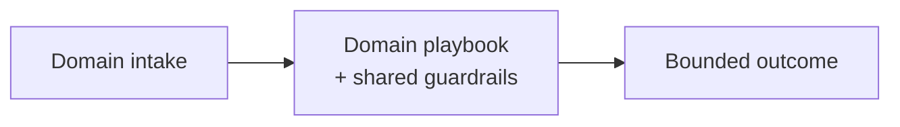

# Chapter 105: SRE / DevOps Agent Playbook

**Part IX — Domain Playbooks**

## SRE / DevOps Agent Playbook Pattern Overview

Diagnose freely, remediate narrowly: read-anywhere, write through an allowlist with change windows and blast-radius caps.

**SRE / DevOps Agent Playbook** is catalogued in the **Domain Playbooks** part of the catalog (id `sre-agent`). It is tagged for devops and is assembled from 4 components.

Full read access for diagnosis; remediations ranked by blast radius; auto-remediate only pre-approved low-risk actions; everything else becomes a ticket with approval. Diagnose freely, remediate narrowly — the asymmetry that keeps incident response fast without making it dangerous. The over-broad fix (restarting the wrong stateful fleet) and runaway scaling (a \$60k/day bill from well-meant automation) are what the allowlist, the human gates, the spend caps, and the change windows jointly prevent.

**Definition 1 (Narrow remediation).** Remediation is *narrow* iff (i) auto-remediation covers only pre-approved low-risk actions from a per-service-class allowlist, (ii) stateful systems are always human-gated (no auto-fix touches state), (iii) infra actions carry spend-per-hour caps, and (iv) every change lands in a change window with auto-rollback on breach.

**Theorem 1 (Diagnosis unlimited, damage bounded).** Under narrow remediation with read-anywhere diagnostics, the agent learns everything but can break only what the allowlist permits within the window and budget — and the wrong-fleet restart is structurally impossible, not merely discouraged.

*Proof.* Read-anywhere diagnostics maximize learning (full visibility into the incident) with zero blast radius (reads change nothing). Writes pass the allowlist: pre-approved low-risk actions auto-apply; everything else — especially stateful systems — waits for humans. Spend caps bound the cost dimension (runaway scaling hits the per-hour ceiling and stops); change windows with auto-rollback bound the time dimension (bad changes revert automatically). The catalogued proof (wrong-fleet restart during an incident) requires an ungated stateful write outside a window — exactly the combination the allowlist plus human-gating plus windows forbid. Verify the self-healing, guardrail, and checkpoint linkages; confirm every change stays reversible or explicitly approved. ∎

## Practical Applications & Use Cases

Domains the catalog tags this pattern for:

- devops

1 documented failure scenario exercises it:

| Scenario | Severity | Likelihood | Domain |
|---|---|---|---|
| SRE agent auto-scales a cluster into a \$60k/day bill | High | Medium | devops |

It also appears in 2 composition cascades:

| Cascade | Class | Blast radius | Impact |
|---|---|---|---|
| SRE / DevOps Agent Playbook — over-broad 'fix' | Inherent | single-agent | Critical |
| SRE agent auto-scales a cluster into a \$60k/day bill | Derived | service | High |

## How It Works

1. Full read access for diagnosis.
2. Remediation suggestions ranked by blast radius.
3. Auto-remediate only pre-approved low-risk actions.
4. Everything else: ticket + approval.

## Components

- Diagnostic reader
- Remediation planner
- Change gate
- Rollback manager

## Control-Flow Diagram

## Failure Modes and Risks

2 failure modes are documented for this pattern:

| Failure mode | Severity | What happens |
|---|---|---|
| Over-broad 'fix' | Critical | Agent restarts the wrong stateful service, causing outage cascade. |
| Runaway scaling | High | Auto-scale triggers cost explosion. |

## Protections

1. Remediation allowlist per service class; stateful systems always human-gated.
2. Cost guardrails on infra actions (spend-per-hour caps).
3. Every change in a change window with auto-rollback.

## At a Glance

| Field | Value |
|---|---|
| Catalog id | `sre-agent` |
| Part | IX — Domain Playbooks |
| Domains | devops |
| Components | Diagnostic reader, Remediation planner, Change gate, Rollback manager |
| Failure modes | 2 |
| Protections | 3 |
| Related patterns | Self-Healing Replan, Financial Guardrails (Spend Controls), Checkpointing & Rollback |
| Linked scenarios | 1 |
| Linked cascades | 2 |

## Key Takeaways

- Diagnose freely, remediate narrowly: read-anywhere, write through an allowlist with change windows and blast-radius caps.
- Remediation allowlist per service class; stateful systems always human-gated.
- Cost guardrails on infra actions (spend-per-hour caps).
- Every change in a change window with auto-rollback.
- Know its failure modes: Over-broad 'fix' (critical); Runaway scaling (high).

## References and Related Patterns

| Related pattern | Part | Summary |
|---|---|---|
| Self-Healing Replan | Resilience & Reliability | On failure, agent diagnoses root cause and re-plans — with containment so healing doesn't compound harm. |
| Financial Guardrails (Spend Controls) | Safety, Security & Governance | Dollar-denominated limits: per-transaction caps, rolling budgets, velocity checks, vendor allowlists, dual control above thresholds. |
| Checkpointing & Rollback | Agent Loop & Control | Snapshot state before risky operations so the agent can revert on failure. |

## Council deliberation

- **Continual-learning researcher:** SRE Playbook diagnoses freely but remediates narrowly through a Diagnostic reader, Remediation planner, Change gate, and Rollback manager, granting broad read access while ranking remediations by blast radius and auto-remediating only pre-approved low-risk actions. That helps devops learn quickly without granting write freedom. The tension pairs Over-broad fix restarting the wrong stateful service into cascade with Runaway scaling triggering cost explosion from well-meant automation.
- **Safety researcher:** Read freedom must not imply write freedom. The protections that carry weight are a per-service remediation allowlist with human gating for stateful systems, spend-per-hour caps on infra actions, and change windows with auto-rollback. The operator should verify self-healing and budget-guardrails and checkpoint-rollback linkages and confirm every change stays reversible or explicitly approved.

## Council reading

- **Red team:** Start with Over-broad 'fix' (critical): Agent restarts the wrong stateful service, causing outage cascade. SRE agent auto-scales a cluster into a \$60k/day bill is the catalogued proof — high severity, devops domain — so rehearse that exact chain before any other.
- **Blue team:** Hold with Remediation allowlist per service class; stateful systems always human-gated; Cost guardrails on infra actions (spend-per-hour caps). Then layer the remaining 1: defence here is the list, not any single item. Compose with Self-Healing Replan, Financial Guardrails (Spend Controls) so a failure in one pattern meets a control in another.
- **Operator:** Deploy where it is tagged (devops), and watch the 2 linked cascades — SRE / DevOps Agent Playbook — over-broad 'fix' first, because composition is where small faults amplify. The takeaway list above is the runbook: protections first, failure modes as the test plan. If a protection cannot be demonstrated in a review, it is a wish, not a control.

## Conclusion

In the catalog this chapter was generated from, **SRE / DevOps Agent Playbook** is one of 107 patterns in *Domain Playbooks*, carrying 2 documented failure modes and 3 listed protections. Use it as a starting point, not a specification: the protection list is the part that survives contact with an adversary.

---
