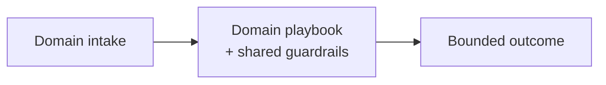

# Chapter 106: Research Agent with Citation Enforcement

**Part IX — Domain Playbooks**

## Research Agent with Citation Enforcement Pattern Overview

Gather → claim-level citation → verifier pass; fabricated sources blocked before they reach a human decision.

**Research Agent with Citation Enforcement** is catalogued in the **Domain Playbooks** part of the catalog (id `research-citation-agent`). It is tagged for research, legal and is assembled from 4 components.

Collect sources via browser/RAG with provenance; draft claims each citing source IDs; the verifier resolves each citation and checks entailment; unverifiable claims are flagged or dropped. The pipeline converts research from generation into verification: the collector may gather anything, but only cited, resolved, entailed claims survive to the report. Fabricated citations (confidently invented papers) and source laundering (attacker SEO elevated to authority) both die at the verifier.

**Definition 1 (Enforced citation).** A research pipeline enforces citation iff (i) every claim carries source IDs resolved to retrieved content hashes (not just names), (ii) the verifier checks entailment (the source must support the claim, not merely exist), (iii) source-quality tiers (primary > secondary > SEO) are surfaced in the report, and (iv) unverifiable claims are dropped, never softened — abstain over fabricate, enforced by the gate.

**Theorem 1 (No uncited claim reaches a decision.** Under enforced citation with entailment checks and tiered sources, a fabricated or laundered claim cannot survive to a human decision: it fails resolution, entailment, tiering, or the abstention gate — at least one, usually several.

*Proof.* Fabricated citations (14 papers that don't exist) fail resolution: no retrieved content hash matches, so there is nothing to entail. Source laundering (attacker SEO cited as authority) fails tiering: SEO-tier sources are surfaced as such and cannot alone support a claim — corroboration requires independent trusted sources. Even a resolved, tiered claim fails if it doesn't entail: the verifier checks support, not existence. And where verification cannot decide, abstention wins over fabrication by gate design — the report omits rather than invents. The catalogued pair (phantom papers, SEO-steered vendors) are exactly un-enforced citation: claims without resolved, entailing, tiered sources reaching humans who trusted the formatting. Verify browser, provenance, and RAG linkages; confirm unverifiable claims are dropped, not softened. ∎

## Practical Applications & Use Cases

Domains the catalog tags this pattern for:

- research
- legal

2 documented failure scenarios exercise it:

| Scenario | Severity | Likelihood | Domain |
|---|---|---|---|
| Strategy report cites 14 papers that don't exist | Medium | High | research |
| Vendor selection steered by attacker SEO content | Medium | High | procurement |

It also appears in 3 composition cascades:

| Cascade | Class | Blast radius | Impact |
|---|---|---|---|
| Research Agent with Citation Enforcement — fabricated citations | Inherent | single-agent | High |
| Strategy report cites 14 papers that don't exist | Derived | single-agent | Medium |
| Vendor selection steered by attacker SEO content | Derived | single-agent | Medium |

## How It Works

1. Collect sources via browser/RAG with provenance.
2. Draft claims each citing source IDs.
3. Verifier resolves each citation and checks entailment.
4. Unverifiable claims flagged or dropped.

## Components

- Collector
- Claim writer
- Citation verifier
- Report renderer

## Control-Flow Diagram

## Failure Modes and Risks

2 failure modes are documented for this pattern:

| Failure mode | Severity | What happens |
|---|---|---|
| Fabricated citations | High | Confidently invented papers drive decisions. |
| Source laundering | High | Low-quality SEO content cited as authority. |

## Protections

1. Citation must resolve to retrieved content hash; entailment checked.
2. Source-quality tiers (primary > secondary > SEO content) surfaced in report.
3. Abstain over fabricate — enforced by the verifier gate.

## At a Glance

| Field | Value |
|---|---|
| Catalog id | `research-citation-agent` |
| Part | IX — Domain Playbooks |
| Domains | research, legal |
| Components | Collector, Claim writer, Citation verifier, Report renderer |
| Failure modes | 2 |
| Protections | 3 |
| Related patterns | Browser / Web Research Agent, Provenance & Citation Enforcement, RAG-Augmented Agent |
| Linked scenarios | 2 |
| Linked cascades | 3 |

## Key Takeaways

- Gather → claim-level citation → verifier pass; fabricated sources blocked before they reach a human decision.
- Citation must resolve to retrieved content hash; entailment checked.
- Source-quality tiers (primary > secondary > SEO content) surfaced in report.
- Abstain over fabricate — enforced by the verifier gate.
- Know its failure modes: Fabricated citations (high); Source laundering (high).

## References and Related Patterns

| Related pattern | Part | Summary |
|---|---|---|
| Browser / Web Research Agent | Tools & Environment | Navigates, extracts, and summarizes the web — the largest prompt-injection surface agents have. |
| Provenance & Citation Enforcement | Safety, Security & Governance | Every claim and action must carry a verifiable provenance chain: which input, which tool, which policy version. |
| RAG-Augmented Agent | Memory & Knowledge | Ground every answer/action in retrieved documents; cite sources; abstain when retrieval is empty. |

## Council deliberation

- **Evaluation methodologist:** Research Agent with Citation Enforcement collects through browser and RAG with provenance, drafts claims citing source IDs, and passes a verifier that resolves each citation and checks entailment through a Collector, Claim writer, Citation verifier, and Report renderer for research and legal. That helps block fabrication before human decisions. The tension pairs Fabricated citations inventing confident papers with Source laundering elevating low-quality SEO content into apparent authority.
- **Safety researcher:** Collection is easy, verification is the gate. The protections that carry weight are requiring citations to resolve to retrieved content hashes with entailment checks, surfacing source-quality tiers from primary to SEO content, and enforcing abstain over fabricate at the verifier. The operator should verify browser-agent and provenance-citation and retrieval-grounded linkages and confirm unverifiable claims are dropped, not softened.

## Council reading

- **Red team:** Start with Fabricated citations (high): Confidently invented papers drive decisions. Vendor selection steered by attacker SEO content is the catalogued proof — medium severity, procurement domain — so rehearse that exact chain before any other.
- **Blue team:** Hold with Citation must resolve to retrieved content hash; entailment checked; Source-quality tiers (primary > secondary > SEO content) surfaced in report. Then layer the remaining 1: defence here is the list, not any single item. Compose with Browser / Web Research Agent, Provenance & Citation Enforcement so a failure in one pattern meets a control in another.
- **Operator:** Deploy where it is tagged (research, legal), and watch the 3 linked cascades — Research Agent with Citation Enforcement — fabricated citations first, because composition is where small faults amplify. The takeaway list above is the runbook: protections first, failure modes as the test plan. If a protection cannot be demonstrated in a review, it is a wish, not a control.

## Conclusion

In the catalog this chapter was generated from, **Research Agent with Citation Enforcement** is one of 107 patterns in *Domain Playbooks*, carrying 2 documented failure modes and 3 listed protections. Use it as a starting point, not a specification: the protection list is the part that survives contact with an adversary.

---
