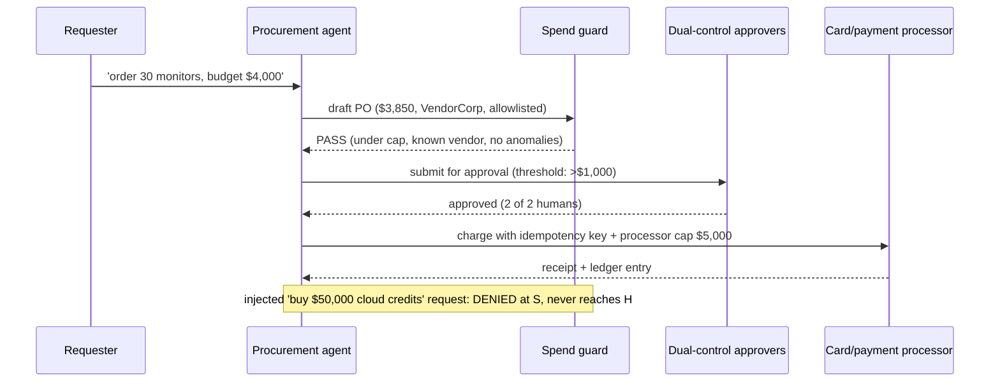

# Chapter 107: Procurement / Purchasing Agent Playbook

**Part IX — Domain Playbooks**

## Procurement / Purchasing Agent Playbook Pattern Overview

Agent may search, compare, and draft orders; money moves only through vendor allowlists, spend caps, and dual control.

**Procurement / Purchasing Agent Playbook** is catalogued in the **Domain Playbooks** part of the catalog (id `procurement-agent`). It is tagged for procurement, finance and is assembled from 6 components.

Requirement intake with budget from requester plus policy (never the model); search the marketplace with provenance on every claim; draft the PO; screening middleware applies caps, vendor, and velocity rules; above threshold, dual-control approval; then processor-level execution with hard caps. Search, compare, and draft are free; money moves only through the gauntlet — and the catalogued proof (the \$50,000 injected purchase denied at the spend guard, never reaching the approvers) shows the gauntlet working.

**Definition 1 (Gauntleted procurement).** Procurement is *gauntleted* iff (i) budgets come from requester plus policy (never the model), (ii) every claim carries provenance (hashed, audited), (iii) the spend guard is deterministic middleware the model cannot bypass, negotiate, or self-approve, (iv) vendors are identity-verified (KYC-style, not name match) with first-time cooling-off, (v) aggregate plus processor-level caps catch splitting in depth, and (vi) dual control stands above threshold.

**Theorem 1 (Drafts are free, money is gated).** Under gauntleted procurement, the agent's freedom to search, compare, and draft is total — and its power to spend is zero without passing all six gates: budget source, provenance, deterministic guard, verified vendor, aggregate caps, dual approval.

*Proof.* Drafting is unguarded by design (search and compare freely); spending is gated six deep. The injected '\$50,000 cloud credits' request dies at the spend guard (deterministic middleware: exceeds cap, new vendor, injected-URL pattern — DENIED, never reaching humans). The counterfeit-component shape dies at vendor identity (KYC, not name match) plus cooling-off. Threshold splitting dies at aggregate plus processor-level caps (the split stream trips what no single order does). Every order carries provenance (which inputs produced it, hashed) — auditable end to end. The gauntlet's strength is that no single gate carries it: bypassing one (even the human approver, via social engineering) still leaves five, and the processor cap enforces last. Verify every purchase path against all six; rehearse the injected purchase first. ∎

## Practical Applications & Use Cases

Domains the catalog tags this pattern for:

- procurement
- finance

2 documented failure scenarios exercise it:

| Scenario | Severity | Likelihood | Domain |
|---|---|---|---|
| Prompt injection triggers \$50,000 purchase on corporate card | Critical | High | finance |
| Procurement agent sources counterfeit components | High | Medium | logistics |

It also appears in 8 composition cascades — the 6 most impactful of 8:

| Cascade | Class | Blast radius | Impact |
|---|---|---|---|
| Cross-scenario cascade in finance | Cascading | fleet | Critical |
| Procurement / Purchasing Agent Playbook — prompt-injected purchase | Inherent | single-agent | Critical |
| Prompt injection triggers \$50,000 purchase on corporate card | Derived | service | Critical |
| Regulatory action → service freeze | Cascading | ecosystem | Critical |
| Authority confusion on handoff | Emergent | service | High |
| Feedback-loop cost runaway | Emergent | service | High |

## How It Works

1. Requirement intake with budget from requester+policy (not the model).
2. Search marketplace with provenance on every claim.
3. Draft PO; screening middleware applies caps/vendor/velocity rules.
4. Above threshold: dual-control approval; then processor-level execution with hard caps.

## Components

- Intake
- Research agent
- PO drafter
- Spend guard
- Approval workflow
- Processor caps

## Control-Flow Diagram

## Failure Modes and Risks

3 failure modes are documented for this pattern:

| Failure mode | Severity | What happens |
|---|---|---|
| Prompt-injected purchase | Critical | Web/email content instructs agent to buy; without spend guard, \$50k leaves the account in minutes. |
| Vendor spoofing | High | Lookalike vendor 'Acme Cloud Urgent' receives funds. |
| Threshold splitting | High | Multiple small orders evade approval. |

## Protections

1. Spend guard is deterministic middleware; model cannot bypass, negotiate, or self-approve.
2. Vendor identity verified (KYC-style), not just name match; first-time vendors cool off.
3. Rolling aggregate caps catch splitting; processor-level caps enforce in depth.
4. Every order carries provenance: which inputs produced it, hashed and audited.

## At a Glance

| Field | Value |
|---|---|
| Catalog id | `procurement-agent` |
| Part | IX — Domain Playbooks |
| Domains | procurement, finance |
| Components | Intake, Research agent, PO drafter, Spend guard, Approval workflow, Processor caps |
| Failure modes | 3 |
| Protections | 4 |
| Related patterns | Financial Guardrails (Spend Controls), Dual Control / Four-Eyes, Approval Gates for Irreversible Actions, Browser / Web Research Agent |
| Linked scenarios | 2 |
| Linked cascades | 8 |

## Key Takeaways

- Agent may search, compare, and draft orders; money moves only through vendor allowlists, spend caps, and dual control.
- Spend guard is deterministic middleware; model cannot bypass, negotiate, or self-approve.
- Vendor identity verified (KYC-style), not just name match; first-time vendors cool off.
- Rolling aggregate caps catch splitting; processor-level caps enforce in depth.
- Every order carries provenance: which inputs produced it, hashed and audited.
- Know its failure modes: Prompt-injected purchase (critical); Vendor spoofing (high); Threshold splitting (high).

## References and Related Patterns

| Related pattern | Part | Summary |
|---|---|---|
| Financial Guardrails (Spend Controls) | Safety, Security & Governance | Dollar-denominated limits: per-transaction caps, rolling budgets, velocity checks, vendor allowlists, dual control above thresholds. |
| Dual Control / Four-Eyes | Safety, Security & Governance | High-risk actions require two independent approvers (or human+policy engine) — neither of which can be the acting agent. |
| Approval Gates for Irreversible Actions | Safety, Security & Governance | Irreversible or high-impact actions require explicit human approval with full context — no exceptions by design. |
| Browser / Web Research Agent | Tools & Environment | Navigates, extracts, and summarizes the web — the largest prompt-injection surface agents have. |

## Council deliberation

- **Safety researcher:** Procurement Playbook lets the agent search, compare, and draft orders through Intake, Research agent, PO drafter, Spend guard, Approval workflow, and Processor caps, with budgets from requester and policy, provenance on claims, and dual-control approval above threshold for procurement and finance. Its documented failure modes warn of Prompt-injected purchase moving large sums in minutes, Vendor spoofing to lookalike names, and Threshold splitting evading review with small orders.
- **Evaluation methodologist:** I agree the spend guard must sit outside persuasion. The protections that carry weight are deterministic middleware the model cannot bypass or self-approve, vendor identity checks with cooling off for first-time vendors, rolling aggregate caps with processor-level enforcement, and hashed audited provenance per order. The operator should verify budget-guardrails and dual-control and approval-gates and browser-agent handling on every purchase path.

## Council reading

- **Red team:** Start with Prompt-injected purchase (critical): Web/email content instructs agent to buy; without spend guard, \$50k leaves the account in minutes. Prompt injection triggers \$50,000 purchase on corporate card is the catalogued proof — critical severity, finance domain — so rehearse that exact chain before any other.
- **Blue team:** Hold with Spend guard is deterministic middleware; model cannot bypass, negotiate, or self-approve; Vendor identity verified (KYC-style), not just name match; first-time vendors cool off. Then layer the remaining 2: defence here is the list, not any single item. Compose with Financial Guardrails (Spend Controls), Dual Control / Four-Eyes so a failure in one pattern meets a control in another.
- **Operator:** Deploy where it is tagged (procurement, finance), and watch the 8 linked cascades — Cross-scenario cascade in finance first, because composition is where small faults amplify. The takeaway list above is the runbook: protections first, failure modes as the test plan. If a protection cannot be demonstrated in a review, it is a wish, not a control.

## Conclusion

In the catalog this chapter was generated from, **Procurement / Purchasing Agent Playbook** is one of 107 patterns in *Domain Playbooks*, carrying 3 documented failure modes and 4 listed protections. Use it as a starting point, not a specification: the protection list is the part that survives contact with an adversary.

---
