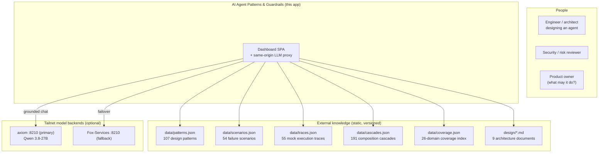

# Chapter 108: What the Application Is

**Part X — The Application**

## Overview

This book's catalog does not arrive as a folder of JSON files. It arrives as *AI Agent Patterns & Guardrails* — a 0-tab single-page dashboard of plain HTML, CSS and JavaScript, rendered at view time by a vendored Mermaid engine, with no build step, no bundler, no framework and no account anywhere in the stack.

The lifecycle it covers is the one this book describes from its first chapter: design patterns, then what can go wrong, then how to protect against it, then a live replay of the control flow, then the architecture, and finally a lab that turns your own agent idea into a guardrail design with a mock run. The whole thing is served by `serve.py`, 897 lines of standard-library Python that also doubles as a same-origin relay to an optional model running on your own network.

It is a reference you can interrogate rather than a shelf you can only read: filter, sort, replay, compose, compare, and take the result out as Markdown, JSON, CSV or a print-friendly page.

## Why It Matters

A catalog earns its keep when it can be asked questions. The application is organized around the four questions every architect brings to a new agent — *what do I need to build?*, *what am I missing?*, *how far does failure spread?*, and *what do I do, in what order?* — and each answer comes back as an artifact: a filtered pattern set, a ranked gap backlog, a cascade with its blast radius, a readiness score, an ADR you can hand to a reviewer.

The flagship example is the proof. A \$50,000 card charge enters the Guardrail Lab and is stopped by five independent layers — context, authority, runtime policy, human process, infrastructure — each one assuming the layers above it have already failed. The replay reports the charge denied at the policy gateway, contained in 2.8 seconds with \$0 moved, while a legitimate \$3,850 order passes through the same five.

The output is reproducible. The lab's analysis comes from a deterministic rule engine running in your browser rather than from a model, so the same agent idea produces the same design tomorrow — which is what makes it discussable in a review.

And it runs where it is needed: after a single visit the service worker holds the whole shell, so a LAN-only or air-gapped host keeps working with the cable unplugged.

## How It Works

1. `index.html` loads the shell script first. The shell owns the tab switcher, the theme, the data load, the Mermaid queue and the zoom viewer, and exposes two registries — `tabLoaders` and `PANE_INIT` — that every tab module fills with its own `init*()`.
2. First paint is phased rather than total: patterns, scenarios, traces and coverage are awaited before the count badges appear, while `cascades.json` — the largest dataset — loads in parallel and is awaited only by the panes that actually need it.
3. A tab builds on first visit behind a skeleton and stays built afterwards. `switchTab` runs a pending pane immediately instead of waiting its turn in the idle queue, so a slow pane is never blank.
4. Every diagram enters one queue. The vendored Mermaid is loaded once, initialised with `securityLevel: 'strict'`, and run node by node — sequential, because Mermaid measures labels in shared global state and concurrent renders would race each other — with a CDN copy used only if the vendored file is missing.
5. Opening Fox-Architect posts to `/api/llm/chat` on the page's own origin; `serve.py` walks its backend list in failover order and relays the reply as it arrives. With no backend online it answers with a payload the interface understands, and the chat falls back to a deterministic catalog answer instead of an error.
6. Everything you build is kept in `localStorage` on this origin, and leaves only when you export it — as JSON, Markdown, CSV or a print page.

## Components

| Tab | What it does |
|---|---|
| Overview | Landing page and architect dashboard: catalog totals, spotlights, a deterministic "Next:" suggestion, the pinned working set, and the report export row. |
| Fox-Architect | Grounded chat with a local model through the server-side proxy: streaming, citations, tables and Mermaid in answers, plus a deterministic offline fallback. |
| Patterns | 107 design patterns across 9 categories, each with failure modes, protections, related patterns and a control-flow diagram; filter by category, domain or diagram. |
| Scenarios | 54 failure scenarios across 26 domains — 18 critical, 27 high, 9 medium — each opening onto its attack chain, protection table, detection signals and response. |
| Cascades | 191 composition cascades in four classes, with propagation paths, amplifiers, blast radius and mitigation columns, plus a simulator and a ranked mitigation backlog. |
| Coverage | Gap view: heatmap per domain, a scenario-budget chart (7 of 26 meet it), ranked gap cards and an exportable authoring backlog. |
| Deployment Plan | Four-step intake, readiness scorecard, recommended stack, autonomy and rollout dial, residual-risk register, and an ADR generator with validated citations. |
| Blueprints | Reference-architecture builder with Mermaid export, deterministic warnings, a cost/latency/risk estimator, a per-blueprint threat model and baseline compare. |
| Live View | 55 filterable mock execution traces, replayed on the control-flow diagram with step tracker, gauges and streaming event log. |
| Design & Architecture | 12 design documents rendered live with their Mermaid diagrams, a scroll-spy outline, a source toggle and a zoom viewer. |
| Guardrail Lab | Any agent idea analyzed into a full guardrail design with a mock run, saved to a collection in `localStorage` and exportable as JSON. |
| Discovery Lab | Deterministic ideation of novel scenarios: candidates compete, winners are kept, the rest are forgotten. Winners are drafts only, never auto-added. |
| Battle Bench | The catalog testing itself: all 54 failure scenarios run as test cases against a configuration, through deterministic simulation, trace replay or the live model — graded by an oracle, attacked by an adversary (chapter 114). |

## System Context

**Definition 1 (Interrogable catalog).** A catalog is *interrogable* iff every record answers queries (filter, sort, replay, compose, compare) and every answer is an exportable artifact naming its source records — the application is a question-answering machine over static versioned data, not a document with a search box.

**Theorem 1 (Determinism enables review).** Because analysis runs in a deterministic in-browser rule engine (not a model), the same agent idea produces the same guardrail design on every machine, every time — which is exactly what makes the design reviewable: reviewers debate a reproducible artifact, not a sampled opinion.

*Proof.* The lab's analyzer is a pure function of (agent idea, catalog version): same inputs, same outputs, on any host — no model call, no temperature, no drift. Two reviewers running the same idea get the same design, the same rule set, the same mock run. Disagreements are therefore about the inputs (the idea, the catalog) rather than the run — which is what makes them resolvable in a review instead of re-rollable. The flagship replay demonstrates it: the \$50,000 charge denied at the policy gateway in 2.8 seconds with \$0 moved, the legitimate \$3,850 order passing through the same five layers — deterministic, reproducible, citable. Models accelerate (Fox-Architect drafts, the bench's live adapter probes); determinism decides. When both backends are down, the chat falls back to catalog answers and the bench to deterministic adapters — the application degrades to certainty, never to silence. ∎

## Risks and Limitations

- The catalog is deliberately unfinished: 54 scenarios across 26 domains, and only 7 of the 26 meet the two-per-domain budget the Coverage tab charts. The gap ships as an exportable backlog rather than being papered over.
- The blueprint exposure index measures matched threat *surface* from the catalog, not measured risk — compare like-for-like designs rather than index numbers against feelings.
- Fox-Architect grounds itself by deterministic retrieval over the catalog, not by fine-tuning: it names the record it used, and reading that record is still your job.
- Cost, latency and benefit figures in the estimator are stated assumptions for comparison, not benchmarks on your infrastructure.
- There is no build step, so nothing stops a mistake before runtime the way a type checker would; the substitute is the gate — lint, data-integrity tests, and a headless smoke test that boots the server and walks all 0 tabs.
- It designs enforcement, it does not enforce. No part of this application sits between your agent and the world: what it produces is a design, a rule set and an ADR that your own runtime still has to implement.

## Safeguards

1. Every recommendation carries its source: cascade rules cite the cascade they break, guardrail configs name the layer they are enforced at, and the ADR generator validates its citations against the catalog before you see them.
2. The lab's analysis is a rule engine, so it is auditable line by line and identical on every machine.
3. Data integrity is tested, not trusted: `npm test` enforces id uniqueness, full referential integrity and a required/unexpected-key schema guard — the check that caught the historical `proteations` typo — plus coverage freshness and the offline precache list.
4. A model is an accelerator, never a dependency: only the chat and the bench's live adapter call one, and both degrade without it — the chat to a deterministic catalog answer, the bench to its deterministic adapters — when both backends are down.
5. Rendered text is treated as data: user content is escaped before it reaches the DOM, and Mermaid runs in strict mode.

## At a Glance

| Field | Value |
|---|---|
| Form | Static single-page app; no build step, no account |
| Tabs | 0 tabs over one shell and 32 modules |
| Catalog | 107 patterns · 9 categories · 207 failure modes · 289 protections |
| Evidence | 54 scenarios · 191 cascades · 55 traces · 26 domains |
| Diagrams | Vendored Mermaid in one queue; CDN only as a fallback |
| Server | `serve.py` — static host plus same-origin model proxy |
| Offline | Service worker precaches the shell (55 entries) |
| Persistence | `localStorage`; exports are user-initiated |
| Model | Optional; local backend first, deterministic fallback |
| Gate | ESLint · node:test · headless smoke · CI |

## Key Takeaways

- The catalog is an application, not a document: 107 patterns, 54 scenarios and 191 cascades that you filter, replay and export instead of merely indexing.
- Its unit of output is a reviewable artifact — a pattern set, a backlog, a rule set, a scorecard, an ADR — and each one names the record behind it.
- The deterministic parts are deterministic on purpose, so a design review reproduces instead of drifting.
- Offline is a first-class state: one visit, then no network.
- What it makes is a design your runtime still has to implement.

## References

- `README.md` — run instructions, the thirteen tabs, testing and performance, and the scope caveats quoted above.
- `design/01-system-context.md` — context and container diagrams, trust boundaries, deployment.
- `design/07-architect-analysis.md` — the four questions and the value map this chapter is organized around.
- `index.html` and `js/app.js` — the shell, the tab registry and the panes themselves.
- `serve.py` — the static host and the same-origin model proxy.
- `sw.js` — the offline shell and its precache list.

## Council deliberation

- **Evaluation methodologist:** The application is the catalog made interrogable rather than merely readable: a single-page dashboard of plain markup, style and script served by one small standard-library server, rendering diagrams at view time with a vendored engine and no build step or account. Its lifecycle mirrors the book, moving from patterns through failures and protections into live replay and lab-generated guardrail designs. What matters to me is reproducibility of output, since deterministic in-browser analysis plus exportable artifacts means a review discusses the same design tomorrow that it approved today.
- **Safety researcher:** I read this chapter as applying the book to its own tool: deterministic analysis instead of model judgment, a gate of lint and integrity tests instead of a build-time checker, a same-origin proxy instead of third-party calls, and a cache instead of a network dependency. The flagship card-charge replay shows layered denial with containment while legitimate orders pass, which demonstrates the defense-in-depth posture the patterns preach. Nothing here enforces on your behalf; it produces designs your runtime must still implement.

## Council reading

- **Red team:** Fourteen tabs share one origin and one localStorage, so a stored-XSS in any catalog record would ride everywhere — audit the escHtml render boundaries, not the tab count.
- **Blue team:** No account, no bundler, no third-party script except an optional Mermaid CDN fallback: the threat model shrinks to the same-origin proxy and the files on disk.
- **Operator:** Serve it yourself with serve.py and it degrades to the deterministic fallback with no model; the app is useful before any backend answers.

## Conclusion

Read the rest of this book through it. Every diagram, count and failure mode in the pattern chapters is one of this application's screens, and Part X is what happens when you take the catalog's own advice and apply it to the tool that publishes the catalog: deterministic where it can be, gated where it cannot, and inside your network either way.

---
