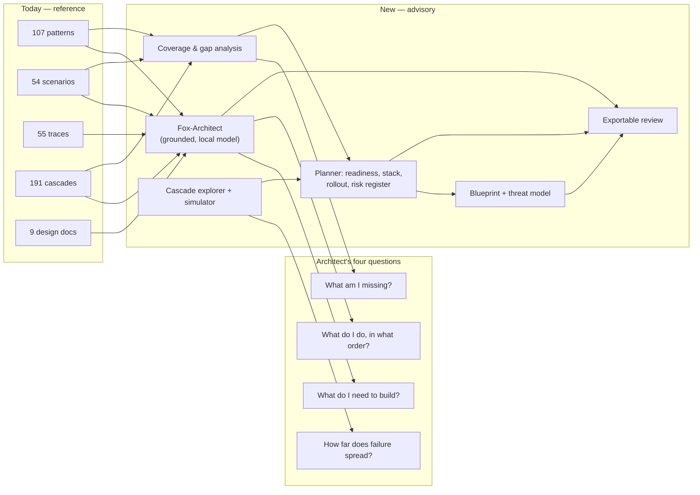

# Chapter 109: Supporting the Agentic Workflow

**Part X — The Application**

## Overview

The loop this book describes has two halves. One is the runtime that executes it — context assembled, model proposes, gateway disposes, every iteration lands in an audit trail. The other is the design work that decides what that runtime should be in the first place.

This application is about the second half. It does not run your agent; it carries the workflow that happens before runs, between runs and after runs — choosing patterns, writing the failure mode before the feature, deciding how much autonomy to grant, rehearsing the control flow, and producing the artifacts a review can approve.

Its spine is the catalog's four questions: *what do I need to build?*, *what am I missing?*, *how far does failure spread?*, and *what do I do, in what order?* Each one is answered by a tab, and each answer leaves something behind.

## Why It Matters

Design work fails in a team when it stays verbal. "We should add a spend guard" is an opinion; a rule set with a per-transaction cap, a rolling window, a vendor allowlist and velocity detection — citing the cascade it breaks — is a design someone can implement and someone else can review.

Keeping the evidence next to the advice is what makes that review possible: every proposal names the records behind it, so the argument happens about the catalog rather than about prose.

It also compresses the loop. One session can go from a one-line agent idea to a threat model, a rollout plan and an exportable report, with a replayed control flow to show the team what failure looks like before it looks like that.

## How It Works

1. Frame the system on Overview: planner readiness, blueprint coverage, the state of the chat and the rule lab, a deterministic *Next:* suggestion, and the working set you have pinned.
2. Choose the vocabulary in Patterns — 107 designs across 9 categories, filtered by domain or by whether they carry a diagram or documented failures.
3. Test the threats in Scenarios: 54 recorded failures across 26 domains, each with its attack chain, protection table, detection signals and incident response.
4. Trace the spread in Cascades — 191 composition cascades in four classes, with propagation paths, blast radius, a simulator and a leverage-ranked mitigation backlog.
5. Find the gaps in Coverage: the heatmap, the two-per-domain budget chart (7 of 26 meet it today) and the exportable authoring backlog.
6. Compose in Blueprints: patterns into a pipeline with a control overlay, Mermaid export, a cost/latency/risk estimator, and a threat model scored against the catalog ceiling.
7. Bound it in the Guardrail Lab: the idea is analyzed into a full design — risk score, advice, tiered proposals, an enforcement diagram, a reference control set, cascade-aware rules and a mock run — then saved to a collection.
8. Plan the rollout in Deployment Plan: intake, readiness scorecard, recommended stack, autonomy dial from shadow to autonomous, residual-risk register, then an ADR whose citations are validated against the catalog.
9. Rehearse in Live View: 55 execution traces, filterable and replayable step by step on the control-flow diagram, with budget, cost and guardrail counters advancing beside them.
10. Test the defenses in Battle Bench: every one of the 54 scenarios becomes a test case against a configuration — simulated deterministically, replayed from the 55 traces, or answered by the live model — graded by an oracle, attacked by an adversary that names the load-bearing control, and saved for comparison across time.
11. Take it out of the app from the Overview export row: the whole architect report as Markdown, JSON or a print-friendly page.

## Components

| Workflow stage | Tab | Artifact produced |
|---|---|---|
| Frame the system | Overview | Dashboard state, pinned working set, "Next:" suggestion |
| Choose the vocabulary | Patterns | Filtered pattern set with failure modes and protections |
| Test the threats | Scenarios | Attack chain, protection table, detection signals |
| Trace the spread | Cascades | Propagation path, blast radius, simulator run, backlog |
| Find the gaps | Coverage | Gap cards and an exportable authoring backlog |
| Compose the design | Blueprints | Architecture, estimator, threat model vs. ceiling |
| Bound it | Guardrail Lab | Rule set citing cascades, mock run, saved collection |
| Plan the rollout | Deployment Plan | Scorecard, stack, autonomy dial, risk register, ADR |
| Rehearse | Live View | Replayed trace with step tracker, gauges and event log |
| Test the defenses | Battle Bench | Pass/fail per scenario against a configuration, adversary findings, saved runs |
| Hand it over | Overview export | Architect report as Markdown, JSON or print page |

## From Catalog to Advisory System

**Definition 1 (Workflow-complete design).** A design session is *workflow-complete* iff it traverses frame → choose → test → trace → gap → compose → bound → plan → rehearse → battle-test → export, leaving the artifact each stage produces — and any skipped stage is recorded as a gap, not silently passed.

**Theorem 1 (Checklists beat memory).** A workflow that records unchecked stages as findings cannot silently skip threat modeling, gap analysis, or bench testing: the export carries the checklist state, and review reads the gaps before the design.

*Proof.* Each stage produces an artifact or an explicit gap marker — no third state. The export bundle includes both, so a reviewer sees what was tested (traces replayed, bench runs saved) alongside what was skipped (unrun presets, unfiled ADRs). Skipping leaves evidence of skipping, which is the opposite of silent: the five stages become a checklist precisely because unchecked boxes are visible. Treat design as a workflow with stages and artifacts; write the failure mode before the feature; attach the record to the recommendation; rehearse before shipping; test before handing over; export before review — and the handover is boring, which is the highest compliment a design review can pay itself. ∎

## Risks and Limitations

- Design-time only. Nothing here is runtime enforcement — the gateway you diagram in the lab still has to be built and deployed by you.
- Discovery Lab results are drafts. Winners are kept and the rest forgotten by design, but they are never auto-added to the catalog: a novel scenario stays an idea until a human reviews it.
- Coverage is thin in places: 7 of 26 domains meet the scenario budget, and the Coverage tab says which ones.
- Scores are starting points. A readiness score or an exposure index opens a conversation; neither certifies anything, and neither measures real-world risk.
- Estimates stay estimates: cost and latency figures come from stated assumptions, not from benchmarks on your stack.

## Safeguards

1. Citations are validated, not decorative: the ADR generator checks its references against the catalog, and each cascade rule names the cascade it breaks.
2. Every stage is inspectable in place — the same records drive the filter, the diagram, the rule and the export, so they cannot quietly disagree with each other.
3. A seeded example ships with the lab, so the whole flow is visible on first load before you put your own idea into it.
4. The mock run is replayable — play, step, back and reset over the same trace — so a review can stop at the exact step where it disagrees.
5. Everything leaves the app explicitly, through export, copy or print, and stays in your browser until it does.

## At a Glance

| Field | Value |
|---|---|
| Input | An agent idea, in plain language |
| Questions | Build? missing? spread? in what order? |
| Stages | frame → choose → test → trace → gap → compose → bound → plan → rehearse → battle-test → export |
| Artifacts | pattern set, gap backlog, rule set, architecture, scorecard, ADR, bench report, report |
| Evidence | every artifact names the catalog record behind it |
| Rehearsal | 55 traces, step-controllable, on the control-flow diagram |
| Determinism | rule engine in the browser; model optional |
| Flagship | \$50k card: five layers, denied in 2.8s, \$0 moved |

## Key Takeaways

- Treat design as a workflow with stages and artifacts, not as a document you start writing.
- Write the failure mode before the feature — the Scenarios and Cascades tabs are the inputs to the design, not an appendix to it.
- Attach the record to the recommendation: a citation that validates is worth more than a paragraph that persuades.
- Rehearse the control flow before you ship it; the replay is cheaper than the incident.
- Test the defenses before you hand over: a configuration nobody ran the scenarios against is a hypothesis, and the bench keeps the receipt.
- Export before you review, so the artifact survives outside the tool.

## References

- `README.md` — the thirteen tabs and what each one produces.
- `design/07-architect-analysis.md` — the four questions, the value map, and the deployment lifecycle the planner encodes.
- `design/04-guardrails.md` — the flagship's enforcement sequence and charge lifecycle.
- `design/03-control-flow.md` — the canonical agent loop and the replay state machine.
- `data/scenarios.json`, `data/cascades.json`, `data/traces.json` — the records every artifact cites.

## Council deliberation

- **Continual-learning researcher:** This chapter covers the design half of the agentic loop: the work before, between and after runs where teams choose patterns, write failure modes first, set autonomy and rehearse control flow. I value its spine of four architect questions, each answered by a working surface that leaves an artifact behind, from filtered pattern sets through gap backlogs and blast-radius cascades to readiness scorecards and reviewable decision records. Keeping evidence beside advice is what turns opinions about guards into designs someone can implement and someone else can challenge.
- **Memory-systems researcher:** The workflow framing resonates because design memory persists: plans, blueprints, collections and preferences live locally and leave only on export, so iteration accumulates rather than evaporates. Moving from a one-line agent idea to threat model, rollout plan and replayed failure in one session compresses the design loop without surrendering provenance, since every proposal names its records. That continuity lets teams revisit why a guard was chosen long after the meeting that chose it.

## Council reading

- **Red team:** A rail that always names a Next step trains click-through — verify the suggestion reads live tool state (planner, blueprint, Fox-Architect, guardrail, mitigation, discovery) before you trust it on autopilot.
- **Blue team:** Every stage links to the tool that owns it and every artifact exports (Markdown, JSON, CSV, ADR): nothing in the workflow is a dead-end claim.
- **Operator:** Start at the Overview Next box, end with the report export; the five stages are a checklist, and an unchecked stage is the finding.

## Conclusion

A design workflow is only as good as what it hands over. The test of this one is whether a colleague can take the export — the pattern set, the rule set, the scorecard and the ADR — and build the thing without asking you what you meant. Every stage above exists to make that hand-over boring, and boring is the highest compliment a design review can pay itself.

---
