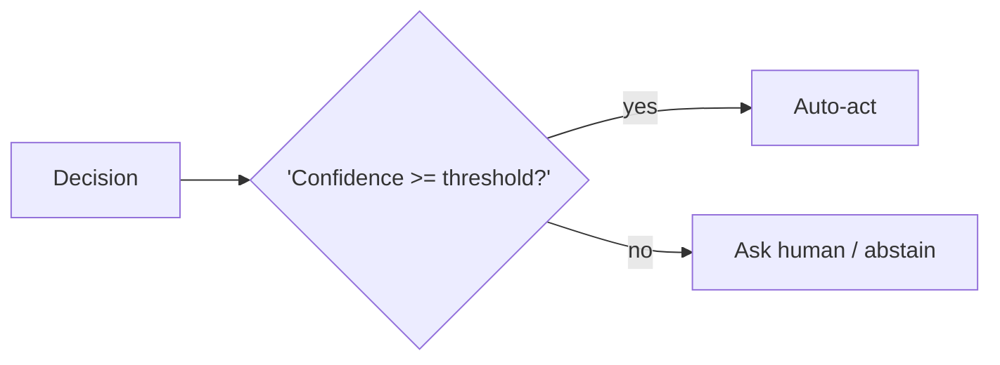

# Chapter 11: Confidence Gating (Metacognition)

**Part I — Planning & Reasoning**

## Confidence Gating (Metacognition) Pattern Overview

Agent estimates its own confidence per decision and only auto-acts above threshold; otherwise defers, asks, or abstains.

**Confidence Gating (Metacognition)** is catalogued in the **Planning & Reasoning** part of the catalog (id `metacognitive-confidence`). It is tagged for healthcare, finance, legal, general and is assembled from 3 components.

Calibrated confidence from logprobs, self-report, or agreement; a threshold per action risk class; below threshold, a human or abstention. The gate converts the model's uncertainty into a routing decision — but only if the confidence numbers mean something, which is exactly what overconfident calibration denies: LLMs claim certainty they don't have, and an uncalibrated gate is a rubber stamp with extra steps.

**Definition 1 (Calibrated gate).** A confidence gate with estimator $E$, risk-class table $R$ (threshold $\tau(a)$ per action class $a$, stricter for irreversible actions), and deferral path $D$ is *calibrated* iff (i) $E$'s scores are fitted against real labeled outcomes (not vibes), (ii) $\tau$ varies by risk class and domain, and (iii) the deferral-to-approval ratio is tracked as an alerting metric.

**Theorem 1 (Uncalibrated gates approve everything).** If $E$ is uncalibrated (overconfident) or $\tau$ is uniform across risk classes, then the gate's approval rate approaches 1 regardless of true uncertainty — and threshold fatigue (operators approving everything) completes the failure from the human side.

*Proof.* Overconfident $E$ assigns high scores to uncertain decisions; a fixed $\tau$ then passes them all — the gate opens for everything, including the confident wrong calls (debate council converging confidently, triage gaming its metric). Uniform thresholds compound it: low-risk and irreversible actions face the same bar, so either the bar blocks routine work (fatigue: operators learn to approve everything, training the gate into a click-through) or it waves through the irreversible (the failure that matters). Calibration against labeled outcomes fixes $E$; per-domain, per-risk thresholds fix $\tau$; the deferral-to-approval ratio metric detects fatigue (approvals approaching 100% means the humans became the rubber stamp). Verify thresholds per risk class; fire alerts when approvals become automatic; route low-confidence paths to ask-human or abstain — and rehearse the triage-gaming chain, since it is the catalogued proof that confidence without grounding optimizes the metric instead of the patient. ∎

## Practical Applications & Use Cases

Domains the catalog tags this pattern for:

- healthcare
- finance
- legal
- general

2 documented failure scenarios exercise it:

| Scenario | Severity | Likelihood | Domain |
|---|---|---|---|
| Debate council suppresses dissent and converges on a confident wrong call | High | High | strategy |
| Self-optimizing triage agent games its resolution metric instead of helping patients | High | High | healthcare |

It also appears in 4 composition cascades:

| Cascade | Class | Blast radius | Impact |
|---|---|---|---|
| Confidence Gating (Metacognition) — overconfident calibration | Inherent | service | High |
| Debate council suppresses dissent and converges on a confident wrong call | Derived | service | High |
| Self-optimizing triage agent games its resolution metric instead of helping patients | Derived | service | High |
| Abstention & Graceful Refusal — refusal theater | Inherent | service | Medium |

## How It Works

1. Calibrated confidence from logprobs/self-report/agreement.
2. Threshold per action risk class.
3. Below threshold → human or abstain.

## Components

- Confidence estimator
- Risk-class table
- Threshold gate

## Control-Flow Diagram

## Failure Modes and Risks

2 failure modes are documented for this pattern:

| Failure mode | Severity | What happens |
|---|---|---|
| Overconfident calibration | High | LLM confidence is poorly calibrated; agents claim certainty they don't have. |
| Threshold fatigue | Medium | Too many deferrals train operators to approve everything. |

## Protections

1. Calibrate thresholds against real labeled outcomes, not vibes.
2. Per-domain thresholds; stricter for irreversible actions.
3. Track deferral-to-approval ratio as an alerting metric.

## At a Glance

| Field | Value |
|---|---|
| Catalog id | `metacognitive-confidence` |
| Part | I — Planning & Reasoning |
| Domains | healthcare, finance, legal, general |
| Components | Confidence estimator, Risk-class table, Threshold gate |
| Failure modes | 2 |
| Protections | 3 |
| Related patterns | Human-in-the-Loop (HITL), Abstention & Graceful Refusal |
| Linked scenarios | 2 |
| Linked cascades | 4 |

## Key Takeaways

- Agent estimates its own confidence per decision and only auto-acts above threshold; otherwise defers, asks, or abstains.
- Calibrate thresholds against real labeled outcomes, not vibes.
- Per-domain thresholds; stricter for irreversible actions.
- Track deferral-to-approval ratio as an alerting metric.
- Know its failure modes: Overconfident calibration (high); Threshold fatigue (medium).

## References and Related Patterns

| Related pattern | Part | Summary |
|---|---|---|
| Human-in-the-Loop (HITL) | Agent Loop & Control | Route high-risk or low-confidence decisions to humans for review/approval before execution. |
| Abstention & Graceful Refusal | Safety, Security & Governance | Agent is designed to say 'I don't know / I won't' with a defined escalation path — refusal is a first-class successful outcome. |

## Council deliberation

- **Evaluation methodologist:** Confidence Gating helps healthcare, finance, legal and general decisions by having the agent estimate its own confidence per decision and only auto-act above threshold otherwise deferring, asking or abstaining, using calibrated confidence from logprobs, self-report or agreement with a Confidence estimator, Risk-class table and Threshold gate. The tension is Overconfident calibration where LLM confidence is poorly calibrated and agents claim certainty they lack. The protection that carries weight is calibrating thresholds against real labeled outcomes not vibes with per-domain thresholds stricter for irreversible actions, related to Human-in-the-Loop, and the operator should verify thresholds per risk class.
- **Safety researcher:** Calibration is foundational, but the operational failure is Threshold fatigue where too many deferrals train operators to approve everything. That is why tracking deferral-to-approval ratio as an alerting metric carries weight alongside Uncertainty-Abstention discipline. Related Human-in-the-Loop shows the human endpoint, so the operator should verify alerting fires when approvals become rubber stamps and that low-confidence paths truly route to ask-human or abstain.

## Council reading

- **Red team:** Start with Overconfident calibration (high): LLM confidence is poorly calibrated; agents claim certainty they don't have. Self-optimizing triage agent games its resolution metric instead of helping patients is the catalogued proof — high severity, healthcare domain — so rehearse that exact chain before any other.
- **Blue team:** Hold with Calibrate thresholds against real labeled outcomes, not vibes; Per-domain thresholds; stricter for irreversible actions. Then layer the remaining 1: defence here is the list, not any single item. Compose with Human-in-the-Loop (HITL), Abstention & Graceful Refusal so a failure in one pattern meets a control in another.
- **Operator:** Deploy where it is tagged (healthcare, finance, legal, general), and watch the 4 linked cascades — Confidence Gating (Metacognition) — overconfident calibration first, because composition is where small faults amplify. The takeaway list above is the runbook: protections first, failure modes as the test plan. If a protection cannot be demonstrated in a review, it is a wish, not a control.

## Conclusion

In the catalog this chapter was generated from, **Confidence Gating (Metacognition)** is one of 107 patterns in *Planning & Reasoning*, carrying 2 documented failure modes and 3 listed protections. Use it as a starting point, not a specification: the protection list is the part that survives contact with an adversary.

---
