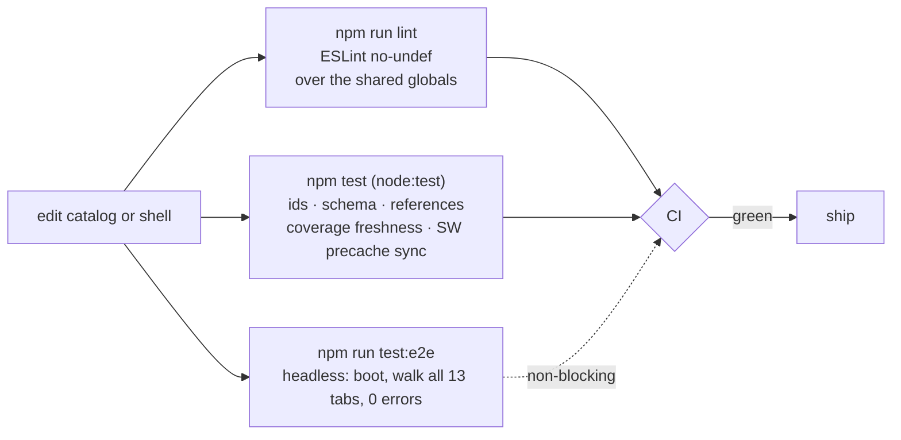
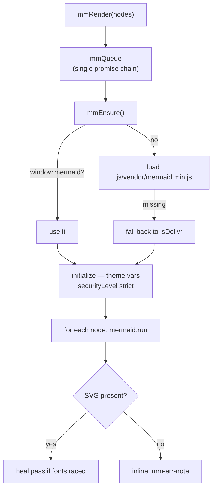

# Chapter 110: Design Principles

**Part X — The Application**

## Overview

The catalog's thesis is that safety lives in deterministic enforcement outside the model. The application applies that thesis to itself: it is not a toolchain project, it is a short list of constraints chosen so that what you read on screen is what the files on disk say.

Seven principles, each one visible in a file — a rule engine instead of a model, a gate instead of a build step, plain JSON instead of a database, one namespace instead of a bundle, one diagram queue instead of concurrent renders, degradation instead of failure, and a printed budget instead of a claim.

## Why It Matters

A tool that tells you where your controls live has to be inspectable itself: you should be able to open the file it named and find the line.

A reference that runs on a LAN, a tailnet or an air-gapped host cannot depend on a package registry, a font CDN, or a service that might be gone tomorrow.

And claims about speed and offline behaviour are worthless unless they are measured. A tool that prints its own numbers can be caught being wrong — which is exactly the point of printing them.

## How It Works

1. **Deterministic outside the model.** The Guardrail Lab's analysis is a rule engine running in the browser: signals times weights, mapped to a tier, matched to proposals. The chat is optional, and when it is unavailable the analysis does not change.
2. **No build step, but there is a gate.** Plain files that any editor can change, wrapped in `npm run lint` (ESLint `no-undef` over the shared globals), `npm test` (ids, schema, references, coverage freshness, precache sync) and a headless smoke test that boots the server and walks all 0 tabs.
3. **Plain, versioned JSON with no hidden defaults.** The datasets are diffable and exportable, and a missing field renders as absent rather than as a silently-chosen value.
4. **One global namespace with guarded edges.** `index.html` loads classic scripts — no modules, no bundler. Cross-module calls are checked with `typeof … === 'function'`, so any single module can fail to define itself without blanking the application.
5. **One queue for every diagram.** Mermaid measures text in shared global state, so renders are serialised behind one promise chain: vendored engine first, CDN only as a fallback, initialise once in strict mode, run node by node, heal if fonts raced, and write an inline note instead of throwing.
6. **Degrade, don't fail.** Phased boot, skeletons for panes that are still building, a pane that can jump the idle queue, a deterministic Fox-Architect fallback, and a worker that serves from cache when the network is gone.
7. **Make the wins visible, not claimed.** The Display panel prints a live budget from the sizes the worker recorded: first load about 1.37 MB compressed against 4.9 MB raw, and a repeat visit about 0.02 MB.

## Components

- **The shell** — `index.html` plus `js/app.js`: one namespace, two registries, and `typeof`-guarded edges between them.
- **The gate** — lint, the `node:test` suite, the headless smoke test, and CI wiring that makes lint and data integrity blocking.
- **The queue** — one promise chain around Mermaid, preserving each block's `data-src` so a re-render never feeds the engine its own generated CSS.
- **The worker** — `sw.js`, with a `VERSION`, a 55-entry precache list, network-first fetches and `/api/*` excluded.
- **The store** — plain JSON on disk, `localStorage` in the browser, exports on the way out.
- **The budget** — the Display panel, reading the worker's own size records instead of a hard-coded number.

## Guardrails for the App Itself

## One Diagram Queue

**Definition 1 (Self-describing tool).** A tool is *self-describing* iff every claim it makes about itself (speed, size, offline behavior, coverage) is readable at runtime from its own recorded measurements — budgets from the worker's size logs, freshness from the precache list, integrity from the test suite — never asserted in prose alone.

**Theorem 1 (Printable claims are checkable claims.** A printed measurement can be caught being wrong, which is exactly the point of printing it: the budget invites refutation, the gate invites failure, and the queue's sequential discipline is justified in the open rather than assumed.

*Proof.* Hard-coded numbers are unfalsifiable within the tool (no path from claim to measurement); worker-recorded budgets are falsifiable by construction (compare the printed number against a fresh load). The gate (lint, schema, smoke) fails loudly on drift: a typo'd global, an unexpected key, a broken tab all break the build instead of shipping silently. One namespace with guarded edges means a module can fail without blanking the app — degradation instead of failure, skeletons instead of blank panes, deterministic fallbacks instead of errors. Apply the pattern chapters' demand to the tool itself: deterministic enforcement outside the model (rule engine, not chat), gated changes (lint, tests, smoke), inspectable everything (open the file, find the line). ∎

## Risks and Limitations

- No bundler means no type checker: a mistake in a module surfaces when that module runs, not when you save. The gate narrows the window; it does not close it.
- One namespace means an accidental redefinition is possible. `no-undef` is what turns a typo into a failed lint instead of a runtime surprise.
- Sequential rendering is a correctness decision that costs perceived speed — a diagram-heavy pane fills in one figure at a time.
- The CSP keeps `'unsafe-inline'` for scripts and styles because the shell is inline-handler heavy and the print view writes its own `<style>`. That is a real widening of `script-src 'self'`, and the clearest concession the hardening makes.
- Saved work lives in `localStorage`, which belongs to the browser profile: a fresh profile starts empty, so export before you move machines.
- A precached shell is a stale shell until `VERSION` moves; the worker's activation step exists to keep that window short.

## Safeguards

1. `no-undef` runs over every `js/*.js`, with the shell's own top-level declarations declared as shared globals, so genuine typos fail and legitimate cross-file calls do not.
2. A schema guard on the data fails the test on an unexpected key — the check that caught the misspelled `proteations` field.
3. `VERSION` plus an activation step that deletes every cache that is not current, so a bumped shell cannot be served stale.
4. `data-src` on every diagram plus a heal pass: a re-render never feeds Mermaid its own CSS, and a font race cannot leave a half-drawn figure.
5. A deterministic fallback wherever a model could fail, so the tool still answers when the network or the backend does not.
6. The perf budget is read from the worker's recorded sizes at runtime — measured, not asserted.

## At a Glance

| Field | Value |
|---|---|
| Thesis | deterministic enforcement outside the model, applied to the tool itself |
| Build | none — plain files, no bundler, no framework |
| Gate | lint · node:test · headless smoke · CI |
| Data | plain versioned JSON; no hidden defaults |
| Namespace | one global namespace, `typeof`-guarded edges |
| Diagrams | vendored Mermaid, strict mode, one sequential queue |
| Failure policy | degrade and skeleton, never blank |
| Budget | first load ~1.37 MB (~4.9 MB raw); repeat ~0.02 MB |

## Key Takeaways

- The catalog's thesis — deterministic enforcement outside the model — is applied to the tool itself, not just to the agents it describes.
- A gate is not a build step: lint, tests and a smoke test catch what a compiler would, without producing a bundle.
- Serialising the diagram queue is a correctness requirement of the engine, and the fallback ladder keeps it offline-safe.
- Degradation is designed: skeletons, guards and deterministic fallbacks mean a failure narrows the app instead of blanking it.
- Print the measurement. If a performance or offline claim cannot be read off the running tool, it is marketing.

## References

- `design/08-runtime-offline.md` — the namespace, the boot phases, the queue, the worker and the gate.
- `design/06-threat-model.md` — the threat model these constraints are answers to.
- `README.md` — testing, offline behaviour and the published perf budget.
- `tools/gen_cascades.py` and `tools/gen_coverage.py` — the deterministic generators behind the derived datasets.

## Council deliberation

- **Safety researcher:** The principles chapter states the book thesis as self-discipline: safety in deterministic enforcement outside the model, expressed as a short list of constraints visible in files. A rule engine instead of a model for analysis, a gate instead of a build step, plain data instead of a database, one diagram queue instead of concurrent renders, degradation instead of failure: each removes a class of drift between what is read and what runs. I find the inspectability demand load-bearing, since a tool that names its controls must let you open the file and find the line.
- **Evaluation methodologist:** What persuades me is that claims are printed as measurements rather than asserted as virtues. Budgets for size and speed, offline behavior verified by visit-then-disconnect, LAN and air-gap operation without registries or remote services: each is catchable when wrong, which is exactly why printing them matters. Designing for degradation keeps the reference useful where networks and backends are absent, so the principles hold under the conditionsört they claim to serve rather than only in the demo.

## Council reading

- **Red team:** Deterministic rule engines have deterministic bypasses: read js/guardrail.js the way an attacker would, because the bypass, if any, is in the open and identical for everyone.
- **Blue team:** Enforcement lives outside the model — gates, caps, proxies, refusals — so audit code paths, not prompts; a prompt is advice, a gate is a fact.
- **Operator:** Apply the book's own test to every control you adopt: if it cannot be demonstrated in a review, it is a wish, not a control.

## Conclusion

Principles are only worth writing down if you can point at where they are enforced, and each one here points at a file: a rule engine, a test, a queue, a version string, a printed budget. Take the list to your own system — it costs nothing to be deterministic outside the model, and everything to leave that part to the model.

---
