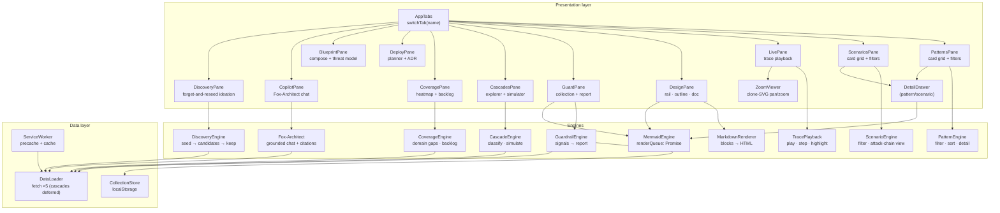
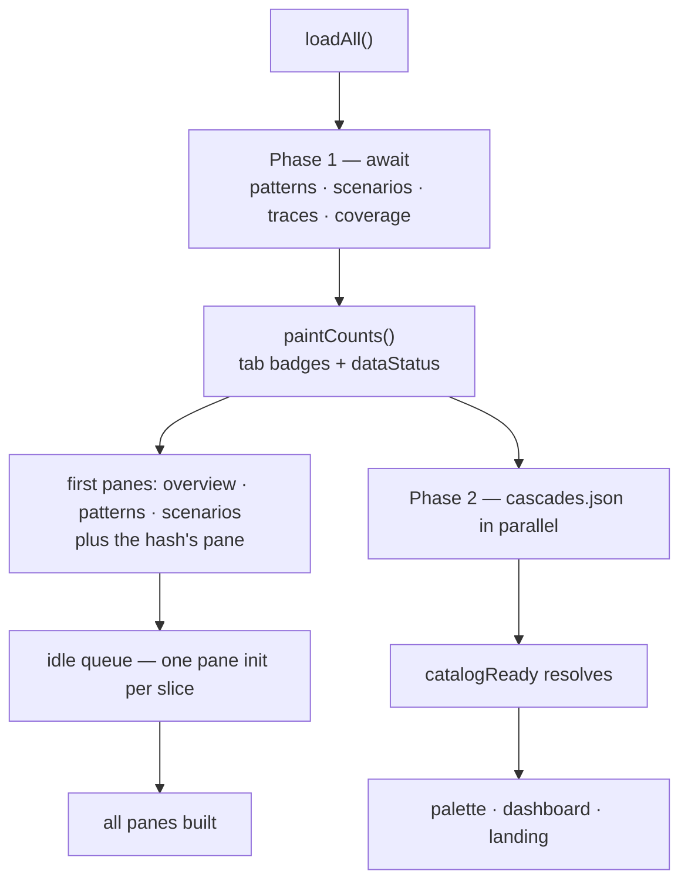

# Chapter 111: Architecture

**Part X — The Application**

## Overview

The deployed shape is static files plus one small server process: a delivery layer that serves and hardens those files, a shell that owns the tab switcher and its registries, 32 feature modules that register into it, five JSON datasets loaded in phases, 12 markdown documents fetched live, a service worker that caches the shell, and an optional same-origin model proxy.

Nothing is compiled, so the architecture you read in the source is the architecture that runs: no bundle to unwind, no generated code to trace back, and no build output that can drift away from the repository.

## Why It Matters

Knowing which layer a control lives in is how you change it safely. A header belongs to the delivery layer, a rule to an engine, a record to the data layer and a cache to the worker — naming the layer is what stops a fix in one place becoming a bug in another.

It also explains the deployment story. The image copies exactly what the server serves, the compose file adds privilege restrictions rather than behaviour, and any other static host can serve the same files, because nothing has to be generated first.

## How It Works

1. **Delivery.** `serve.py` serves the files with gzip, conditional revalidation for a cheap 304, immutable caching for the vendored engine, and the same header block on every single response.
2. **Shell.** `index.html` and `js/app.js` own the tab switcher, theme, data load, Mermaid queue, zoom viewer and the registries every module plugs into.
3. **Feature modules.** 32 plain scripts: one per pane — overview, catalog, scenarios, cascades, coverage, deployment planner, blueprints, Fox-Architect, live view, design, guardrail lab, discovery and battle bench — plus the shared playback widget, LLM client, grounding context, report, dashboard, help, command palette and shortcuts.
4. **Data.** Five JSON datasets. Phase one (patterns, scenarios, traces, coverage) is awaited for first paint; `cascades.json` streams in beside it and is awaited only by the panes that read it.
5. **Documents.** `design/*.md` — 12 of them — are fetched live and rendered, which is the one reason a server is needed at all beyond hosting the optional model proxy.
6. **Offline.** `sw.js` precaches 55 entries, answers same-origin GETs network-first with a cache fallback, and never touches `/api/*`.
7. **Model.** `/api/llm/*` relays to a configured backend in failover order with watchdog timeouts, streaming the reply back chunked so the interface can render it as it arrives.

## Components

| Layer | Files | Responsibility |
|---|---|---|
| Delivery | `serve.py` | Static host: gzip, ETag and Last-Modified revalidation, immutable vendor cache, security headers, CSP. |
| Shell | `index.html` · `js/app.js` | Tab switcher, theme, data load, Mermaid queue, zoom viewer, `tabLoaders` and `PANE_INIT` registries. |
| Feature modules | `js/*.js` — 32 files | One per pane — overview, catalog, scenarios, cascades, coverage, planner, blueprints, Fox-Architect, live view, design, guardrail lab, discovery, battle bench — plus the shared player, LLM client, context, report, dashboard, help, palette and shortcuts. |
| Data | `data/*.json` — 5 datasets | Patterns, scenarios, cascades, traces and coverage; plain, versioned, diffable. |
| Documents | `design/*.md` — 12 docs | Architecture documents fetched at view time and rendered with live Mermaid. |
| Offline | `sw.js` | 55 precache entries; network-first with cache fallback; `/api/*` exempt. |
| Model | `serve.py` → `/api/llm/*` | Same-origin proxy: failover list, watchdogs, chunked relay, deterministic fallback. |

## Component Diagram

## Phased Boot

**Definition 1 (Layer-addressable change).** A change is *layer-addressable* iff its file, layer, and blast radius are all nameable before editing: headers in delivery, rules in engines, records in data, caches in the worker — so a fix in one layer cannot silently become a bug in another.

**Theorem 1 (No generated drift).** With nothing compiled, the architecture read in source *is* the architecture that runs: no bundle to unwind, no generated output to drift, and deployment modes (laptop, container, static host) differ in privilege, never in behavior.

*Proof.* Generated artifacts introduce a drift surface: source changes without rebuilding, stale builds served as current, behavior differing from review. With zero generated files, that surface does not exist — what you read is what runs, on every host, because every host serves the same files. The container image copies exactly what the server serves; the compose file adds privilege restrictions rather than behavior; any static host serves the same files identically. Phased boot, typeof-guarded edges, and the worker's precache discipline are all visible in source and verifiable at runtime — the deployment story is inspectable precisely because there is nothing to generate. ∎

## Risks and Limitations

- One small threaded server is sized for a team, not for the internet: there is no authentication anywhere in it, and it does not pretend otherwise.
- The Design pane needs an HTTP origin, because `file://` blocks its fetch — so even a bare static host is required for that pane, however the rest of the app is deployed.
- State lives in each browser's `localStorage` rather than in a database: no multi-user sync, and a fresh profile starts from nothing.
- Modules share one global namespace, so an accidental redefinition is possible; the lint configuration is the guard (chapter 110).
- The corpus is loaded rather than paged: five datasets and 12 documents sit in memory together, which is right at catalog scale and a limit well before it.

## Safeguards

1. One header block for every response — `nosniff`, `X-Frame-Options: DENY`, `Referrer-Policy: no-referrer` and the content security policy — so a file added next month is hardened before anyone asks.
2. Caching that cannot go stale silently: vendored assets are immutable, everything else revalidates with `If-Modified-Since`, and the worker drops old caches whenever `VERSION` moves.
3. Blast radius inside the shell: a module that fails to register leaves a skeleton or a narrower pane, never a blank application, because every cross-module call is guarded.
4. `/api/*` is excluded from the cache, so a model answer or a diagnostic beacon can never be replayed out of it.
5. The image copies only what the server serves, and CI keeps the offline precache list in step with the files on disk.

## At a Glance

| Field | Value |
|---|---|
| Delivery | `serve.py` — gzip, 304 revalidation, immutable vendor |
| Shell | `index.html` + `js/app.js`, one global namespace |
| Modules | 32 scripts, one pane each, `typeof`-guarded |
| Data | 5 JSON datasets, phased load with cascades deferred |
| Documents | 12 `design/*.md`, fetched live |
| Offline | `sw.js`, 55 entries, network-first |
| Model | `/api/llm/*` — failover, watchdogs, chunked relay |
| Container | python:3.12-slim, non-root, read-only, about 42 MB |
| Health | urllib healthcheck on `/`, 3s interval, 1s timeout |

## Key Takeaways

- Seven layers, one process, zero generated files: the source is the deployment.
- The delivery layer is where the headers, the compression and the cache policy live — hardening a response is one block of code, not a per-file decision.
- Phased loading is an architecture decision, not an optimisation: first paint waits for what the first screen reads and nothing more.
- The model sits behind the server, never beside the browser, which is what keeps the application one origin.
- Deployment modes differ in privilege, not in behaviour — the same files are served by a laptop, a container or a static host.

## References

- `design/01-system-context.md` — context and container overview, trust boundaries, deployment.
- `design/02-uml.md` — the component diagram and the classes behind each pane.
- `design/03-control-flow.md` — boot phases, data flow and the render queue.
- `design/08-runtime-offline.md` — delivery, offline shell and the perf budget.
- `Dockerfile`, `docker-compose.yml`, `.env.example` — the container and its configuration.

## Council deliberation

- **Memory-systems researcher:** The architecture is static files plus one small server: a delivery layer with hardening headers and caching, a shell owning tab switching and registries, feature modules registering into it, phased datasets, live-fetched design documents, a service worker shell cache and an optional same-origin model relay. Nothing compiles, so the architecture read in source is the architecture that runs, with no bundle to unwind or generated output to drift. I like that layer naming guides change, since headers, rules, records and caches each live where a fix in one place cannot silently become a bug in another.
- **Safety researcher:** Layering is also a trust argument: deployment copies exactly what the server serves, privilege restrictions arrive via composition rather than behavior change, and any static host can serve the same files. Knowing which layer a control inhabits keeps modifications honest, and the absence of generated code removes an entire class of supply-chain surprise. The shape is deliberately small, which keeps the surface describable and therefore reviewable by people who did not write it.

## Council reading

- **Red team:** One Mermaid queue, one theme class, two registries: break the queue and every diagram lies at once — strict securityLevel plus data-src reseeding is the control that keeps renders honest.
- **Blue team:** Phased boot with skeletons and typeof-guarded cross-module calls mean a failed tab cannot take the shell; the app degrades pane by pane, never all at once.
- **Operator:** Load order is fixed in index.html and the boot check names every entry point it expects — after a deploy, the fresh banner tells you before your users do.

## Conclusion

Architecture is the set of decisions that are expensive to change later, and this one is deliberately small: static files, one process, one origin, one queue, one worker. Everything else — the thirteen panes, the engines, the lab, the bench — is replaceable detail built on top of it, which is the only kind of complexity a catalog tool should be allowed to carry.

---
