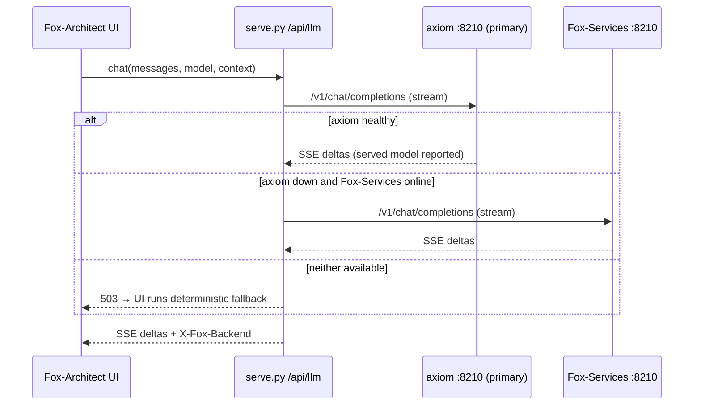

# Chapter 112: Privacy: Local Models and Data That Stay Put

**Part X — The Application**

## Overview

The privacy posture fits in one line from the README: *no data ever leaves your network for a third-party cloud*. It is enforced structurally rather than promised — the page can only reach its own origin, the model only reaches a backend you configured on your own network, and the things you build are kept in your browser.

That matters more in this domain than most. A tool that holds your agent's architecture, your spend thresholds, your incident scenarios and your threat model is exactly the kind of thing you do not want phoning home before you have shipped anything.

## Why It Matters

Agents touch money, personal data, health records and customer content; the design document you write for them is the map of where those things move. Publishing that map by using a design tool would be a leak on day one.

A local model keeps the questions inside the boundary. Fox-Architect is grounded in the catalog and answered by a model on your own network, so asking how your spend guard should work does not become somebody else's telemetry.

There is no account, no cloud store and no analytics vendor: there is no server-side copy of your work to breach, because there is no server-side copy.

## How It Works

1. The browser talks to itself first. Every `fetch` and `XMLHttpRequest` the page's scripts make is bound by `connect-src 'self'`, so the network client in the page cannot open a connection to any origin but the one that served it.
2. The proxy walks its backends in failover order. `/api/llm/chat` tries the primary backend on your tailnet first and the local one second (`LLM_PRIMARY` flips the order), with watchdogs of 5 seconds to connect, 60 to the first token, 45 of silence mid-answer and 600 in total.
3. The reply is relayed as it arrives, tagged with the backend that produced it. If neither backend answers, the proxy returns a normal response carrying `ok: false` and the reason, and the chat runs its deterministic catalog fallback instead of showing an error.
4. What you save stays in `localStorage` on this origin — patterns, scenarios, blueprints, collections and preferences — with no sync and no background upload. Exports happen only when you ask for one.
5. Diagnostics are small and server-side: the beacon accepts a short payload, truncates the message, kind, tab and user-agent fields before writing, logs at DEBUG to the server's own stderr, and is never served back to anyone.

## Components

| Path | Where it lives | Crosses the machine boundary? |
|---|---|---|
| Patterns, scenarios, cascades, traces, coverage | `data/*.json` on the same origin | No — fetched once, then from cache |
| Design documents and diagrams | `design/*.md`, rendered by the vendored engine | No — CDN only if the vendored file is missing |
| Collections, blueprints, plans, preferences | `localStorage` on this origin | No — browser-local until you export |
| Model prompts and answers | Browser → `/api/llm/*` → your backend | Only to the backend you configured on your network |
| Diagnostics beacon | `/api/diag` → server stderr, DEBUG level | To the same server; truncated before it is written |
| Perf counters and session state | Page memory | No — printed in the Display panel, not sent |
| Anything a third party could buy | Nowhere — no account, no cloud, no analytics | No |

## Where the Local Model Sits

**Definition 1 (Structural privacy).** A tool's privacy is *structural* iff the allowed destinations are enforced by mechanism — $connect\text{-}src$ pinning the page to its origin, the proxy knowing only configured backends, $localStorage$ scoped to the origin — rather than by policy text any update could silently widen.

**Theorem 1 (Topology, not promise).** Under structural privacy with a same-origin page, a configured-backend-only proxy, and browser-local storage, no catalog content, design artifact, or model prompt reaches a third party unless the operator repoints a backend URL — and repointing moves the boundary visibly, in a file, rather than silently.

*Proof.* The page cannot open third-party connections ($connect\text{-}src$ `'self'` binds every fetch the scripts make), so catalog and document data stays on the serving origin or its cache. The proxy's destination set is exactly the configured backends: prompts travel only to the tailnet or local address the operator chose, with watchdogs bounding even that path — pointing a URL at a public API moves traffic there, but the move is a visible configuration change, not a silent leak. Saved work never leaves except through explicit export (no sync, no upload, truncated server-side beacon), and model outage degrades to the deterministic fallback rather than to an external service. Privacy therefore reduces to three inspectable places — browser to origin, server to backend, browser to export — each readable in a file. Know them, and the leak surface is known. ∎

## Risks and Limitations

- On your network is not the same as zero transmission. Prompts do leave the browser for the backend you configured — point `AXIOM_LLM_URL` or `FOX_LLM_URL` at a public API and the traffic follows them, because the browser's security policy governs the page, not the server's egress.
- The proxy has no authentication and no secrets, by design; its own documentation says so. Anyone who can reach the port can use whatever backend you pointed it at, which is why the stated scope is a LAN, a tailnet or a CIDR rather than the open internet.
- `localStorage` is plain, per-browser storage: a fresh profile has none of your collections, and clearing site data clears them. Export before you switch machines.
- The diagnostics beacon still carries your user agent and client IP into the server's log — server-side only, DEBUG level, but it is a log.
- Offline is earned after one visit, so a genuinely air-gapped host has to be seeded once before it can run with the network out.

## Safeguards

1. The page's own reach is pinned by `connect-src 'self'`, `Referrer-Policy: no-referrer`, no third-party script beyond the documented Mermaid CDN fallback, and no analytics of any kind.
2. The service worker never caches `/api/*`, so model calls and diagnostics always go to the network rather than being frozen into a cache someone could read later.
3. Watchdogs bound a hung backend, and an upstream 5xx skips that backend for the next one in the failover list.
4. The beacon is truncated at the source — message to 300 characters, kind and tab to 20, user-agent to 120 — before anything is written.
5. No account and no cloud store means the only copies of your work are the one in your browser and whatever you exported.
6. A model outage is not a tool outage: everything except the chat and the bench's live adapter works with no backend at all.

## At a Glance

| Field | Value |
|---|---|
| Page egress | same origin only (`connect-src 'self'`) |
| Model egress | your network: primary backend, then fallback; `LLM_PRIMARY` flips |
| Model | Qwen 3.8-27B, optional; deterministic answer if it is down |
| Saved work | `localStorage`; exports are user-initiated |
| Account / cloud | none |
| Analytics | none — one truncated same-origin beacon, DEBUG to stderr |
| Diagrams | vendored Mermaid; CDN only as a documented fallback |
| Retention | no server-side store; clearing the profile clears the collections |
| Scope | LAN, tailnet or CIDR — not published to the internet |

## Key Takeaways

- Privacy here is structural: one origin, one optional proxy, one local model — not a policy page.
- Prompts and answers do travel, and they travel only to a backend you chose on a network you own.
- Your artifacts never leave the browser unless you export them, and there is no account that could hold a copy.
- The honest limitations are real: no proxy authentication, plain browser storage, and a log line for the beacon.
- Point the backend URLs somewhere public and the guarantees move with them — the boundary is where you put it.

## References

- `README.md` — the no-third-party-cloud claim and the deployment scopes.
- `serve.py` — the proxy, the failover order, the watchdogs and the truncating diagnostics handler.
- `design/05-data-model.md` — retention and privacy: what is stored, where, and what leaves.
- `design/07-architect-analysis.md` — where the local model sits in the architecture.
- `design/06-threat-model.md` — the STRIDE table this posture answers.
- `.env.example` — the backend URLs and watchdog timeouts you can change.

## Council deliberation

- **Safety researcher:** The privacy posture is structural rather than promised: the page reaches only its own origin, the model reaches only backends on your own network with ordered failover and watchdogs, and everything built stays in local browser storage until export. There is no account, no cloud store and no analytics recipient, so there is no server-side copy to breach. This matters because agent designs map money, personal and health data flows; asking for design help must not leak that map. Local grounded chat keeps questions inside the boundary the design is meant to protect.
- **Memory-systems researcher:** Persistence locality is the memory point I would stress: plans and collections rest in origin-scoped storage rather than a shared service, and relayed model replies arrive tagged by backend with deterministic fallback when none answer. Constraining the page client to same-origin connections makes exfiltration a structural impossibility rather than a policy request. For teams drafting threat models and thresholds before shipping, that containment is what lets the tool hold sensitive architecture without becoming its weakest custodian.

## Council reading

- **Red team:** The same-origin proxy still moves prompts to a tailnet model: the wire is yours, but the GPU hears everything — scope the grounding data sent per request, especially traces and blueprints.
- **Blue team:** Axiom-first failover with Fox-Services fallback and a deterministic offline answer: no backend reachable still means an answer, never an error-shaped hole where judgment was.
- **Operator:** Everything built lives in localStorage on your origin and leaves only when you export it — check the bell-backed backup before you clear a browser you care about.

## Conclusion

Privacy in a tool like this is a topology, not a promise: one origin the page cannot leave, one proxy that only knows backends you configured, one browser profile that holds your work, and a deterministic answer waiting when the model is not there. Know the three places data can move — browser to origin, server to backend, browser to export — and you know exactly what this application can and cannot leak.

---
