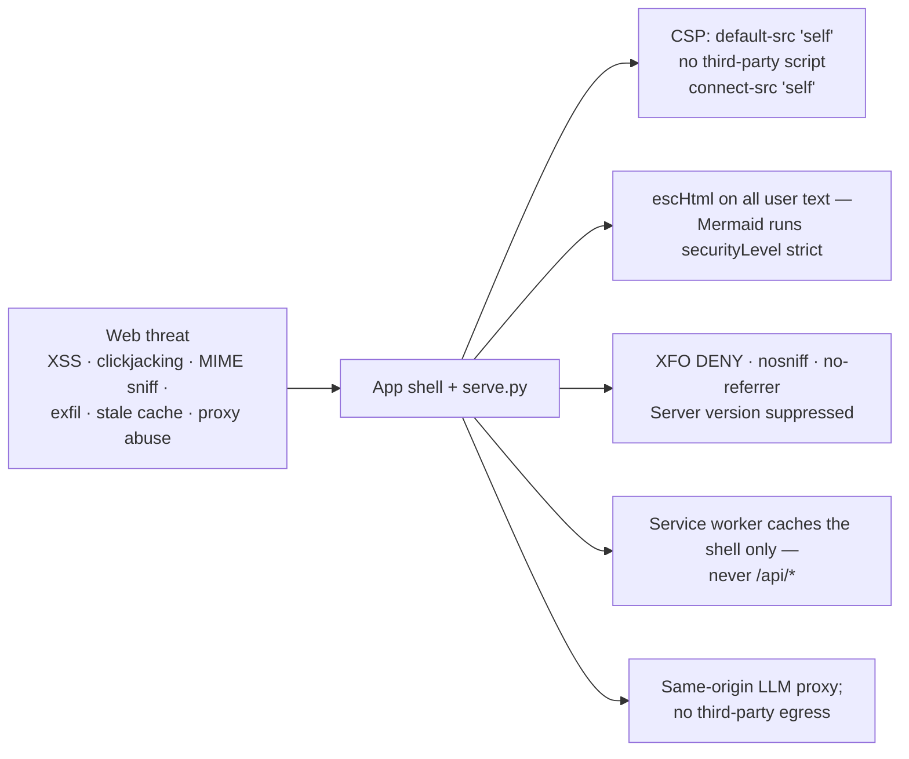
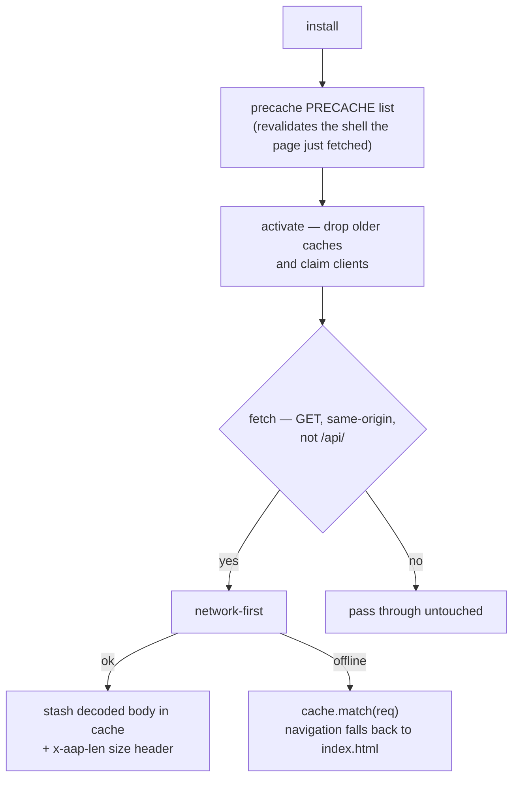

# Chapter 113: Isolation, Hardening and Offline Operation

**Part X — The Application**

## Overview

Isolation here means four different things at once: the browser from the page's own content, the process from its host, the service from the network, and the application from the clock — the last one being offline operation, which is what makes an air-gap deployment real instead of aspirational.

Each has a control you can read in a file: a header block in the server, a Dockerfile, a compose file, and a service worker. None of them requires trusting the model, the vendor or each other.

## Why It Matters

A static shell plus one small server is a small surface, but only if it is a bounded one. Small surfaces that listen on a port still need to say who may talk to them and what they may do.

This application holds your threat model and your spend thresholds. Neither should be one missing escape or one open port away from being readable by something you did not invite.

And a LAN or air-gapped deployment is only honest if it keeps working with the cable out — otherwise the offline claim is a screenshot, not a capability.

## How It Works

1. **In the browser.** Every response carries the same hardening — `nosniff`, `X-Frame-Options: DENY`, `Referrer-Policy: no-referrer` and a content security policy with `frame-ancestors 'none'` — and the server declines to advertise its version. User text is escaped before it is rendered, and Mermaid runs in strict mode.
2. **In the container.** The image is a slim Python base with only the served files copied in, running as a non-root uid with a nologin shell; compose runs it with a read-only root filesystem, `cap_drop: ALL`, `no-new-privileges`, a tmpfs for `/tmp`, and a health check that re-requests `/` on a short interval.
3. **On the network.** The service is published on an address you choose — your LAN, your tailnet, a CIDR — and the dedicated Tailscale variant shares the container's network namespace so `tailscale serve` fronts the loopback port and nothing else is exposed.
4. **In time.** After one visit the service worker has precached the shell, so same-origin requests are answered network-first with a cache fallback and the offline chip reads *Offline · cached*. A `VERSION` bump drops the old caches so clients re-precache instead of running a stale shell.

## Components

| Axis | Control | What it buys you |
|---|---|---|
| Content | Escaped user text; Mermaid `securityLevel: 'strict'` | Answers and markdown are data, never code |
| Headers | `nosniff` · `DENY` · `no-referrer` · `frame-ancestors 'none'` | No sniffing, no framing, no referrer leak |
| Fingerprint | Fixed server token, system version suppressed | The server does not advertise what it is |
| Identity | Non-root uid with a nologin shell; only served files copied in | A compromised request runs as nothing useful |
| Privilege | Read-only rootfs · `cap_drop: ALL` · `no-new-privileges` · tmpfs `/tmp` | The process cannot write, escalate or hold a capability |
| Exposure | Published on your LAN, tailnet or CIDR; loopback behind `tailscale serve` | The port exists exactly where you put it |
| Model path | Same-origin proxy, no secrets, `/api/*` never cached, watchdogs, truncated beacon | The one outbound path is bounded and auditable |
| Time | `sw.js` precaches 55 entries; network-first; `VERSION` invalidation | After one visit, no network is needed |

## The App's Own Threat Model

## The Offline Shell

**Definition 1 (Four-boundary isolation).** Isolation is *four-boundary* iff content (escaped text, strict diagrams), process (non-root, read-only, capability-free), network (address-scoped publishing with loopback tailnet fronting), and time (versioned precache with network-first fallback) are each enforced by a readable control — $I = C \land P \land N \land T$, with no boundary resting on another's promise.

**Theorem 1 (Small surface, explicitly bounded).** Under four-boundary isolation, a compromise must defeat an independent control per boundary it crosses: a content escape still faces a capability-free process, a process escape still faces address-scoped exposure, and a network outage still leaves a working cached shell — defense multiplies rather than merely adding.

*Proof.* Each boundary is enforced at a different layer (headers and escaping in responses, uid and filesystem in the image, publish address in compose, precache and $VERSION$ in the worker), so no single misconfiguration dissolves more than one. The read-only, non-root, capability-free process bounds what a content escape can do (nowhere to write, nothing to escalate to); address scoping bounds who can even reach the process; the worker's network-first-with-fallback bounds what an outage costs (one visit seeds indefinite offline use). Stale-shell risk is closed by $VERSION$ invalidation on activate. State the scope out loud — a team tool on infrastructure you control — and each control above assumes exactly that, nothing more. ∎

## Risks and Limitations

- The content security policy keeps `'unsafe-inline'` for scripts and styles because the shell is inline-handler heavy. It is a backstop against third-party script, not a sandbox against inline handlers.
- Nothing in the deployment authenticates a user. Whoever can reach the port can read the catalog and use the proxy — the trust boundary is the network you published it on, and that is stated as scope rather than hidden behind a login.
- A precached shell is a stale shell until `VERSION` bumps; the worker's activation step exists precisely so that window cannot persist.
- A read-only root filesystem means the container keeps nothing: logs go to stderr, `/tmp` is a tmpfs, and anything you want to keep has to leave through an export.
- Offline state is per-browser. Clearing site data, opening a new profile or moving to another machine all cost one more visit.

## Safeguards

1. Spoofing: answers are untrusted data, rendered as escaped text and markdown, never executed.
2. Tampering: same-origin fetch, `nosniff`, `frame-ancestors 'none'`, and a pinned vendored Mermaid.
3. Repudiation: the data is versioned in git, and exports are explicit and stamped.
4. Information disclosure: `connect-src 'self'`, `Referrer-Policy: no-referrer`, and browser-local storage with nothing auto-sent.
5. Denial of service: proxy watchdogs, `VERSION` invalidation and per-pane boot isolation so one stuck pane cannot stop the shell.
6. Elevation of privilege: no in-app shell, a CSP that blocks third-party inline script, and strict Mermaid rendering.
7. Container: non-root, read-only, capability-free, no-new-privileges, health-checked.

## At a Glance

| Field | Value |
|---|---|
| Browser | escaped text · strict Mermaid · hardened header set · no version leak |
| Container | slim image, non-root uid, read-only rootfs, `cap_drop: ALL`, health check |
| Network | LAN / tailnet / CIDR scope; loopback only behind `tailscale serve` |
| Model path | same-origin proxy, no secrets, `/api/*` never cached |
| Offline | 55 precached entries, network-first with cache fallback |
| Invalidation | `VERSION` bump drops every older cache on activate |
| Retention | no server-side store; exports are how data leaves |
| Scope | a team tool on infrastructure you control — not an internet service |

## Key Takeaways

- Isolation is four boundaries — content, process, network and time — and each one is a control you can point at in a file.
- The hardening is the same on every response, so a new file cannot be served without it.
- A read-only, capability-free, non-root container turns the server from a foothold into a process with nowhere to go.
- Offline is a tested state, not a fallback: precache, network-first, and a version that invalidates stale shells.
- State the scope out loud. This is published on a network you control, and every control above assumes you meant to.

## References

- `design/06-threat-model.md` — the STRIDE table condensed above.
- `design/01-system-context.md` — trust boundaries and deployment.
- `design/08-runtime-offline.md` — the offline shell, delivery and header story.
- `Dockerfile` and `docker-compose.yml` — image hygiene, privilege drops and the health check.
- `docker-compose.tailscale.yml` — the dedicated tailnet node behind `tailscale serve`.
- `sw.js` — precache list, fetch strategy and `VERSION`.

## Council deliberation

- **Safety researcher:** Isolation here spans browser, process, network and time: hardened response headers with strict framing and referrer policy, escaped rendering with strict diagram mode, a minimal non-root container image with read-only filesystem and dropped capabilities, address-scoped publishing with a tailnet-fronted variant, and a precached shell that serves offline after one visit. Each control reads in a file rather than resting on model or vendor trust. I value that offline is a capability rather than a screenshot, since air-gap honesty requires the tool to keep working with the cable out.
- **Continual-learning researcher:** The time dimension deserves emphasis: version-bumped cache rotation keeps clients from running stale shells, while network-first with cache fallback keeps same-origin requests alive through outages. Hardening that survives disconnection means lessons learned on connected networks still apply when isolated, which is where many tools quietly fail. Small surface plus explicit bounds on who may talk to the service and what they may do keeps a simple static-plus-server shape genuinely simple under adversarial attention.

## Council reading

- **Red team:** Offline-first means stale shells are the failure mode: VERSION-gated caches plus the boot-check banner are the freshness story, because a pinned stale worker is a feature freeze nobody chose.
- **Blue team:** The precache list is CI-gated against the files on disk, containers run read-only as non-root with healthchecks, and /api/* never touches the cache.
- **Operator:** After one visit the air-gapped host works; the perf panel's x-aap-len sizes prove what the cache actually holds — verify, don't assume.

## Conclusion

None of these controls is exotic: a header block, a non-root user, a dropped capability set, a cache that knows its own version. What makes them worth writing down is that they are all that stands between a tool holding your threat model and a network that would read it — and that every one of them keeps working when the network itself is gone.

---
