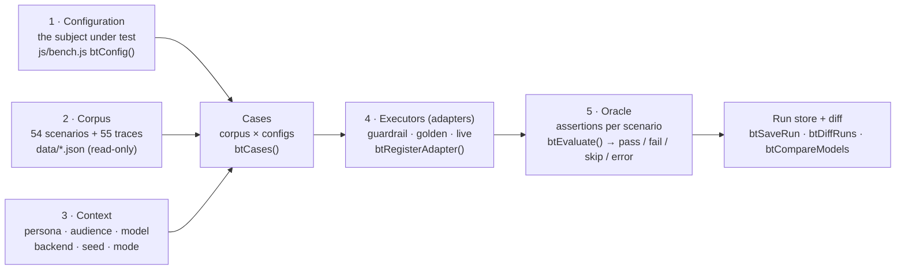
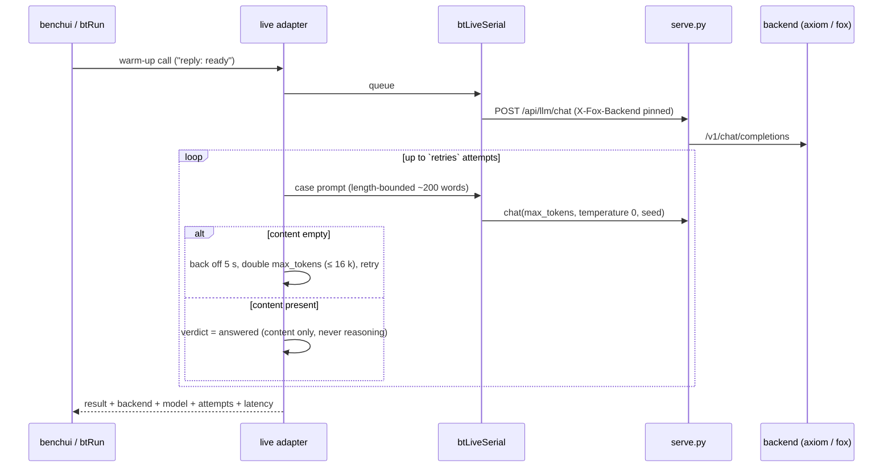
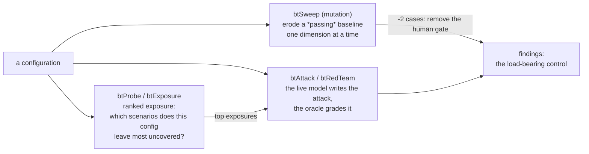

# Chapter 114: Testing the Defenses

**Part X — The Application**

## Overview

Every chapter so far has recommended controls — spend guards, approval gates, injection shields, sandboxes, audit trails. This chapter is about the uncomfortable question that follows: do those controls actually hold? The Battle Bench is the catalog turned on itself. It takes all 54 failure scenarios as a test corpus, runs them against a *configuration* — a set of controls an agent would actually deploy — and grades whether each scenario's defenses held.

A case is a triple: one scenario, one configuration, one context (persona, audience, model, backend, seed, mode). Cases are *derived*, not listed — the corpus crossed with the configurations — so full coverage is a property of the math: add a scenario or a configuration and its cases appear automatically. The bench also reports what a run did *not* test, by severity.

Three interchangeable executors answer the same cases: a deterministic guardrail simulation (54 scenarios in a fraction of a second, so the bench works with no model at all), a golden adapter that replays the catalog's 55 execution traces, and a live adapter that puts the question to the local model. An oracle grades every answer against assertions derived from each scenario's own protections — and an adversary attacks the configuration to find which control matters most.

## Why It Matters

A control nobody tested is a hypothesis. Teams adopt spend caps and approval gates because the catalog recommends them, then discover in production which ones were wired wrong, scoped too narrowly, or quietly bypassed by the next feature. Running the failure scenarios against the configuration *before* deployment moves that discovery left, where it is cheap.

Testing against your own catalog also closes a loop the rest of the book leaves open. The workflow chapters hand over designs, rule sets and ADRs; the bench checks the handover by replaying the threats the design claims to stop. A design that passes its scenarios is still not proven safe — but a design that *fails* them was never a design, only a document.

And the bench keeps the receipt. Runs are saved locally and comparable across time, so a model swap or a config change shows up as a diff of verdicts — regressions listed explicitly — instead of a feeling that the new version behaves about the same.

## How It Works

1. **Configure.** Pick or edit configurations — autonomy tier, spend caps, approval gates, injection shield, sandboxing, logging — as plain data. The configuration dimensions are derived from the Deployment Plan's own option tables, with a drift check that fails loudly if the two ever disagree, so the bench can never quietly test a different space than the app configures.
2. **Derive cases.** The bench crosses the 54 scenarios with the chosen configurations and contexts into the full case list, each case stamped with hashes of exactly what was tested.
3. **Execute.** Run the matrix through one of three adapters: `guardrail` simulates the configuration's controls deterministically; `golden` replays the 55 catalog traces; `live` sends each scenario to the local model with the backend pinned per run and recorded in every result. New executors register through one function and inherit the runner, the oracle and the interface unchanged.
4. **Grade.** The oracle derives machine-checkable assertions from each scenario's own protections and evaluates them against the result — pass, fail, skip, or error. Errored and skipped runs are never counted as passes.
5. **Attack.** Turn the adversary on the configuration: ranked exposure shows which scenarios it leaves most uncovered; a mutation sweep erodes a passing baseline one dial at a time and ranks the controls by sensitivity; a live red-team loop has the model write attacks that the oracle grades for named-but-missing controls.
6. **Compare and keep.** Diff two models on the same cases, save runs for cross-time comparison, and export the report as Markdown or JSON — the eighth work product in the architect report.

## Components

| Piece | File | Responsibility |
|---|---|---|
| Configuration, context, cases | `js/bench.js` | Config and context models with hashing, the drift check against the planner, corpus × configs case derivation, and coverage of what was not tested. |
| Adapters | `js/bench.js` registry | `guardrail` (deterministic), `golden` (trace replay), `live` (the model, serialised, backend pinned); new executors register with one call. |
| Oracle | `js/bench.js` evaluator | Assertions derived from each scenario's protections; pass / fail / skip / error, with errors never counted as passes. |
| Runner and store | `js/bench.js` + `localStorage` | Serial execution with progress, saved runs comparable across time, verdict diffs with explicit regressions. |
| Adversary | `js/adversary.js` | Exposure probe, mutation sweep over passing baselines, and the live red-team loop. |
| Interface | `js/benchui.js` | Matrix view, configuration editor, adversary panel, model comparison, run store and report export. |
| Golden traces | `tools/gen_traces.py` | Deterministic generator for the scenarios that had no replay — built from each scenario's own record, never hand-written to match a verdict. |

## Five Capabilities, One Case List

## The Live Path

## Attacking the Configuration

**Definition 1 (Derived coverage).** A bench has *derived* coverage iff its case list $C = S \times K \times X$ is computed from scenarios $S$, configurations $K$, and contexts $X$ — so adding any scenario or configuration automatically adds its cases, and untested regions ($S \times K \setminus C_{run}$) are reported by severity rather than silently absent.

**Theorem 1 (Errors are never passes).** Under derived coverage with a protection-derived oracle, a passing run proves the named controls held for the tested cases — and an errored or skipped run proves nothing: fenced out of pass rates by construction, an adapter that fails has failed loudly, not passed quietly.

*Proof.* Let verdict $v(c) \in \\{\text{pass}, \text{fail}, \text{skip}, \text{error}\\}$ per case $c$, with pass rate $P = |\text{pass}| / |C_{run}|$ computed only over decided cases. Errors (empty completions, hung backends, missing traces) and skips land outside the numerator by construction — they cannot inflate $P$ because they never enter it. The oracle derives assertions from each scenario's own protections, so a pass means the named controls held against the named threat, not that the agent is safe in general (the report prints this limit). The first campaign demonstrates the arithmetic: a defended configuration at 53/54 with the human gate load-bearing, an undefended one failing 31 — controls wired versus controls hypothesized, measured on the same derived cases. ∎

## Risks and Limitations

- A passing synthetic run proves the *controls are wired*, not that any agent is safe — the bench measures the controls the catalog names, and reports the rest as gaps. Its own report template says so.
- Live verdicts are flaky by nature: roughly one call in four can return an empty completion from a reasoning model whose hidden reasoning consumed the token budget. Warm-up calls and escalating retries reduce it; the bench reports the remainder as errors rather than hiding them.
- The oracle is only as complete as the scenario records. Two of its own rules had to be corrected by measurement — a coverage ratio instead of an identity check, escaped spend instead of attempted spend — and the catalog itself carries at least one scenario no listed control stops.
- A red-team attack the model writes is bounded by what the model can imagine; absence of findings is not absence of holes.
- Small samples mislead: a two-case model comparison proves the comparison mechanism, not a ranking between models.

## Safeguards

1. Errored and skipped runs are fenced out of pass rates by construction — an adapter that fails has failed loudly, not passed quietly.
2. The configuration space is checked against the planner's option tables, so the bench cannot drift into testing controls the app does not offer.
3. Every live result records which backend served it, with failover disabled for the run — a silent backend swap is right for a chat and wrong for a measurement you intend to diff.
4. The bench never mutates the shipped catalog: scenarios and traces are read-only, runs live beside the other work products, and generated traces come from scenario records rather than from expected verdicts.
5. Coverage is reported both ways — what ran and what did not, by severity — so an untested corner is visible instead of assumed.

## At a Glance

| Field | Value |
|---|---|
| Corpus | 54 scenarios · 55 replayable traces |
| Coverage | derived: corpus × configurations × contexts |
| Adapters | guardrail (deterministic) · golden (replay) · live (model, pinned backend) |
| Oracle | assertions from each scenario's protections; errors never pass |
| Adversary | exposure rank · mutation sweep · live red-team loop |
| Comparison | same cases, two models, explicit regressions |
| Memory | saved runs in `localStorage`; Markdown/JSON report |
| First campaign | defended config 53/54; undefended fails 31; human gate is load-bearing |
| Honesty | a pass proves wiring, not safety — printed in the report |

## Key Takeaways

- Test the configuration, not the idea: scenarios × controls is where a design meets the threats it claims to stop.
- Derive coverage instead of listing it — a case list computed from the corpus cannot quietly go stale.
- Never let an error count as a pass; a bench that agrees with you every time is not testing anything.
- Measure the backend before trusting it: pin it, record it, and report the flakiness you cannot remove.
- Attack the configuration on purpose — exposure ranking, mutation sweeps and red-team loops find the load-bearing control before production does.

## References

- `BATTLE-ANALYSIS.md` — the analysis, the twenty-iteration plan and the first campaign's findings.
- `design/09-battle-bench.md` — the bench architecture: the five capabilities, the measured live path and the adversary.
- `js/bench.js`, `js/adversary.js`, `js/benchui.js` — the engine, the adversary and the tab.
- `tools/gen_traces.py` — the deterministic trace generator.
- `data/scenarios.json`, `data/traces.json` — the corpus the bench runs.

## Council deliberation

- **Evaluation methodologist:** The Battle Bench turns the catalog on itself by crossing failure scenarios with deployed configurations into derived cases, then executing them through deterministic simulation, golden trace replay or the live local model, with an oracle grading against assertions from each scenario own protections and an adversary probing which control matters most. Runs persist locally and compare across time so model or config changes appear as verdict diffs with explicit regressions. I consider untested controls hypotheses, so moving discovery left into pre-deployment replay is where this bench earns its keep rather than as post-incident forensics.
- **Safety researcher:** What closes the loop is coverage honesty: the bench reports what it did not test by severity, derives cases mathematically so new scenarios and configs appear automatically, and saves receipts for review. Adversarial pressure on the configuration finds the load-bearing control instead of assuming all layers hold equally. A design that fails its own scenarios was never a design, only a document, while one that passes still needs production vigilance; the bench distinguishes those states before deployment rather than after harm.

## Council reading

- **Red team:** The guardrail adapter is instant and deterministic, which also makes it gameable — tune to it and you get eval-overfit with a passing matrix; the live adapter is the one allowed to surprise you.
- **Blue team:** The oracle derives assertions from each scenario's own protections and an errored run is never counted as a pass, so green means held, not merely attempted.
- **Operator:** Run the full matrix before every model swap and diff the verdicts with Compare models: regressions listed explicitly beat vibes, every time.

## Conclusion

The bench is the book's thesis with the serial numbers filed back on: deterministic enforcement outside the model, verification outside the enforcement, and every claim pointing at a record. It will not tell you an agent is safe — nothing synthetic can — but it will tell you, case by case and run by run, whether the controls you named are the controls you built. That receipt is the difference between a design and a document, and it is why this part of the book closes with a test harness rather than a peroration.

---
