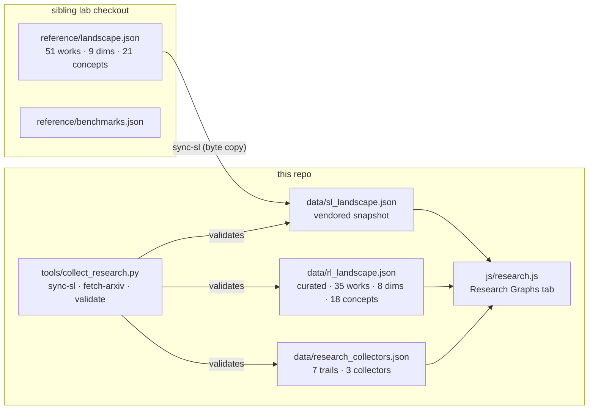
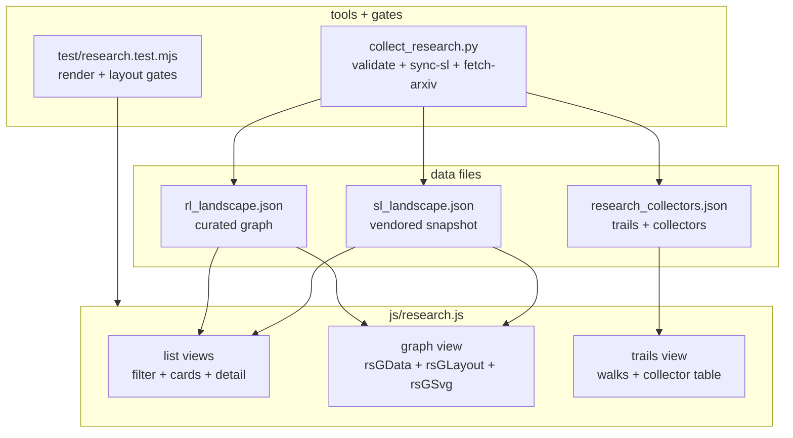
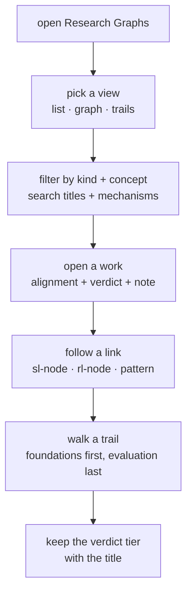
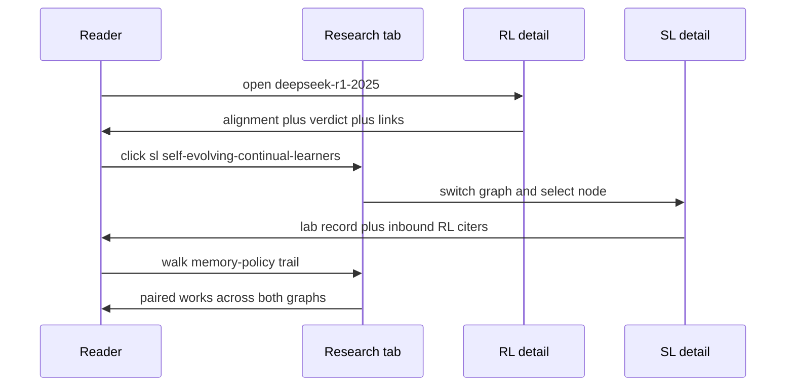

# Chapter 115: The Research Landscape

**Part X — The Application**

## Overview

Behind the Research Graphs tab sit two knowledge graphs that read each other. One is the self-learning landscape — 51 works across 21 concepts, vendored as a byte snapshot from the sibling lab so this repository can never silently fork its curation. The other is the reinforcement-learning graph, curated here: 35 works across 18 concepts on 8 dimensions, from Bellman recursion through deep RL and offline methods to RLHF, verifiable rewards, verbal reflection and memory-policy learning.

They interlink three ways. Five concept identifiers exist in both graphs with identical meaning — credit assignment, memory-policy learning, experience evolution, continual learning and verifier feedback. Every RL work carries explicit links: `rl_links` to the gradient ancestors it builds on, `sl_links` into the lab's landscape. And seven reading trails address works as `rl:` and `sl:` references, so a trail is a cross-graph path rather than a list.

This chapter is the condensed map. The full excerpts — every one of the 35 RL works with its alignment row, verdict tier and researcher note, argued by a council of researchers — live in the *Self-Learning Agents* supplement's research-graphs part, generated from the same files by the same fail-loud discipline.

## Why It Matters

The lab studies learning with the weights frozen — prose, skills, memory operators — and that narrowing is productive only while its outside stays visible. Reinforcement learning is that outside: the lineage of reward, bootstrapping, policy gradients, trust regions and learned rewards from which the lab borrows its vocabulary while refusing its machinery.

The borrowing direction is stated, not hidden: mechanisms travel from RL into the lab, while evidence must be re-earned on drifting streams with per-boundary checkpoints. A return curve from the deep-RL era proves game competence, not continual learning; a trust region is a stability idea worth translating into scope fences, not a result that transfers.

The safety case is reward hacking, which the RL lineage names and the lab inherits. Optimise a proxy and the optimiser finds the crack — in weights or in language, the disease is the same, and so is the prescription: an admission gate, a scope fence and an expiry on every learning loop.

## How It Works

1. **Two graphs, split ownership.** The self-learning snapshot is copied byte-for-byte from the sibling checkout (`sync-sl` is a no-op when equal); the RL graph is curated in `data/rl_landscape.json`. One validator checks both, and the test suite enforces it in CI.
2. **Three gates per RL work.** Each work is placed on all 8 dimensions, and the verdict counts three of them: a stability control (trust region, clipping, KL anchor, scope fence, TTL decay), a holdout or banded evaluation, and a reported cost. Three closed is measured and priced; none closed is a design prior, never evidence about agents.
3. **Trails order the pile.** Seven curated walks — foundations, deep RL, offline, the LLM arc, verbal, memory-policy and evaluation last — each reframing the last. Evaluation walks last because it is the gate all the others must pass.
4. **Collectors tend the graphs, human-gated.** Snapshot sync, an arXiv watch that stages an inbox, and the integrity gate. Drafts enter flagged and stay flagged until a human replaces the staged summary with a read one.
5. **The tab draws what the files say.** Filterable lists plus a force-layout graph view — solid builds-on edges, dashed cross-graph edges, diamond hubs for the five shared concepts — with click-for-record into the catalog's own patterns.

## Components

| Piece | File | Responsibility |
|---|---|---|
| Self-learning graph | `data/sl_landscape.json` | Vendored snapshot of the sibling lab's landscape; owned there, copied here, validated here. |
| RL graph | `data/rl_landscape.json` | 35 curated works on 8 dimensions with explicit `sl_links` and `rl_links`; every reference validated. |
| Trails and collectors | `data/research_collectors.json` | 7 reading trails plus the three collector definitions (sync, watch, validate). |
| Collector scripts | `tools/collect_research.py` | `validate` / `sync-sl` / `fetch-arxiv` / `report`: stdlib only, network only for the arXiv watch, graphs never written silently. |
| Interface | `js/research.js` | Lists, trails and the SVG graph view (deterministic layout, pan/zoom, click-for-record); lazy-loaded, offline-precached. |
| Full excerpts | `tools/build_sl_book.py` + `tools/sl_book_prose.py` | The supplement's research-graphs part: all 35 works with verdicts and researcher notes in the council's voice. |

## Two Graphs, One Tab

## Tab Modules

## Reader Activity

## Cross-Graph Jump

**Definition 1 (Shared-concept interlink).** Two graphs are *interlinked* iff they share concept identifiers with identical glosses (credit-assignment, memory-policy-learning, experience-evolution, continual-learning, verifier-feedback), every cross-reference resolves by validator ($rl\\_links$, $sl\\_links$, and all seven trails), and the snapshot side copies bytes — so drift is a diff, never a silent merge.

**Theorem 1 (Borrow mechanisms, re-earn evidence).** Under interlinked graphs with three-gate verdicts (stability control, holdout or banded evaluation, reported cost), an RL mechanism may travel into the lab while its evidence never does: three closed gates is measured and priced, fewer is a design prior — and the tier travels with every citation, so authority cannot launder across the bridge.

*Proof.* Let work $w$ carry gates $g_1, g_2, g_3$. The verdict counts closed gates: 3 means measured and priced, 0 means design prior regardless of fame — the most-cited rows close the fewest, which the tier column prints rather than hides. Mechanisms travel explicitly ($rl\\_links$ name the gradient ancestors, $sl\\_links$ name the lab borrowers); evidence stays behind because return curves and tabular results are mathematics about their own substrate, not agent evidence about drifting streams. Shared identifiers with identical glosses keep the two teams arguing about evidence rather than words (a forked gloss would be two vocabularies with one spelling). The validator plus byte-copy sync plus human-gated collectors enforce all three properties mechanically: unresolvable links fail the build, drift shows as a diff, flagged drafts stay flagged until read. ∎

## Risks and Limitations

- Fame concentrates where gates are open: the most-cited RL rows close the fewest, and teams borrow authority along with mechanism. The verdict tier travels with every citation in the supplement; quote the tier, not the title.
- A foundations section launders authority for readers who skip the verdict column. Tabular results are mathematics, not agent evidence — never let one testify about a deployment.
- Shared concept identifiers are shared obligations. If the two graphs ever fork a gloss, two teams will argue about words while believing they argue about evidence.
- The arXiv watch stages candidates; unstaged triage rots into implied endorsement. Flagged drafts are honest only while someone reads the flag.
- Return curves do not transfer across substrates, tasks or decades. Borrow the optimiser, re-measure the forgetting, re-price the cost — every time.

## Safeguards

1. Every cross-graph reference is validated by script and by the test suite: patterns resolve in the catalog, every link and trail reference resolves, no self-links, no duplicate ids.
2. The borrowing direction is printed, not implied — mechanisms in, evidence re-earned — in the supplement's opening chapter and in every per-work reading line.
3. The snapshot sync copies bytes and reports no-op when equal, so drift between the lab and the vendored copy shows as a diff, never a silent merge.
4. The book generators fail loudly on drift: a renamed work without its researcher note, a figure heading that moved, a count cited from memory instead of disk — all fail the build rather than shipping wrong.
5. The tab degrades to lists and tables when the graphs cannot load, and the graphs it draws are the files on disk — served offline from the precache after one visit.

## At a Glance

| Field | Value |
|---|---|
| Self-learning graph | 51 works · 21 concepts (vendored snapshot) |
| RL graph | 35 works · 18 concepts · 8 dimensions (curated) |
| Shared concepts | credit-assignment · memory-policy-learning · experience-evolution · continual-learning · verifier-feedback |
| Verdict gates | stability control · holdout/banded evaluation · reported cost |
| Trails | 7 curated walks, evaluation last |
| Collectors | sync-sl (bytes) · arXiv watch (inbox) · validate (gate) |
| Full text | supplement research-graphs part: all 35 works with notes |
| Honesty | mechanisms in, evidence re-earned — printed, not implied |

## Key Takeaways

- Keep the lab's narrowing honest by mapping its outside: every verbal mechanism has a gradient ancestor, and the graph walks you to it before you claim novelty.
- Judge RL imports by three gates — stability control, holdout or bands, reported cost — and quote the tier with the title.
- Share concept identifiers across graphs only with shared meanings; a forked gloss is two teams arguing about words.
- Tend the collectors on a schedule: re-sync, re-validate, retire trails whose frontier moved on.
- Read the full excerpts in the supplement, where the council of researchers argues every work before the verdict.

## References

- `data/rl_landscape.json`, `data/sl_landscape.json`, `data/research_collectors.json` — the graphs and the trails.
- `tools/collect_research.py` — the three collectors.
- `design/12-research-graphs.md` — the architecture: ownership, interlinks, collectors, freshness contract.
- `js/research.js` — the tab: lists, trails and the graph view.
- `tools/build_sl_book.py`, `tools/sl_book_prose.py` — the supplement's research-graphs part with all 35 researcher notes.

## Council deliberation

- **Memory-systems researcher:** The landscape chapter maps the outside the lab deliberately excludes: a vendored self-learning snapshot the repository cannot silently fork, plus a curated RL graph from Bellman through reasoning models, joined by five shared concepts and explicit cross-links. I value the ownership split most, since byte-copy snapshots plus a validator turn curation drift into a visible diff rather than a quiet fork. Reading the bridge works evolver-to-evolver against the lab mechanisms is where this earns its keep, because fencing and expiry matter more than the optimizer in every substrate.
- **Evaluation methodologist:** What persuades me is the three-gate verdict device applied uniformly: a stability control, a holdout or banded evaluation, and a reported cost, counted per work and never averaged into a score. Only a handful of rows close all three, which correctly marks the tabular foundations as mathematics rather than agent evidence. I consider unmeasured rows context however famous, so the tier column lets a meeting quote claims that travel while naming the re-measurement the rest still owe.

## Council reading

- **Red team:** Fame concentrates where gates are open — the most-cited RL rows close the fewest, so quote the verdict tier with the title and never let a tabular result testify about a deployment.
- **Blue team:** Shared concept identifiers are shared obligations: five glosses, identical on both sides, checked by script — a forked concept is two teams arguing about words.
- **Operator:** Walk the trails in order and tend the collectors on schedule; a graph nobody re-validates is a rumour with good type, and flagged drafts are honest only while someone reads the flag.

## Conclusion

The research landscape is the book's method applied to its own context: enumerate the outside, place every work on explicit dimensions, count the gates each one closes, and let a validator — not a memory — keep the references honest. It will not tell you which mechanism to adopt; it will tell you, work by work, what you may borrow and what you must re-measure. That receipt is what makes a literature review a tool instead of a shelf, and it is why the book closes its application part with a map rather than a moral.

---

# Glossary

The 18 terms below are the app's own glossary — the vocabulary the catalog uses consistently across patterns, scenarios and cascades.

| Term | Definition |
|---|---|
| Autonomy tier | How much the agent may do unsupervised, from human approves everything to fully autonomous. Higher tiers demand stronger gates. |
| Blast radius | How far a failure can reach: single-request → single-agent → service → tenant → fleet → org → ecosystem. The cascades tab ranks every entry on this ladder. |
| Canary / shadow | Run the new agent on a slice of traffic (canary) or beside production without effects (shadow) before full rollout. |
| Cascading | Crosses a trust or system boundary and amplifies or correlates there. Example: one tenant's poisoned retrieval pollutes a shared cache for everyone. |
| Derived | The necessary consequence chain from a first failure — A must lead to B. Example: a bad refund forces a reconciliation write, which forces a notification. |
| Dual control | Two independent approvals before an irreversible action — borrowed from finance, applied to agent tool calls. |
| Emergent | Only exists when components interact — no single part is at fault. Example: two agents that are safe alone but livelock when paired. |
| Eval | A repeatable test that scores agent behaviour — the only way to know a guardrail still holds after a model swap. |
| Exposure index | The Blueprint tab's 0–100 estimate of residual threat surface: matched scenarios and cascades, discounted by the controls you actually added. |
| Guardrail | A runtime control that bounds what an agent can do: budgets, approvals, sandboxes, output shields, audit trails. |
| Inherent | Fails inside one component on its own — no interaction needed. Example: a prompt-injection string that tricks a lone LLM call. |
| Provenance | A record of where each piece of data came from, so retrieved text is never silently trusted as instruction. |
| RAG | Retrieval-augmented generation: the agent looks up documents before answering. Powerful — and the main road poisoned data drives in on. |
| Red team | Deliberately attacking your own agent (prompt injection, tool abuse) to find holes before someone else does. |
| Residual risk | What is left after your controls. A control you haven't added yet doesn't reduce anything — the index only credits what's on the canvas. |
| STRIDE | Spoofing, Tampering, Repudiation, Information disclosure, Denial of service, Elevation of privilege — the six threat buckets the Design docs map to protections. |
| Tool use | Any moment the agent acts on the world: API calls, refunds, emails, code execution. Every tool call is a trust decision. |
| Trace | A replayable record of one agent run: inputs, tool calls, outputs. Live View replays them step by step. |

---

# Index of Terms

All 107 patterns, alphabetical, with chapter numbers.

| Pattern | Chapter | Part |
|---|---|---|
| Abstention & Graceful Refusal | 87 | Safety, Security & Governance |
| Agent Handoff / Swarm | 44 | Multi-Agent Topologies |
| Agent Identity & Authentication | 86 | Safety, Security & Governance |
| Agent Incident Response Playbook | 81 | Safety, Security & Governance |
| Analogical / Case-Based Reasoning | 12 | Planning & Reasoning |
| Approval Gates for Irreversible Actions | 69 | Safety, Security & Governance |
| Autonomous Trading Agent Playbook | 103 | Domain Playbooks |
| Batch Agent Processing | 32 | Workflow Orchestration |
| Behavior & Drift Monitoring | 80 | Safety, Security & Governance |
| Blackboard Architecture | 45 | Multi-Agent Topologies |
| Browser / Web Research Agent | 58 | Tools & Environment |
| Budget-Bounded Execution | 21 | Agent Loop & Control |
| Canary & Shadow Deployment | 79 | Safety, Security & Governance |
| Chain-of-Thought (CoT) | 1 | Planning & Reasoning |
| Chain-of-Verification (CoVe) | 8 | Planning & Reasoning |
| Checkpointing & Rollback | 20 | Agent Loop & Control |
| Circuit Breaker & Kill Switch | 76 | Safety, Security & Governance |
| Clinical Triage Agent Playbook | 104 | Domain Playbooks |
| Code-as-Action | 56 | Tools & Environment |
| Coding Agent Pipeline | 101 | Domain Playbooks |
| Computer Use (GUI Agent) | 57 | Tools & Environment |
| Confidence Gating (Metacognition) | 11 | Planning & Reasoning |
| Confused-Deputy Defense | 91 | Safety, Security & Governance |
| Consensus / Voting Protocols | 47 | Multi-Agent Topologies |
| Context Compression / Summarization | 39 | Memory & Knowledge |
| Customer Support Agent Playbook | 102 | Domain Playbooks |
| Data Loss Prevention | 82 | Safety, Security & Governance |
| Dry-Run / Diff Mode Tools | 61 | Tools & Environment |
| Dual Control / Four-Eyes | 70 | Safety, Security & Governance |
| Dynamic DAG Planning | 30 | Workflow Orchestration |
| Dynamic Tool Retrieval | 55 | Tools & Environment |
| Ensemble Verification | 97 | Resilience & Reliability |
| Episodic Memory | 35 | Memory & Knowledge |
| Eval Harness & Continuous Red-Teaming | 78 | Safety, Security & Governance |
| Evaluator–Optimizer | 29 | Workflow Orchestration |
| External Scratchpad / File Memory | 40 | Memory & Knowledge |
| Fallback Chain | 93 | Resilience & Reliability |
| Fan-Out & Concurrency Caps | 88 | Safety, Security & Governance |
| Financial Guardrails (Spend Controls) | 67 | Safety, Security & Governance |
| Forgetting / Memory Decay & TTL | 41 | Memory & Knowledge |
| Front-Desk Triage | 48 | Multi-Agent Topologies |
| Graceful Degradation | 98 | Resilience & Reliability |
| Group Chat with Moderator | 51 | Multi-Agent Topologies |
| Hierarchical Teams | 43 | Multi-Agent Topologies |
| Human-in-the-Loop (HITL) | 18 | Agent Loop & Control |
| Idempotency Keys | 85 | Safety, Security & Governance |
| Immutable Audit Trail | 75 | Safety, Security & Governance |
| Input Sanitization & Prompt-Injection Shield | 71 | Safety, Security & Governance |
| Interrupt & Resume (Checkpointed HITL) | 19 | Agent Loop & Control |
| Least Privilege Scoping | 65 | Safety, Security & Governance |
| Least-to-Most Prompting | 7 | Planning & Reasoning |
| LLM-as-Judge | 96 | Resilience & Reliability |
| Long-Term Memory (Vector Store) | 34 | Memory & Knowledge |
| Loop / Stall Detection | 100 | Resilience & Reliability |
| Market / Auction Task Allocation | 50 | Multi-Agent Topologies |
| Memory Consolidation (Reflection-Driven) | 38 | Memory & Knowledge |
| Multi-Agent Debate / Council | 46 | Multi-Agent Topologies |
| Network Egress Control | 83 | Safety, Security & Governance |
| OODA Loop | 16 | Agent Loop & Control |
| Orchestrator–Workers | 28 | Workflow Orchestration |
| Output / Content Shielding | 72 | Safety, Security & Governance |
| Parallelization (Sectioning) | 26 | Workflow Orchestration |
| Parallelization (Voting / Best-of-N) | 27 | Workflow Orchestration |
| PII Detection & Redaction | 73 | Safety, Security & Governance |
| Pipeline with Fallback | 31 | Workflow Orchestration |
| Plan-and-Execute | 5 | Planning & Reasoning |
| Policy Engine (Rules Outside the Model) | 66 | Safety, Security & Governance |
| Procurement / Purchasing Agent Playbook | 107 | Domain Playbooks |
| Prompt Chaining | 24 | Workflow Orchestration |
| Provenance & Citation Enforcement | 74 | Safety, Security & Governance |
| Quotas & Rate Limiting | 68 | Safety, Security & Governance |
| RAG Poisoning Defense | 90 | Safety, Security & Governance |
| RAG-Augmented Agent | 37 | Memory & Knowledge |
| ReAct (Reason + Act) | 4 | Planning & Reasoning |
| Recursive Criticism & Improvement | 14 | Planning & Reasoning |
| Red Team / Blue Team Agents | 52 | Multi-Agent Topologies |
| Reflexion / Self-Reflection | 9 | Planning & Reasoning |
| Research Agent with Citation Enforcement | 106 | Domain Playbooks |
| Retry with Exponential Backoff + Jitter | 92 | Resilience & Reliability |
| Reversibility-First Design | 84 | Safety, Security & Governance |
| Routing | 25 | Workflow Orchestration |
| Saga / Compensation | 94 | Resilience & Reliability |
| Sandboxed Execution | 59 | Tools & Environment |
| Self-Consistency Sampling | 2 | Planning & Reasoning |
| Self-Critique & Revise | 10 | Planning & Reasoning |
| Self-Healing Replan | 99 | Resilience & Reliability |
| Semantic Memory / Knowledge Graph | 36 | Memory & Knowledge |
| Sequential Handoff Pipeline | 49 | Multi-Agent Topologies |
| Shadow Agents (Dry-Run Parity) | 53 | Multi-Agent Topologies |
| Simulation / Digital Twin | 60 | Tools & Environment |
| Skeptical Reasoning (Devil's Advocate) | 13 | Planning & Reasoning |
| Skill Library (Reusable Capabilities) | 63 | Tools & Environment |
| SRE / DevOps Agent Playbook | 105 | Domain Playbooks |
| Standard Agent Loop | 15 | Agent Loop & Control |
| Structured Event Logging (OpenTelemetry for Agents) | 89 | Safety, Security & Governance |
| Structured Function Calling | 54 | Tools & Environment |
| Structured Output (Constrained Decoding) | 77 | Safety, Security & Governance |
| Subgoal Gating / Milestones | 23 | Agent Loop & Control |
| Supervisor (Master–Worker) | 42 | Multi-Agent Topologies |
| Task Decomposition (Decompose & Conquer) | 6 | Planning & Reasoning |
| Timeboxing | 22 | Agent Loop & Control |
| Tool Dry-Run Tier (Alias: Safe-Mode Tools) | 64 | Tools & Environment |
| Tool Registry / MCP-Style Server | 62 | Tools & Environment |
| Tool Use / Function Calling | 17 | Agent Loop & Control |
| Tree of Thoughts (ToT) | 3 | Planning & Reasoning |
| Validation Loop | 95 | Resilience & Reliability |
| Working Memory (Context Window) | 33 | Memory & Knowledge |

---

# Conclusion

The catalog this book was generated from is deliberately unfinished. 54 scenarios and 191 cascades are recorded today; the coverage gap is published rather than hidden, because a gap you can see is a backlog and a gap you cannot see is a surprise.

Three habits are worth taking from the chapters above. Name the layer where each control is enforced, because a control with no enforcement point is a suggestion. Write the failure mode before the feature, because the protection list that follows it is usually the more useful half. And treat composition as a first class risk: most of what goes wrong in agent systems is not a single broken part but two correct parts that interact.

The rest of the shelf keeps moving — new patterns, new attack chains, new cascades. This book is a snapshot of a catalog that is meant to be read in its live form too, where every diagram above is a running page you can filter, replay and export.

## Council deliberation

- **Safety researcher:** The closing argument is that safe agency is a property of systems, not of models: scoped identity, deterministic policy, financial and rate bounds, human gates on irreversible acts, content and boundary controls, tamper-evident memory and rehearsed response, layered so each assumes the others may fail. No single control carries the design; their composition does. An agent that inherits this stack can be capable and still be governable, since every path to the world crosses checkpoints its own reasoning cannot move, rename or approve away.
- **Continual-learning researcher:** What endures after the details is the discipline of bounded adaptation. Retry, fallback, compensate, degrade, replan, escalate: each is a way to keep going without breaking the envelope, and each stays finite through caps, windows and human handoff. Systems that learn from incidents into eval cases, from drift into rebaselined thresholds, and from near-misses into tighter gates improve without expanding authority. That is the trajectory worth building toward, where experience compounds and blast radius does not.
- **Evaluation methodologist:** I would leave readers with measurement as maintenance: replayable trails, per-checker verdicts, serving-tier logs, abstain and block-rate telemetry, canary diffs across config changes. Designs rot as tools, models and threats shift, so the harness, the bench and the drift baselines are not one-time gates but ongoing instruments. A team that keeps those instruments staffed and reviewed will catch its next failure in a dashboard before it meets it in production, which is the quietest victory this book recommends.

---

# Colophon

*Agentic Design Patterns & Guardrails* was written and compiled from study and experiment observation notes of Harish Govardhan Damodar and generated by the *AI Agent Patterns & Guardrails* catalog by a deterministic script (`tools/build_book.py`), then typeset to PDF with headless Chrome and the vendored Mermaid engine (`tools/render_pdf.mjs`) — the same Mermaid that renders the diagrams in the app, so no diagram in this book was drawn by hand or screenshotted.

Catalog revision: 107 patterns · 54 scenarios · 191 cascades · 26 domains. Edition: First edition — October 2026.

© Harish Govardhan Damodar. Generated artifact — regenerate with `npm run book`.
