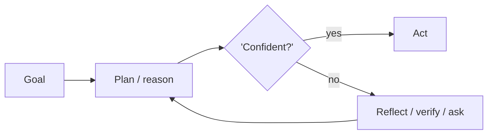

# Chapter 12: Analogical / Case-Based Reasoning

**Part I — Planning & Reasoning**

## Analogical / Case-Based Reasoning Pattern Overview

Retrieve past cases closest to the current situation and adapt their resolutions.

**Analogical / Case-Based Reasoning** is catalogued in the **Planning & Reasoning** part of the catalog (id `analogical-reasoning`). It is tagged for legal, support, engineering and is assembled from 3 components.

Embed the current case, retrieve the $k$ most similar past cases, adapt the precedent solution — and cite the case IDs so the adaptation is auditable. Precedent is leverage: a solved past case compresses a novel present one. It is also attack surface: a superficially similar case with materially different context leads the agent astray, and a planted precedent redirects every future case that retrieves it.

**Definition 1 (Provenanced precedent).** A retrieved precedent is *provenanced* iff it carries (i) a human-curated store entry with review history, (ii) its similarity score plus the distinguishing differences from the current case, and (iii) a citation (case ID) attached to the adapted resolution — with no auto-application to irreversible actions.

**Theorem 1 (Similarity is not sameness).** Retrieval ranks by similarity; action requires sameness of the material facts. Under provenanced precedent, a superficially similar case with materially different context is blocked at the differences review — and a planted precedent is blocked at provenance, before it is ever adapted.

*Proof.* Bad transfer exploits similarity without sameness: the retriever scores high on surface features while material context differs. Showing distinguishing differences alongside similarities forces the comparison the retriever skipped — the operator reviews differences, not just matches, and the adaptation is gated on material agreement. Poisoning exploits store trust: a planted 'precedent' with no provenance, no review, no history. Human curation with provenance makes the plant visible as an unreviewed entry; the no-auto-apply rule for irreversible actions means even a retrieved plant waits at a human gate. Verify provenance on every retrieved precedent before consequential adaptation; the Adapter must not launder planted cases into applied resolutions. ∎

## Practical Applications & Use Cases

Domains the catalog tags this pattern for:

- legal
- support
- engineering

No catalogued scenario names this pattern yet — in the app it shows up in the Coverage tab's backlog as a domain that deserves a written failure scenario.

It also appears in 2 composition cascades:

| Cascade | Class | Blast radius | Impact |
|---|---|---|---|
| Analogical / Case-Based Reasoning — precedent poisoning | Inherent | service | High |
| Episodic Memory — outcome mislabeling | Inherent | single-agent | Medium |

## How It Works

1. Embed current case.
2. Retrieve k similar past cases.
3. Adapt precedent solution; cite case IDs.

## Components

- Case memory store
- Similarity retriever
- Adapter

## Control-Flow Diagram

## Failure Modes and Risks

2 failure modes are documented for this pattern:

| Failure mode | Severity | What happens |
|---|---|---|
| Bad precedent transfer | Medium | Superficially similar case with materially different context leads agent astray. |
| Precedent poisoning | High | Adversary plants a 'precedent' in the case store. |

## Protections

1. Human-curated case store with provenance and review.
2. Show distinguishing differences alongside similarities.
3. Never auto-apply precedent to irreversible actions.

## At a Glance

| Field | Value |
|---|---|
| Catalog id | `analogical-reasoning` |
| Part | I — Planning & Reasoning |
| Domains | legal, support, engineering |
| Components | Case memory store, Similarity retriever, Adapter |
| Failure modes | 2 |
| Protections | 3 |
| Related patterns | Episodic Memory, RAG-Augmented Agent |
| Linked scenarios | 0 |
| Linked cascades | 2 |

## Key Takeaways

- Retrieve past cases closest to the current situation and adapt their resolutions.
- Human-curated case store with provenance and review.
- Show distinguishing differences alongside similarities.
- Never auto-apply precedent to irreversible actions.
- Know its failure modes: Bad precedent transfer (medium); Precedent poisoning (high).

## References and Related Patterns

| Related pattern | Part | Summary |
|---|---|---|
| Episodic Memory | Memory & Knowledge | Store whole past episodes (task + outcome) and replay them for case-based decisions. |
| RAG-Augmented Agent | Memory & Knowledge | Ground every answer/action in retrieved documents; cite sources; abstain when retrieval is empty. |

## Council deliberation

- **Memory-systems researcher:** Analogical and Case-Based Reasoning helps legal, support and engineering work by retrieving past cases closest to the current situation and adapting their resolutions, embedding the current case, retrieving k similar past cases, then adapting the precedent solution while citing case IDs using a Case memory store, Similarity retriever and Adapter. The tension is Bad precedent transfer where a superficially similar case with materially different context leads the agent astray. The protection that carries weight is showing distinguishing differences alongside similarities with a human-curated store, related to Episodic-Memory and RAG-Augmented, and the operator should verify differences are reviewed.
- **Safety researcher:** Surfacing differences helps, but the high-severity failure is Precedent poisoning where an adversary plants a precedent in the case store. That is why a human-curated case store with provenance and review carries the weight alongside never auto-applying precedent to irreversible actions. The Adapter must not launder planted cases, so the operator should verify provenance on every retrieved precedent before any consequential adaptation.

## Council reading

- **Red team:** Start with Precedent poisoning (high): Adversary plants a 'precedent' in the case store. No catalogued scenario exercises it yet, which means the exploit path is unwritten, not absent — write the scenario before the adversary does.
- **Blue team:** Hold with Human-curated case store with provenance and review; Show distinguishing differences alongside similarities. Then layer the remaining 1: defence here is the list, not any single item. Compose with Episodic Memory, RAG-Augmented Agent so a failure in one pattern meets a control in another.
- **Operator:** Deploy where it is tagged (legal, support, engineering), and watch the 2 linked cascades — Analogical / Case-Based Reasoning — precedent poisoning first, because composition is where small faults amplify. The takeaway list above is the runbook: protections first, failure modes as the test plan. If a protection cannot be demonstrated in a review, it is a wish, not a control.

## Conclusion

In the catalog this chapter was generated from, **Analogical / Case-Based Reasoning** is one of 107 patterns in *Planning & Reasoning*, carrying 2 documented failure modes and 3 listed protections. Use it as a starting point, not a specification: the protection list is the part that survives contact with an adversary.

---
