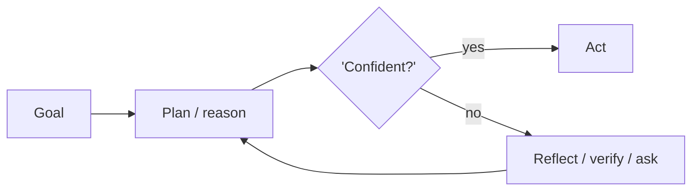

# Chapter 13: Skeptical Reasoning (Devil's Advocate)

**Part I — Planning & Reasoning**

## Skeptical Reasoning (Devil's Advocate) Pattern Overview

Dedicated critique pass that argues against the agent's own plan before execution.

**Skeptical Reasoning (Devil's Advocate)** is catalogued in the **Planning & Reasoning** part of the catalog (id `skeptic-devils-advocate`). It is tagged for finance, legal, strategy and is assembled from 3 components.

The planner proposes; the skeptic attacks assumptions and enumerates failure modes; only surviving plans proceed through the verdict gate. The design's honesty depends on the skeptic's independence: a skeptic sharing the planner's context inherits the planner's framing and produces cosmetic objections (performative skepticism) — critique theater that passes plans while missing the real risk.

**Definition 1 (Independent skeptic).** A devil's-advocate pass is *independent* iff (i) planner and skeptic run in separate context windows, (ii) every objection maps to a threat-taxonomy entry (checklist coverage — no free-floating vibes), and (iii) irreversible-action objections outrank style objections at the verdict gate by construction.

**Theorem 1 (Cosmetic critique is detectable).** Under independent skepticism with taxonomy-mapped objections, performative skepticism is visible as a coverage gap: objections that map to no taxonomy entry, or that cluster on style while irreversible risks go unmentioned, fail the gate's checklist — the verdict gate cannot pass what the taxonomy does not cover.

*Proof.* The taxonomy enumerates the threat classes the plan must survive; mapping each objection to an entry makes coverage computable — uncovered entries are explicit gaps, not silent omissions. Separation of contexts prevents framing inheritance: the skeptic cannot parrot the planner's assumptions because it never saw them. Weighting irreversible-action objections above style ones orders the gate correctly: a plan with polished prose and an unaddressed irreversible risk fails, while a plan with style nits and covered risks passes with notes. The catalogued extreme — a debate council suppressing dissent and converging confidently wrong — is what happens when the skeptic shares context and the gate counts votes instead of coverage: map objections, isolate contexts, weight irreversibility first. ∎

## Practical Applications & Use Cases

Domains the catalog tags this pattern for:

- finance
- legal
- strategy

1 documented failure scenario exercises it:

| Scenario | Severity | Likelihood | Domain |
|---|---|---|---|
| Debate council suppresses dissent and converges on a confident wrong call | High | High | strategy |

It also appears in 4 composition cascades:

| Cascade | Class | Blast radius | Impact |
|---|---|---|---|
| Debate council suppresses dissent and converges on a confident wrong call | Derived | service | High |
| Multi-Agent Debate / Council — injected debater | Inherent | service | High |
| Red Team / Blue Team Agents — collusive red team | Inherent | single-agent | Medium |
| Skeptical Reasoning (Devil's Advocate) — performative skepticism | Inherent | service | Low |

## How It Works

1. Planner proposes action.
2. Skeptic prompt attacks assumptions and enumerates failure modes.
3. Only plans surviving critique proceed.

## Components

- Planner
- Skeptic critic
- Verdict gate

## Control-Flow Diagram

## Failure Modes and Risks

1 failure mode is documented for this pattern:

| Failure mode | Severity | What happens |
|---|---|---|
| Performative skepticism | Low | Critic raises cosmetic objections while missing the real risk. |

## Protections

1. Skeptic must map objections to a threat taxonomy (checklist coverage).
2. Weight irreversible-action objections above style objections.
3. Separate context windows for planner and skeptic.

## At a Glance

| Field | Value |
|---|---|
| Catalog id | `skeptic-devils-advocate` |
| Part | I — Planning & Reasoning |
| Domains | finance, legal, strategy |
| Components | Planner, Skeptic critic, Verdict gate |
| Failure modes | 1 |
| Protections | 3 |
| Related patterns | Multi-Agent Debate / Council, Red Team / Blue Team Agents |
| Linked scenarios | 1 |
| Linked cascades | 4 |

## Key Takeaways

- Dedicated critique pass that argues against the agent's own plan before execution.
- Skeptic must map objections to a threat taxonomy (checklist coverage).
- Weight irreversible-action objections above style objections.
- Separate context windows for planner and skeptic.
- Know its failure modes: Performative skepticism (low).

## References and Related Patterns

| Related pattern | Part | Summary |
|---|---|---|
| Multi-Agent Debate / Council | Multi-Agent Topologies | Several agents argue positions or independently answer, then converge — surfaces disagreements before they surface in production. |
| Red Team / Blue Team Agents | Multi-Agent Topologies | Adversarial agent pair: red attacks the plan/artifact, blue defends; iteration hardens output before release. |

## Council deliberation

- **Safety researcher:** Skeptical Reasoning helps finance, legal and strategy planning through a dedicated critique pass that argues against the agent's own plan before execution, where the planner proposes action, the skeptic prompt attacks assumptions and enumerates failure modes, and only surviving plans proceed using a Planner, Skeptic critic and Verdict gate. The tension is Performative skepticism where the critic raises cosmetic objections while missing the real risk. The protection that carries weight is mapping objections to a threat taxonomy for checklist coverage, related to Debate-Council and Red-Team-Pair, and the operator should verify coverage before the gate passes.
- **Evaluation methodologist:** Checklist coverage is the right bar, and the companion protections of weighting irreversible-action objections above style objections and using separate context windows for planner and skeptic carry the operational weight. Without separation the skeptic inherits planner framing and stays cosmetic. The Verdict gate should enforce that ordering, so the operator should verify planner and skeptic contexts are isolated and that irreversible risks block progress even when style issues dominate the critique.

## Council reading

- **Red team:** Start with Performative skepticism (low): Critic raises cosmetic objections while missing the real risk. Debate council suppresses dissent and converges on a confident wrong call is the catalogued proof — high severity, strategy domain — so rehearse that exact chain before any other.
- **Blue team:** Hold with Skeptic must map objections to a threat taxonomy (checklist coverage); Weight irreversible-action objections above style objections. Then layer the remaining 1: defence here is the list, not any single item. Compose with Multi-Agent Debate / Council, Red Team / Blue Team Agents so a failure in one pattern meets a control in another.
- **Operator:** Deploy where it is tagged (finance, legal, strategy), and watch the 4 linked cascades — Debate council suppresses dissent and converges on a confident wrong call first, because composition is where small faults amplify. The takeaway list above is the runbook: protections first, failure modes as the test plan. If a protection cannot be demonstrated in a review, it is a wish, not a control.

## Conclusion

In the catalog this chapter was generated from, **Skeptical Reasoning (Devil's Advocate)** is one of 107 patterns in *Planning & Reasoning*, carrying 1 documented failure mode and 3 listed protections. Use it as a starting point, not a specification: the protection list is the part that survives contact with an adversary.

---
