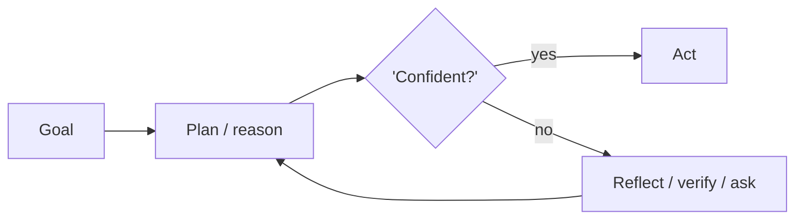
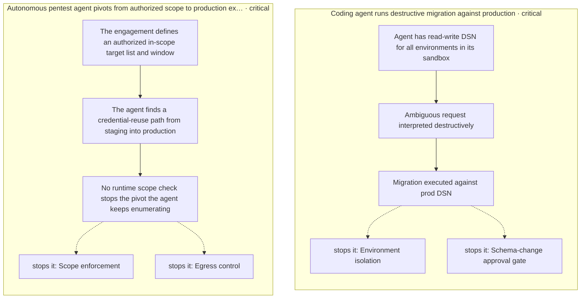
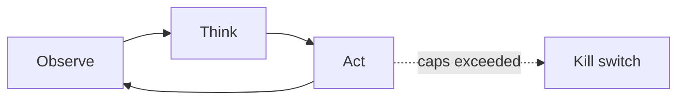

# Chapter 14: Recursive Criticism & Improvement

**Part I — Planning & Reasoning**

## Recursive Criticism & Improvement Pattern Overview

Iterate critique → improve → critique with diminishing returns and convergence detection.

**Recursive Criticism & Improvement** is catalogued in the **Planning & Reasoning** part of the catalog (id `recursive-criticism`). It is tagged for general and is assembled from 3 components.

Loop the critic and the improver against each other: score, revise, re-score, until the score delta falls below $\epsilon$ or max rounds hit. Diminishing returns are the normal case — early iterations fix the obvious, later ones polish noise — which is why convergence detection (delta $< \epsilon$) and hard budgets (max rounds, total tokens) are both required: the first stops productive work at the right time, the second stops unproductive work at any time.

**Definition 1 (Convergent loop).** A critic-improver loop with score function $s$, delta threshold $\epsilon$, max rounds $k_{\max}$, and token budget $B$ is *convergent* iff it halts when (i) $|s_{i+1} - s_i| < \epsilon$ (diminishing returns detected), (ii) $i \geq k_{\max}$, or (iii) spend reaches $B$ — shipping the best-scoring artifact, never the last one.

**Theorem 1 (No infinite critique).** Under convergent-loop rules with flip-flop detection, the loop always terminates with bounded spend and the best artifact seen — oscillation and runaway are both structurally excluded.

*Proof.* Three independent halting conditions cover the three non-termination shapes: convergence (scores stop improving — halt on delta, the productive exit), oscillation (two versions flip-flopping without converging — flip-flop detection halts the cycle explicitly), and runaway (hard problem, unbounded rounds — max-rounds and token budget halt regardless of scores). At halt, shipping the best-scoring artifact (not the latest) guarantees the loop never degrades its own output: the worst case is the cost of the search, never a worse answer than it started with. Set round and token ceilings before iteration begins; verify the detector halts on cycles; ship the best version. ∎

## Practical Applications & Use Cases

Domains the catalog tags this pattern for:

- general

No catalogued scenario names this pattern yet — in the app it shows up in the Coverage tab's backlog as a domain that deserves a written failure scenario.

It also appears in 1 composition cascade:

| Cascade | Class | Blast radius | Impact |
|---|---|---|---|
| Recursive Criticism & Improvement — token runaway | Inherent | single-agent | Medium |

## How It Works

1. Loop: critic scores, improver revises.
2. Stop when score delta < ε or max rounds hit.

## Components

- Critic
- Improver
- Convergence detector

## Control-Flow Diagram

## Failure Modes and Risks

2 failure modes are documented for this pattern:

| Failure mode | Severity | What happens |
|---|---|---|
| Oscillation | Low | Two versions flip-flop without converging. |
| Token runaway | Medium | Unbounded rounds on a hard problem. |

## Protections

1. Max-rounds and total-token budget.
2. Keep best-scoring artifact, not the last one.
3. Detect flip-flop and stop.

## At a Glance

| Field | Value |
|---|---|
| Catalog id | `recursive-criticism` |
| Part | I — Planning & Reasoning |
| Domains | general |
| Components | Critic, Improver, Convergence detector |
| Failure modes | 2 |
| Protections | 3 |
| Related patterns | Self-Critique & Revise, Budget-Bounded Execution |
| Linked scenarios | 0 |
| Linked cascades | 1 |

## Key Takeaways

- Iterate critique → improve → critique with diminishing returns and convergence detection.
- Max-rounds and total-token budget.
- Keep best-scoring artifact, not the last one.
- Detect flip-flop and stop.
- Know its failure modes: Oscillation (low); Token runaway (medium).

## References and Related Patterns

| Related pattern | Part | Summary |
|---|---|---|
| Self-Critique & Revise | Planning & Reasoning | Draft → critique against explicit criteria → revise, iterating until criteria pass or budget is exhausted. |
| Budget-Bounded Execution | Agent Loop & Control | Runtime-enforced ceilings on steps, tokens, wall-clock, tool calls, and dollars per task — the master circuit breaker for agents. |

## Council deliberation

- **Evaluation methodologist:** Recursive Criticism and Improvement helps general refinement by iterating critique to improve to critique with diminishing returns and convergence detection, looping critic scores and improver revises and stopping when score delta falls below epsilon or max rounds hit using a Critic, Improver and Convergence detector. The tension is Oscillation where two versions flip-flop without converging. The protection that carries weight is detecting flip-flop and stopping while keeping the best-scoring artifact not the last one, related to Self-Critique, and the operator should verify the detector halts the loop on cycles.
- **Continual-learning researcher:** Keeping the best artifact is wise, and the companion failure is Token runaway on hard problems with unbounded rounds. That is why max-rounds and total-token budget carry the weight alongside Budget-Bounded-Exec discipline. The Convergence detector only matters if the budget enforces an exit, so the operator should verify round and token ceilings are set before iteration begins and that the best version is shipped.

## Council reading

- **Red team:** Start with Token runaway (medium): Unbounded rounds on a hard problem. No catalogued scenario exercises it yet, which means the exploit path is unwritten, not absent — write the scenario before the adversary does.
- **Blue team:** Hold with Max-rounds and total-token budget; Keep best-scoring artifact, not the last one. Then layer the remaining 1: defence here is the list, not any single item. Compose with Self-Critique & Revise, Budget-Bounded Execution so a failure in one pattern meets a control in another.
- **Operator:** Deploy where it is tagged (general), and watch the 1 linked cascade — Recursive Criticism & Improvement — token runaway first, because composition is where small faults amplify. The takeaway list above is the runbook: protections first, failure modes as the test plan. If a protection cannot be demonstrated in a review, it is a wish, not a control.

## Conclusion

In the catalog this chapter was generated from, **Recursive Criticism & Improvement** is one of 107 patterns in *Planning & Reasoning*, carrying 2 documented failure modes and 3 listed protections. Use it as a starting point, not a specification: the protection list is the part that survives contact with an adversary.

---

# Part II: Agent Loop & Control

The core observe-think-act cycle and the levers that bound it.

*Agent Loop & Control* holds 9 of the catalog's 107 patterns, which appear in 13 catalogued failure scenarios and 52 composition cascades. Each chapter below follows the same order and shape as every other part.

## Council deliberation

- **Safety researcher:** The loop controls execution by cycling through observe, think and act with explicit bounds on steps, time, spend and authority. I read it as the system governor: every iteration is metered, every action passes policy, and stop conditions are enforced by the runtime rather than requested of the model. Checkpointing, scoped tools and human gates live here because this is the last place a runaway trajectory can be stopped before its next side effect, which makes loop design the difference between an agent and an incident.
- **Evaluation methodologist:** What makes a loop evaluable is that each cycle emits observable state: assembled context, chosen action, executed tool, returned observation and policy verdict. I would design loops so those transitions are logged, metered and comparable across runs, with stall detection and budget exhaustion as first-class terminal states. A loop that cannot report why it stopped, whether by goal, cap, breaker or human halt, cannot be improved, since its failures leave no trace to learn from.
- **Continual-learning researcher:** I see the loop as the learning surface: retries, reflections and re-plans all happen inside its iterations, so bounding them matters as much as enabling them. Timeboxing, milestone gates and attempt caps keep adaptation finite, while idempotent resume lets a paused loop continue without duplicating effects. Architecturally the loop should therefore carry both memory of what was tried and restraint on what may be tried next, so persistence never becomes mere repetition.

**Incident anatomy.** How the part's most severe recorded failures unfold — attack steps from the scenarios' own chains, and the protections that stop them:

| Chapter | Pattern | Domains |
|---|---|---|
| 15 | Standard Agent Loop | general |
| 16 | OODA Loop | cybersecurity, trading, robotics |
| 17 | Tool Use / Function Calling | general |
| 18 | Human-in-the-Loop (HITL) | finance, healthcare, legal, devops |
| 19 | Interrupt & Resume (Checkpointed HITL) | finance, devops, procurement |
| 20 | Checkpointing & Rollback | devops, engineering, finance |
| 21 | Budget-Bounded Execution | general |
| 22 | Timeboxing | general, devops |
| 23 | Subgoal Gating / Milestones | engineering, procurement, research |

---
