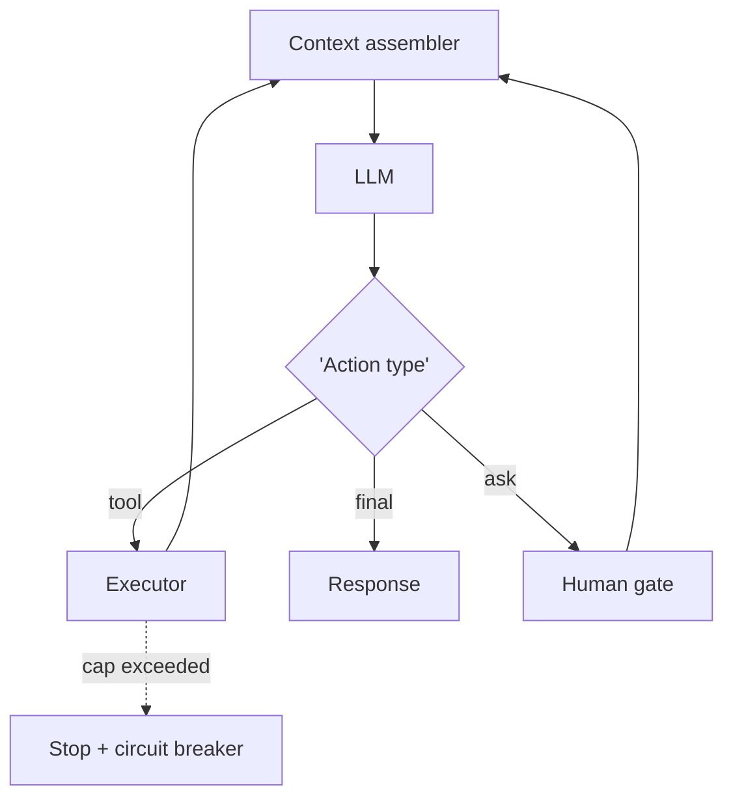

# Chapter 15: Standard Agent Loop

**Part II — Agent Loop & Control**

## Standard Agent Loop Pattern Overview

The canonical runtime: retrieve context → plan → select tool → execute → observe → repeat until done or bounded.

**Standard Agent Loop** is catalogued in the **Agent Loop & Control** part of the catalog (id `standard-agent-loop`). It is tagged for general and is assembled from 5 components.

Assemble context (system prompt, memory, tool docs, history); let the LLM choose the next action; execute, append the observation, loop. Stop on goal met, steps cap, budget cap, or human stop. The loop is the system governor: every iteration metered, every action passing policy, stop conditions enforced by the runtime rather than requested of the model. This is the last place a runaway trajectory can be stopped before its next side effect.

**Definition 1 (Runtime-bounded loop).** A loop is *runtime-bounded* iff (i) steps, tokens, and dollars are capped by the runtime (never by the model), (ii) the context compressor never drops system safety policy, and (iii) every iteration is written to the audit trail with its stop reason when it stops (goal, cap, breaker, or human halt).

**Theorem 1 (No unbounded execution).** Under runtime bounds with policy-preserving compression and per-iteration audit, the loop always terminates with bounded cost, intact guardrails, and an attributable stop reason — runaway and silent truncation are both structurally excluded.

*Proof.* Termination: steps/tokens/dollars caps are runtime-enforced counters, not model promises — the loop cannot outrun arithmetic, so the runaway failure (critical) terminates at the cap with bounded cost and side effects. Guardrails: the compressor is constrained to preserve system safety policy, so history growth squeezes context but never the guardrails — the overflow failure degrades recall, never protection. Attributability: per-iteration audit plus logged stop reason means every termination is classified (goal/cap/breaker/human), so failures leave the trace improvement needs. Verify caps are external (runtime, not model), compression preserves policy, and the history store never squeezes out guardrails. ∎

## Practical Applications & Use Cases

Domains the catalog tags this pattern for:

- general

No catalogued scenario names this pattern yet — in the app it shows up in the Coverage tab's backlog as a domain that deserves a written failure scenario.

It also appears in 5 composition cascades:

| Cascade | Class | Blast radius | Impact |
|---|---|---|---|
| ReAct (Reason + Act) — injected observations | Inherent | service | Critical |
| Standard Agent Loop — runaway loop | Inherent | single-agent | Critical |
| Working Memory (Context Window) — cwe-style instruction loss | Inherent | single-agent | Critical |
| Budget-Bounded Execution — budget set by the model | Inherent | single-agent | High |
| OODA Loop — adversarial manipulation | Inherent | service | High |

## How It Works

1. Assemble context (system prompt, memory, tool docs, history).
2. LLM chooses next action.
3. Runtime executes, appends observation, loops.
4. Stop conditions: goal met, steps cap, budget cap, human stop.

## Components

- Context assembler
- LLM
- Tool registry
- History store
- Stop-condition engine

## Control-Flow Diagram

## Failure Modes and Risks

2 failure modes are documented for this pattern:

| Failure mode | Severity | What happens |
|---|---|---|
| Runaway loop | Critical | No effective stop condition; costs and side effects compound. |
| Context window overflow | Medium | History grows until the model truncates safety instructions. |

## Protections

1. Hard step/token/dollar caps enforced by runtime, not by the model.
2. Context compressor that never drops system safety policy.
3. Every loop iteration written to the audit trail.

## At a Glance

| Field | Value |
|---|---|
| Catalog id | `standard-agent-loop` |
| Part | II — Agent Loop & Control |
| Domains | general |
| Components | Context assembler, LLM, Tool registry, History store, Stop-condition engine |
| Failure modes | 2 |
| Protections | 3 |
| Related patterns | ReAct (Reason + Act), Budget-Bounded Execution, Immutable Audit Trail |
| Linked scenarios | 0 |
| Linked cascades | 5 |

## Key Takeaways

- The canonical runtime: retrieve context → plan → select tool → execute → observe → repeat until done or bounded.
- Hard step/token/dollar caps enforced by runtime, not by the model.
- Context compressor that never drops system safety policy.
- Every loop iteration written to the audit trail.
- Know its failure modes: Runaway loop (critical); Context window overflow (medium).

## References and Related Patterns

| Related pattern | Part | Summary |
|---|---|---|
| ReAct (Reason + Act) | Planning & Reasoning | Interleave reasoning traces with tool actions: think, act, observe, think again. The canonical agentic loop. |
| Budget-Bounded Execution | Agent Loop & Control | Runtime-enforced ceilings on steps, tokens, wall-clock, tool calls, and dollars per task — the master circuit breaker for agents. |
| Immutable Audit Trail | Safety, Security & Governance | Append-only, tamper-evident log of every prompt, tool call, policy decision, approval, and outcome. |

## Council deliberation

- **Memory-systems researcher:** The Standard Agent Loop supports general runtime work by cycling retrieve context to plan to select tool to execute to observe to repeat until done or bounded, assembling context from system prompt, memory, tool docs and history, letting the LLM choose the next action, executing and appending observations, with stop on goal met, steps cap, budget cap or human stop using a Context assembler, LLM, Tool registry, History store and Stop-condition engine. The tension is Runaway loop with no effective stop where costs and side effects compound. The protection that carries weight is hard step, token and dollar caps enforced by runtime not the model, related to ReAct and Budget-Bounded-Exec, and the operator should verify caps are external.
- **Safety researcher:** External caps are essential, and the companion failure is Context window overflow where history grows until the model truncates safety instructions. That is why a context compressor that never drops system safety policy carries weight alongside writing every loop iteration to the audit trail. Related Audit-Trail gives accountability, so the operator should verify compression preserves policy and that the History store never squeezes out guardrails.

## Council reading

- **Red team:** Start with Runaway loop (critical): No effective stop condition; costs and side effects compound. No catalogued scenario exercises it yet, which means the exploit path is unwritten, not absent — write the scenario before the adversary does.
- **Blue team:** Hold with Hard step/token/dollar caps enforced by runtime, not by the model; Context compressor that never drops system safety policy. Then layer the remaining 1: defence here is the list, not any single item. Compose with ReAct (Reason + Act), Budget-Bounded Execution so a failure in one pattern meets a control in another.
- **Operator:** Deploy where it is tagged (general), and watch the 5 linked cascades — ReAct (Reason + Act) — injected observations first, because composition is where small faults amplify. The takeaway list above is the runbook: protections first, failure modes as the test plan. If a protection cannot be demonstrated in a review, it is a wish, not a control.

## Conclusion

In the catalog this chapter was generated from, **Standard Agent Loop** is one of 107 patterns in *Agent Loop & Control*, carrying 2 documented failure modes and 3 listed protections. Use it as a starting point, not a specification: the protection list is the part that survives contact with an adversary.

---
