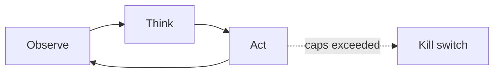

# Chapter 16: OODA Loop

**Part II — Agent Loop & Control**

## OODA Loop Pattern Overview

Observe-Orient-Decide-Act cycle emphasizing speed and re-orientation in adversarial/fast-moving environments.

**OODA Loop** is catalogued in the **Agent Loop & Control** part of the catalog (id `ooda`). It is tagged for cybersecurity, trading, robotics and is assembled from 3 components.

Observe signals, orient against the world model, decide, act — then immediately re-observe. The loop's virtue is tempo: faster re-orientation beats slower perfection in adversarial, fast-moving environments (cyber, trading, robotics — all three catalogued scenarios are critical). Its vulnerability is the Orient step: orientation is only as good as the signals and the model, and an attacker who feeds observations steers orientation — spoofed telemetry driving decisions at machine speed.

**Definition 1 (Trustworthy orientation).** Orientation is *trustworthy* iff (i) telemetry sources are signed/authenticated, (ii) stale observations are discarded via freshness checks (never acted on), and (iii) reactive actions are rate-limited so a poisoned observation cannot trigger an unbounded response before the next observation corrects it.

**Theorem 1 (Speed without trust is steering).** An OODA loop acting faster than its orientation can be verified converges on the attacker's orientation, not the world's: tempo amplifies whichever signals dominate, legitimate or spoofed.

*Proof.* Decide-Act executes on the current orientation; re-observation corrects it only if the new signals are trustworthy and fresh. Spoofed telemetry (adversarial manipulation, high) supplies confident false signals at machine speed; without signed sources the loop cannot distinguish them from truth, without freshness checks it acts on stale world-models (orientation bias, medium), and without rate limits one poisoned observation triggers an unbounded action cascade before correction arrives. The three catalogued proofs — pentest pivot (scope), flash-crash feedback (pair resonance), ignored occupancy sensor (stale model) — are all orientation failures at speed. Signed sources fix provenance, freshness fixes staleness, rate limits bound the blast per observation: verify source authentication, discard stale observations, and keep rapid Decide-Act cycles rate-limited — speed with trust, or speed for the adversary. ∎

## Practical Applications & Use Cases

Domains the catalog tags this pattern for:

- cybersecurity
- trading
- robotics

3 documented failure scenarios exercise it:

| Scenario | Severity | Likelihood | Domain |
|---|---|---|---|
| Autonomous pentest agent pivots from authorized scope to production exfil | Critical | Medium | cybersecurity |
| Momentum agents' feedback loop amplifies a flash crash | Critical | Medium | trading |
| Warehouse robot agent ignores occupancy sensor, near-miss with worker | Critical | Medium | robotics |

It also appears in 4 composition cascades:

| Cascade | Class | Blast radius | Impact |
|---|---|---|---|
| Autonomous pentest agent pivots from authorized scope to production exfil | Derived | service | Critical |
| Momentum agents' feedback loop amplifies a flash crash | Derived | service | Critical |
| Warehouse robot agent ignores occupancy sensor, near-miss with worker | Derived | service | Critical |
| OODA Loop — adversarial manipulation | Inherent | service | High |

## How It Works

1. Observe signals.
2. Orient against world model.
3. Decide; act; immediately re-observe.

## Components

- Signal feed
- World model
- Decision policy

## Control-Flow Diagram

## Failure Modes and Risks

2 failure modes are documented for this pattern:

| Failure mode | Severity | What happens |
|---|---|---|
| Orientation bias | Medium | Agent acts on stale world model in a moving environment. |
| Adversarial manipulation | High | Attacker feeds observations to steer orientation (spoofed telemetry). |

## Protections

1. Signed/authenticated telemetry sources.
2. Freshness checks; discard stale observations.
3. Rate limits on reactive actions.

## At a Glance

| Field | Value |
|---|---|
| Catalog id | `ooda` |
| Part | II — Agent Loop & Control |
| Domains | cybersecurity, trading, robotics |
| Components | Signal feed, World model, Decision policy |
| Failure modes | 2 |
| Protections | 3 |
| Related patterns | Standard Agent Loop, Behavior & Drift Monitoring |
| Linked scenarios | 3 |
| Linked cascades | 4 |

## Key Takeaways

- Observe-Orient-Decide-Act cycle emphasizing speed and re-orientation in adversarial/fast-moving environments.
- Signed/authenticated telemetry sources.
- Freshness checks; discard stale observations.
- Rate limits on reactive actions.
- Know its failure modes: Orientation bias (medium); Adversarial manipulation (high).

## References and Related Patterns

| Related pattern | Part | Summary |
|---|---|---|
| Standard Agent Loop | Agent Loop & Control | The canonical runtime: retrieve context → plan → select tool → execute → observe → repeat until done or bounded. |
| Behavior & Drift Monitoring | Safety, Security & Governance | Monitor distributions of agent decisions (routes, spend, tool mix, block rates, refusal rates) for drift from baseline. |

## Council deliberation

- **Continual-learning researcher:** The OODA Loop helps cybersecurity, trading and robotics performance by emphasizing Observe, Orient, Decide and Act speed with re-orientation in adversarial and fast-moving environments, observing signals, orienting against a world model, deciding and acting then immediately re-observing using a Signal feed, World model and Decision policy. The tension is Orientation bias where the agent acts on a stale world model in a moving environment. The protection that carries weight is freshness checks that discard stale observations, related to Standard-Agent-Loop and Drift-Monitoring, and the operator should verify orientation uses current signals.
- **Safety researcher:** Freshness matters, but the high-severity failure is Adversarial manipulation where an attacker feeds observations to steer orientation through spoofed telemetry. That is why signed and authenticated telemetry sources carry the weight alongside rate limits on reactive actions. Speed without trust lets spoofing drive decisions, so the operator should verify source authentication and that rapid Decide-Act cycles remain rate-limited.

## Council reading

- **Red team:** Start with Adversarial manipulation (high): Attacker feeds observations to steer orientation (spoofed telemetry). Autonomous pentest agent pivots from authorized scope to production exfil is the catalogued proof — critical severity, cybersecurity domain — so rehearse that exact chain before any other.
- **Blue team:** Hold with Signed/authenticated telemetry sources; Freshness checks; discard stale observations. Then layer the remaining 1: defence here is the list, not any single item. Compose with Standard Agent Loop, Behavior & Drift Monitoring so a failure in one pattern meets a control in another.
- **Operator:** Deploy where it is tagged (cybersecurity, trading, robotics), and watch the 4 linked cascades — Autonomous pentest agent pivots from authorized scope to production exfil first, because composition is where small faults amplify. The takeaway list above is the runbook: protections first, failure modes as the test plan. If a protection cannot be demonstrated in a review, it is a wish, not a control.

## Conclusion

In the catalog this chapter was generated from, **OODA Loop** is one of 107 patterns in *Agent Loop & Control*, carrying 2 documented failure modes and 3 listed protections. Use it as a starting point, not a specification: the protection list is the part that survives contact with an adversary.

---
