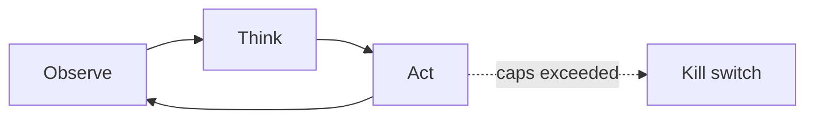

# Chapter 17: Tool Use / Function Calling

**Part II — Agent Loop & Control**

## Tool Use / Function Calling Pattern Overview

Expose typed tools to the model; model emits structured calls the runtime validates and executes.

**Tool Use / Function Calling** is catalogued in the **Agent Loop & Control** part of the catalog (id `tool-use`). It is tagged for general and is assembled from 4 components.

Publish JSON-schema tool definitions; the model emits a structured call; the runtime validates arguments, checks permissions, executes, and returns the result. The contract is mechanical: the model proposes, the runtime disposes — schemas plus server-side validation plus per-caller scoped tokens plus dry-run diffs. Every failure is a hole in that contract: attacker-shaped arguments, hallucinated tools, or the agent's broad credentials spent on a low-privilege requester's behalf.

**Definition 1 (Validated execution).** A tool call is *validated* iff (i) arguments pass server-side schema validation plus semantic checks (allowlists, ranges), (ii) the caller's token scopes exactly the requested capability (never ambient authority), and (iii) state-changing tools preview through dry-run/diff mode before executing.

**Theorem 1 (Three holes, three patches — complete).** Argument injection, hallucinated calls, and confused-deputy spending are each closed by exactly one protection, and together the three protections close all paths from model output to unauthorized state change.

*Proof.* Argument injection (attacker-shaped recipient/URL) is a validation failure: server-side schema plus semantic checks (allowlists, ranges) reject what the schema forbids — the model may propose anything, but only valid arguments execute. Tool hallucination (nonexistent tools, malformed args) is the same check's second job: unregistered tools have no schema, malformed args fail it. Confused deputy (broad credentials spent for a low-privilege requester) is an authority failure: per-caller scoped tokens mean the agent holds only the requester's authority, so spending beyond it is refused as out-of-scope. Dry-run/diff mode previews state changes before they land, catching what validation missed. Verify validation and dry-run precede any state change; the operator's check is that no path from model text to world state skips all three. ∎

## Practical Applications & Use Cases

Domains the catalog tags this pattern for:

- general

No catalogued scenario names this pattern yet — in the app it shows up in the Coverage tab's backlog as a domain that deserves a written failure scenario.

It also appears in 5 composition cascades:

| Cascade | Class | Blast radius | Impact |
|---|---|---|---|
| Least Privilege Scoping — standing broad credentials | Inherent | service | Critical |
| ReAct (Reason + Act) — injected observations | Inherent | service | Critical |
| Tool Use / Function Calling — confused deputy | Inherent | single-agent | Critical |
| Dynamic Tool Retrieval — tool smuggling | Inherent | single-agent | High |
| Structured Function Calling — result re-interpretation | Inherent | single-agent | High |

## How It Works

1. Publish JSON-schema tool definitions.
2. Model emits structured call.
3. Runtime validates args, checks permissions, executes, returns result.

## Components

- Tool registry
- Schema validator
- Permission checker
- Executor

## Control-Flow Diagram

## Failure Modes and Risks

3 failure modes are documented for this pattern:

| Failure mode | Severity | What happens |
|---|---|---|
| Argument injection | High | Attacker-influenced content shapes tool args (e.g., recipient, URL). |
| Tool hallucination | Medium | Model calls non-existent tools or malformed args. |
| Confused deputy | Critical | Agent's broad credentials used on behalf of a low-privilege requester. |

## Protections

1. Server-side schema validation + semantic checks (allowlists, ranges).
2. Per-caller scoped tokens — the agent never holds ambient authority.
3. Dry-run/diff mode for state-changing tools.

## At a Glance

| Field | Value |
|---|---|
| Catalog id | `tool-use` |
| Part | II — Agent Loop & Control |
| Domains | general |
| Components | Tool registry, Schema validator, Permission checker, Executor |
| Failure modes | 3 |
| Protections | 3 |
| Related patterns | Structured Function Calling, Least Privilege Scoping, Tool Dry-Run Tier (Alias: Safe-Mode Tools) |
| Linked scenarios | 0 |
| Linked cascades | 5 |

## Key Takeaways

- Expose typed tools to the model; model emits structured calls the runtime validates and executes.
- Server-side schema validation + semantic checks (allowlists, ranges).
- Per-caller scoped tokens — the agent never holds ambient authority.
- Dry-run/diff mode for state-changing tools.
- Know its failure modes: Argument injection (high); Tool hallucination (medium); Confused deputy (critical).

## References and Related Patterns

| Related pattern | Part | Summary |
|---|---|---|
| Structured Function Calling | Tools & Environment | JSON-schema-constrained tool calls with runtime validation; the mechanical backbone of every action an agent takes. |
| Least Privilege Scoping | Safety, Security & Governance | The agent holds the minimum credentials and data access needed for the current task — nothing ambient, nothing standing. |
| Tool Dry-Run Tier (Alias: Safe-Mode Tools) | Tools & Environment | Every state-changing tool ships a read-only simulation variant used during agent evaluation and onboarding. |

## Council deliberation

- **Safety researcher:** Tool Use helps general agency by exposing typed tools where the model emits structured calls the runtime validates and executes, publishing JSON-schema definitions, validating args, checking permissions, executing and returning results using a Tool registry, Schema validator, Permission checker and Executor. The tension is Confused deputy where broad agent credentials are used on behalf of a low-privilege requester. The protection that carries weight is per-caller scoped tokens so the agent never holds ambient authority, related to Function-Calling and Least-Privilege, and the operator should verify scopes per caller.
- **Evaluation methodologist:** Scoped authority is decisive, and the companion failures are Argument injection where attacker-influenced content shapes tool args such as recipient or URL and Tool hallucination where the model calls non-existent tools or malformed args. The protections that carry weight are server-side schema validation with semantic checks including allowlists and ranges plus dry-run and diff mode for state-changing tools, related to Tool-Sandbox. The operator should verify validation and dry-run precede any state change.

## Council reading

- **Red team:** Start with Confused deputy (critical): Agent's broad credentials used on behalf of a low-privilege requester. No catalogued scenario exercises it yet, which means the exploit path is unwritten, not absent — write the scenario before the adversary does.
- **Blue team:** Hold with Server-side schema validation + semantic checks (allowlists, ranges); Per-caller scoped tokens — the agent never holds ambient authority. Then layer the remaining 1: defence here is the list, not any single item. Compose with Structured Function Calling, Least Privilege Scoping so a failure in one pattern meets a control in another.
- **Operator:** Deploy where it is tagged (general), and watch the 5 linked cascades — Least Privilege Scoping — standing broad credentials first, because composition is where small faults amplify. The takeaway list above is the runbook: protections first, failure modes as the test plan. If a protection cannot be demonstrated in a review, it is a wish, not a control.

## Conclusion

In the catalog this chapter was generated from, **Tool Use / Function Calling** is one of 107 patterns in *Agent Loop & Control*, carrying 3 documented failure modes and 3 listed protections. Use it as a starting point, not a specification: the protection list is the part that survives contact with an adversary.

---
