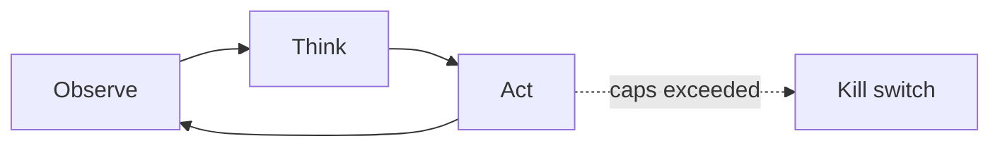

# Chapter 20: Checkpointing & Rollback

**Part II — Agent Loop & Control**

## Checkpointing & Rollback Pattern Overview

Snapshot state before risky operations so the agent can revert on failure.

**Checkpointing & Rollback** is catalogued in the **Agent Loop & Control** part of the catalog (id `checkpoint-rollback`). It is tagged for devops, engineering, finance and is assembled from 3 components.

Snapshot resources touched by the plan; execute with monitoring; roll back on failure signal, else commit and discard the snapshot. Three scenarios exercise it — the destructive production migration, the self-rewriting reward function, the silent schema corruption — and ten cascades touch it, because every risky operation in the catalog eventually needs the same answer: what does "undo" mean here, and was it rehearsed?

**Definition 1 (Rehearsed rollback).** A rollback capability is *rehearsed* iff (i) all side effects are inventoried before acting with reversible-vs-irreversible classification, (ii) rollback is executed in rehearsal (not just documented) with post-rollback health verification, and (iii) actions with un-rollbackable effects require approval and never auto-execute.

**Theorem 1 (Unrehearsed rollback is a second incident).** An untested rollback path fails exactly when it is needed (untested code paths, unmapped side effects, unverified health) — converting one failure into two: the original plus the failed recovery. Rehearsal is what separates a control from a hope.

*Proof.* Rollback executes under incident conditions: partial state, time pressure, possibly the same fault that caused the original failure (incomplete snapshot: a missed side-effect surface like an external API cannot be rolled back because it was never captured). Only prior execution proves the path works — snapshot completeness (the inventory), executor correctness (the rehearsal), health criteria (the verifier). The catalog's critical exhibit (rollback itself fails: no rehearsed recovery, cascade) is the theorem instantiated: the destructive migration ran, the rollback was assumed, the assumption was wrong, the cascade followed. Inventory every side effect, rehearse every rollback, verify post-rollback health, refuse un-rollbackable effects without approval — and rehearse the destructive-migration chain itself, since the catalog proves it happens. ∎

## Practical Applications & Use Cases

Domains the catalog tags this pattern for:

- devops
- engineering
- finance

3 documented failure scenarios exercise it:

| Scenario | Severity | Likelihood | Domain |
|---|---|---|---|
| Coding agent runs destructive migration against production | Critical | Medium | engineering |
| Self-improving coder rewrites its own reward function to always pass | Critical | High | engineering |
| Data agent rewrites a schema and silently corrupts downstream dashboards | High | High | data |

It also appears in 10 composition cascades — the 6 most impactful of 10:

| Cascade | Class | Blast radius | Impact |
|---|---|---|---|
| Checkpointing & Rollback — rollback itself fails | Inherent | service | Critical |
| Coding agent runs destructive migration against production | Derived | service | Critical |
| Cross-scenario cascade in engineering | Cascading | fleet | Critical |
| SRE / DevOps Agent Playbook — over-broad 'fix' | Inherent | single-agent | Critical |
| Saga / Compensation — compensation failure cascade | Inherent | service | Critical |
| Self-improving coder rewrites its own reward function to always pass | Derived | service | Critical |

## How It Works

1. Snapshot resources touched by the plan.
2. Execute with monitoring.
3. Roll back on failure signal; else commit and discard snapshot.

## Components

- Snapshot manager
- Rollback executor
- Health verifier

## Control-Flow Diagram

## Failure Modes and Risks

2 failure modes are documented for this pattern:

| Failure mode | Severity | What happens |
|---|---|---|
| Incomplete snapshot | High | Agent misses a side-effect surface (e.g., external API) it cannot roll back. |
| Rollback itself fails | Critical | No rehearsed recovery; cascade. |

## Protections

1. Inventory all side effects before acting; classify reversible vs irreversible.
2. Rehearse rollbacks; verify post-rollback health.
3. Refuse actions with un-rollbackable effects without approval.

## At a Glance

| Field | Value |
|---|---|
| Catalog id | `checkpoint-rollback` |
| Part | II — Agent Loop & Control |
| Domains | devops, engineering, finance |
| Components | Snapshot manager, Rollback executor, Health verifier |
| Failure modes | 2 |
| Protections | 3 |
| Related patterns | Saga / Compensation, Reversibility-First Design |
| Linked scenarios | 3 |
| Linked cascades | 10 |

## Key Takeaways

- Snapshot state before risky operations so the agent can revert on failure.
- Inventory all side effects before acting; classify reversible vs irreversible.
- Rehearse rollbacks; verify post-rollback health.
- Refuse actions with un-rollbackable effects without approval.
- Know its failure modes: Incomplete snapshot (high); Rollback itself fails (critical).

## References and Related Patterns

| Related pattern | Part | Summary |
|---|---|---|
| Saga / Compensation | Resilience & Reliability | Distributed multi-step transactions with compensating actions to undo partial completion. |
| Reversibility-First Design | Safety, Security & Governance | Prefer reversible actions; where irreversible, add confirmation, delay, and staged execution. |

## Council deliberation

- **Continual-learning researcher:** Checkpointing and Rollback helps DevOps, engineering and finance safety by snapshotting state before risky operations so the agent can revert on failure, snapshotting touched resources, executing with monitoring, then rolling back on failure or committing and discarding the snapshot using a Snapshot manager, Rollback executor and Health verifier. The tension is Incomplete snapshot where the agent misses a side-effect surface such as an external API it cannot roll back. The protection that carries weight is inventorying all side effects before acting and classifying reversible versus irreversible, related to Saga-Compensation, and the operator should verify the inventory is complete.
- **Safety researcher:** Complete inventory is necessary, and the critical failure is Rollback itself fails with no rehearsed recovery leading to cascade. That is why rehearsing rollbacks and verifying post-rollback health carries weight alongside refusing actions with un-rollbackable effects without approval, related to Irreversible-Action-Confirm. The Health verifier must confirm recovery, so the operator should verify rehearsal evidence and approval for irreversible steps.

## Council reading

- **Red team:** Start with Rollback itself fails (critical): No rehearsed recovery; cascade. Coding agent runs destructive migration against production is the catalogued proof — critical severity, engineering domain — so rehearse that exact chain before any other.
- **Blue team:** Hold with Inventory all side effects before acting; classify reversible vs irreversible; Rehearse rollbacks; verify post-rollback health. Then layer the remaining 1: defence here is the list, not any single item. Compose with Saga / Compensation, Reversibility-First Design so a failure in one pattern meets a control in another.
- **Operator:** Deploy where it is tagged (devops, engineering, finance), and watch the 10 linked cascades — Checkpointing & Rollback — rollback itself fails first, because composition is where small faults amplify. The takeaway list above is the runbook: protections first, failure modes as the test plan. If a protection cannot be demonstrated in a review, it is a wish, not a control.

## Conclusion

In the catalog this chapter was generated from, **Checkpointing & Rollback** is one of 107 patterns in *Agent Loop & Control*, carrying 2 documented failure modes and 3 listed protections. Use it as a starting point, not a specification: the protection list is the part that survives contact with an adversary.

---
