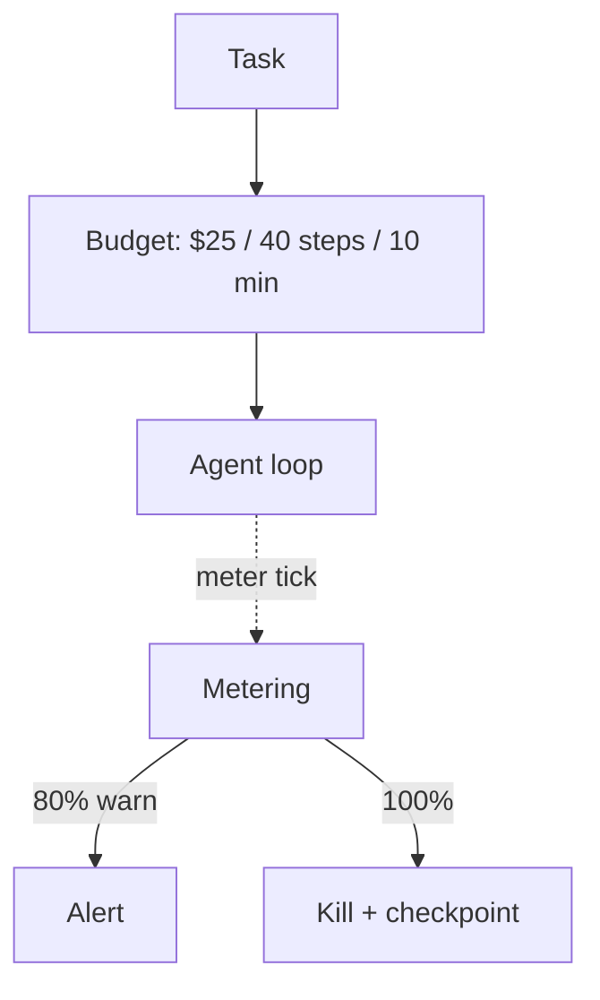

# Chapter 21: Budget-Bounded Execution

**Part II — Agent Loop & Control**

## Budget-Bounded Execution Pattern Overview

Runtime-enforced ceilings on steps, tokens, wall-clock, tool calls, and dollars per task — the master circuit breaker for agents.

**Budget-Bounded Execution** is catalogued in the **Agent Loop & Control** part of the catalog (id `budget-bounded-exec`). It is tagged for general and is assembled from 3 components.

Declare budget at task start; the runtime meters consumption across every loop; exhaustion stops with checkpoint and report — never silent continuation. Three scenarios prove why (the unbounded fleet spawn, the \$8,400 overnight token burn, the bill-blowing delegation), and sixteen cascades touch it — the most load-bearing governor in the loop. Two rules carry the whole pattern: budgets are set by the caller, never the model, and the meter counts every descendant.

**Definition 1 (Caller-set budget).** A task budget $B = (\text{steps}, \text{tokens}, \text{wall-clock}, \text{calls}, \$)$ is *caller-set* iff (i) it is declared by the caller/policy engine at task start and immutable at runtime, (ii) metering covers the task plus all descendants (sub-agents, retries, deferred jobs), and (iii) exhaustion stops with checkpoint plus report (never silent continuation), denominated in dollars as well as tokens.

**Theorem 1 (No self-funded runaway).** Under caller-set budgets with descendant-inclusive metering, no agent — however compromised, spawned, or delegated — can spend beyond $B$: self-raised limits are refused, unmetered side channels do not exist, and dollar accounting bounds what token accounting misses.

*Proof.* Self-set budgets (the high-severity failure) let the attacker-influenced model raise its own limits — caller-set with runtime immutability removes the pen from the model's hand. Unmetered side channels (sub-agents, deferred jobs escaping the meter) are closed by descendant-inclusive metering: the Budget registry aggregates descendant spend before exhaustion handling, so spawning multiplies actors but not budget. Dollar denomination closes the unit gap: token caps without dollar caps miss price changes, model swaps, and tool-call fees. The three catalogued proofs bound the claim empirically: unbounded fleet spawn (spawn without budget dies at the cap), the \$8,400 overnight burn (metered loops stop at dollars, not vibes), delegation blowout (descendant spend counts against the delegator). Declare, meter everything, stop with a report. ∎

## Practical Applications & Use Cases

Domains the catalog tags this pattern for:

- general

3 documented failure scenarios exercise it:

| Scenario | Severity | Likelihood | Domain |
|---|---|---|---|
| Self-parallelizing agent spawns an unbounded fleet of sub-agent copies | Critical | Medium | enterprise |
| Unbounded agent loop burns \$8,400 in tokens overnight | High | High | general |
| Hierarchical agents delegate until the bill exceeds the project budget | Medium | Medium | enterprise |

It also appears in 16 composition cascades — the 6 most impactful of 16:

| Cascade | Class | Blast radius | Impact |
|---|---|---|---|
| Circuit Breaker & Kill Switch — breaker owned by the agent | Inherent | service | Critical |
| Cross-scenario cascade in general | Cascading | fleet | Critical |
| Provider outage → retry storm → cost halt | Cascading | fleet | Critical |
| Self-parallelizing agent spawns an unbounded fleet of sub-agent copies | Derived | service | Critical |
| Standard Agent Loop — runaway loop | Inherent | single-agent | Critical |
| Budget-Bounded Execution — budget set by the model | Inherent | single-agent | High |

## How It Works

1. Declare budget at task start.
2. Runtime meters consumption across every loop.
3. Exhaustion → stop, checkpoint, report; never silent continuation.

## Components

- Metering middleware
- Budget registry
- Stop controller

## Control-Flow Diagram

## Failure Modes and Risks

2 failure modes are documented for this pattern:

| Failure mode | Severity | What happens |
|---|---|---|
| Budget set by the model | High | Agent writes its own limits; attacker-influenced model raises them. |
| Unmetered side channels | Medium | Sub-agents or deferred jobs escape the meter. |

## Protections

1. Budgets set by the caller/policy engine, never the model; immutable at runtime.
2. Meter includes all descendants (sub-agents, retries).
3. Dollar-denominated, not just token-denominated.

## At a Glance

| Field | Value |
|---|---|
| Catalog id | `budget-bounded-exec` |
| Part | II — Agent Loop & Control |
| Domains | general |
| Components | Metering middleware, Budget registry, Stop controller |
| Failure modes | 2 |
| Protections | 3 |
| Related patterns | Quotas & Rate Limiting, Circuit Breaker & Kill Switch, Standard Agent Loop |
| Linked scenarios | 3 |
| Linked cascades | 16 |

## Key Takeaways

- Runtime-enforced ceilings on steps, tokens, wall-clock, tool calls, and dollars per task — the master circuit breaker for agents.
- Budgets set by the caller/policy engine, never the model; immutable at runtime.
- Meter includes all descendants (sub-agents, retries).
- Dollar-denominated, not just token-denominated.
- Know its failure modes: Budget set by the model (high); Unmetered side channels (medium).

## References and Related Patterns

| Related pattern | Part | Summary |
|---|---|---|
| Quotas & Rate Limiting | Safety, Security & Governance | Per-agent, per-tool, per-tenant rate and volume ceilings; the blast-radius limiter of last resort. |
| Circuit Breaker & Kill Switch | Safety, Security & Governance | Automatic trip on anomaly (looping, error rate, spend, output class) plus a human-operable global kill switch. |
| Standard Agent Loop | Agent Loop & Control | The canonical runtime: retrieve context → plan → select tool → execute → observe → repeat until done or bounded. |

## Council deliberation

- **Evaluation methodologist:** Budget-Bounded Execution is the master circuit breaker for general tasks through runtime-enforced ceilings on steps, tokens, wall-clock, tool calls and dollars per task, declaring budget at task start, metering consumption across every loop, and stopping with checkpoint and report on exhaustion using Metering middleware, Budget registry and Stop controller. The tension is Budget set by the model where the agent writes its own limits and attacker-influenced models raise them. The protection that carries weight is budgets set by the caller and policy engine never the model and immutable at runtime, related to Quota-Rate-Limit and Circuit-Breaker, and the operator should verify immutability.
- **Safety researcher:** Caller-set budgets are foundational, and the companion failure is Unmetered side channels where sub-agents or deferred jobs escape the meter. That is why metering that includes all descendants including sub-agents and retries carries weight alongside dollar-denominated not just token-denominated accounting, related to Standard-Agent-Loop. The operator should verify the Budget registry aggregates descendant spend before exhaustion handling.

## Council reading

- **Red team:** Start with Budget set by the model (high): Agent writes its own limits; attacker-influenced model raises them. Self-parallelizing agent spawns an unbounded fleet of sub-agent copies is the catalogued proof — critical severity, enterprise domain — so rehearse that exact chain before any other.
- **Blue team:** Hold with Budgets set by the caller/policy engine, never the model; immutable at runtime; Meter includes all descendants (sub-agents, retries). Then layer the remaining 1: defence here is the list, not any single item. Compose with Quotas & Rate Limiting, Circuit Breaker & Kill Switch so a failure in one pattern meets a control in another.
- **Operator:** Deploy where it is tagged (general), and watch the 16 linked cascades — Circuit Breaker & Kill Switch — breaker owned by the agent first, because composition is where small faults amplify. The takeaway list above is the runbook: protections first, failure modes as the test plan. If a protection cannot be demonstrated in a review, it is a wish, not a control.

## Conclusion

In the catalog this chapter was generated from, **Budget-Bounded Execution** is one of 107 patterns in *Agent Loop & Control*, carrying 2 documented failure modes and 3 listed protections. Use it as a starting point, not a specification: the protection list is the part that survives contact with an adversary.

---
