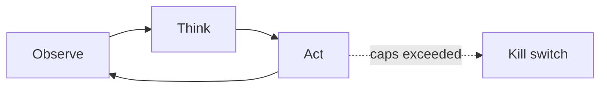

# Chapter 22: Timeboxing

**Part II — Agent Loop & Control**

## Timeboxing Pattern Overview

Wall-clock deadline per task; agent must deliver partial result or escalate when time expires.

**Timeboxing** is catalogued in the **Agent Loop & Control** part of the catalog (id `timeboxing`). It is tagged for general, devops and is assembled from 2 components.

Deadline at dispatch; the agent plans with time awareness; at 80% it reduces scope, at 100% it checkpoints and escalates. The deadline bounds the worst case in the dimension budgets miss: wall-clock time, which matters when the cost is physical (a robot near a worker) rather than metered (tokens on a bill). The failure is deadline-induced corner cutting — verification skipped under time pressure — which is why verification steps are exempt from scope reduction by construction, not by discipline.

**Definition 1 (Honest timebox).** A timebox with deadline $T$ is *honest* iff (i) scope reduction at 80% never touches verification steps (exempt by construction), (ii) expiry produces checkpoint plus escalation (never silent continuation or fake completion), and (iii) partial delivery carries explicit `incomplete` markers routed to escalate, never presented as finished.

**Theorem 1 (Deadlines bound time, not correctness).** Under honest timeboxing, a task exceeding $T$ costs at most $T$ plus escalation — and never a skipped verification: verification is deadline-exempt, so time pressure cannot convert it into corner-cutting.

*Proof.* Scope reduction under pressure sheds scope, and without exemption it sheds verification first (cheapest to cut, hardest to miss immediately — the catalogued failure). Exempting verification by construction removes it from the reducible set: at 80% the agent cuts scope around verification, never through it. At 100% the agent checkpoints and escalates rather than continuing silently or faking completion; `incomplete` markers preserve honesty about what was cut. The robotics proof (ignored occupancy sensor, near-miss) shows the stakes: a verification step skipped under time pressure is a safety step skipped. Verify verification still runs at deadline; confirm partial outputs are flagged incomplete and routed to escalate. ∎

## Practical Applications & Use Cases

Domains the catalog tags this pattern for:

- general
- devops

1 documented failure scenario exercises it:

| Scenario | Severity | Likelihood | Domain |
|---|---|---|---|
| Warehouse robot agent ignores occupancy sensor, near-miss with worker | Critical | Medium | robotics |

It also appears in 2 composition cascades:

| Cascade | Class | Blast radius | Impact |
|---|---|---|---|
| Warehouse robot agent ignores occupancy sensor, near-miss with worker | Derived | service | Critical |
| Timeboxing — deadline-induced corner cutting | Inherent | single-agent | Medium |

## How It Works

1. Deadline at dispatch.
2. Agent plans with time awareness.
3. At 80%: reduce scope; at 100%: checkpoint & escalate.

## Components

- Deadline clock
- Scope-reduction policy

## Control-Flow Diagram

## Failure Modes and Risks

1 failure mode is documented for this pattern:

| Failure mode | Severity | What happens |
|---|---|---|
| Deadline-induced corner cutting | Medium | Agent skips verification steps under time pressure. |

## Protections

1. Verification steps are exempt from scope reduction.
2. Graceful partial delivery with explicit 'incomplete' markers.

## At a Glance

| Field | Value |
|---|---|
| Catalog id | `timeboxing` |
| Part | II — Agent Loop & Control |
| Domains | general, devops |
| Components | Deadline clock, Scope-reduction policy |
| Failure modes | 1 |
| Protections | 2 |
| Related patterns | Budget-Bounded Execution, Subgoal Gating / Milestones |
| Linked scenarios | 1 |
| Linked cascades | 2 |

## Key Takeaways

- Wall-clock deadline per task; agent must deliver partial result or escalate when time expires.
- Verification steps are exempt from scope reduction.
- Graceful partial delivery with explicit 'incomplete' markers.
- Know its failure modes: Deadline-induced corner cutting (medium).

## References and Related Patterns

| Related pattern | Part | Summary |
|---|---|---|
| Budget-Bounded Execution | Agent Loop & Control | Runtime-enforced ceilings on steps, tokens, wall-clock, tool calls, and dollars per task — the master circuit breaker for agents. |
| Subgoal Gating / Milestones | Agent Loop & Control | Split long tasks into milestones; each gate requires a verifiable success criterion before proceeding. |

## Council deliberation

- **Evaluation methodologist:** Timeboxing helps general and DevOps delivery through a wall-clock deadline per task where the agent must deliver a partial result or escalate on expiry, setting a deadline at dispatch, planning with time awareness, then reducing scope and checkpointing and escalating at expiry using a Deadline clock and Scope-reduction policy. The tension is Deadline-induced corner cutting where the agent skips verification under time pressure. The protection that carries weight is exempting verification steps from scope reduction, related to Budget-Bounded-Exec and Subgoal-Gating, and the operator should verify verification still runs at deadline.
- **Continual-learning researcher:** Protecting verification is the key point, and the companion protection of graceful partial delivery with explicit incomplete markers carries the operational weight. Because scope reduction must not masquerade as completion, markers preserve honesty about what was cut. The Scope-reduction policy should enforce that labeling, so the operator should verify partial outputs are flagged incomplete and routed to escalate rather than presented as finished.

## Council reading

- **Red team:** Start with Deadline-induced corner cutting (medium): Agent skips verification steps under time pressure. Warehouse robot agent ignores occupancy sensor, near-miss with worker is the catalogued proof — critical severity, robotics domain — so rehearse that exact chain before any other.
- **Blue team:** Hold with Verification steps are exempt from scope reduction; Graceful partial delivery with explicit 'incomplete' markers. Compose with Budget-Bounded Execution, Subgoal Gating / Milestones so a failure in one pattern meets a control in another.
- **Operator:** Deploy where it is tagged (general, devops), and watch the 2 linked cascades — Warehouse robot agent ignores occupancy sensor, near-miss with worker first, because composition is where small faults amplify. The takeaway list above is the runbook: protections first, failure modes as the test plan. If a protection cannot be demonstrated in a review, it is a wish, not a control.

## Conclusion

In the catalog this chapter was generated from, **Timeboxing** is one of 107 patterns in *Agent Loop & Control*, carrying 1 documented failure mode and 2 listed protections. Use it as a starting point, not a specification: the protection list is the part that survives contact with an adversary.

---
