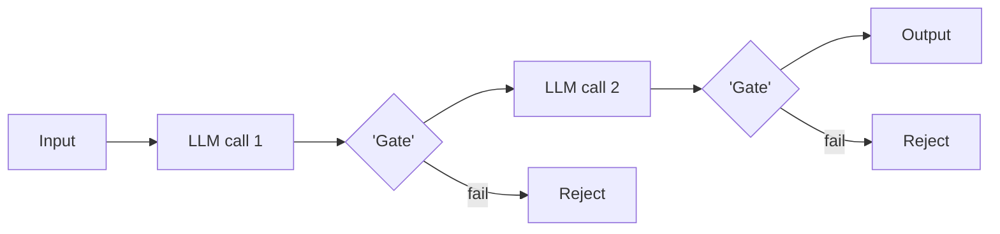

# Chapter 24: Prompt Chaining

**Part III — Workflow Orchestration**

## Prompt Chaining Pattern Overview

Decompose a task into a fixed sequence of LLM calls, each with structured output feeding the next; gates between steps.

**Prompt Chaining** is catalogued in the **Workflow Orchestration** part of the catalog (id `prompt-chaining`). It is tagged for general and is assembled from 3 components.

Fixed pipeline of prompts; each step emits validated structured output; optional gates reject or branch on failed validation. The chain trades open-ended autonomy for repeatability: every handoff is a typed boundary where validation can fail closed, provenance tags attach, and per-step failure rates are measurable as drift signal. Error compounding — early hallucination laundered into 'fact' by later steps — is what the boundaries exist to stop.

**Definition 1 (Validated chain).** A prompt chain $s_1 \to s_2 \to \dots \to s_n$ is *validated* iff (i) every step boundary validates structured output and fails closed on failure, (ii) provenance tags travel with data through the chain, and (iii) per-step failure rates are monitored as a drift signal.

**Theorem 1 (Laundering requires an unvalidated boundary).** Under validated chaining with fail-closed gates, an early hallucination cannot become a downstream 'fact': it is rejected at the first boundary whose validator checks the claim — and every boundary checks.

*Proof.* Laundering means step $s_i$'s hallucination is consumed as fact by $s_{i+1}$ — possible only if the $s_i \to s_{i+1}$ boundary passes it through. Fail-closed validation at every boundary rejects malformed or uncheckable output before the next step consumes it, so the hallucination terminates at the first checked claim. Provenance tags make the rejection attributable (which step produced what), and per-step failure-rate monitoring detects the pattern (rising rejects at one boundary signal envelope breach — inputs outside the design envelope, the rigidity failure). The operator verifies boundary validation blocks suspect outputs, provenance persists across steps, and failure-rate alerts are reviewed — because a chain is only as honest as its weakest boundary. ∎

## Practical Applications & Use Cases

Domains the catalog tags this pattern for:

- general

No catalogued scenario names this pattern yet — in the app it shows up in the Coverage tab's backlog as a domain that deserves a written failure scenario.

It also appears in 3 composition cascades:

| Cascade | Class | Blast radius | Impact |
|---|---|---|---|
| Routing — router poisoning | Inherent | single-agent | High |
| Prompt Chaining — error compounding | Inherent | single-agent | Medium |
| Sequential Handoff Pipeline — gate capture by upstream style | Inherent | service | Medium |

## How It Works

1. Fixed pipeline of prompts.
2. Each step emits validated structured output.
3. Optional gate: reject/branch on failed validation.

## Components

- Prompt steps
- Schema validators
- Gates

## Control-Flow Diagram

## Failure Modes and Risks

2 failure modes are documented for this pattern:

| Failure mode | Severity | What happens |
|---|---|---|
| Error compounding | Medium | Early hallucination gets laundered into 'fact' by later steps. |
| Rigid to novel inputs | Low | Fixed chain fails on inputs outside design envelope. |

## Protections

1. Validate at every boundary; fail closed.
2. Provenance tags travel with data through the chain.
3. Monitor per-step failure rates as drift signal.

## At a Glance

| Field | Value |
|---|---|
| Catalog id | `prompt-chaining` |
| Part | III — Workflow Orchestration |
| Domains | general |
| Components | Prompt steps, Schema validators, Gates |
| Failure modes | 2 |
| Protections | 3 |
| Related patterns | Routing, Sequential Handoff Pipeline |
| Linked scenarios | 0 |
| Linked cascades | 3 |

## Key Takeaways

- Decompose a task into a fixed sequence of LLM calls, each with structured output feeding the next; gates between steps.
- Validate at every boundary; fail closed.
- Provenance tags travel with data through the chain.
- Monitor per-step failure rates as drift signal.
- Know its failure modes: Error compounding (medium); Rigid to novel inputs (low).

## References and Related Patterns

| Related pattern | Part | Summary |
|---|---|---|
| Routing | Workflow Orchestration | Classifier dispatches input to a specialized downstream prompt/model; cheap fast path, expensive path only when needed. |
| Sequential Handoff Pipeline | Multi-Agent Topologies | Specialist agents in a fixed order each transforming the artifact (draft → fact-check → legal → style). |

## Council deliberation

- **Continual-learning researcher:** Prompt Chaining helps general tasks by decomposing work into a fixed sequence of LLM calls with structured output feeding the next step and gates between steps, using fixed pipelines, validated structured output per step, and optional reject or branch on failed validation with Prompt steps, Schema validators and Gates. The tension is Error compounding where early hallucination gets laundered into fact by later steps. The protection that carries weight is validating at every boundary and failing closed, related to Routing and Sequential-Pipeline, and the operator should verify boundary validation blocks suspect outputs.
- **Evaluation methodologist:** Boundary validation is essential, and the companion protections of provenance tags traveling with data through the chain and monitoring per-step failure rates as drift signal carry lasting weight. Because fixed chains are rigid to novel inputs outside the design envelope, drift monitoring reveals envelope breaches. The Gates enforce discipline, so the operator should verify provenance persists across steps and failure-rate alerts are reviewed.

## Council reading

- **Red team:** Start with Error compounding (medium): Early hallucination gets laundered into 'fact' by later steps. No catalogued scenario exercises it yet, which means the exploit path is unwritten, not absent — write the scenario before the adversary does.
- **Blue team:** Hold with Validate at every boundary; fail closed; Provenance tags travel with data through the chain. Then layer the remaining 1: defence here is the list, not any single item. Compose with Routing, Sequential Handoff Pipeline so a failure in one pattern meets a control in another.
- **Operator:** Deploy where it is tagged (general), and watch the 3 linked cascades — Routing — router poisoning first, because composition is where small faults amplify. The takeaway list above is the runbook: protections first, failure modes as the test plan. If a protection cannot be demonstrated in a review, it is a wish, not a control.

## Conclusion

In the catalog this chapter was generated from, **Prompt Chaining** is one of 107 patterns in *Workflow Orchestration*, carrying 2 documented failure modes and 3 listed protections. Use it as a starting point, not a specification: the protection list is the part that survives contact with an adversary.

---
