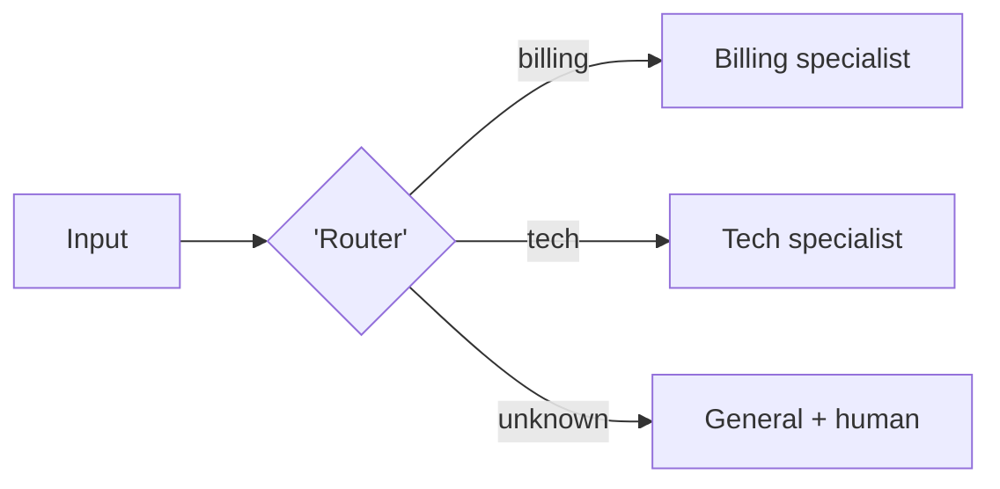

# Chapter 25: Routing

**Part III — Workflow Orchestration**

## Routing Pattern Overview

Classifier dispatches input to a specialized downstream prompt/model; cheap fast path, expensive path only when needed.

**Routing** is catalogued in the **Workflow Orchestration** part of the catalog (id `routing`). It is tagged for support, general and is assembled from 3 components.

Route with a classifier (LLM or small model); the specialist prompt handles the shard; unknowns take the fallback lane. The router is the cheapest decision point in the building — and therefore the highest-leverage attack surface: injection text that manipulates routing to a permissive specialist bypasses every downstream guardrail by choosing the lane without them. Safety-critical intents get a hard-coded route, not a learned one, for exactly this reason.

**Definition 1 (Guardrailed routing).** A router is *guardrailed* iff (i) safety-critical intents map to fixed routes (hard-coded, never learned), (ii) every routing decision is logged with alerting on unusual route distributions, (iii) every specialist inherits the generalist's full guardrails (no permissive lane), and (iv) unknown inputs take the fallback lane (general + human), never the cheapest match.

**Theorem 1 (Routing cannot downgrade protection).** Under guardrailed routing, no input — however crafted — reaches a specialist with weaker protections than the generalist would have applied: the route may change the expertise, never the guardrails.

*Proof.* Poisoned routing (high severity) steers input toward the most permissive specialist; hard-coded safety routes (i) remove the steering target for critical intents (they cannot be learned away), guardrail parity (iii) removes the payoff (all lanes equally guarded, so the permissive specialist does not exist), and decision logging with distribution alerts (ii) exposes the steering attempt (unusual routes are themselves the signal). The fallback lane (iv) handles unknowns safely: novel inputs get the generalist plus a human, not the closest cheap match. Misrouting (urgent safety issue to a chatty general lane) is the availability dual — fixed routes for critical intents close it from the other side. Verify critical intents cannot be learned away; verify guardrail parity; review route logs for anomalies. ∎

## Practical Applications & Use Cases

Domains the catalog tags this pattern for:

- support
- general

No catalogued scenario names this pattern yet — in the app it shows up in the Coverage tab's backlog as a domain that deserves a written failure scenario.

It also appears in 4 composition cascades:

| Cascade | Class | Blast radius | Impact |
|---|---|---|---|
| Customer Support Agent Playbook — social-engineered refunds | Inherent | single-agent | High |
| Front-Desk Triage — triage under-classification | Inherent | service | High |
| Routing — router poisoning | Inherent | single-agent | High |
| Prompt Chaining — error compounding | Inherent | single-agent | Medium |

## How It Works

1. Route with classifier (LLM or small model).
2. Specialist prompt handles the shard.
3. Fallback route for unknowns.

## Components

- Router classifier
- Specialist prompt set
- Fallback lane

## Control-Flow Diagram

## Failure Modes and Risks

2 failure modes are documented for this pattern:

| Failure mode | Severity | What happens |
|---|---|---|
| Misrouting | Medium | Urgent safety issue routed to a chatty general lane. |
| Router poisoning | High | Injection text manipulates routing to a permissive specialist. |

## Protections

1. Safety-critical intents have a hard-coded route, not a learned one.
2. Log route decisions; alert on unusual route distribution.
3. Specialists inherit the same guardrails as the generalist.

## At a Glance

| Field | Value |
|---|---|
| Catalog id | `routing` |
| Part | III — Workflow Orchestration |
| Domains | support, general |
| Components | Router classifier, Specialist prompt set, Fallback lane |
| Failure modes | 2 |
| Protections | 3 |
| Related patterns | Front-Desk Triage, Prompt Chaining |
| Linked scenarios | 0 |
| Linked cascades | 4 |

## Key Takeaways

- Classifier dispatches input to a specialized downstream prompt/model; cheap fast path, expensive path only when needed.
- Safety-critical intents have a hard-coded route, not a learned one.
- Log route decisions; alert on unusual route distribution.
- Specialists inherit the same guardrails as the generalist.
- Know its failure modes: Misrouting (medium); Router poisoning (high).

## References and Related Patterns

| Related pattern | Part | Summary |
|---|---|---|
| Front-Desk Triage | Multi-Agent Topologies | Cheap intake agent classifies and routes; specialists handle; triage retains escalation authority. |
| Prompt Chaining | Workflow Orchestration | Decompose a task into a fixed sequence of LLM calls, each with structured output feeding the next; gates between steps. |

## Council deliberation

- **Evaluation methodologist:** Routing helps support and general workloads by having a classifier dispatch input to a specialized downstream prompt or model with a cheap fast path and an expensive path only when needed, routing with an LLM or small-model classifier, handling shards with specialist prompts, and keeping a fallback lane using a Router classifier, Specialist prompt set and Fallback lane. The tension is Misrouting where an urgent safety issue goes to a chatty general lane. The protection that carries weight is hard-coding safety-critical intents to a fixed route not a learned one, related to Specialist-Triage and Prompt-Chaining, and the operator should verify critical intents cannot be learned away.
- **Safety researcher:** Hard-coded safety routes are decisive, and the high-severity failure is Router poisoning where injection text manipulates routing to a permissive specialist. That is why specialists inheriting the same guardrails as the generalist carries weight alongside logging route decisions and alerting on unusual route distribution. The Router classifier must not downgrade protections, so the operator should verify guardrail parity and review route logs for anomalies.

## Council reading

- **Red team:** Start with Router poisoning (high): Injection text manipulates routing to a permissive specialist. No catalogued scenario exercises it yet, which means the exploit path is unwritten, not absent — write the scenario before the adversary does.
- **Blue team:** Hold with Safety-critical intents have a hard-coded route, not a learned one; Log route decisions; alert on unusual route distribution. Then layer the remaining 1: defence here is the list, not any single item. Compose with Front-Desk Triage, Prompt Chaining so a failure in one pattern meets a control in another.
- **Operator:** Deploy where it is tagged (support, general), and watch the 4 linked cascades — Customer Support Agent Playbook — social-engineered refunds first, because composition is where small faults amplify. The takeaway list above is the runbook: protections first, failure modes as the test plan. If a protection cannot be demonstrated in a review, it is a wish, not a control.

## Conclusion

In the catalog this chapter was generated from, **Routing** is one of 107 patterns in *Workflow Orchestration*, carrying 2 documented failure modes and 3 listed protections. Use it as a starting point, not a specification: the protection list is the part that survives contact with an adversary.

---
