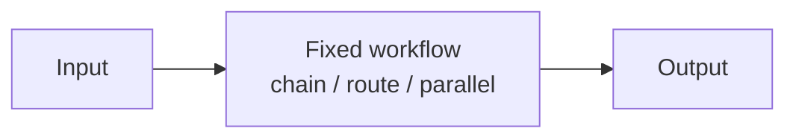

# Chapter 26: Parallelization (Sectioning)

**Part III — Workflow Orchestration**

## Parallelization (Sectioning) Pattern Overview

Run independent subtasks concurrently (subtasks of a prompt, or independent prompts) and merge.

**Parallelization (Sectioning)** is catalogued in the **Workflow Orchestration** part of the catalog (id `parallelization-sectioning`). It is tagged for research, legal, general and is assembled from 3 components.

Split into independent units; fan out to concurrent workers; merge results deterministically. Concurrency buys speed at two prices: the merge must reconcile branches that may disagree (hidden dependencies cause inconsistent merges), and the fan-out multiplies spend (thundering herd: concurrent workers plus retries compounding cost). Both prices are bounded by construction — deterministic merge with conflict detection, global concurrency and spend caps.

**Definition 1 (Sound fan-out).** A fan-out over units $u_1, \dots, u_n$ is *sound* iff (i) the units are truly independent (no hidden dependencies), (ii) the merge is deterministic with conflict detection (disagreements surface, never smooth over), and (iii) global concurrency and spend caps cover initial fan-out plus retries.

**Theorem 1 (Independence is a precondition, not an assumption).** If the split is non-independent (hidden dependencies), no merge rule recovers correctness — the inconsistency is in the inputs, and deterministic merging only makes the failure reproducible. Caps bound cost, never correctness.

*Proof.* Deterministic merge with conflict detection surfaces disagreements: conflicting branch results raise a conflict instead of merging silently — which converts silent corruption into a visible decision point. But surfacing is not resolving: hidden dependencies mean the units were never independent, so no merge of their outputs is valid regardless of the rule. Correctness requires the split to be genuinely independent (verified, not assumed); caps require the Fan-out scheduler to enforce ceilings over fan-out plus retries (thundering herd dies at the cap, not in the invoice). Verify the merger surfaces conflicts rather than hiding them; verify caps cover retries before launch — cost multiplies fast when concurrency meets retry. ∎

## Practical Applications & Use Cases

Domains the catalog tags this pattern for:

- research
- legal
- general

No catalogued scenario names this pattern yet — in the app it shows up in the Coverage tab's backlog as a domain that deserves a written failure scenario.

It also appears in 2 composition cascades:

| Cascade | Class | Blast radius | Impact |
|---|---|---|---|
| Dynamic DAG Planning — cyclic or degenerate plans | Inherent | service | Medium |
| Parallelization (Sectioning) — thundering-herd cost | Inherent | service | Medium |

## How It Works

1. Split into independent units.
2. Fan out to concurrent workers.
3. Merge results deterministically.

## Components

- Fan-out scheduler
- Workers
- Merger

## Control-Flow Diagram

## Failure Modes and Risks

2 failure modes are documented for this pattern:

| Failure mode | Severity | What happens |
|---|---|---|
| Non-independent split | Low | Hidden dependencies cause inconsistent merges. |
| Thundering-herd cost | Medium | Fan-out multiplies spend; retries amplify. |

## Protections

1. Global concurrency and spend caps across the fan-out.
2. Deterministic merge with conflict detection.

## At a Glance

| Field | Value |
|---|---|
| Catalog id | `parallelization-sectioning` |
| Part | III — Workflow Orchestration |
| Domains | research, legal, general |
| Components | Fan-out scheduler, Workers, Merger |
| Failure modes | 2 |
| Protections | 2 |
| Related patterns | Parallelization (Voting / Best-of-N), Orchestrator–Workers |
| Linked scenarios | 0 |
| Linked cascades | 2 |

## Key Takeaways

- Run independent subtasks concurrently (subtasks of a prompt, or independent prompts) and merge.
- Global concurrency and spend caps across the fan-out.
- Deterministic merge with conflict detection.
- Know its failure modes: Non-independent split (low); Thundering-herd cost (medium).

## References and Related Patterns

| Related pattern | Part | Summary |
|---|---|---|
| Parallelization (Voting / Best-of-N) | Workflow Orchestration | Run the same task n times and vote/judge to boost reliability on a single decision. |
| Orchestrator–Workers | Workflow Orchestration | A central orchestrator dynamically decomposes work and spawns worker LLMs with shared context; returns synthesized result. |

## Council deliberation

- **Continual-learning researcher:** Parallelization by Sectioning helps research, legal and general throughput by running independent subtasks concurrently and merging, splitting into independent units, fanning out to concurrent workers, and merging deterministically with a Fan-out scheduler, Workers and Merger. The tension is Non-independent split where hidden dependencies cause inconsistent merges. The protection that carries weight is deterministic merge with conflict detection, related to Parallelization-Voting and Orchestrator-Workers, and the operator should verify the Merger surfaces conflicts rather than hiding them.
- **Evaluation methodologist:** Conflict-aware merging is key, and the companion failure is Thundering-herd cost where fan-out multiplies spend and retries amplify. That is why global concurrency and spend caps across the fan-out carry weight. Because concurrent Workers compound cost quickly, the Fan-out scheduler must enforce ceilings, so the operator should verify caps cover initial fan-out plus retries before launch.

## Council reading

- **Red team:** Start with Thundering-herd cost (medium): Fan-out multiplies spend; retries amplify. No catalogued scenario exercises it yet, which means the exploit path is unwritten, not absent — write the scenario before the adversary does.
- **Blue team:** Hold with Global concurrency and spend caps across the fan-out; Deterministic merge with conflict detection. Compose with Parallelization (Voting / Best-of-N), Orchestrator–Workers so a failure in one pattern meets a control in another.
- **Operator:** Deploy where it is tagged (research, legal, general), and watch the 2 linked cascades — Dynamic DAG Planning — cyclic or degenerate plans first, because composition is where small faults amplify. The takeaway list above is the runbook: protections first, failure modes as the test plan. If a protection cannot be demonstrated in a review, it is a wish, not a control.

## Conclusion

In the catalog this chapter was generated from, **Parallelization (Sectioning)** is one of 107 patterns in *Workflow Orchestration*, carrying 2 documented failure modes and 2 listed protections. Use it as a starting point, not a specification: the protection list is the part that survives contact with an adversary.

---
