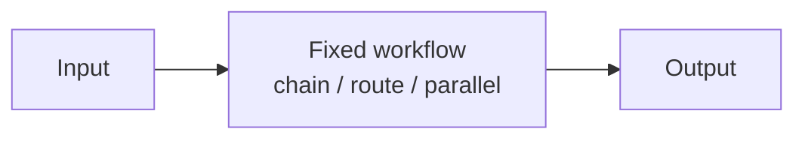

# Chapter 27: Parallelization (Voting / Best-of-N)

**Part III — Workflow Orchestration**

## Parallelization (Voting / Best-of-N) Pattern Overview

Run the same task n times and vote/judge to boost reliability on a single decision.

**Parallelization (Voting / Best-of-N)** is catalogued in the **Workflow Orchestration** part of the catalog (id `parallelization-voting`). It is tagged for finance, healthcare, legal and is assembled from 2 components.

$n$ parallel identical runs; vote or LLM-judge selects; disagreement escalates — never a silent tiebreak. Voting buys reliability only where errors are independent: $n$ identical-model runs share the base model's bias (correlated errors, false confidence), and a judge that shares the blind spot — or is itself injected — ratifies the wrong answer with process (judge capture, high severity). Heterogeneity plus blinding plus escalation-on-disagreement is what makes the $n$ runs worth more than one.

**Definition 1 (Independent vote).** A best-of-$n$ decision is *independent* iff (i) runners are heterogeneous models when stakes are high (decorrelated errors), (ii) the judge sees anonymized/blinded candidates (no source favoring, no injected framing), and (iii) disagreement escalates to a human — never a silent tiebreak or a judge's coin flip.

**Theorem 1 (Shared bias is unfixable by repetition).** If all $n$ runners share the same base-model bias, then increasing $n$ increases confidence without increasing correctness — the vote converges on the biased answer faster, and the judge (same family) confirms it.

*Proof.* Correlated errors violate the independence that makes voting work: where independent errors cancel ($1/\sqrt{n}$), shared bias compounds — every runner makes the same mistake, the majority is unanimous, and unanimity reads as certainty. Heterogeneous models (i) restore partial independence (different biases, different blind spots). Blinding (ii) removes judge-side favoritism and injected framing (the judge cannot prefer what it cannot identify). Escalation on disagreement (iii) converts the remaining signal — disagreement itself — into human review rather than a forced choice. Verify model diversity for consequential votes; verify blinding; verify disagreement routes to escalate. A judge that shares the blind spot is a second vote for the same error, not a check on it. ∎

## Practical Applications & Use Cases

Domains the catalog tags this pattern for:

- finance
- healthcare
- legal

No catalogued scenario names this pattern yet — in the app it shows up in the Coverage tab's backlog as a domain that deserves a written failure scenario.

It also appears in 3 composition cascades:

| Cascade | Class | Blast radius | Impact |
|---|---|---|---|
| Parallelization (Voting / Best-of-N) — judge capture | Inherent | service | High |
| Ensemble Verification — homogeneity illusion | Inherent | single-agent | Medium |
| Parallelization (Sectioning) — thundering-herd cost | Inherent | service | Medium |

## How It Works

1. n parallel identical runs.
2. Vote or LLM-judge selects.
3. Disagreement → escalate.

## Components

- N runners
- Voter/judge

## Control-Flow Diagram

## Failure Modes and Risks

2 failure modes are documented for this pattern:

| Failure mode | Severity | What happens |
|---|---|---|
| Correlated errors | Medium | All n share the same base-model bias → false confidence. |
| Judge capture | High | Judge model shares the blind spot or is itself injected. |

## Protections

1. Use heterogeneous models when stakes are high.
2. Judge sees anonymized/blinded candidates.
3. Disagreement is an escalation trigger, never a silent tiebreak.

## At a Glance

| Field | Value |
|---|---|
| Catalog id | `parallelization-voting` |
| Part | III — Workflow Orchestration |
| Domains | finance, healthcare, legal |
| Components | N runners, Voter/judge |
| Failure modes | 2 |
| Protections | 3 |
| Related patterns | Self-Consistency Sampling, Ensemble Verification, LLM-as-Judge |
| Linked scenarios | 0 |
| Linked cascades | 3 |

## Key Takeaways

- Run the same task n times and vote/judge to boost reliability on a single decision.
- Use heterogeneous models when stakes are high.
- Judge sees anonymized/blinded candidates.
- Disagreement is an escalation trigger, never a silent tiebreak.
- Know its failure modes: Correlated errors (medium); Judge capture (high).

## References and Related Patterns

| Related pattern | Part | Summary |
|---|---|---|
| Self-Consistency Sampling | Planning & Reasoning | Sample N reasoning paths at temperature > 0 and take the majority answer; disagreement signals low confidence. |
| Ensemble Verification | Resilience & Reliability | Multiple heterogeneous verifiers (rules + ML + different models) must concur before high-impact actions. |
| LLM-as-Judge | Resilience & Reliability | A separate model grades outputs against a rubric for quality/safety gating. |

## Council deliberation

- **Evaluation methodologist:** Parallel Voting helps finance, healthcare and legal reliability by running the same task n times and voting or judging to boost reliability on a single decision, with n parallel identical runs, vote or LLM-judge selection, and escalation on disagreement using N runners and Voter slash judge. The tension is Correlated errors where all n share the same base-model bias creating false confidence. The protection that carries weight is using heterogeneous models when stakes are high, related to Self-Consistency and Ensemble-Verify, and the operator should verify model diversity for consequential votes.
- **Safety researcher:** Diversity mitigates shared bias, but the high-severity failure is Judge capture where the judge shares the blind spot or is itself injected. That is why blinded candidates where the judge sees anonymized options carries weight alongside treating disagreement as an escalation trigger never a silent tiebreak, related to LLM-Judge. The operator should verify blinding and that disagreement routes to escalate.

## Council reading

- **Red team:** Start with Judge capture (high): Judge model shares the blind spot or is itself injected. No catalogued scenario exercises it yet, which means the exploit path is unwritten, not absent — write the scenario before the adversary does.
- **Blue team:** Hold with Use heterogeneous models when stakes are high; Judge sees anonymized/blinded candidates. Then layer the remaining 1: defence here is the list, not any single item. Compose with Self-Consistency Sampling, Ensemble Verification so a failure in one pattern meets a control in another.
- **Operator:** Deploy where it is tagged (finance, healthcare, legal), and watch the 3 linked cascades — Parallelization (Voting / Best-of-N) — judge capture first, because composition is where small faults amplify. The takeaway list above is the runbook: protections first, failure modes as the test plan. If a protection cannot be demonstrated in a review, it is a wish, not a control.

## Conclusion

In the catalog this chapter was generated from, **Parallelization (Voting / Best-of-N)** is one of 107 patterns in *Workflow Orchestration*, carrying 2 documented failure modes and 3 listed protections. Use it as a starting point, not a specification: the protection list is the part that survives contact with an adversary.

---
