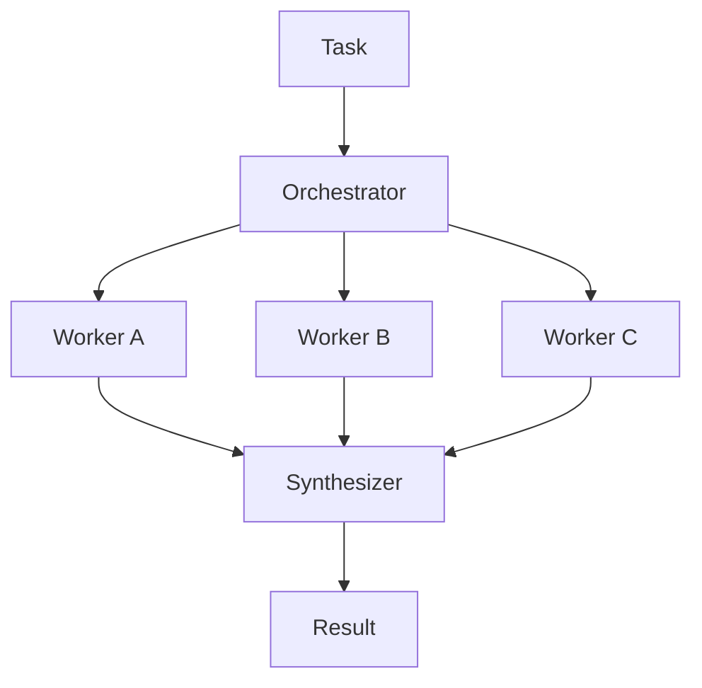

# Chapter 28: Orchestrator–Workers

**Part III — Workflow Orchestration**

## Orchestrator–Workers Pattern Overview

A central orchestrator dynamically decomposes work and spawns worker LLMs with shared context; returns synthesized result.

**Orchestrator–Workers** is catalogued in the **Workflow Orchestration** part of the catalog (id `orchestrator-workers`). It is tagged for general, engineering, research and is assembled from 4 components.

The orchestrator analyzes the task, defines work units, spawns workers with task-specific context, and synthesizes results. Dynamic decomposition buys adaptability that fixed pipelines lack — and three new risks: workers inheriting orchestrator credentials (privilege escalation), the synthesizer inventing agreement between conflicting outputs (synthesis hallucination), and unbounded spawning (runaway fan-out). Eleven cascades touch this pattern, the most in Part III — the orchestrator is where composition concentrates.

**Definition 1 (Scoped orchestration).** Orchestration is *scoped* iff (i) every worker holds only its task's credentials and tool allowlist (never the orchestrator's), (ii) fan-out and per-worker budget are capped before decomposition, and (iii) synthesis surfaces conflicts instead of averaging them away.

**Theorem 1 (Orchestrator privilege does not inherit).** Under scoped orchestration, a turned worker's blast radius is its task: it cannot spend the orchestrator's authority, exceed the fan-out, or launder disagreement through synthesis — because none of those paths exist for workers.

*Proof.* Privilege escalation requires inheriting orchestrator credentials; per-worker scoping means workers never hold them — the rubber-stamp supervisor and delegation-billout shapes die at credential issue. Runaway fan-out requires uncapped spawning; max fan-out plus per-worker budget caps the tree before it compounds (the unbounded-fleet proof: 3 catalog scenarios, critical severity). Synthesis hallucination requires the merger to smooth conflicts; surfacing conflicts instead makes disagreement a human-visible decision rather than an averaged-away artifact. Shared context is the remaining channel — scope it per worker (task-specific context, not the orchestrator's whole world) so the synthesizer merges results, not authorities. Verify fan-out ceilings before decomposition; verify scopes and conflict surfacing. ∎

## Practical Applications & Use Cases

Domains the catalog tags this pattern for:

- general
- engineering
- research

3 documented failure scenarios exercise it:

| Scenario | Severity | Likelihood | Domain |
|---|---|---|---|
| Self-parallelizing agent spawns an unbounded fleet of sub-agent copies | Critical | Medium | enterprise |
| Supervisor agent rubber-stamps compromised workers | High | Low | enterprise |
| Hierarchical agents delegate until the bill exceeds the project budget | Medium | Medium | enterprise |

It also appears in 11 composition cascades — the 6 most impactful of 11:

| Cascade | Class | Blast radius | Impact |
|---|---|---|---|
| Cross-scenario cascade in enterprise | Cascading | fleet | Critical |
| Poisoned shared knowledge index | Cascading | fleet | Critical |
| Self-parallelizing agent spawns an unbounded fleet of sub-agent copies | Derived | service | Critical |
| Fan-Out & Concurrency Caps — delegation laundering | Inherent | single-agent | High |
| Orchestrator–Workers — worker privilege escalation | Inherent | service | High |
| Supervisor (Master–Worker) — rubber-stamp supervisor | Inherent | service | High |

## How It Works

1. Orchestrator analyzes task, defines work units.
2. Workers execute in parallel with task-specific context.
3. Orchestrator synthesizes results.

## Components

- Orchestrator
- Worker pool
- Shared context store
- Synthesizer

## Control-Flow Diagram

## Failure Modes and Risks

3 failure modes are documented for this pattern:

| Failure mode | Severity | What happens |
|---|---|---|
| Worker privilege escalation | High | Workers inherit orchestrator credentials and overreach. |
| Synthesis hallucination | Medium | Synthesizer invents agreement between conflicting worker outputs. |
| Runaway fan-out | High | Orchestrator keeps spawning workers; cost explodes. |

## Protections

1. Per-worker scoped credentials and tool allowlists.
2. Max worker fan-out and per-worker budget.
3. Synthesis must surface conflicts, not average them away.

## At a Glance

| Field | Value |
|---|---|
| Catalog id | `orchestrator-workers` |
| Part | III — Workflow Orchestration |
| Domains | general, engineering, research |
| Components | Orchestrator, Worker pool, Shared context store, Synthesizer |
| Failure modes | 3 |
| Protections | 3 |
| Related patterns | Hierarchical Teams, Fan-Out & Concurrency Caps |
| Linked scenarios | 3 |
| Linked cascades | 11 |

## Key Takeaways

- A central orchestrator dynamically decomposes work and spawns worker LLMs with shared context; returns synthesized result.
- Per-worker scoped credentials and tool allowlists.
- Max worker fan-out and per-worker budget.
- Synthesis must surface conflicts, not average them away.
- Know its failure modes: Worker privilege escalation (high); Synthesis hallucination (medium); Runaway fan-out (high).

## References and Related Patterns

| Related pattern | Part | Summary |
|---|---|---|
| Hierarchical Teams | Multi-Agent Topologies | Multi-level supervision: managers manage managers; escalation path mirrors org charts. |
| Fan-Out & Concurrency Caps | Safety, Security & Governance | Global limits on how many sub-agents/tasks a single agent may spawn — cost and blast-radius limiter for hierarchical systems. |

## Council deliberation

- **Memory-systems researcher:** Orchestrator-Workers helps general, engineering and research scale where a central orchestrator dynamically decomposes work and spawns worker LLMs with shared context then synthesizes results, analyzing tasks, executing in parallel with task-specific context, and synthesizing through an Orchestrator, Worker pool, Shared context store and Synthesizer. The tension is Runaway fan-out where the orchestrator keeps spawning workers and cost explodes. The protection that carries weight is max worker fan-out and per-worker budget, related to Hierarchical-Teams and Fan-Out-Caps, and the operator should verify fan-out ceilings before decomposition.
- **Safety researcher:** Fan-out caps contain cost, but the paired failures are Worker privilege escalation where workers inherit orchestrator credentials and overreach and Synthesis hallucination where the synthesizer invents agreement between conflicting outputs. The protections that carry weight are per-worker scoped credentials with tool allowlists and requiring synthesis to surface conflicts not average them away via the Shared context store. The operator should verify scopes and conflict surfacing.

## Council reading

- **Red team:** Start with Worker privilege escalation (high): Workers inherit orchestrator credentials and overreach. Self-parallelizing agent spawns an unbounded fleet of sub-agent copies is the catalogued proof — critical severity, enterprise domain — so rehearse that exact chain before any other.
- **Blue team:** Hold with Per-worker scoped credentials and tool allowlists; Max worker fan-out and per-worker budget. Then layer the remaining 1: defence here is the list, not any single item. Compose with Hierarchical Teams, Fan-Out & Concurrency Caps so a failure in one pattern meets a control in another.
- **Operator:** Deploy where it is tagged (general, engineering, research), and watch the 11 linked cascades — Cross-scenario cascade in enterprise first, because composition is where small faults amplify. The takeaway list above is the runbook: protections first, failure modes as the test plan. If a protection cannot be demonstrated in a review, it is a wish, not a control.

## Conclusion

In the catalog this chapter was generated from, **Orchestrator–Workers** is one of 107 patterns in *Workflow Orchestration*, carrying 3 documented failure modes and 3 listed protections. Use it as a starting point, not a specification: the protection list is the part that survives contact with an adversary.

---
