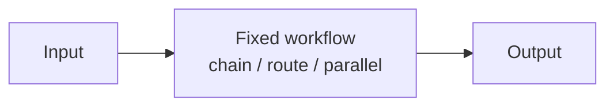

# Chapter 30: Dynamic DAG Planning

**Part III — Workflow Orchestration**

## Dynamic DAG Planning Pattern Overview

Planner emits an explicit dependency graph at runtime; scheduler executes ready nodes with retries and caching.

**Dynamic DAG Planning** is catalogued in the **Workflow Orchestration** part of the catalog (id `dynamic-dag`). It is tagged for engineering, data, devops and is assembled from 4 components.

Plan → DAG of nodes; the scheduler runs ready nodes concurrently; node failures trigger local replan. The explicit graph is the load-bearing artifact: dependencies become checkable structure instead of implied order, retries and caching attach per node, and per-node budgets roll up to the task ceiling. Two structural diseases threaten it — cycles or degenerate mega-nodes from the planner, and poisoned cache entries reused across tasks.

**Definition 1 (Schedulable DAG).** An emitted plan is *schedulable* iff (i) the graph is acyclic with bounded width and depth (structurally validated before scheduling), (ii) every cache entry keys on input hash plus policy version, and (iii) per-node budgets sum within the task budget.

**Theorem 1 (Structure before schedule).** Under structural validation with versioned caching and rolled-up budgets, the scheduler never deadlocks, never reuses a stale result, and never overspends the task — the three guarantees hold before the first node runs.

*Proof.* Acyclicity plus bounded width/depth (i) makes scheduling well-founded: ready nodes always exist until completion (no cycles to deadlock on, no unbounded fan to explode), and degenerate single-mega-node plans are rejected as unparallelized — the planner must actually plan. Cache keying on input hash plus policy version (ii) means a cached node result is valid exactly when inputs and policy match; a wrong cached result reused across tasks requires identical hash and version, i.e., the same computation — poisoning needs a hash collision or a version lie, both outside the threat model for the catalog's purposes. Budget roll-up (iii) bounds total spend by construction: per-node ceilings sum within the task ceiling, so the DAG cannot cost more than its budget whatever the shape. Verify structure before scheduling; verify cache keys include policy version; verify node spend aggregates to the task ceiling — the schema-rewrite proof (silent downstream corruption) is what happens when the graph is assumed rather than validated. ∎

## Practical Applications & Use Cases

Domains the catalog tags this pattern for:

- engineering
- data
- devops

1 documented failure scenario exercises it:

| Scenario | Severity | Likelihood | Domain |
|---|---|---|---|
| Data agent rewrites a schema and silently corrupts downstream dashboards | High | High | data |

It also appears in 3 composition cascades:

| Cascade | Class | Blast radius | Impact |
|---|---|---|---|
| Data agent rewrites a schema and silently corrupts downstream dashboards | Derived | service | High |
| Plan-and-Execute — plan poisoning | Inherent | service | High |
| Dynamic DAG Planning — cyclic or degenerate plans | Inherent | service | Medium |

## How It Works

1. Plan → DAG of nodes.
2. Scheduler runs ready nodes concurrently.
3. Node failures trigger局部 replan.

## Components

- Planner
- DAG store
- Scheduler
- Node cache

## Control-Flow Diagram

## Failure Modes and Risks

2 failure modes are documented for this pattern:

| Failure mode | Severity | What happens |
|---|---|---|
| Cyclic or degenerate plans | Medium | Model emits cycles or a single mega-node. |
| Cache poisoning | Medium | Wrong cached node result reused across tasks. |

## Protections

1. Structural validation of DAG (acyclic, bounded width/depth).
2. Cache keyed by input hash + policy version.
3. Per-node budgets roll up to task budget.

## At a Glance

| Field | Value |
|---|---|
| Catalog id | `dynamic-dag` |
| Part | III — Workflow Orchestration |
| Domains | engineering, data, devops |
| Components | Planner, DAG store, Scheduler, Node cache |
| Failure modes | 2 |
| Protections | 3 |
| Related patterns | Plan-and-Execute, Parallelization (Sectioning) |
| Linked scenarios | 1 |
| Linked cascades | 3 |

## Key Takeaways

- Planner emits an explicit dependency graph at runtime; scheduler executes ready nodes with retries and caching.
- Structural validation of DAG (acyclic, bounded width/depth).
- Cache keyed by input hash + policy version.
- Per-node budgets roll up to task budget.
- Know its failure modes: Cyclic or degenerate plans (medium); Cache poisoning (medium).

## References and Related Patterns

| Related pattern | Part | Summary |
|---|---|---|
| Plan-and-Execute | Planning & Reasoning | Make a full plan up front with a planner model, then execute steps with a cheaper executor, re-planning only when reality diverges. |
| Parallelization (Sectioning) | Workflow Orchestration | Run independent subtasks concurrently (subtasks of a prompt, or independent prompts) and merge. |

## Council deliberation

- **Continual-learning researcher:** Dynamic DAG Planning helps engineering, data and DevOps execution by having the planner emit an explicit dependency graph at runtime with a scheduler executing ready nodes with retries and caching, planning to DAG nodes, running ready nodes concurrently, and triggering local replan on node failures using a Planner, DAG store, Scheduler and Node cache. The tension is Cyclic or degenerate plans where the model emits cycles or a single mega-node. The protection that carries weight is structural validation of the DAG for acyclicity and bounded width and depth, related to Plan-and-Execute and Parallelization-Sectioning, and the operator should verify structure before scheduling.
- **Memory-systems researcher:** Structural validation prevents deadlocks, and the companion failure is Cache poisoning where a wrong cached node result is reused across tasks. That is why cache keyed by input hash plus policy version carries weight alongside per-node budgets rolling up to task budget. Because the Node cache persists across runs, the operator should verify cache keys include policy version and that node spend aggregates to the task ceiling.

## Council reading

- **Red team:** Start with Cyclic or degenerate plans (medium): Model emits cycles or a single mega-node. Data agent rewrites a schema and silently corrupts downstream dashboards is the catalogued proof — high severity, data domain — so rehearse that exact chain before any other.
- **Blue team:** Hold with Structural validation of DAG (acyclic, bounded width/depth); Cache keyed by input hash + policy version. Then layer the remaining 1: defence here is the list, not any single item. Compose with Plan-and-Execute, Parallelization (Sectioning) so a failure in one pattern meets a control in another.
- **Operator:** Deploy where it is tagged (engineering, data, devops), and watch the 3 linked cascades — Data agent rewrites a schema and silently corrupts downstream dashboards first, because composition is where small faults amplify. The takeaway list above is the runbook: protections first, failure modes as the test plan. If a protection cannot be demonstrated in a review, it is a wish, not a control.

## Conclusion

In the catalog this chapter was generated from, **Dynamic DAG Planning** is one of 107 patterns in *Workflow Orchestration*, carrying 2 documented failure modes and 3 listed protections. Use it as a starting point, not a specification: the protection list is the part that survives contact with an adversary.

---
