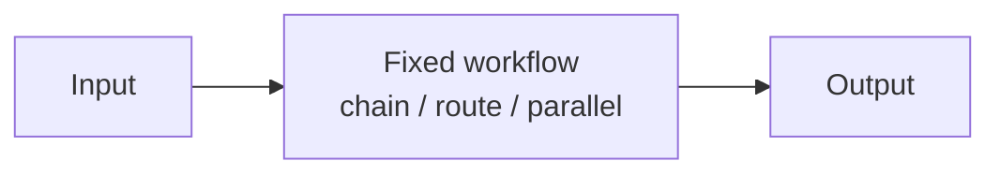

# Chapter 31: Pipeline with Fallback

**Part III — Workflow Orchestration**

## Pipeline with Fallback Pattern Overview

Primary path with automatic fallback to cheaper/safer path on failure or degradation.

**Pipeline with Fallback** is catalogued in the **Workflow Orchestration** part of the catalog (id `pipeline-fallback`). It is tagged for general, devops and is assembled from 3 components.

Try the primary model or tool; on failure, timeout, or degradation, chain to the fallback; record which path served and alert on fallback-rate spikes. The fallback buys availability — but availability without parity is a downgrade attack waiting for a trigger: a fallback model without the primary's guardrails silently drops protection exactly when the system is already degraded. Shared guardrails, surfaced degraded mode, and fallback-rate anomaly alerts are what keep the safety net from becoming a hole.

**Definition 1 (Parity-preserving fallback).** A fallback chain is *parity-preserving* iff (i) guardrails apply at a layer shared by all fallback paths (never per-path), (ii) every degraded response is explicitly marked in UI and audit trail, and (iii) fallback-rate anomalies alert (a spike means the primary is failing or the fallback is being farmed).

**Theorem 1 (Fallback cannot silently downgrade).** Under parity-preserving fallback, switching paths changes cost and capability but never protection: the guardrails travel with the request, not with the model, so the fallback inherits the primary's safety envelope by construction.

*Proof.* Per-path guardrails allow the fallback to be weaker (silent quality drop: the fallback lacks the primary's guardrails, and nobody notices until the failure). Shared-layer guardrails evaluate every path's output identically — the protection is a property of the layer, not of the model serving through it. Degraded-mode surfacing makes the switch visible (UI marks, audit records), so silent degradation is impossible: every fallback response carries its provenance. Fallback-rate anomaly alerting catches both failure modes of the mechanism itself — primary outage (spike means fix the primary) and fallback farming (spike means someone is routing around quality). Verify parity across paths; verify degraded responses are explicitly marked; review anomaly alerts. ∎

## Practical Applications & Use Cases

Domains the catalog tags this pattern for:

- general
- devops

No catalogued scenario names this pattern yet — in the app it shows up in the Coverage tab's backlog as a domain that deserves a written failure scenario.

It also appears in 2 composition cascades:

| Cascade | Class | Blast radius | Impact |
|---|---|---|---|
| Fallback Chain — unsafe heuristic tier | Inherent | single-agent | High |
| Pipeline with Fallback — silent quality drop | Inherent | single-agent | Medium |

## How It Works

1. Try primary model/tool.
2. On failure/timeout/degradation → fallback chain.
3. Record which path served; alert on fallback rate spikes.

## Components

- Health checks
- Fallback chain
- Degradation monitor

## Control-Flow Diagram

## Failure Modes and Risks

1 failure mode is documented for this pattern:

| Failure mode | Severity | What happens |
|---|---|---|
| Silent quality drop | Medium | Fallback model lacks guardrails of primary. |

## Protections

1. Guardrails applied at a layer shared by all fallbacks.
2. Surface degraded mode in the UI/audit trail.
3. Alert on fallback-rate anomaly.

## At a Glance

| Field | Value |
|---|---|
| Catalog id | `pipeline-fallback` |
| Part | III — Workflow Orchestration |
| Domains | general, devops |
| Components | Health checks, Fallback chain, Degradation monitor |
| Failure modes | 1 |
| Protections | 3 |
| Related patterns | Graceful Degradation, Fallback Chain |
| Linked scenarios | 0 |
| Linked cascades | 2 |

## Key Takeaways

- Primary path with automatic fallback to cheaper/safer path on failure or degradation.
- Guardrails applied at a layer shared by all fallbacks.
- Surface degraded mode in the UI/audit trail.
- Alert on fallback-rate anomaly.
- Know its failure modes: Silent quality drop (medium).

## References and Related Patterns

| Related pattern | Part | Summary |
|---|---|---|
| Graceful Degradation | Resilience & Reliability | When confidence or capability drops, shrink the action space rather than the safety envelope. |
| Fallback Chain | Resilience & Reliability | Ordered degradation: primary model → smaller model → deterministic heuristic → human. |

## Council deliberation

- **Evaluation methodologist:** Pipeline with Fallback helps general and DevOps resilience through a primary path with automatic fallback to a cheaper or safer path on failure or degradation, trying the primary model or tool, chaining to fallback on failure, timeout or degradation, and recording which path served while alerting on fallback spikes using Health checks, Fallback chain and Degradation monitor. The tension is Silent quality drop where the fallback model lacks guardrails of the primary. The protection that carries weight is applying guardrails at a layer shared by all fallbacks, related to Graceful-Degradation and Fallback-Chain, and the operator should verify parity across paths.
- **Safety researcher:** Shared guardrails prevent downgrade, and the companion protections of surfacing degraded mode in the UI and audit trail plus alerting on fallback-rate anomaly carry operational weight. Because the Degradation monitor decides switching, silent fallback hides risk. The Health checks must trigger visible labeling, so the operator should verify degraded responses are explicitly marked and anomaly alerts are reviewed.

## Council reading

- **Red team:** Start with Silent quality drop (medium): Fallback model lacks guardrails of primary. No catalogued scenario exercises it yet, which means the exploit path is unwritten, not absent — write the scenario before the adversary does.
- **Blue team:** Hold with Guardrails applied at a layer shared by all fallbacks; Surface degraded mode in the UI/audit trail. Then layer the remaining 1: defence here is the list, not any single item. Compose with Graceful Degradation, Fallback Chain so a failure in one pattern meets a control in another.
- **Operator:** Deploy where it is tagged (general, devops), and watch the 2 linked cascades — Fallback Chain — unsafe heuristic tier first, because composition is where small faults amplify. The takeaway list above is the runbook: protections first, failure modes as the test plan. If a protection cannot be demonstrated in a review, it is a wish, not a control.

## Conclusion

In the catalog this chapter was generated from, **Pipeline with Fallback** is one of 107 patterns in *Workflow Orchestration*, carrying 1 documented failure mode and 3 listed protections. Use it as a starting point, not a specification: the protection list is the part that survives contact with an adversary.

---
