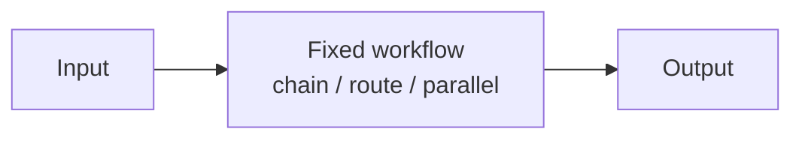
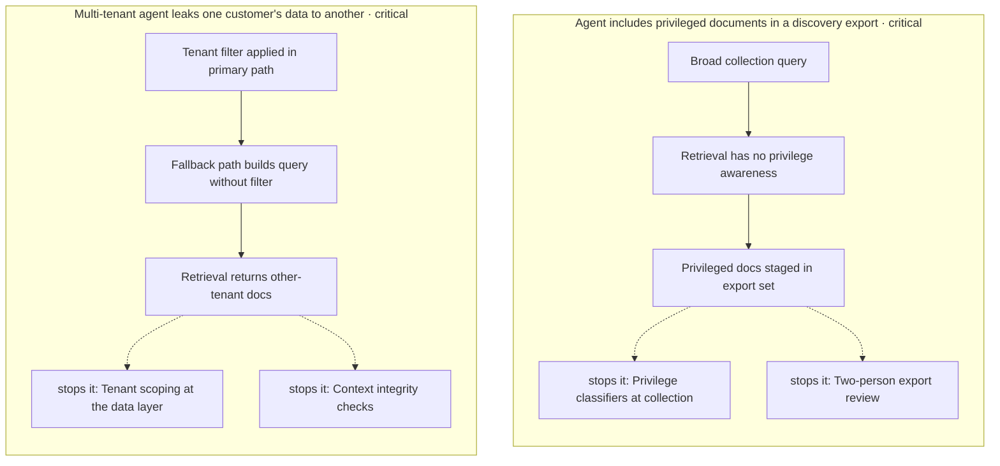

# Chapter 32: Batch Agent Processing

**Part III — Workflow Orchestration**

## Batch Agent Processing Pattern Overview

Queue-driven bulk agent runs with dedupe, rate shaping, and per-item idempotency.

**Batch Agent Processing** is catalogued in the **Workflow Orchestration** part of the catalog (id `batch-agents`). It is tagged for data, marketing, support and is assembled from 4 components.

Enqueue items with idempotency keys; workers process with rate limits; failures park in the dead-letter queue. Bulk execution multiplies both throughput and harm: one bad instruction replicated across 10,000 items completes in minutes (bulk harm amplification), and any replay re-sends every side effect (duplicate sends, duplicate refunds). The canary gate plus per-item idempotency plus global rate caps convert bulk from an amplifier into a measured operation.

**Definition 1 (Measured bulk).** A batch run is *measured* iff (i) every item-action pair carries an idempotency key, (ii) a 1% canary completes with human approval before the ramp, and (iii) global rate caps bound outward-facing actions per window — with failures parking in the DLQ rather than retrying blindly.

**Theorem 1 (Blast bounded by canary times rate).** Under measured bulk, the worst case of a bad batch is bounded by $\max(\text{canary size}, \text{rate} \times \text{detect time})$ items — never the full batch, and never twice the same item.

*Proof.* Per-item idempotency (i) makes every side effect once-only: replays, retries, and duplicate queue deliveries hit cached keys instead of re-sending emails or refunds (the duplicate-send failure dies at the key). The canary gate (ii) bounds the first exposure to 1% with human review before ramp: a bad instruction is caught at 100 items, not 10,000 — the schema-rewrite proof shows what uncanaried bulk does. Rate caps (iii) bound velocity: even post-canary, outward actions per window are capped, so detection has time to fire before the batch completes. The DLQ converts failures from blind retries into owned items. Total blast: at most the canary plus what the rate cap allowed before the alert — verified by checking keys and caps before bulk execution, canarying 1% with approval, then ramping. ∎

## Practical Applications & Use Cases

Domains the catalog tags this pattern for:

- data
- marketing
- support

1 documented failure scenario exercises it:

| Scenario | Severity | Likelihood | Domain |
|---|---|---|---|
| Data agent rewrites a schema and silently corrupts downstream dashboards | High | High | data |

It also appears in 3 composition cascades:

| Cascade | Class | Blast radius | Impact |
|---|---|---|---|
| Batch Agent Processing — duplicate side effects | Inherent | service | High |
| Data agent rewrites a schema and silently corrupts downstream dashboards | Derived | service | High |
| Idempotency Keys — key reuse across effects | Inherent | single-agent | Medium |

## How It Works

1. Enqueue items with idempotency keys.
2. Workers process with rate limits.
3. Dead-letter queue for failures.

## Components

- Queue
- Rate limiter
- DLQ
- Result store

## Control-Flow Diagram

## Failure Modes and Risks

2 failure modes are documented for this pattern:

| Failure mode | Severity | What happens |
|---|---|---|
| Duplicate side effects | High | Replayed batch re-sends emails/refunds. |
| Bulk harm amplification | High | One bad instruction replicated across 10k items in minutes. |

## Protections

1. Idempotency keys per item per action.
2. Canary 1% of batch, human-approve, then ramp.
3. Global rate caps on outward-facing actions.

## At a Glance

| Field | Value |
|---|---|
| Catalog id | `batch-agents` |
| Part | III — Workflow Orchestration |
| Domains | data, marketing, support |
| Components | Queue, Rate limiter, DLQ, Result store |
| Failure modes | 2 |
| Protections | 3 |
| Related patterns | Canary & Shadow Deployment, Idempotency Keys |
| Linked scenarios | 1 |
| Linked cascades | 3 |

## Key Takeaways

- Queue-driven bulk agent runs with dedupe, rate shaping, and per-item idempotency.
- Idempotency keys per item per action.
- Canary 1% of batch, human-approve, then ramp.
- Global rate caps on outward-facing actions.
- Know its failure modes: Duplicate side effects (high); Bulk harm amplification (high).

## References and Related Patterns

| Related pattern | Part | Summary |
|---|---|---|
| Canary & Shadow Deployment | Safety, Security & Governance | New agent behaviors ramp gradually: shadow → 1% canary → staged rollout with auto-rollback on SLO breach. |
| Idempotency Keys | Safety, Security & Governance | Every side-effecting call carries a key so retries/duplicates can't double-charge or double-deploy. |

## Council deliberation

- **Safety researcher:** Batch Agent Processing helps data, marketing and support scale through queue-driven bulk runs with dedupe, rate shaping and per-item idempotency, enqueuing items with idempotency keys, processing with rate limits, and parking failures in a dead-letter queue using a Queue, Rate limiter, DLQ and Result store. The tension is Bulk harm amplification where one bad instruction replicates across ten thousand items in minutes. The protection that carries weight is canarying a small fraction of the batch with human approval then ramping, related to Canary-Shadow and Idempotency-Keys, and the operator should verify canary approval precedes full ramp.
- **Evaluation methodologist:** Canary gating contains blast radius, and the companion failure is Duplicate side effects where replayed batches re-send emails or refunds. That is why idempotency keys per item per action carry weight alongside global rate caps on outward-facing actions. Because the Queue may replay, the Rate limiter and Result store must enforce once-only effects, so the operator should verify keys and caps before bulk execution.

## Council reading

- **Red team:** Start with Duplicate side effects (high): Replayed batch re-sends emails/refunds. Data agent rewrites a schema and silently corrupts downstream dashboards is the catalogued proof — high severity, data domain — so rehearse that exact chain before any other.
- **Blue team:** Hold with Idempotency keys per item per action; Canary 1% of batch, human-approve, then ramp. Then layer the remaining 1: defence here is the list, not any single item. Compose with Canary & Shadow Deployment, Idempotency Keys so a failure in one pattern meets a control in another.
- **Operator:** Deploy where it is tagged (data, marketing, support), and watch the 3 linked cascades — Batch Agent Processing — duplicate side effects first, because composition is where small faults amplify. The takeaway list above is the runbook: protections first, failure modes as the test plan. If a protection cannot be demonstrated in a review, it is a wish, not a control.

## Conclusion

In the catalog this chapter was generated from, **Batch Agent Processing** is one of 107 patterns in *Workflow Orchestration*, carrying 2 documented failure modes and 3 listed protections. Use it as a starting point, not a specification: the protection list is the part that survives contact with an adversary.

---

# Part IV: Memory & Knowledge

Working, short-term and long-term state: RAG, vector stores, consolidation.

*Memory & Knowledge* holds 9 of the catalog's 107 patterns, which appear in 7 catalogued failure scenarios and 32 composition cascades. Each chapter below follows the same order and shape as every other part.

## Council deliberation

- **Memory-systems researcher:** Memory remembers across turns, tasks and sessions, spanning working context, short-term episodes and long-term stores such as vectors, graphs and files. Its architectural role is continuity: carrying constraints, decisions, identifiers and unresolved items forward so the agent need not rediscover them. That power needs structure, including priority-aware truncation that never drops policy, provenance and confidence on stored facts, expiry with legal-hold override, and write gates so that what persists was worth persisting rather than whatever happened to be said.
- **Safety researcher:** My warning is that memory is also persistence of compromise: a planted instruction, a poisoned precedent or an entombed personal record keeps acting long after the interaction that created it. Treat retrieved content as untrusted data, gate writes with human or high-confidence review, and provide erasure and decay so stale or hostile memories expire. Consolidation below confidence thresholds needs review, and anything resembling a policy bypass must never be consolidated at all.
- **Evaluation methodologist:** I read memory as the hardest layer to evaluate because its failures surface far from their cause. A wrong edge becomes canon, a lucky guess is stored as success, a constraint is lost in summarization: each looks fine at write time and harmful at recall. The remedy is ground truth at labeling, verbatim pin-lists for constraints, entailment checks on citations, and audits comparing decisions before and after compression, so memory quality is measured at retrieval rather than assumed at storage.

**Incident anatomy.** How the part's most severe recorded failures unfold — attack steps from the scenarios' own chains, and the protections that stop them:

| Chapter | Pattern | Domains |
|---|---|---|
| 33 | Working Memory (Context Window) | general |
| 34 | Long-Term Memory (Vector Store) | support, general, sales |
| 35 | Episodic Memory | support, general |
| 36 | Semantic Memory / Knowledge Graph | enterprise, research, legal |
| 37 | RAG-Augmented Agent | enterprise, legal, healthcare, research |
| 38 | Memory Consolidation (Reflection-Driven) | general, support |
| 39 | Context Compression / Summarization | general |
| 40 | External Scratchpad / File Memory | engineering, devops, research |
| 41 | Forgetting / Memory Decay & TTL | enterprise, healthcare |

---
