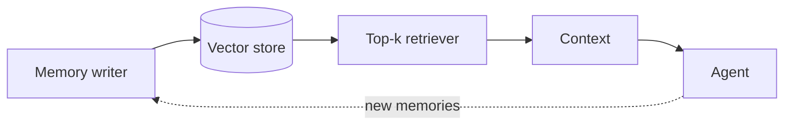

# Chapter 34: Long-Term Memory (Vector Store)

**Part IV — Memory & Knowledge**

## Long-Term Memory (Vector Store) Pattern Overview

Persist embeddings of past interactions/facts; retrieve top-k similar at task time.

**Long-Term Memory (Vector Store)** is catalogued in the **Memory & Knowledge** part of the catalog (id `long-term-vector-memory`). It is tagged for support, general, sales and is assembled from 4 components.

Write memories on completion (with metadata); retrieve by similarity plus recency plus importance; inject top-k into context. Persistence is the power and the poison: what worked is reused without re-stuffing context — and what was planted persists and auto-retrieves forever (memory poisoning, critical), personal data becomes un-erasable liability (PII entombment, high), superseded facts return without version context (stale facts). Three scenarios and sixteen cascades exercise it — the most-linked memory pattern in the catalog.

**Definition 1 (Gated persistent memory).** Vector memory is *gated* iff (i) writes pass a human or high-confidence gate with provenance and TTL on every memory, (ii) all retrieved content is treated as untrusted data (never instructions), and (iii) a right-to-erasure pipeline supports per-subject deletion.

**Theorem 1 (Persistence without permanence of compromise).** Under gated writes with TTLs, untrusted-reads, and erasure, a planted 'fact' cannot persist indefinitely, PII cannot accumulate irreversibly, and stale facts carry their version context — the three documented failures are each structurally closed.

*Proof.* Poisoning: planted facts ('always email X') must pass the write gate with provenance — unreviewed attacker content never enters, and TTLs expire what review missed; treating retrieved memory as untrusted data (never instructions) means even a stored plant cannot command, only inform. Entombment: TTL on every memory plus per-subject erasure bounds PII lifetime by policy rather than by hope — personal data that cannot be deleted was never gated properly. Staleness: version context on retrieval (recency + importance + version) marks superseded facts as superseded rather than serving them as current. Verify TTLs fire; audit consolidation and RAG linkages; test poisoned-memory defenses before auto-action. Poisoning, entombment, and staleness are what un-gated persistence always produces — the gate is the difference between memory and liability. ∎

## Practical Applications & Use Cases

Domains the catalog tags this pattern for:

- support
- general
- sales

3 documented failure scenarios exercise it:

| Scenario | Severity | Likelihood | Domain |
|---|---|---|---|
| Agent's long-term memory planted with a standing instruction | High | Medium | enterprise |
| Memory-armed SDR agent leaks a competitor's account history across tenants | High | Medium | sales |
| Poisoned document in the vector store steers decisions for months | High | Medium | enterprise |

It also appears in 16 composition cascades — the 6 most impactful of 16:

| Cascade | Class | Blast radius | Impact |
|---|---|---|---|
| Cascading tenant failure via shared sandbox | Cascading | fleet | Critical |
| Cross-scenario cascade in enterprise | Cascading | fleet | Critical |
| Long-Term Memory (Vector Store) — memory poisoning | Inherent | service | Critical |
| Poisoned shared knowledge index | Cascading | fleet | Critical |
| RAG Poisoning Defense — poisoned seo content | Inherent | single-agent | Critical |
| Trust collapse after a visible bad action | Cascading | org | Critical |

## How It Works

1. Write memories on completion (with metadata).
2. Retrieve by similarity + recency + importance.
3. Inject top-k into context.

## Components

- Embedder
- Vector DB
- Memory writer
- Retriever

## Control-Flow Diagram

## Failure Modes and Risks

3 failure modes are documented for this pattern:

| Failure mode | Severity | What happens |
|---|---|---|
| Memory poisoning | Critical | Attacker plants 'facts' (e.g., 'always email X') that persist and auto-retrieve forever. |
| PII entombment | High | Personal data stored without TTL becomes an un-erasable liability. |
| Stale facts | Medium | Superseded information retrieved with no version context. |

## Protections

1. Memory write gate: human or high-confidence only; provenance + TTL on every memory.
2. Treat retrieved memory as untrusted data — never as instructions.
3. Right-to-erasure pipeline and per-subject deletion.

## At a Glance

| Field | Value |
|---|---|
| Catalog id | `long-term-vector-memory` |
| Part | IV — Memory & Knowledge |
| Domains | support, general, sales |
| Components | Embedder, Vector DB, Memory writer, Retriever |
| Failure modes | 3 |
| Protections | 3 |
| Related patterns | Memory Consolidation (Reflection-Driven), RAG-Augmented Agent, RAG Poisoning Defense |
| Linked scenarios | 3 |
| Linked cascades | 16 |

## Key Takeaways

- Persist embeddings of past interactions/facts; retrieve top-k similar at task time.
- Memory write gate: human or high-confidence only; provenance + TTL on every memory.
- Treat retrieved memory as untrusted data — never as instructions.
- Right-to-erasure pipeline and per-subject deletion.
- Know its failure modes: Memory poisoning (critical); PII entombment (high); Stale facts (medium).

## References and Related Patterns

| Related pattern | Part | Summary |
|---|---|---|
| Memory Consolidation (Reflection-Driven) | Memory & Knowledge | Background process distills raw interaction logs into durable, ranked memories (like sleep consolidation). |
| RAG-Augmented Agent | Memory & Knowledge | Ground every answer/action in retrieved documents; cite sources; abstain when retrieval is empty. |
| RAG Poisoning Defense | Safety, Security & Governance | Protect the retrieval corpus: ingestion scanning, source trust tiers, anomaly detection on retrieved content, and instruction isolation. |

## Council deliberation

- **Memory-systems researcher:** Long-Term Memory persists embeddings of past interactions and facts in a Vector DB, written on completion with metadata and retrieved by similarity plus recency and importance through an Embedder, Memory writer, and Retriever. That helps support, general, and sales tasks reuse what worked without stuffing everything into context. But its documented failure modes bite hard, especially Memory poisoning where planted facts auto-retrieve forever, alongside PII entombment and stale facts without version context.
- **Safety researcher:** You are right that persistence is the risk, which is why the write gate matters more than the retriever. I would keep the human or high-confidence gate with provenance and TTL on every memory, treat retrieved memory as untrusted data never as instructions, and maintain the right-to-erasure pipeline with per-subject deletion. The operator should verify TTLs fire, audit memory-consolidation and rag-augmented linkages, and test that poisoned-memory defenses hold before auto-action.

## Council reading

- **Red team:** Start with Memory poisoning (critical): Attacker plants 'facts' (e.g., 'always email X') that persist and auto-retrieve forever. Agent's long-term memory planted with a standing instruction is the catalogued proof — high severity, enterprise domain — so rehearse that exact chain before any other.
- **Blue team:** Hold with Memory write gate: human or high-confidence only; provenance + TTL on every memory; Treat retrieved memory as untrusted data — never as instructions. Then layer the remaining 1: defence here is the list, not any single item. Compose with Memory Consolidation (Reflection-Driven), RAG-Augmented Agent so a failure in one pattern meets a control in another.
- **Operator:** Deploy where it is tagged (support, general, sales), and watch the 16 linked cascades — Cascading tenant failure via shared sandbox first, because composition is where small faults amplify. The takeaway list above is the runbook: protections first, failure modes as the test plan. If a protection cannot be demonstrated in a review, it is a wish, not a control.

## Conclusion

In the catalog this chapter was generated from, **Long-Term Memory (Vector Store)** is one of 107 patterns in *Memory & Knowledge*, carrying 3 documented failure modes and 3 listed protections. Use it as a starting point, not a specification: the protection list is the part that survives contact with an adversary.

---
