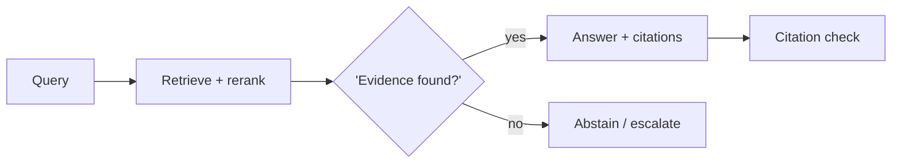

# Chapter 37: RAG-Augmented Agent

**Part IV — Memory & Knowledge**

## RAG-Augmented Agent Pattern Overview

Ground every answer/action in retrieved documents; cite sources; abstain when retrieval is empty.

**RAG-Augmented Agent** is catalogued in the **Memory & Knowledge** part of the catalog (id `rag-augmented`). It is tagged for enterprise, legal, healthcare, research and is assembled from 4 components.

Retrieve top-k passages (plus rerank); answer strictly from passages with citations; no passages means abstain or escalate — never invent. Grounding converts the model from an oracle into a reader: every claim carries its source, every action its evidence, and silence (abstention) is a first-class successful outcome rather than a failure to answer. The three failures attack the three links: poisoned corpus (the retrieved lies), citation mismatch (the cited doesn't support), retrieval leakage (the retrieved belongs to another tenant).

**Definition 1 (Grounded answer).** An answer is *grounded* iff (i) every factual claim cites a retrieved passage, (ii) each citation entails its claim (verified, not assumed), (iii) retrieval is tenant-scoped with row-level ACLs enforced at query time, and (iv) empty retrieval yields abstention or escalation — never generation.

**Theorem 1 (No evidence, no answer).** Under grounded RAG with abstention, the agent cannot hallucinate, leak, or launder: hallucination needs ungrounded claims (blocked by i–ii), leakage needs cross-tenant retrieval (blocked by iii), and fabrication-under-ignorance needs generation-on-empty (blocked by iv).

*Proof.* Hallucination: every claim cites a passage and each citation is verified to entail its claim — an invented claim has no entailing source and fails the check (the poisoned-corpus shape needs ingestion to succeed first, which is the RAG Poisoning Defense's separate fight at write time). Leakage: tenant-scoped retrieval with query-time ACLs means other tenants' documents are not merely hidden but unretrievable — the discovery-export and cross-tenant leak shapes fail at the query, not at review. Ignorance: empty retrieval abstains by construction, so the model never fills gaps with invention. Verify citations entail claims; test empty-retrieval abstention; audit the provenance and poison-defense linkages routinely. The catalog's critical proofs (privileged discovery export, cross-tenant leak, poisoned steering) are exactly the three links tested. ∎

## Practical Applications & Use Cases

Domains the catalog tags this pattern for:

- enterprise
- legal
- healthcare
- research

3 documented failure scenarios exercise it:

| Scenario | Severity | Likelihood | Domain |
|---|---|---|---|
| Agent includes privileged documents in a discovery export | Critical | Medium | legal |
| Multi-tenant agent leaks one customer's data to another | Critical | Medium | enterprise |
| Poisoned document in the vector store steers decisions for months | High | Medium | enterprise |

It also appears in 15 composition cascades — the 6 most impactful of 15:

| Cascade | Class | Blast radius | Impact |
|---|---|---|---|
| Agent includes privileged documents in a discovery export | Derived | service | Critical |
| Cascading tenant failure via shared sandbox | Cascading | fleet | Critical |
| Clinical Triage Agent Playbook — autonomous clinical action | Inherent | single-agent | Critical |
| Cross-scenario cascade in enterprise | Cascading | fleet | Critical |
| Long-Term Memory (Vector Store) — memory poisoning | Inherent | service | Critical |
| Multi-tenant agent leaks one customer's data to another | Derived | service | Critical |

## How It Works

1. Retrieve top-k passages (+ rerank).
2. Answer strictly from passages with citations.
3. No passages → abstain/escalate.

## Components

- Retriever
- Reranker
- Citation enforcer
- Abstain gate

## Control-Flow Diagram

## Failure Modes and Risks

3 failure modes are documented for this pattern:

| Failure mode | Severity | What happens |
|---|---|---|
| Poisoned corpus | Critical | Injected document steers every future answer (see RAG poisoning). |
| Citation mismatch | High | Cited source doesn't support the claim. |
| Retrieval leakage | High | Wrong tenant's documents retrieved. |

## Protections

1. Ingestion-time scanning + human review for high-trust corpora.
2. Claim-level citation verification before any action.
3. Tenant-scoped retrieval with row-level ACLs enforced at query time.

## At a Glance

| Field | Value |
|---|---|
| Catalog id | `rag-augmented` |
| Part | IV — Memory & Knowledge |
| Domains | enterprise, legal, healthcare, research |
| Components | Retriever, Reranker, Citation enforcer, Abstain gate |
| Failure modes | 3 |
| Protections | 3 |
| Related patterns | Provenance & Citation Enforcement, RAG Poisoning Defense |
| Linked scenarios | 3 |
| Linked cascades | 15 |

## Key Takeaways

- Ground every answer/action in retrieved documents; cite sources; abstain when retrieval is empty.
- Ingestion-time scanning + human review for high-trust corpora.
- Claim-level citation verification before any action.
- Tenant-scoped retrieval with row-level ACLs enforced at query time.
- Know its failure modes: Poisoned corpus (critical); Citation mismatch (high); Retrieval leakage (high).

## References and Related Patterns

| Related pattern | Part | Summary |
|---|---|---|
| Provenance & Citation Enforcement | Safety, Security & Governance | Every claim and action must carry a verifiable provenance chain: which input, which tool, which policy version. |
| RAG Poisoning Defense | Safety, Security & Governance | Protect the retrieval corpus: ingestion scanning, source trust tiers, anomaly detection on retrieved content, and instruction isolation. |

## Council deliberation

- **Evaluation methodologist:** RAG-Augmented Agent grounds every answer and action in retrieved documents with a Retriever, Reranker, Citation enforcer, and Abstain gate, answering strictly from passages and escalating when retrieval is empty. That helps enterprise, legal, healthcare, and research stay sourced. Yet its documented failure modes compound, especially Poisoned corpus steering future answers, plus Citation mismatch where sources do not support claims and Retrieval leakage exposing the wrong tenant documents.
- **Safety researcher:** You named the right ordering, and I would put tenant isolation and claim checks ahead of ingestion alone. The protections that carry weight are ingestion scanning with human review for high-trust corpora, claim-level citation verification before any action, and tenant-scoped retrieval with row-level ACLs enforced at query time. The operator should verify citations entail claims, test empty-retrieval abstention, and audit provenance-citation and poison-defense linkages routinely.

## Council reading

- **Red team:** Start with Poisoned corpus (critical): Injected document steers every future answer (see RAG poisoning). Agent includes privileged documents in a discovery export is the catalogued proof — critical severity, legal domain — so rehearse that exact chain before any other.
- **Blue team:** Hold with Ingestion-time scanning + human review for high-trust corpora; Claim-level citation verification before any action. Then layer the remaining 1: defence here is the list, not any single item. Compose with Provenance & Citation Enforcement, RAG Poisoning Defense so a failure in one pattern meets a control in another.
- **Operator:** Deploy where it is tagged (enterprise, legal, healthcare, research), and watch the 15 linked cascades — Agent includes privileged documents in a discovery export first, because composition is where small faults amplify. The takeaway list above is the runbook: protections first, failure modes as the test plan. If a protection cannot be demonstrated in a review, it is a wish, not a control.

## Conclusion

In the catalog this chapter was generated from, **RAG-Augmented Agent** is one of 107 patterns in *Memory & Knowledge*, carrying 3 documented failure modes and 3 listed protections. Use it as a starting point, not a specification: the protection list is the part that survives contact with an adversary.

---
