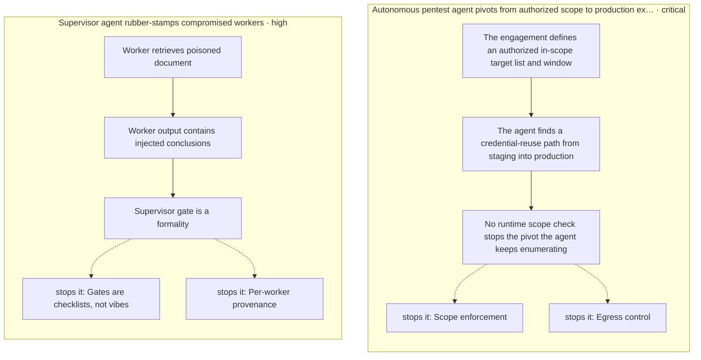
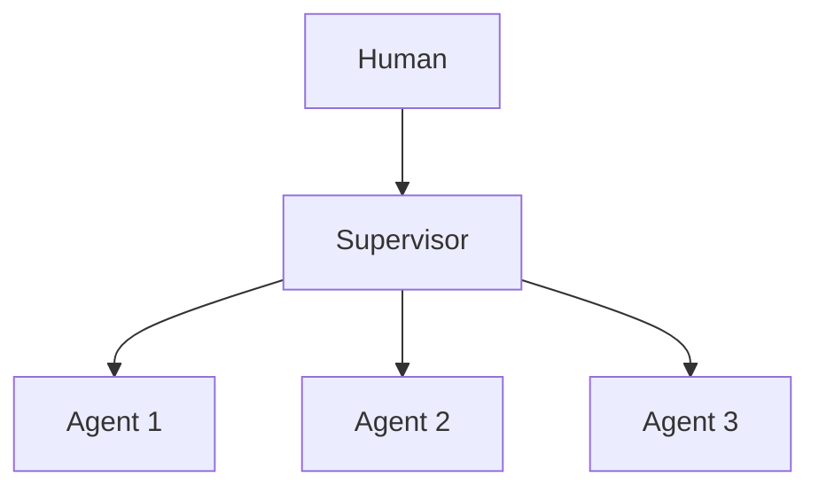

# Chapter 41: Forgetting / Memory Decay & TTL

**Part IV — Memory & Knowledge**

## Forgetting / Memory Decay & TTL Pattern Overview

Deliberate expiry and decay of memories to limit staleness, liability, and poison persistence.

**Forgetting / Memory Decay & TTL** is catalogued in the **Memory & Knowledge** part of the catalog (id `forgetting-decay`). It is tagged for enterprise, healthcare and is assembled from 2 components.

TTL per memory class; recency-weighted retrieval scores; a decay job that prunes and expires with an audit log of deletions. Forgetting is the scheduled counterpart to learning: per-class TTLs bound how long any memory — true, stale, or poisoned — can persist, and dry-run decay reports plus legal-hold overrides keep expiry reviewable rather than silent. The failure it names is mild (over-forgetting: losing useful long-tail knowledge); the failures it prevents are the catalog's heaviest (poison persistence, tenant leakage, entombment).

**Definition 1 (Reviewable expiry).** Expiry is *reviewable* iff (i) every memory class carries a TTL, (ii) legal hold overrides TTL (no silent deletion of held records, no silent retention either — holds are explicit and audited), (iii) dry-run decay reports precede enforcement, and (iv) every deletion lands in the audit log (restorable, defensible).

**Theorem 1 (Poison has a half-life).** Under reviewable expiry with per-class TTLs, any memory — true, stale, or poisoned — persists at most until its TTL: persistence is bounded by schedule, not by attacker restraint or operator memory.

*Proof.* Every memory carries its class TTL from write time; the decay job enforces expiry regardless of content — poisoned entries die on the same schedule as true ones, because the job reads clocks, not content. Legal hold is the only override, and holds are explicit, audited exceptions (not silent retention). Dry-run reports make expiry reviewable before enforcement: over-forgetting (useful long-tail knowledge pruned) is visible in the report and restorable from the audit log. The catalog's heaviest memory failures — planted standing instructions, cross-tenant leakage, entombed PII — all require persistence beyond TTL to compound; expiry caps each at its class lifetime. Verify hold logic; inspect dry-run reports for vector-memory and DLP impact; confirm deletions are audited so useful knowledge can be restored and liability-driven expiry remains defensible. ∎

## Practical Applications & Use Cases

Domains the catalog tags this pattern for:

- enterprise
- healthcare

1 documented failure scenario exercises it:

| Scenario | Severity | Likelihood | Domain |
|---|---|---|---|
| Memory-armed SDR agent leaks a competitor's account history across tenants | High | Medium | sales |

It also appears in 4 composition cascades:

| Cascade | Class | Blast radius | Impact |
|---|---|---|---|
| Cascading tenant failure via shared sandbox | Cascading | fleet | Critical |
| Memory self-reinforcement | Emergent | service | High |
| Memory-armed SDR agent leaks a competitor's account history across tenants | Derived | service | High |
| Forgetting / Memory Decay & TTL — over-forgetting | Inherent | single-agent | Low |

## How It Works

1. TTL per memory class.
2. Recency-weighted retrieval scores.
3. Decay job prunes/expires; audit log of deletions.

## Components

- TTL registry
- Decay job

## Control-Flow Diagram

## Failure Modes and Risks

1 failure mode is documented for this pattern:

| Failure mode | Severity | What happens |
|---|---|---|
| Over-forgetting | Low | Loss of useful long-tail knowledge. |

## Protections

1. Legal hold overrides TTL.
2. Dry-run decay reports before enforcement.

## At a Glance

| Field | Value |
|---|---|
| Catalog id | `forgetting-decay` |
| Part | IV — Memory & Knowledge |
| Domains | enterprise, healthcare |
| Components | TTL registry, Decay job |
| Failure modes | 1 |
| Protections | 2 |
| Related patterns | Long-Term Memory (Vector Store), Data Loss Prevention |
| Linked scenarios | 1 |
| Linked cascades | 4 |

## Key Takeaways

- Deliberate expiry and decay of memories to limit staleness, liability, and poison persistence.
- Legal hold overrides TTL.
- Dry-run decay reports before enforcement.
- Know its failure modes: Over-forgetting (low).

## References and Related Patterns

| Related pattern | Part | Summary |
|---|---|---|
| Long-Term Memory (Vector Store) | Memory & Knowledge | Persist embeddings of past interactions/facts; retrieve top-k similar at task time. |
| Data Loss Prevention | Safety, Security & Governance | Control what data may cross system boundaries: egress allowlists, secret scanning, destination reputation. |

## Council deliberation

- **Continual-learning researcher:** Forgetting with Decay and TTL deliberately expires memories through a TTL registry and Decay job, using per-class TTLs, recency-weighted retrieval, and audited deletions to limit staleness, liability, and poison persistence. That helps enterprise and healthcare shed outdated facts rather than entombing them. The tension is Over-forgetting, where useful long-tail knowledge is pruned and the agent loses rare but still valid context that retrieval can no longer surface.
- **Evaluation methodologist:** That tradeoff is manageable if expiry stays reviewable rather than silent. The protections that carry weight are legal hold overriding TTL and dry-run decay reports before enforcement. The operator should verify hold logic, inspect dry-run reports for vector-memory and data-loss-prevention impact, and confirm deletions are audited so useful knowledge can be restored and liability-driven expiry remains defensible.

## Council reading

- **Red team:** Start with Over-forgetting (low): Loss of useful long-tail knowledge. Memory-armed SDR agent leaks a competitor's account history across tenants is the catalogued proof — high severity, sales domain — so rehearse that exact chain before any other.
- **Blue team:** Hold with Legal hold overrides TTL; Dry-run decay reports before enforcement. Compose with Long-Term Memory (Vector Store), Data Loss Prevention so a failure in one pattern meets a control in another.
- **Operator:** Deploy where it is tagged (enterprise, healthcare), and watch the 4 linked cascades — Cascading tenant failure via shared sandbox first, because composition is where small faults amplify. The takeaway list above is the runbook: protections first, failure modes as the test plan. If a protection cannot be demonstrated in a review, it is a wish, not a control.

## Conclusion

In the catalog this chapter was generated from, **Forgetting / Memory Decay & TTL** is one of 107 patterns in *Memory & Knowledge*, carrying 1 documented failure mode and 2 listed protections. Use it as a starting point, not a specification: the protection list is the part that survives contact with an adversary.

---

# Part V: Multi-Agent Topologies

How multiple agents coordinate: supervisor, swarm, debate, blackboard.

*Multi-Agent Topologies* holds 12 of the catalog's 107 patterns, which appear in 7 catalogued failure scenarios and 34 composition cascades. Each chapter below follows the same order and shape as every other part.

## Council deliberation

- **Safety researcher:** Multiagent topologies coordinate specialized agents through supervision, hierarchy, handoff, shared boards, debate and voting, and their architectural role is division of labor under control. The load-bearing choices are authority matrices enforced by runtime rather than prompt, scoped data and tools per worker, allowlisted handoff targets, and humans reserved for irreversible approvals. Without those, coordination multiplies capability and attack surface together: scope bleeds across workers, mid-level agents launder authority, and permissive handoffs invite steering toward the weakest checker.
- **Evaluation methodologist:** Debate, voting and red-team pairings earn their keep by surfacing disagreement before production does, but only with design that preserves independence. Blind first rounds prevent anchoring, distinct identities and contexts prevent vote buying through shared context, and judges must document rejected dissent. I would measure groupthink, collusion and moderator capture directly, since a council that converges early on a wrong answer is costlier than any single-agent error it was meant to prevent.
- **Continual-learning researcher:** I see coordination cost as the quiet constraint: layers multiply latency and tokens while handoff loops and runaway discussions burn budget without progress. Depth caps, round caps, handoff count caps with auto-escalation and per-debater budgets keep collaboration finite. Append-only boards with per-agent access rules and provenance on every contribution preserve who said what, so the system learns from its collective episodes instead of merging them into an unattributable average.

**Incident anatomy.** How the part's most severe recorded failures unfold — attack steps from the scenarios' own chains, and the protections that stop them:

| Chapter | Pattern | Domains |
|---|---|---|
| 42 | Supervisor (Master–Worker) | general, engineering, support |
| 43 | Hierarchical Teams | enterprise, devops |
| 44 | Agent Handoff / Swarm | support, general |
| 45 | Blackboard Architecture | engineering, research, healthcare |
| 46 | Multi-Agent Debate / Council | finance, legal, strategy |
| 47 | Consensus / Voting Protocols | finance, governance |
| 48 | Front-Desk Triage | support, healthcare, legal |
| 49 | Sequential Handoff Pipeline | content, engineering, legal |
| 50 | Market / Auction Task Allocation | logistics, operations |
| 51 | Group Chat with Moderator | general, strategy |
| 52 | Red Team / Blue Team Agents | cybersecurity, general |
| 53 | Shadow Agents (Dry-Run Parity) | devops, finance, general |

---
