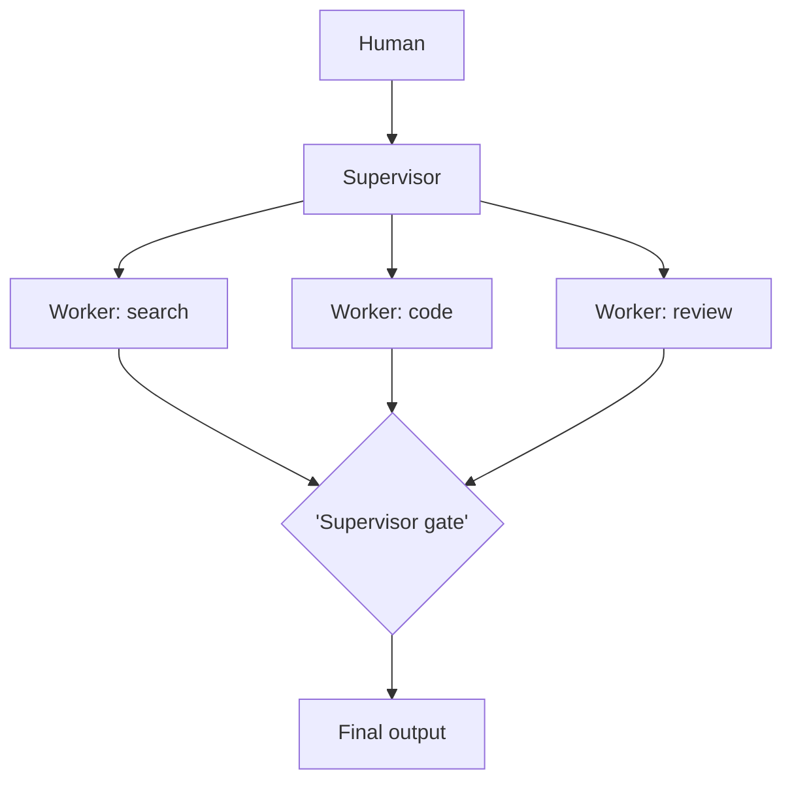

# Chapter 42: Supervisor (Master–Worker)

**Part V — Multi-Agent Topologies**

## Supervisor (Master–Worker) Pattern Overview

One supervisor agent owns the goal, delegates to specialist workers, and gates their outputs.

**Supervisor (Master–Worker)** is catalogued in the **Multi-Agent Topologies** part of the catalog (id `supervisor-workers`). It is tagged for general, engineering, support and is assembled from 4 components.

The supervisor decomposes and dispatches; workers execute in isolation; the supervisor validates and integrates behind a result gate. Delegation multiplies hands but must never multiply authority: workers get task-scoped data and tools (never each other's), and the gate is a checklist, not a vibe — machine-checkable criteria, or the rubber-stamp supervisor approves compromised outputs with full ceremony and zero verification.

**Definition 1 (Checklist gate).** A supervisor gate is a *checklist* iff (i) every worker output is verified against explicit machine-checkable criteria, (ii) workers hold strict data scopes and cannot call each other's tools, and (iii) gate passage requires all checklist items (no impressionistic approval).

**Theorem 1 (Vibes-gates pass everything).** If the supervisor gate is impressionistic (no checklist), then compromised worker outputs pass with the same probability as clean ones — the gate is decorative regardless of supervisor competence, because there is no criterion against which competence could act.

*Proof.* A vibes gate has no rejection condition stated in advance: approve/reject reduces to supervisor impression, which a compromised worker output is designed to satisfy (it looks like work product). With machine-checkable criteria, each output faces the same fixed tests — compromised outputs fail the tests they cannot satisfy (provenance gaps, scope violations, unchecked claims). Strict data scopes bound what workers can adulterate (no cross-tool calls, no shared data beyond the task), so the attack surface the gate must cover is the worker's own output, not the whole system. Verify gate criteria are machine-checkable; audit the orchestrator and hierarchy linkages; confirm isolation holds under load. The rubber-stamp chain — poisoned document, injected conclusions, formal approval — is exactly what checklists interrupt. ∎

## Practical Applications & Use Cases

Domains the catalog tags this pattern for:

- general
- engineering
- support

1 documented failure scenario exercises it:

| Scenario | Severity | Likelihood | Domain |
|---|---|---|---|
| Supervisor agent rubber-stamps compromised workers | High | Low | enterprise |

It also appears in 7 composition cascades — the 6 most impactful of 7:

| Cascade | Class | Blast radius | Impact |
|---|---|---|---|
| Cross-scenario cascade in enterprise | Cascading | fleet | Critical |
| Hierarchical Teams — authority laundering | Inherent | single-agent | Critical |
| Poisoned shared knowledge index | Cascading | fleet | Critical |
| Blackboard Architecture — board vandalism | Inherent | service | High |
| Supervisor (Master–Worker) — rubber-stamp supervisor | Inherent | service | High |
| Supervisor agent rubber-stamps compromised workers | Derived | service | High |

## How It Works

1. Supervisor decomposes and dispatches.
2. Workers execute in isolation.
3. Supervisor validates and integrates.

## Components

- Supervisor
- Worker agents
- Handoff protocol
- Result gate

## Control-Flow Diagram

## Failure Modes and Risks

2 failure modes are documented for this pattern:

| Failure mode | Severity | What happens |
|---|---|---|
| Rubber-stamp supervisor | High | Supervisor approves worker outputs without real verification. |
| Scope creep across workers | High | Worker A's task bleeds into Worker B's data. |

## Protections

1. Supervisor gates are checklists, not vibes.
2. Strict data scopes per worker.
3. Workers cannot call each other's tools.

## At a Glance

| Field | Value |
|---|---|
| Catalog id | `supervisor-workers` |
| Part | V — Multi-Agent Topologies |
| Domains | general, engineering, support |
| Components | Supervisor, Worker agents, Handoff protocol, Result gate |
| Failure modes | 2 |
| Protections | 3 |
| Related patterns | Orchestrator–Workers, Hierarchical Teams |
| Linked scenarios | 1 |
| Linked cascades | 7 |

## Key Takeaways

- One supervisor agent owns the goal, delegates to specialist workers, and gates their outputs.
- Supervisor gates are checklists, not vibes.
- Strict data scopes per worker.
- Workers cannot call each other's tools.
- Know its failure modes: Rubber-stamp supervisor (high); Scope creep across workers (high).

## References and Related Patterns

| Related pattern | Part | Summary |
|---|---|---|
| Orchestrator–Workers | Workflow Orchestration | A central orchestrator dynamically decomposes work and spawns worker LLMs with shared context; returns synthesized result. |
| Hierarchical Teams | Multi-Agent Topologies | Multi-level supervision: managers manage managers; escalation path mirrors org charts. |

## Council deliberation

- **Evaluation methodologist:** Supervisor Workers gives one supervisor ownership of the goal, dispatching to isolated specialist workers through a Handoff protocol and integrating results behind a Result gate. That helps general, engineering, and support work parallelize while keeping validation central. The tension is gate weakness, with Rubber-stamp supervisor approving outputs without real verification and Scope creep across workers letting one task bleed into another worker data and tools.
- **Safety researcher:** Central ownership fails if the gate is vibes, so checklists and scoping must be enforced. The protections that carry weight are checklist gates rather than impressionistic approval, strict data scopes per worker, and barring workers from calling each other tools. The operator should verify gate criteria are machine-checkable, audit orchestrator-workers and hierarchical-teams linkages, and confirm isolation holds under load.

## Council reading

- **Red team:** Start with Rubber-stamp supervisor (high): Supervisor approves worker outputs without real verification. Supervisor agent rubber-stamps compromised workers is the catalogued proof — high severity, enterprise domain — so rehearse that exact chain before any other.
- **Blue team:** Hold with Supervisor gates are checklists, not vibes; Strict data scopes per worker. Then layer the remaining 1: defence here is the list, not any single item. Compose with Orchestrator–Workers, Hierarchical Teams so a failure in one pattern meets a control in another.
- **Operator:** Deploy where it is tagged (general, engineering, support), and watch the 7 linked cascades — Cross-scenario cascade in enterprise first, because composition is where small faults amplify. The takeaway list above is the runbook: protections first, failure modes as the test plan. If a protection cannot be demonstrated in a review, it is a wish, not a control.

## Conclusion

In the catalog this chapter was generated from, **Supervisor (Master–Worker)** is one of 107 patterns in *Multi-Agent Topologies*, carrying 2 documented failure modes and 3 listed protections. Use it as a starting point, not a specification: the protection list is the part that survives contact with an adversary.

---
