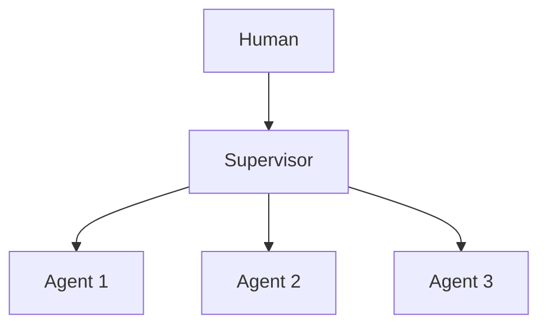

# Chapter 43: Hierarchical Teams

**Part V — Multi-Agent Topologies**

## Hierarchical Teams Pattern Overview

Multi-level supervision: managers manage managers; escalation path mirrors org charts.

**Hierarchical Teams** is catalogued in the **Multi-Agent Topologies** part of the catalog (id `hierarchical-teams`). It is tagged for enterprise, devops and is assembled from 2 components.

Leaf workers to team leads to directors, with budget and authority scaling by level and escalation upward on ambiguity. The hierarchy's risk is laundering: each layer can approve what the layer below should have escalated, so a mid-level agent's signature substitutes for the human judgment the design intended. The protection is a ceiling, not a chain: humans remain the only level that can approve irreversible or high-value actions, the authority matrix is enforced by runtime rather than prompt, and delegation depth is capped.

**Definition 1 (Capped hierarchy).** A hierarchy with levels $L_0$ (leaf) through $L_n$ (human) is *capped* iff (i) only $L_n$ approves irreversible/high-value actions (no mid-level approval authority), (ii) the authority matrix is runtime-enforced (a mid-level approval of a human-reserved action is refused mechanically), and (iii) delegation chains have a max depth with auto-escalation at the cap.

**Theorem 1 (Layering cannot create authority).** Under a capped hierarchy with runtime enforcement, no chain of mid-level approvals sums to a human approval: authority does not accumulate across layers, and laundering (leaf → mid approval presented as authorization) is refused at the runtime check.

*Proof.* Let action $a$ require human approval. A laundered path produces approvals $m_1, \dots, m_k$ from mid-level agents. Runtime enforcement checks the approver's level against the action's requirement: $\mathrm{level}(m_i) < L_n$ for all $i$, so every mid-level approval fails the check regardless of count — approvals do not sum, stack, or inherit upward. Depth caps bound the chain length anyway (auto-escalate at max depth), and coordination cost (latency, tokens per layer) makes deep chains expensive as well as unauthorized. Verify the runtime denies mid-level self-approval (not the prompt); review the supervisor and dual-control linkages; confirm escalation actually reaches a human rather than a higher-titled agent. ∎

## Practical Applications & Use Cases

Domains the catalog tags this pattern for:

- enterprise
- devops

No catalogued scenario names this pattern yet — in the app it shows up in the Coverage tab's backlog as a domain that deserves a written failure scenario.

It also appears in 3 composition cascades:

| Cascade | Class | Blast radius | Impact |
|---|---|---|---|
| Hierarchical Teams — authority laundering | Inherent | single-agent | Critical |
| Orchestrator–Workers — worker privilege escalation | Inherent | service | High |
| Supervisor (Master–Worker) — rubber-stamp supervisor | Inherent | service | High |

## How It Works

1. Leaf workers → team lead → director.
2. Budget/authority scales by level.
3. Escalation upward on ambiguity.

## Components

- Multi-level supervisors
- Authority matrix

## Control-Flow Diagram

## Failure Modes and Risks

2 failure modes are documented for this pattern:

| Failure mode | Severity | What happens |
|---|---|---|
| Authority laundering | Critical | A mid-level agent approves what a leaf worker should have escalated to a human. |
| Coordination cost | Medium | Layers multiply latency and tokens. |

## Protections

1. Humans remain the only level that can approve irreversible/high-value actions.
2. Authority matrix enforced by runtime, not by prompt.
3. Depth caps on delegation chains.

## At a Glance

| Field | Value |
|---|---|
| Catalog id | `hierarchical-teams` |
| Part | V — Multi-Agent Topologies |
| Domains | enterprise, devops |
| Components | Multi-level supervisors, Authority matrix |
| Failure modes | 2 |
| Protections | 3 |
| Related patterns | Supervisor (Master–Worker), Dual Control / Four-Eyes |
| Linked scenarios | 0 |
| Linked cascades | 3 |

## Key Takeaways

- Multi-level supervision: managers manage managers; escalation path mirrors org charts.
- Humans remain the only level that can approve irreversible/high-value actions.
- Authority matrix enforced by runtime, not by prompt.
- Depth caps on delegation chains.
- Know its failure modes: Authority laundering (critical); Coordination cost (medium).

## References and Related Patterns

| Related pattern | Part | Summary |
|---|---|---|
| Supervisor (Master–Worker) | Multi-Agent Topologies | One supervisor agent owns the goal, delegates to specialist workers, and gates their outputs. |
| Dual Control / Four-Eyes | Safety, Security & Governance | High-risk actions require two independent approvers (or human+policy engine) — neither of which can be the acting agent. |

## Council deliberation

- **Continual-learning researcher:** Hierarchical Teams stacks supervision from leaf workers through team leads to directors, with budget and authority scaling by level and escalation upward on ambiguity via multi-level supervisors and an Authority matrix. That helps enterprise and devops mirror familiar escalation paths. The tension is Authority laundering, where a mid-level agent approves what should have risen to a human, compounded by Coordination cost as layers multiply latency and tokens on every decision.
- **Safety researcher:** Layering cannot create authority, so humans must remain the approval ceiling. The protection that carries weight is reserving irreversible and high-value approvals to humans, enforcing the authority matrix in runtime rather than prompt text, and capping delegation depth. The operator should verify runtime denies mid-level self-approval, review supervisor-workers and dual-control linkages, and confirm escalation actually reaches a human.

## Council reading

- **Red team:** Start with Authority laundering (critical): A mid-level agent approves what a leaf worker should have escalated to a human. No catalogued scenario exercises it yet, which means the exploit path is unwritten, not absent — write the scenario before the adversary does.
- **Blue team:** Hold with Humans remain the only level that can approve irreversible/high-value actions; Authority matrix enforced by runtime, not by prompt. Then layer the remaining 1: defence here is the list, not any single item. Compose with Supervisor (Master–Worker), Dual Control / Four-Eyes so a failure in one pattern meets a control in another.
- **Operator:** Deploy where it is tagged (enterprise, devops), and watch the 3 linked cascades — Hierarchical Teams — authority laundering first, because composition is where small faults amplify. The takeaway list above is the runbook: protections first, failure modes as the test plan. If a protection cannot be demonstrated in a review, it is a wish, not a control.

## Conclusion

In the catalog this chapter was generated from, **Hierarchical Teams** is one of 107 patterns in *Multi-Agent Topologies*, carrying 2 documented failure modes and 3 listed protections. Use it as a starting point, not a specification: the protection list is the part that survives contact with an adversary.

---
