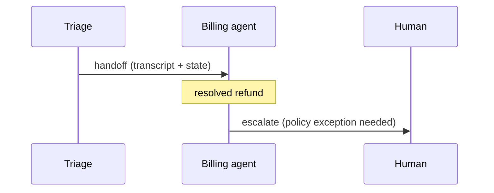

# Chapter 44: Agent Handoff / Swarm

**Part V — Multi-Agent Topologies**

## Agent Handoff / Swarm Pattern Overview

Peers hand the conversation/task to the best-fit agent; full context transfers; any agent may route back.

**Agent Handoff / Swarm** is catalogued in the **Multi-Agent Topologies** part of the catalog (id `handoff-swarm`). It is tagged for support, general and is assembled from 3 components.

Each agent exposes a handoff tool; handoff transfers transcript plus state; the terminal agent resolves or escalates to a human. Flexibility is the design and the risk: any agent may route anywhere, which means a steered handoff can route to a permissive agent — privilege escalation via handoff. The corridor is narrow by construction: structured payloads with mandatory fields, handoff count caps with auto-human transfer, allowlist-only targets.

**Definition 1 (Narrow-corridor handoff).** Handoff satisfies the *narrow corridor* iff (i) every handoff carries a structured payload with mandatory fields (constraints, budget, risk), (ii) handoff count is capped with auto-human transfer on breach, and (iii) targets are selected from an allowlist only — no open routing.

**Theorem 1 (Routing cannot escape or loop forever).** Under the narrow corridor, a handoff chain can neither drop constraints, loop forever, nor reach an unlisted agent: the payload carries the constraints, the cap bounds the chain, the allowlist bounds the graph.

*Proof.* Context loss (dropped constraints): mandatory payload fields travel with every handoff — constraints, budget, and risk are part of the transfer, not the conversation's memory, so no hop can silently shed them (verify payload completeness). Loops (ping-ponging the same task): the count cap terminates any chain at $k$ handoffs with auto-human transfer — infinite routing is structurally impossible, and the human receives the full accumulated context. Privilege escalation (steering to a permissive agent): allowlist-only targets mean the steering set is the reviewed set; no unlisted agent is reachable regardless of who steers. Verify loop counts; audit the specialist and moderator linkages for permissive targets; the corridor is narrow on purpose — flexibility inside it, refusal outside it. ∎

## Practical Applications & Use Cases

Domains the catalog tags this pattern for:

- support
- general

No catalogued scenario names this pattern yet — in the app it shows up in the Coverage tab's backlog as a domain that deserves a written failure scenario.

It also appears in 3 composition cascades:

| Cascade | Class | Blast radius | Impact |
|---|---|---|---|
| Agent Handoff / Swarm — privilege escalation via handoff | Inherent | single-agent | High |
| Front-Desk Triage — triage under-classification | Inherent | service | High |
| Group Chat with Moderator — moderator capture | Inherent | single-agent | High |

## How It Works

1. Each agent exposes handoff tool.
2. Handoff transfers transcript + state.
3. Terminal agent resolves or escalates to human.

## Components

- Handoff tool
- State transfer protocol
- Registry of agents

## Control-Flow Diagram

## Failure Modes and Risks

3 failure modes are documented for this pattern:

| Failure mode | Severity | What happens |
|---|---|---|
| Context loss on handoff | Medium | Critical constraint dropped between agents; user repeats themselves. |
| Handoff loops | Medium | Agents ping-pong the same task. |
| Privilege escalation via handoff | High | Attacker steers handoff to a permissive agent. |

## Protections

1. Structured handoff payload with mandatory fields (constraints, budget, risk).
2. Handoff count cap → auto-human.
3. Handoff target selection from allowlist only.

## At a Glance

| Field | Value |
|---|---|
| Catalog id | `handoff-swarm` |
| Part | V — Multi-Agent Topologies |
| Domains | support, general |
| Components | Handoff tool, State transfer protocol, Registry of agents |
| Failure modes | 3 |
| Protections | 3 |
| Related patterns | Front-Desk Triage, Group Chat with Moderator |
| Linked scenarios | 0 |
| Linked cascades | 3 |

## Key Takeaways

- Peers hand the conversation/task to the best-fit agent; full context transfers; any agent may route back.
- Structured handoff payload with mandatory fields (constraints, budget, risk).
- Handoff count cap → auto-human.
- Handoff target selection from allowlist only.
- Know its failure modes: Context loss on handoff (medium); Handoff loops (medium); Privilege escalation via handoff (high).

## References and Related Patterns

| Related pattern | Part | Summary |
|---|---|---|
| Front-Desk Triage | Multi-Agent Topologies | Cheap intake agent classifies and routes; specialists handle; triage retains escalation authority. |
| Group Chat with Moderator | Multi-Agent Topologies | Open forum of agents; a moderator controls turn-taking, prevents loops, and summarizes. |

## Council deliberation

- **Evaluation methodologist:** Agent Handoff or Swarm lets peers transfer conversation and task state to the best-fit agent through a Handoff tool, State transfer protocol, and Registry, with any agent able to route back and terminal agents escalating to humans. That helps support and general triage stay flexible. Yet its documented failure modes interact, with Context loss on handoff dropping constraints, Handoff loops ping-ponging tasks, and Privilege escalation via handoff steering toward a permissive agent.
- **Safety researcher:** Flexibility needs a narrow corridor, otherwise routing becomes the exploit. The protections that carry weight are structured handoff payloads with mandatory constraints, budget, and risk fields, a handoff count cap leading to auto-human transfer, and allowlist-only target selection. The operator should verify payload completeness, monitor loop counts, and audit specialist-triage and group-chat-moderator linkages for permissive targets.

## Council reading

- **Red team:** Start with Privilege escalation via handoff (high): Attacker steers handoff to a permissive agent. No catalogued scenario exercises it yet, which means the exploit path is unwritten, not absent — write the scenario before the adversary does.
- **Blue team:** Hold with Structured handoff payload with mandatory fields (constraints, budget, risk); Handoff count cap → auto-human. Then layer the remaining 1: defence here is the list, not any single item. Compose with Front-Desk Triage, Group Chat with Moderator so a failure in one pattern meets a control in another.
- **Operator:** Deploy where it is tagged (support, general), and watch the 3 linked cascades — Agent Handoff / Swarm — privilege escalation via handoff first, because composition is where small faults amplify. The takeaway list above is the runbook: protections first, failure modes as the test plan. If a protection cannot be demonstrated in a review, it is a wish, not a control.

## Conclusion

In the catalog this chapter was generated from, **Agent Handoff / Swarm** is one of 107 patterns in *Multi-Agent Topologies*, carrying 3 documented failure modes and 3 listed protections. Use it as a starting point, not a specification: the protection list is the part that survives contact with an adversary.

---
