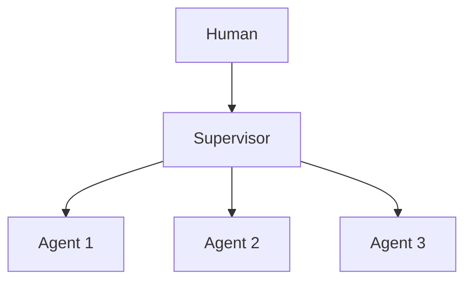

# Chapter 45: Blackboard Architecture

**Part V — Multi-Agent Topologies**

## Blackboard Architecture Pattern Overview

Shared workspace agents read/write; coordination through the board rather than direct messaging.

**Blackboard Architecture** is catalogued in the **Multi-Agent Topologies** part of the catalog (id `blackboard`). It is tagged for engineering, research, healthcare and is assembled from 3 components.

Specialists contribute to typed board sections when they have relevant expertise; a monitor merges and resolves conflicts. Coordination without channels — but shared state is shared attack surface: one compromised agent overwrites others' contributions (board vandalism, high), and concurrent writes race into incoherence that later readers treat as settled (race conditions). Append-only sections with per-agent ACLs, optimistic concurrency control, and full provenance are what make the commons writable without making it defenseless.

**Definition 1 (Defended commons).** A blackboard is *defended* iff (i) sections are append-only with per-agent ACLs (edits arrive as diffs requiring monitor merge — never in-place overwrites), (ii) concurrent writes resolve through optimistic concurrency control (conflicts detected, never silently merged), and (iii) every contribution carries full provenance (who wrote what, when, from which inputs).

**Theorem 1 (Vandalism is visible and reversible).** Under a defended commons, a compromised agent's overwrite attempt becomes a rejected diff or a provenance-marked edit — never a silent replacement of settled work: the board's history makes every contribution attributable and every destruction recoverable.

*Proof.* In-place overwrite requires write access the vandal lacks: append-only sections plus per-agent ACLs mean the compromised agent can append its own section entries but cannot alter others' — its "overwrite" arrives as a diff the monitor must merge. Optimistic concurrency detects the race (concurrent writes to the same section conflict explicitly rather than interleaving silently). Provenance marks every contribution with its author, so the vandal's entries are attributable and revertible. Overwritten work is therefore detectable (conflict log, provenance trail) and recoverable (prior versions intact) — the commons degrades to a noisy board under attack, never to a corrupted record. Verify ACL enforcement; check conflict-resolution logs; audit the supervisor and audit-trail linkages to confirm overwritten work is detectable and recoverable. ∎

## Practical Applications & Use Cases

Domains the catalog tags this pattern for:

- engineering
- research
- healthcare

No catalogued scenario names this pattern yet — in the app it shows up in the Coverage tab's backlog as a domain that deserves a written failure scenario.

It also appears in 1 composition cascade:

| Cascade | Class | Blast radius | Impact |
|---|---|---|---|
| Blackboard Architecture — board vandalism | Inherent | service | High |

## How It Works

1. Shared blackboard with typed sections.
2. Agents contribute when they have relevant expertise.
3. Monitor merges/resolves conflicts.

## Components

- Blackboard
- Specialist agents
- Monitor/controller

## Control-Flow Diagram

## Failure Modes and Risks

2 failure modes are documented for this pattern:

| Failure mode | Severity | What happens |
|---|---|---|
| Board vandalism | High | One compromised agent overwrites others' contributions. |
| Race conditions | Medium | Concurrent writes produce incoherent state. |

## Protections

1. Append-only sections with per-agent ACLs; edits are diffs requiring monitor merge.
2. Optimistic concurrency control.
3. Full provenance on every contribution.

## At a Glance

| Field | Value |
|---|---|
| Catalog id | `blackboard` |
| Part | V — Multi-Agent Topologies |
| Domains | engineering, research, healthcare |
| Components | Blackboard, Specialist agents, Monitor/controller |
| Failure modes | 2 |
| Protections | 3 |
| Related patterns | Supervisor (Master–Worker), Immutable Audit Trail |
| Linked scenarios | 0 |
| Linked cascades | 1 |

## Key Takeaways

- Shared workspace agents read/write; coordination through the board rather than direct messaging.
- Append-only sections with per-agent ACLs; edits are diffs requiring monitor merge.
- Optimistic concurrency control.
- Full provenance on every contribution.
- Know its failure modes: Board vandalism (high); Race conditions (medium).

## References and Related Patterns

| Related pattern | Part | Summary |
|---|---|---|
| Supervisor (Master–Worker) | Multi-Agent Topologies | One supervisor agent owns the goal, delegates to specialist workers, and gates their outputs. |
| Immutable Audit Trail | Safety, Security & Governance | Append-only, tamper-evident log of every prompt, tool call, policy decision, approval, and outcome. |

## Council deliberation

- **Memory-systems researcher:** Blackboard coordinates specialist agents through a shared Blackboard with typed sections rather than direct messaging, with a Monitor or controller merging contributions and resolving conflicts. That helps engineering, research, and healthcare combine expertise without tangled channels. The tension is shared-state fragility, with Board vandalism where one compromised agent overwrites others and Race conditions where concurrent writes produce incoherent state that later readers treat as settled.
- **Evaluation methodologist:** Shared writing needs versioned control, not goodwill. The protections that carry weight are append-only sections with per-agent ACLs where edits become diffs requiring monitor merge, optimistic concurrency control, and full provenance on every contribution. The operator should verify ACL enforcement, check conflict resolution logs, and audit supervisor-workers and audit-trail linkages to confirm overwritten work is detectable and recoverable.

## Council reading

- **Red team:** Start with Board vandalism (high): One compromised agent overwrites others' contributions. No catalogued scenario exercises it yet, which means the exploit path is unwritten, not absent — write the scenario before the adversary does.
- **Blue team:** Hold with Append-only sections with per-agent ACLs; edits are diffs requiring monitor merge; Optimistic concurrency control. Then layer the remaining 1: defence here is the list, not any single item. Compose with Supervisor (Master–Worker), Immutable Audit Trail so a failure in one pattern meets a control in another.
- **Operator:** Deploy where it is tagged (engineering, research, healthcare), and watch the 1 linked cascade — Blackboard Architecture — board vandalism first, because composition is where small faults amplify. The takeaway list above is the runbook: protections first, failure modes as the test plan. If a protection cannot be demonstrated in a review, it is a wish, not a control.

## Conclusion

In the catalog this chapter was generated from, **Blackboard Architecture** is one of 107 patterns in *Multi-Agent Topologies*, carrying 2 documented failure modes and 3 listed protections. Use it as a starting point, not a specification: the protection list is the part that survives contact with an adversary.

---
