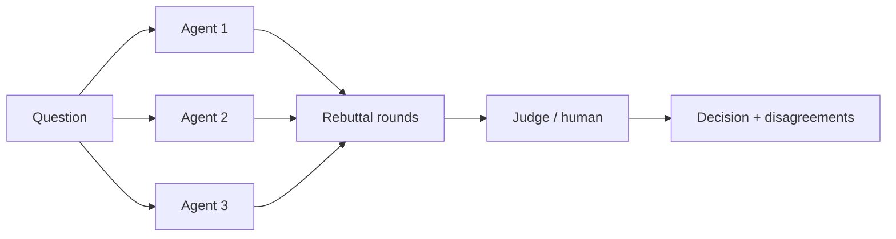

# Chapter 46: Multi-Agent Debate / Council

**Part V — Multi-Agent Topologies**

## Multi-Agent Debate / Council Pattern Overview

Several agents argue positions or independently answer, then converge — surfaces disagreements before they surface in production.

**Multi-Agent Debate / Council** is catalogued in the **Multi-Agent Topologies** part of the catalog (id `debate-council`). It is tagged for finance, legal, strategy and is assembled from 3 components.

$n$ agents answer independently; rounds of rebuttal; a judge or human picks or synthesizes. The value is independence: blind first answers that cannot anchor on each other, rebuttals that preserve dissent, a judge that documents why dissent was rejected. The failures are independence failures — groupthink (early convergence on the majority's wrong answer), injected debaters (poisoned context steering the council) — plus the tax on every round: $n\times$ cost per decision.

**Definition 1 (Independent council).** A debate is *independent* iff (i) the first round is blind (no cross-visibility, no anchoring), (ii) rebuttal logs preserve dissent verbatim (disagreement survives to the decision), (iii) the judge documents why each dissent was rejected, and (iv) per-debater budgets bound the cost.

**Theorem 1 (Blindness first, or theater).** Without a blind first round, rebuttal converges on the first confident voice rather than the best argument — groupthink is the default outcome, and the judge ratifies the anchor instead of the evidence.

*Proof.* Visible first answers anchor subsequent ones: debaters optimize for agreement with the confident early voice (social proof operates on models trained on human discourse too). Blind first answers are independent draws — disagreement among them is genuine signal about the question's difficulty, not performance. The judge's dissent documentation then forces the convergence to account for every blind disagreement: a confident wrong call must explain away each recorded dissent to pass. The catalogued proof (debate council suppressing dissent into confident error; voting council captured by duplicate personas) is what happens when independence is assumed rather than staged: shared context anchors all voters, injected debaters steer the council, and no log preserves what was suppressed. Verify rebuttal logs preserve dissent; confirm injected content cannot silently set the verdict; budget per debater. ∎

## Practical Applications & Use Cases

Domains the catalog tags this pattern for:

- finance
- legal
- strategy

2 documented failure scenarios exercise it:

| Scenario | Severity | Likelihood | Domain |
|---|---|---|---|
| Debate council suppresses dissent and converges on a confident wrong call | High | High | strategy |
| Voting council gamed by duplicate personas; quorum captured | High | Medium | governance |

It also appears in 7 composition cascades — the 6 most impactful of 7:

| Cascade | Class | Blast radius | Impact |
|---|---|---|---|
| Consensus / Voting Protocols — sybil agents | Inherent | single-agent | High |
| Debate council suppresses dissent and converges on a confident wrong call | Derived | service | High |
| Group Chat with Moderator — moderator capture | Inherent | single-agent | High |
| Multi-Agent Debate / Council — injected debater | Inherent | service | High |
| Voting council gamed by duplicate personas; quorum captured | Derived | service | High |
| Self-Consistency Sampling — shared-blind-spot consensus | Inherent | service | Medium |

## How It Works

1. n agents answer independently.
2. Round(s) of rebuttal.
3. Judge or human picks/synthesizes.

## Components

- Debater agents
- Judge
- Round controller

## Control-Flow Diagram

## Failure Modes and Risks

3 failure modes are documented for this pattern:

| Failure mode | Severity | What happens |
|---|---|---|
| Groupthink | Medium | Debaters converge early on the majority's wrong answer. |
| Cost/latency | Low | n× cost per decision. |
| Injected debater | High | One agent's context contains injected text steering the council. |

## Protections

1. Blind first round (no cross-visibility) to prevent anchoring.
2. Judge must document why dissent was rejected.
3. Per-debater budgets.

## At a Glance

| Field | Value |
|---|---|
| Catalog id | `debate-council` |
| Part | V — Multi-Agent Topologies |
| Domains | finance, legal, strategy |
| Components | Debater agents, Judge, Round controller |
| Failure modes | 3 |
| Protections | 3 |
| Related patterns | Self-Consistency Sampling, Skeptical Reasoning (Devil's Advocate), Ensemble Verification |
| Linked scenarios | 2 |
| Linked cascades | 7 |

## Key Takeaways

- Several agents argue positions or independently answer, then converge — surfaces disagreements before they surface in production.
- Blind first round (no cross-visibility) to prevent anchoring.
- Judge must document why dissent was rejected.
- Per-debater budgets.
- Know its failure modes: Groupthink (medium); Cost/latency (low); Injected debater (high).

## References and Related Patterns

| Related pattern | Part | Summary |
|---|---|---|
| Self-Consistency Sampling | Planning & Reasoning | Sample N reasoning paths at temperature > 0 and take the majority answer; disagreement signals low confidence. |
| Skeptical Reasoning (Devil's Advocate) | Planning & Reasoning | Dedicated critique pass that argues against the agent's own plan before execution. |
| Ensemble Verification | Resilience & Reliability | Multiple heterogeneous verifiers (rules + ML + different models) must concur before high-impact actions. |

## Council deliberation

- **Evaluation methodologist:** Multi-Agent Debate convenes debater agents with a Judge and Round controller to answer independently, exchange rebuttals, and converge through judging or human synthesis, surfacing disagreement before production for finance, legal, and strategy. That independence helps catch blind spots. Yet its documented failure modes warn of Groupthink converging early on the majority wrong answer, Cost and latency scaling with debater count, and an Injected debater steering the council from poisoned context.
- **Safety researcher:** Independence must be staged, not assumed. The protections that carry weight are a blind first round without cross-visibility to prevent anchoring, a judge requirement to document why dissent was rejected, and per-debater budgets. The operator should verify rebuttal logs preserve dissent, check self-consistency and skeptical-reasoning and ensemble-verify linkages, and confirm injected content cannot silently set the verdict.

## Council reading

- **Red team:** Start with Injected debater (high): One agent's context contains injected text steering the council. Voting council gamed by duplicate personas; quorum captured is the catalogued proof — high severity, governance domain — so rehearse that exact chain before any other.
- **Blue team:** Hold with Blind first round (no cross-visibility) to prevent anchoring; Judge must document why dissent was rejected. Then layer the remaining 1: defence here is the list, not any single item. Compose with Self-Consistency Sampling, Skeptical Reasoning (Devil's Advocate) so a failure in one pattern meets a control in another.
- **Operator:** Deploy where it is tagged (finance, legal, strategy), and watch the 7 linked cascades — Consensus / Voting Protocols — sybil agents first, because composition is where small faults amplify. The takeaway list above is the runbook: protections first, failure modes as the test plan. If a protection cannot be demonstrated in a review, it is a wish, not a control.

## Conclusion

In the catalog this chapter was generated from, **Multi-Agent Debate / Council** is one of 107 patterns in *Multi-Agent Topologies*, carrying 3 documented failure modes and 3 listed protections. Use it as a starting point, not a specification: the protection list is the part that survives contact with an adversary.

---
