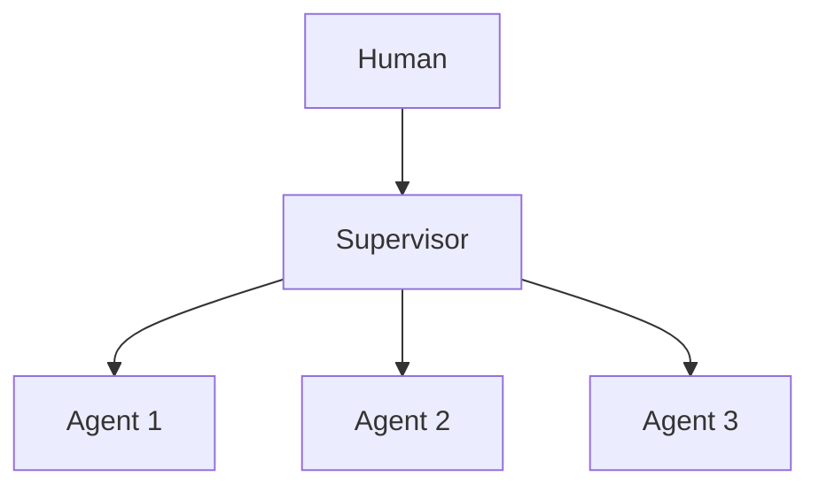

# Chapter 47: Consensus / Voting Protocols

**Part V — Multi-Agent Topologies**

## Consensus / Voting Protocols Pattern Overview

Formal voting rules (quorum, weighted votes, veto rights) over agent decisions; risky actions need k-of-n approval.

**Consensus / Voting Protocols** is catalogued in the **Multi-Agent Topologies** part of the catalog (id `consensus-voting`). It is tagged for finance, governance and is assembled from 2 components.

Define quorum and thresholds per action class; agents vote with rationale; tally; ties and vetoes escalate to humans. Voting formalizes collective judgment — and formal rules need formal identities: sybil agents (spawned voters outvoting safeguards) and vote buying via shared context (all voters anchored to the same flawed rationale) both attack the voter roll, not the tally. Distinct registered identities with distinct contexts, always-available logged human veto, and an adversarially-prompted checker in quorum are what make the count mean something.

**Definition 1 (Sybil-resistant quorum).** A vote with $n$ ballots and quorum $q$ is *Sybil-resistant* iff (i) every ballot binds to a distinct registered identity with a distinct context, (ii) human veto is always available and logged, and (iii) the quorum includes at least one adversarially-prompted checker (a voter explicitly tasked to disagree).

**Theorem 1 (One identity, one vote — enforced).** Under Sybil-resistant quorum, spawning $m$ sybil agents yields at most one countable vote, and shared-context anchoring is detected by the adversarial checker — vote buying requires compromising distinct registered identities, not minting ballots.

*Proof.* Sybil ballots share the attacker's identity or context by construction (copies, not citizens); distinct-identity-plus-distinct-context binding counts the identity once and rejects the copies' shared context. Shared-context anchoring (all voters fed the same flawed rationale) produces unnaturally correlated rationales — the adversarial checker, tasked to disagree, breaks the correlation visibly or flags its absence (suspicious unanimity). Human veto stands behind both: any passed motion remains vetoable with the veto logged. The catalogued proof (duplicate personas capturing quorum) is what happens when identities are self-asserted rather than registered: verify identity binding, test the debate-council and dual-control escalation paths, confirm no shared prompt silently aligns the electorate. ∎

## Practical Applications & Use Cases

Domains the catalog tags this pattern for:

- finance
- governance

1 documented failure scenario exercises it:

| Scenario | Severity | Likelihood | Domain |
|---|---|---|---|
| Voting council gamed by duplicate personas; quorum captured | High | Medium | governance |

It also appears in 4 composition cascades:

| Cascade | Class | Blast radius | Impact |
|---|---|---|---|
| Consensus / Voting Protocols — sybil agents | Inherent | single-agent | High |
| Dual Control / Four-Eyes — approval rings | Inherent | single-agent | High |
| Multi-agent echo chamber | Emergent | tenant | High |
| Voting council gamed by duplicate personas; quorum captured | Derived | service | High |

## How It Works

1. Define quorum and thresholds per action class.
2. Agents vote with rationale.
3. Tally; ties/vetoes escalate to human.

## Components

- Voting registry
- Tally engine

## Control-Flow Diagram

## Failure Modes and Risks

2 failure modes are documented for this pattern:

| Failure mode | Severity | What happens |
|---|---|---|
| Sybil agents | High | Attacker spawns agents to outvote safeguards. |
| Vote buying via context | Medium | Shared context anchors all voters. |

## Protections

1. Votes bound to distinct, registered identities with distinct contexts.
2. Human veto is always available and logged.
3. Quorum includes at least one adversarially-prompted checker.

## At a Glance

| Field | Value |
|---|---|
| Catalog id | `consensus-voting` |
| Part | V — Multi-Agent Topologies |
| Domains | finance, governance |
| Components | Voting registry, Tally engine |
| Failure modes | 2 |
| Protections | 3 |
| Related patterns | Multi-Agent Debate / Council, Dual Control / Four-Eyes |
| Linked scenarios | 1 |
| Linked cascades | 4 |

## Key Takeaways

- Formal voting rules (quorum, weighted votes, veto rights) over agent decisions; risky actions need k-of-n approval.
- Votes bound to distinct, registered identities with distinct contexts.
- Human veto is always available and logged.
- Quorum includes at least one adversarially-prompted checker.
- Know its failure modes: Sybil agents (high); Vote buying via context (medium).

## References and Related Patterns

| Related pattern | Part | Summary |
|---|---|---|
| Multi-Agent Debate / Council | Multi-Agent Topologies | Several agents argue positions or independently answer, then converge — surfaces disagreements before they surface in production. |
| Dual Control / Four-Eyes | Safety, Security & Governance | High-risk actions require two independent approvers (or human+policy engine) — neither of which can be the acting agent. |

## Council deliberation

- **Evaluation methodologist:** Consensus Voting applies formal quorum, weighted votes, and veto rights through a Voting registry and Tally engine, requiring k-of-n approval for risky actions with ties and vetoes escalating to humans. That helps finance and governance make agent decisions explicit. The tension is vote integrity, with Sybil agents spawned to outvote safeguards and Vote buying via context where shared context anchors all voters toward the same flawed rationale.
- **Safety researcher:** Rules help only if identities and contexts stay distinct. The protections that carry weight are binding votes to distinct registered identities with distinct contexts, keeping human veto always available and logged, and including at least one adversarially prompted checker in quorum. The operator should verify identity binding, test debate-council and dual-control escalation paths, and confirm no shared prompt silently aligns the electorate.

## Council reading

- **Red team:** Start with Sybil agents (high): Attacker spawns agents to outvote safeguards. Voting council gamed by duplicate personas; quorum captured is the catalogued proof — high severity, governance domain — so rehearse that exact chain before any other.
- **Blue team:** Hold with Votes bound to distinct, registered identities with distinct contexts; Human veto is always available and logged. Then layer the remaining 1: defence here is the list, not any single item. Compose with Multi-Agent Debate / Council, Dual Control / Four-Eyes so a failure in one pattern meets a control in another.
- **Operator:** Deploy where it is tagged (finance, governance), and watch the 4 linked cascades — Consensus / Voting Protocols — sybil agents first, because composition is where small faults amplify. The takeaway list above is the runbook: protections first, failure modes as the test plan. If a protection cannot be demonstrated in a review, it is a wish, not a control.

## Conclusion

In the catalog this chapter was generated from, **Consensus / Voting Protocols** is one of 107 patterns in *Multi-Agent Topologies*, carrying 2 documented failure modes and 3 listed protections. Use it as a starting point, not a specification: the protection list is the part that survives contact with an adversary.

---
